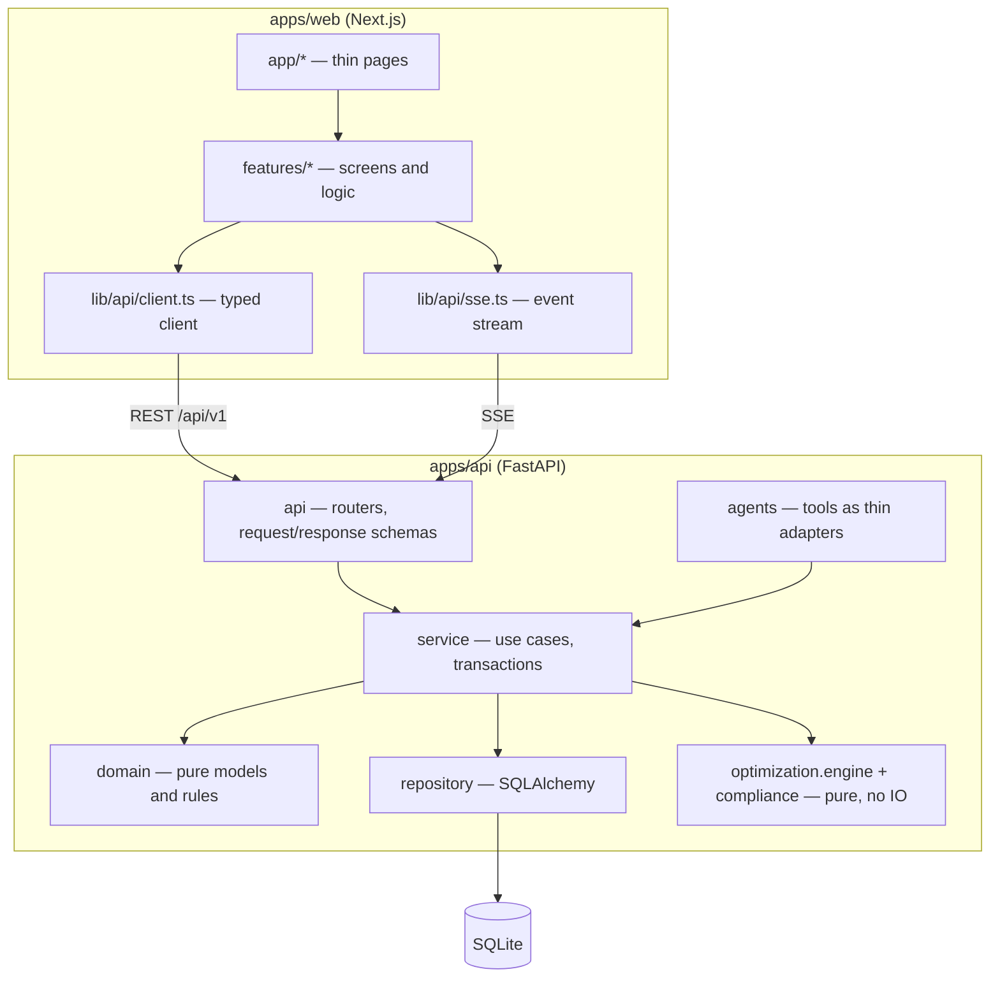
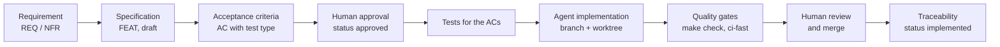

# RoutePilot AI — Development Guide

> **Audience:** humans who build or review RoutePilot AI. Coding agents start from [`AGENTS.md`](AGENTS.md) and [`context.md`](context.md).
> **Status (2026-11-09, UI design added 2026-11-11):** design phase. Everything described here is **planned** until the code exists. Commands are the target commands defined in [`specs/FEAT-000-monorepo-and-ci.md`](specs/FEAT-000-monorepo-and-ci.md).
> **One source of truth per topic:** rules → `context.md`; research and rationale → [`docs/report.md`](docs/report.md); what to build → [`specs/`](specs/README.md); why → [`docs/adr/`](docs/adr/README.md); overview and run steps → [`README.md`](README.md); how-to → this file. If this file disagrees with `context.md`, `context.md` wins.

Contents: [1 Standards matrix](#1-standards-compliance-matrix) · [2 Architecture](#2-architecture-and-layering) · [3 Repository](#3-repository-structure) · [4 API guide](#4-api-design-guide) · [5 Database](#5-database) · [6 Running locally](#6-running-locally) · [7 Testing](#7-testing-strategy-and-commands) · [8 CI](#8-quality-gates-and-ci) · [9 UX/UI](#9-uxui-guidelines) · [10 AI-assisted development](#10-ai-assisted-development) · [11 Runtime AI](#11-runtime-ai-design-for-maintainers) · [12 Git](#12-git-workflow) · [13 Security](#13-security-notes) · [14 Add a feature](#14-how-to-add-a-feature)

---

## 1. Standards compliance matrix

The project has a fixed set of delivery standards (its acceptance standards). The table maps each one to the design decision that meets it and to the place that proves it. "Proof" points to a specification section or acceptance criterion (AC); once code exists, the tests for those ACs are the proof.

| # | Delivery standard | Design decision | Proof (file → section / AC) |
|---|---|---|---|
| 1 | A small full-stack MVP with a transport theme; AI features welcome; usefulness and understanding matter more than complexity | An AI dispatcher for 5 vans; a multi-agent chat on top of a deterministic optimizer; the app also works without AI; plain-language explanations of the engine and the agents | `README.md` §1–3; `docs/report.md` §18.4, §22.9; FEAT-003, FEAT-006 (AC-FEAT-006-19: no key → manual path) |
| 2 | Backend: free choice of language and framework; the API supports CRUD for the chosen functionality | Python 3.13 + FastAPI; full CRUD for drivers, vehicles, cost profiles and manual freight offers | ADR-0001, ADR-0009; FEAT-001 §6.2 (AC-FEAT-001-04 … 15) |
| 3 | Frontend: free choice; smooth communication with the API | Next.js 16 + TypeScript; typed client generated from OpenAPI; TanStack Query; SSE for agent runs | FEAT-005 §6 (AC-FEAT-005-20 … 22); this file §4 |
| 4 | Database: in-memory or SQLite only, no external server | One SQLite file (WAL); tests on in-memory SQLite; agent checkpoints in a second SQLite file | ADR-0002; FEAT-001 §6.1 (AC-FEAT-001-01 … 03); this file §5 |
| 5 | Any libraries and AI coding tools are allowed | Libraries listed with versions and licences; AI coding workflow documented | `docs/report.md` §9.2; this file §10; `README.md` §7 |
| 6 | UX/UI: intuitive and pleasant | Own design system "Clear Route v3" (one red accent, drawn vehicles, top-view load plan); empty/loading/error states, confirmations, toasts, inline validation, EN/PL, accessible components | this file §9; [`docs/design/README.md`](docs/design/README.md); ADR-0015; FEAT-005 §4 and "UX acceptance checklist" (AC-FEAT-005-04 … 07, 18, 19, 26, 27) |
| 7a | Architecture and organisation: logical layers; frontend and backend in separate folders | `apps/api` and `apps/web`; backend layers `api → service → domain / repository`; boundaries enforced by import-linter and ESLint | this file §2–3; FEAT-000 (AC-FEAT-000-11); `context.md` → Module Boundaries |
| 7b | Code quality and readability on both sides | ruff, mypy `--strict`, ESLint, Prettier, `tsc --noEmit`; small PRs; coverage thresholds | this file §8; FEAT-000 (AC-FEAT-000-05, 10); FEAT-007 (AC-FEAT-007-10) |
| 7c | REST API design and smooth FE↔BE communication, including CORS | Resource naming, status codes, problem+json, cursor pagination, idempotency; explicit CORS allowlist with credentials; CSRF token + `Origin` check; preflight tests | this file §4; ADR-0009; FEAT-001 (AC-FEAT-001-16 … 19, 23, 24, 32) |
| 7d | Care for UX/UI | The same decisions as standard 6, checked in E2E | FEAT-005 UX checklist; FEAT-007 (AC-FEAT-007-03) |
| 7e | A creative twist: a small but clever unique feature | The AI explains trade-offs between profit, time, fuel and CO₂, but every number is grounded in the deterministic engine and a human approves writes; live agent trace | `README.md` §3; FEAT-006 (AC-FEAT-006-03 … 05, 09); FEAT-003 (AC-FEAT-003-13) |
| 8a | A public GitHub repository | Public repo; no secrets, no personal data, gitleaks in CI | FEAT-000 (AC-FEAT-000-06, 12); FEAT-007 §4 |
| 8b | `README.md`: short description and features; technical description; step-by-step local run for API and frontend; how AI tools were used | README sections 1–7 in a fixed order; a completeness checklist; a clean-clone run test | `README.md`; FEAT-007 (AC-FEAT-007-04, 05) |
| 8c | A short demo video (`.gif` or `.mp4`) committed to the repo | `docs/media/demo.mp4` and/or `demo.gif`, 2–4 minutes, embedded in the README | FEAT-009 (AC-FEAT-009-01 … 04) |
| 8d | Dedicated agent-instruction files committed | `AGENTS.md`, `CLAUDE.md`, `context.md`, `docs/agent-prompts/` | `AGENTS.md`; `CLAUDE.md`; FEAT-000 (AC-FEAT-000-13) |
| 8e | Deadline 2026-11-15 23:59 | Day-by-day plan with a cut list and a "never cut" list | `context.md` → Delivery Deadline; `docs/report.md` §33 |

---

## 2. Architecture and layering

RoutePilot AI is two applications in one repository. The web app runs on `http://localhost:3000` and calls the API on `http://localhost:8000` directly from the browser. The API is a **modular monolith**: one process that serves HTTP, runs optimisation jobs and agent runs in an in-process worker, and stores everything in SQLite.



### 2.1 Backend layers

Every domain module (`identity`, `fleet`, `freight`, `routing`, `optimization.jobs`, `agents`) uses the same four layers.

| Layer | Contains | May depend on | Must not |
|---|---|---|---|
| `api` | FastAPI routers, Pydantic request/response schemas, dependency wiring | `service`, `shared` | hold business logic, touch the database |
| `service` | use cases, transaction boundaries, authorisation checks, audit events | `domain`, `repository`, ports | know about HTTP |
| `domain` | entities, value objects, pure rules | `shared` | do IO (database, HTTP, environment, system clock) |
| `repository` | SQLAlchemy models and queries | `domain`, `shared` | contain rules |

Two modules are **pure cores** with no IO at all: `compliance` (the `DriverRules` profiles) and `optimization.engine` (prefilter, cost model, search, fleet assignment, validators). They receive ready data — for example a travel matrix — and return results. This is what makes them testable with property-based tests.

### 2.2 Module boundaries

The allowed imports are listed in [`context.md` → Module Boundaries](context.md#module-boundaries). They are enforced by import-linter contracts in CI (Gate 10), not by convention. The short version:

- `shared` imports nothing from the project. Everything may import `shared`.
- `optimization.engine` imports only `shared` and `compliance`.
- `agents` reaches other modules only through their public services, wrapped as tools. It never imports repositories or engine internals.
- `main.py` is the only place that wires everything together (dependency injection, routers, CORS, lifespan).

### 2.3 Frontend structure

- `app/*` — routes. Pages are thin: they compose feature components.
- `features/{auth,agent-chat,fleet,offers,plans,optimizer,admin}` — one folder per screen area with its components, hooks and Zod schemas. A feature imports another feature only through that feature's `index.ts`.
- `lib/api/` — the generated types (`schema.d.ts`, never edited by hand), the `openapi-fetch` client (`client.ts`), the SSE helper (`sse.ts`).
- `lib/format/` — number, date, currency and unit formatting.
- `messages/en.json`, `messages/pl.json` — all UI text.

---

## 3. Repository structure

Planned layout (created by FEAT-000; ✅ = exists today):

```
RoutePilotAI/
├── README.md                ✅ overview and run steps
├── DEVELOPMENT.md           ✅ this guide
├── context.md               ✅ rules for coding agents
├── AGENTS.md · CLAUDE.md    ✅ agent entry points
├── Makefile                 optional shortcuts (check, test-props, test-agents, test-db, openapi, trace, e2e, bench)
├── apps/
│   ├── api/
│   │   ├── pyproject.toml · uv.lock · .env.example · alembic.ini
│   │   ├── src/routepilot/
│   │   │   ├── main.py                  composition root
│   │   │   ├── shared/                  money, units, ids, clock, errors, config
│   │   │   ├── identity/                users, sessions, captcha, roles
│   │   │   ├── fleet/                   drivers, vehicles, driver state, cost profiles, fleet generator
│   │   │   ├── freight/                 offers and stops, manual offers, normalisation
│   │   │   ├── routing/                 RoutingProvider, matrix, ORS, haversine, cache
│   │   │   ├── compliance/              DriverRules profiles (pure)
│   │   │   ├── optimization/engine/     pure engine
│   │   │   ├── optimization/jobs/       jobs, worker, results, assignments
│   │   │   ├── agents/                  graph, nodes, tools, guards, prompts, models
│   │   │   └── integrations/            mock provider, TIMOCOM mapper and schemas
│   │   ├── migrations/                  Alembic
│   │   ├── data/                        routepilot.db, agents.db (gitignored)
│   │   └── tests/                       unit, props, golden, contract, db, api, security, agents, fixtures
│   └── web/
│       ├── package.json · .env.example · next.config.ts
│       ├── src/{app,features,lib}/
│       └── messages/{en,pl}.json
├── contracts/openapi.json   generated and committed
├── specs/                   ✅ requirements, FEAT specifications, golden cases
├── docs/
│   ├── report.md            ✅ research report
│   ├── adr/                 ✅ ADR-0001 … ADR-0015
│   ├── design/              ✅ design system: README, tokens.json, mockups/ of every screen
│   ├── agent-prompts/       ✅ prompts given to coding agents
│   ├── traceability.md      generated by scripts/trace.py
│   └── media/               demo video, screenshots
├── data/mock/               cities.json, routing-matrix.json, offers.timocom.json, offers.enrichment.json, fleet.json
├── scripts/                 export_openapi.py, trace.py, check_spec_touch.py, benchmark_report.py
├── tests/e2e/               Playwright
├── evals/                   live agent evaluation scenarios
├── bench/                   engine benchmark
└── .github/workflows/       ci-fast.yml, ci-full.yml, ai-evals.yml
```

---

## 4. API design guide

Decision record: [ADR-0009](docs/adr/ADR-0009-api-crud-cors-contracts.md). Endpoint list: `docs/report.md` §11.3. Full schemas: FEAT-001 (CRUD, auth), FEAT-004 (jobs, plans, assignments), FEAT-006 (agent threads and runs).

### 4.1 Resource naming

- Prefix `/api/v1`. Health endpoints `/health` and `/ready` have no prefix.
- Plural, kebab-case nouns: `/drivers`, `/vehicles`, `/cost-profiles`, `/freight-offers`, `/optimization-jobs`, `/route-plans`, `/assignments`.
- Sub-resources for things that belong to a parent: `/drivers/{id}/state`, `/route-plans/{id}/explanations`.
- Actions that are not CRUD are modelled as resources where possible (`POST /optimization-jobs` instead of `/optimize`). The few command endpoints are explicit: `/auth/login`, `/auth/logout`, `/agent/runs/{runId}/resume`, `/admin/demo-data/generate`, `/admin/demo-data/reset`.
- JSON uses camelCase. IDs are UUID strings. Timestamps are ISO 8601 in UTC with a `Z` suffix. Money is `{ "amountMinor": 12345, "currency": "EUR" }`.

### 4.2 Methods and status codes

| Operation | Method and path | Success | Typical errors |
|---|---|---|---|
| List | `GET /drivers?limit=50&cursor=…` | `200` with `{ items, nextCursor }` | `401`, `403`, `422` (bad filter) |
| Read | `GET /drivers/{id}` | `200` | `404` |
| Create | `POST /drivers` | `201` + `Location: /api/v1/drivers/{id}` + the created resource | `409`, `422` |
| Partial update | `PATCH /drivers/{id}` with `version` | `200` with the updated resource (`version` incremented) | `404`, `409` (`VERSION_CONFLICT`), `422` |
| Delete | `DELETE /drivers/{id}` | `204`, no body | `404`, `409` |
| Start a long job | `POST /optimization-jobs` | `202` + `Location` + the job resource | `409`, `422` |

Rules:

- `PUT` is used only for a full replacement. The MVP has no `PUT` endpoint.
- `PATCH` changes only the fields that are sent. The client sends the `version` it last read. If the stored version is different, the API answers `409 VERSION_CONFLICT` and the client must reload.
- `DELETE` is idempotent from the client's point of view: deleting an already deleted resource returns `404`.
- Validation errors are always `422`, never `400`. `400` is reserved for requests the API cannot parse and for a failed captcha.

### 4.3 CRUD conventions

- **Full CRUD** exists for `drivers`, `vehicles`, `cost-profiles` and `freight-offers` with `source=manual`.
- **Provider offers are read-only.** `PATCH` or `DELETE` on an offer whose `source` is not `manual` returns `409 PROVIDER_OFFER_READ_ONLY`.
- **Deleting with dependants:** a driver with an active assignment cannot be deleted (`409 DRIVER_HAS_ACTIVE_ASSIGNMENT`); a driver with only historical assignments is soft-deleted. A vehicle assigned to a driver (`409 VEHICLE_ASSIGNED_TO_DRIVER`) and a cost profile used by a vehicle (`409 COST_PROFILE_IN_USE`) cannot be deleted.
- Every create, update and delete writes an `audit_events` row.

### 4.4 Pagination and filtering

- Cursor pagination: `limit` (default 50, maximum 200) and an opaque `cursor`. The response is `{ "items": [...], "nextCursor": "…" | null }`.
- The default order is stable: `createdAt` descending, then `id`.
- Filters are plain query parameters named after the field: `GET /freight-offers?source=manual&originCountry=PL&minCompleteness=0.8`. Unknown parameters return `422`.

### 4.5 Errors: problem+json

All errors use RFC 9457 `application/problem+json` with a stable machine-readable `code`:

```json
{
  "type": "https://routepilot.local/problems/version-conflict",
  "title": "Version conflict",
  "status": 409,
  "detail": "The driver was changed by someone else. Reload and try again.",
  "instance": "/api/v1/drivers/3f0c…",
  "code": "VERSION_CONFLICT",
  "requestId": "…",
  "errors": [{ "field": "version", "code": "STALE", "message": "expected 4, got 3" }]
}
```

The frontend shows a translated message chosen by `code`; `detail` is for developers. Stack traces never appear outside `APP_ENV=local`.

**Error-code catalogue** (defined in FEAT-001 §6.4, extended by FEAT-004 and FEAT-006):

| `code` | HTTP | Meaning |
|---|---|---|
| `VALIDATION_ERROR` | 422 | request body, path or query failed validation (`errors[]` lists the fields) |
| `MALFORMED_REQUEST` | 400 | the body is not valid JSON |
| `CAPTCHA_FAILED` | 400 | Turnstile verification failed |
| `UNAUTHENTICATED` | 401 | no valid session |
| `INVALID_CREDENTIALS` | 401 | wrong email or password (same answer for both) |
| `FORBIDDEN` | 403 | the role may not do this |
| `CSRF_FAILED` | 403 | missing or wrong `X-CSRF-Token` |
| `ORIGIN_NOT_ALLOWED` | 403 | `Origin` is not in the allowlist for a state-changing request |
| `NOT_FOUND` | 404 | resource does not exist |
| `VERSION_CONFLICT` | 409 | optimistic-concurrency version mismatch |
| `DUPLICATE_RESOURCE` | 409 | unique value already used (for example a vehicle label) |
| `PROVIDER_OFFER_READ_ONLY` | 409 | attempt to change a non-manual offer |
| `DRIVER_HAS_ACTIVE_ASSIGNMENT` | 409 | driver cannot be deleted |
| `VEHICLE_ASSIGNED_TO_DRIVER` | 409 | vehicle cannot be deleted |
| `COST_PROFILE_IN_USE` | 409 | cost profile cannot be deleted |
| `IDEMPOTENCY_KEY_REUSED` | 409 | the same `Idempotency-Key` was sent with a different body |
| `JOB_NOT_FINISHED` | 409 | result requested before the job finished |
| `PLAN_NOT_ASSIGNABLE` | 409 | plan is stale: an offer is no longer open or the driver already has an active assignment |
| `APPROVAL_NOT_PENDING` | 409 | resume sent for a run that is not waiting for approval |
| `RUN_IN_PROGRESS` | 409 | the chat thread already has an active run |
| `RATE_LIMITED` | 429 | too many requests (`Retry-After` header) |
| `AI_BUDGET_EXCEEDED` | 429 | the user's daily AI budget is used up |
| `AI_UNAVAILABLE` | 503 | no LLM configured or all providers failed; use the manual optimizer |
| `NOT_READY` | 503 | `/ready`: database unreachable or migrations not applied |
| `INTERNAL_ERROR` | 500 | unexpected error |

### 4.6 Idempotency

`POST /optimization-jobs` and `POST /agent/threads/{id}/messages` accept an `Idempotency-Key` header (a client-generated UUID). The same key with the same body returns the existing resource instead of creating a second one. The same key with a different body returns `409 IDEMPOTENCY_KEY_REUSED`. The frontend sends a key for every job so that a double click or a retry after a network error does not start two jobs.

### 4.7 Versioning

The path prefix `/api/v1` is the version. Additive changes (new optional fields, new endpoints) stay in `v1`. A breaking change needs a contract review by the owner and the label `contract-change-approved`; `oasdiff breaking` in CI detects it.

### 4.8 OpenAPI workflow

1. Change the Pydantic schemas or routers.
2. Run `make openapi` (`uv run python scripts/export_openapi.py`) — it writes `contracts/openapi.json`.
3. Run `pnpm --filter web gen:api` — it regenerates `apps/web/src/lib/api/schema.d.ts`.
4. Commit both generated files with the change. CI fails if either one is stale (Gate 4).

The frontend never hand-writes request or response types.

### 4.9 CORS and CSRF explained

**Why the requests are cross-origin.** An origin is scheme + host + port. `http://localhost:3000` (web) and `http://localhost:8000` (API) differ in the port, so the browser treats API calls as cross-origin and enforces CORS. We keep the two apps separate on purpose: it mirrors a real deployment and keeps the API usable by other clients.

**Why credentials.** The session lives in an `HttpOnly` cookie, so JavaScript cannot read it. For the browser to send that cookie on a cross-origin `fetch`, the client sets `credentials: 'include'` and the server must answer with `Access-Control-Allow-Credentials: true`.

**Why not `*`.** Browsers reject `Access-Control-Allow-Origin: *` on credentialed requests. More importantly, a wildcard would let any website call the API with the user's cookie. The API therefore echoes the origin only if it is in the allowlist.

Configuration:

| Setting | Value |
|---|---|
| `CORS_ALLOWED_ORIGINS` | comma-separated list, default `http://localhost:3000`; a `*` entry stops the API at startup |
| `allow_credentials` | `True` |
| Allowed methods | `GET, POST, PATCH, PUT, DELETE, OPTIONS` |
| Allowed headers | `Content-Type, Idempotency-Key, X-CSRF-Token` |
| Exposed headers | `Location, Retry-After` |

**Why CSRF protection is still needed.** `localhost:3000` and `localhost:8000` are different origins but the same *site*, so a `SameSite=Lax` cookie is sent. CORS stops a foreign page from *reading* responses, but not from *sending* some requests. Two extra checks close the gap for every state-changing method (`POST`, `PATCH`, `PUT`, `DELETE`):

1. **Double-submit token.** After login the API sets a readable cookie `rp_csrf` and returns the same value as `csrfToken` in `GET /auth/me`. The client sends it in the `X-CSRF-Token` header. The API compares header and cookie and verifies that the token belongs to the session.
2. **`Origin` check.** The `Origin` header must be in the CORS allowlist.

A failure returns `403 CSRF_FAILED` or `403 ORIGIN_NOT_ALLOWED`. Tests: FEAT-001 AC-FEAT-001-17 … 19 (preflight) and 23, 24 (CSRF, Origin).

---

## 5. Database

Decision records: [ADR-0002](docs/adr/ADR-0002-database-sqlite-then-postgresql.md), [ADR-0010](docs/adr/ADR-0010-units-and-money.md). Tables and columns: `docs/report.md` §14 and FEAT-001 §6.1.

### 5.1 SQLite settings

- Main file `apps/api/data/routepilot.db`; LangGraph checkpoints in a separate file `apps/api/data/agents.db` (fewer write conflicts). Both are gitignored.
- PRAGMAs set on every connection: `journal_mode=WAL`, `foreign_keys=ON`, `busy_timeout=5000`.
- Writes are serialised by SQLite. Keep transactions short; there is exactly one background worker.
- Tests use in-memory SQLite (`sqlite://` with a shared connection) or a temporary file for migration tests.

### 5.2 Type conventions

| Value | Storage in SQLite | Python type | In PostgreSQL later |
|---|---|---|---|
| Primary key | `TEXT`, 36-character UUID | `uuid.UUID` | `uuid` |
| Date-time | ISO 8601 text in UTC through the `UtcDateTime` type decorator | aware `datetime` (UTC) | `timestamptz` |
| Money | `INTEGER` minor units + `TEXT(3)` currency | `Money(amount_minor: int, currency: str)` | `bigint` + `char(3)` |
| Length (vehicle interior) | `INTEGER` millimetres | `Decimal` metres in the domain | `integer` |
| Distance | `INTEGER` metres | `Decimal` kilometres in the domain | `integer` |
| Mass | `INTEGER` kilograms | `int` | `integer` |
| Duration | `INTEGER` minutes | `int` | `integer` |
| Coordinates | `REAL` | `float` | `double precision` |
| Lists and structures | `JSON` | `list` / `dict` / Pydantic model | `jsonb` |
| Email | `TEXT`, lower-cased, `UNIQUE` | `str` | `citext` or lower-cased `text` |

Never use `float` for money. Never call `datetime.now()` in domain code — inject a `Clock`.

### 5.3 Migrations

- Alembic only, with `render_as_batch=True` (SQLite cannot `ALTER` most things in place; batch mode recreates the table).
- Every migration has a working `downgrade`. CI runs `upgrade head → downgrade -1 → upgrade head` on a fresh file (Gate 5).
- Do not edit a merged migration. Add a new one.
- A new migration always needs human review.
- The LangGraph checkpoint tables are **not** Alembic migrations; the library creates them with `setup()` on start.

### 5.4 First-start seed

On start the API checks the marker `seed_version` in the `app_meta` table. If it is missing, the API creates the `admin` and `demo` accounts from `.env`, the default cost profile, the demo fleet and the demo offers (FEAT-002), then writes the marker. The seed is idempotent: a second start changes nothing.

### 5.5 Path to PostgreSQL (post-MVP)

Models and queries use no dialect-specific functions, so the same code runs on PostgreSQL 17. What changes: the connection URL, the checkpointer package (`langgraph-checkpoint-postgres`), and the job queue (a separate worker container with `SELECT … FOR UPDATE SKIP LOCKED`). See ADR-0002 and ADR-0008.

---

## 6. Running locally

The steps are the same as in [`README.md` §6](README.md#6-run-locally--step-by-step). They start the foundation (health/readiness and the EN/PL placeholder page). Authentication, seed data and product screens remain planned. The full MVP clean-clone check belongs to FEAT-007, AC-FEAT-007-04.

```bash
# terminal 1 — API
cd apps/api
cp .env.example .env
uv sync
uv run alembic upgrade head
uv run uvicorn routepilot.main:app --reload --port 8000

# terminal 2 — web
cd apps/web
cp .env.example .env.local
pnpm install
pnpm dev
```

Open `http://localhost:3000`. API docs are at `http://localhost:8000/docs`.

### 6.1 Environment variables

| Variable (API) | Default in `.env.example` | Purpose |
|---|---|---|
| `APP_ENV` | `local` | `local`, `test`, `demo` or `production`; non-local values require own secrets |
| `DATABASE_URL` | `sqlite:///./data/routepilot.db` | main database |
| `AGENTS_DB_PATH` | `./data/agents.db` | LangGraph checkpoints |
| `CORS_ALLOWED_ORIGINS` | `http://localhost:3000` | CORS allowlist |
| `SECRET_KEY` | empty | signs CSRF tokens; generated and stored on first local start when empty |
| `TURNSTILE_SITE_KEY` / `TURNSTILE_SECRET_KEY` | Cloudflare test keys `1x00000000000000000000AA` / `1x0000000000000000000000000000000AA` | captcha |
| `ADMIN_EMAIL` / `ADMIN_PASSWORD`, `DEMO_EMAIL` / `DEMO_PASSWORD` | local demo values | first-start accounts |
| `GOOGLE_API_KEY`, `ANTHROPIC_API_KEY`, `OPENAI_API_KEY` | empty | optional LLM keys |
| `AGENT_MODEL_POLICY` | empty | role → `provider:model` mapping (JSON) |
| `ORS_API_KEY` | empty | optional OpenRouteService key |
| `MOCK_SEED`, `MOCK_REFERENCE_DATE` | seed set; date empty (= date of first start) | make demo data reproducible |

Web: `NEXT_PUBLIC_API_BASE_URL=http://localhost:8000`.

### 6.2 Troubleshooting

| Symptom | Cause | Fix |
|---|---|---|
| `Address already in use` on 8000 or 3000 | another process uses the port | find it with `lsof -i :8000` (macOS/Linux) and stop it, or start on another port and update `NEXT_PUBLIC_API_BASE_URL` / `CORS_ALLOWED_ORIGINS` to match |
| `uv: command not found` | uv is not installed | install it from the official guide at docs.astral.sh/uv, then reopen the terminal |
| `pnpm: command not found` | Corepack is off | run `corepack enable`, then `pnpm --version` |
| Wrong Python or Node version | an older runtime is first in `PATH` | `uv python install 3.13`; install Node.js 22 LTS |
| Browser console shows a CORS error | the web origin is not in the allowlist | set `CORS_ALLOWED_ORIGINS` to the exact web origin (scheme, host, port) and restart the API |
| Every `POST` returns `403 CSRF_FAILED` | stale tab after an API restart | reload the page so the client fetches a fresh token from `/auth/me` |
| Login always fails with `CAPTCHA_FAILED` | the keys in `.env` are the "always fail" `2x…` test keys | restore the `1x…` keys from `.env.example` |
| `/ready` returns `503` | migrations were not applied | `uv run alembic upgrade head` |
| The app shows no drivers or offers | the seed did not run | check the API log for the seed step; reset the database (below) |
| Chat says "AI is off" | no LLM key | this is expected; add a key and `AGENT_MODEL_POLICY`, or use the manual optimizer |

**Reset the database:** stop the API, delete `apps/api/data/routepilot.db*` and `apps/api/data/agents.db*`, run `uv run alembic upgrade head` and start the API again. The seed runs once more. An admin can also call `POST /api/v1/admin/demo-data/reset`.

**Run without AI keys:** nothing to do. The manual optimizer (`/optimizer`), the plan views and template explanations work without any key.

---

## 7. Testing strategy and commands

Rules and locations: [`context.md` → Testing Standards](context.md#testing-standards). Every acceptance criterion has at least one test that names it: `@pytest.mark.ac("AC-FEAT-003-07")` in Python, `[AC-FEAT-005-02]` in the title of a TypeScript or Playwright test.

| Kind | What it proves | Command (planned) |
|---|---|---|
| Unit | one function or class, no IO | `uv run pytest tests/unit` · `pnpm test` |
| Property-based | invariants hold for generated inputs; the search equals a brute-force oracle on small instances | `make test-props` (`uv run pytest tests/props`, Hypothesis profile `dev`/`ci`/`nightly`) |
| Golden | exact numbers of the ten hand-checked scenarios in `specs/golden/` | `uv run pytest tests/golden` |
| Contract | the TIMOCOM mapper on OpenAPI examples, the ORS adapter on recorded responses, the API against its OpenAPI (schemathesis), problem+json shape | `uv run pytest tests/contract` |
| DB | migrations up/down/up, repositories, type conventions | `make test-db` |
| API / CRUD | every status code of every CRUD resource, pagination, filters | `uv run pytest tests/api` |
| Security | auth, sessions, roles, Turnstile pass/fail keys, CSRF, `Origin`, CORS preflight | `uv run pytest tests/security` |
| Agent | the LangGraph graph on scripted fake models: delegation, allowlists, interrupt and resume, guards, budgets | `make test-agents` |
| Integration | generator → import → fleet optimisation → agent run on a fake model → assignment | `uv run pytest -m integration` |
| E2E | the demo scenario in a real browser against locally started API and web | `make e2e` (`pnpm exec playwright test`) |
| Evals | live LLM scenarios with a budget; not part of CI | `ai-evals` workflow, manual |

`make check` runs lint, type checks and unit tests for both apps. Run it before every completion report.

**Coverage thresholds (lines/branches):** `optimization.engine` and `compliance` ≥ 90/85; `identity` ≥ 90/80; `freight`, `fleet`, `routing`, `agents` ≥ 85/75; routers ≥ 75; web `lib/` ≥ 80.

**Determinism:** tests never use the network, the real clock or unseeded randomness. `ci-fast` and `ci-full` run without any external service: fake LLMs, ORS fixtures, Turnstile test keys.

---

## 8. Quality gates and CI

Workflows (planned): `ci-fast` on every pull request (blocking, target ≤ 8 minutes), `ci-full` on `main` and nightly, `ai-evals` started by hand with a budget. Gate definitions: [`context.md` → CI Quality Gates](context.md#ci-quality-gates).

| Gate | Checks | `ci-fast` | `ci-full` | Blocks a merge |
|---|---|---|---|---|
| 1 Format and lint | `ruff format --check`, `ruff check`, Prettier, ESLint with `--max-warnings=0` | ✅ | ✅ | yes |
| 2 Types | `mypy --strict`, `tsc --noEmit` | ✅ | ✅ | yes |
| 3 Unit and property | pytest + Hypothesis (`ci` profile; `nightly` in `ci-full`) + coverage thresholds; Vitest | ✅ | ✅ | yes |
| 3a Agents | graph tests on fake models | ✅ | ✅ | yes |
| 4 Contracts | OpenAPI drift, TypeScript types drift, `oasdiff breaking`, schemathesis (subset in fast, full in full) | ✅ | ✅ | yes |
| 5 Database | Alembic up/down/up on a fresh SQLite file; repository tests | ✅ | ✅ | yes |
| 6 Integration | the end-to-end backend scenario | — | ✅ | on `main` |
| 7 E2E | Playwright scenario | — | ✅ | before a release |
| 8a Secrets | gitleaks | ✅ | ✅ | yes |
| 8b Audits | pip-audit, `pnpm audit`, SAST, licence check | — | ✅ | yes for high severity |
| 8c Auth and CORS | security tests including preflight | ✅ | ✅ | yes |
| 9 Build and smoke | `next build`; start the API on an empty database, `GET /health`, `GET /ready`, one CORS preflight | ✅ | ✅ | yes |
| 10 Architecture and traceability | import-linter, ESLint boundaries, `trace.py --check`, `check_spec_touch.py` | ✅ | ✅ | yes |

Merge policy:

```
No passing CI                → no merge
No approved specification    → no implementation
No acceptance criteria       → no completed feature
No tests                     → no completed implementation
Breaking API change          → contract review required
New migration                → human review
Prompt / agent policy change → new version + ai-evals run
Write tool without interrupt → rejected
```

Note: Gate 9 starts `uvicorn` on an empty database because the MVP has no Docker image (ADR-0007, `docs/report.md` §26); `context.md` was aligned with this on 2026-11-11 (FEAT-000 OQ-000-01).

---

## 9. UX/UI guidelines

Screens and acceptance checklist: [`specs/FEAT-005-frontend.md`](specs/FEAT-005-frontend.md). Look and components: the design system **"Clear Route v3"** in [`docs/design/README.md`](docs/design/README.md), values in [`docs/design/tokens.json`](docs/design/tokens.json), mockups of every screen in [`docs/design/mockups/`](docs/design/mockups/). Stack decision: [ADR-0015](docs/adr/ADR-0015-frontend-ui-components-and-design-system.md) — Tailwind themed from the tokens, Radix UI primitives for behaviour, own components; **no shadcn/ui**.

**Design system in short**

- **Colour.** Neutral surfaces (page `#F4F5F7`, cards white, text `#1A1D23` / `#474C55` / `#656C76`) and **one accent, red `#D42A22`**: primary buttons, the active page in the top bar, routes and stop markers, cargo on the van, focus ring, attention states. No green, amber, blue or yellow anywhere. Destructive buttons are outlined red, never filled.
- **Status levels.** Red tint = needs attention (assumption, conflict, flagged text); solid red = error or rejected; four greys = done, info, quiet, synthetic badge. The level is always written in the pill — colour is never the only signal.
- **Type.** Inter (body), Inter Tight (headings and figures), JetBrains Mono (ids such as `PLAN-1a2b3c4d`, `MOCK-000117`, `BUS-01`), loaded with `next/font`; tabular numbers everywhere.
- **Shape and space.** Spacing 4–40 px on an 8 px rhythm; radii card 16, inner 12, controls 10, pills 6; touch targets 44 px; cards have a hairline shadow, only sheets and dialogs float.
- **Where components live.** `apps/web/src/styles/tokens.css` (CSS variables from `tokens.json`), `src/components/ui/` (button, icon button, segmented control, pill, field, choice card, table, meter, route track, banner, toast, dialog, sheet, tooltip, tabs), `src/components/vehicle/van-side.tsx`, `src/features/plans/load-plan-top-view.tsx`. Raw colour values and `font-family` outside `styles/tokens.css` fail the lint rule (AC-FEAT-005-27).
- **Vehicle components.** The drawn van side view (no photos) with its label appears wherever a vehicle operates a route — plan header, proposal cards, fleet rows, optimizer rows (FR-32). The **top-view load plan** shows the van floor from above with the pallet places of its layout template (6 + 4 or 5 + 3; a counter for declared-only vans), a stop selector, offer id and kg on every occupied place, and the notice that positions are illustrative (FR-15, AC-FEAT-005-26; placement rule in `docs/design/README.md` §7.2).
- **Charts.** Timeline: driving red, loading/unloading light red `#F5AAA6`, breaks grey `#B6BCC6`, daily rest light grey hatch, waiting white — rounded segments with gaps on a light track, never black bars. Occupancy: pallet places red, mass grey. Baselines: engine red, baselines grey. Each chart has a legend and a text alternative.
- **Mockups vs. this guide.** The mockups set layout, hierarchy and copy; the number formats below and the specification win where a mockup differs.

**States — every data view implements all four**

| State | Rule |
|---|---|
| Loading | skeleton placeholders shaped like the final content; no layout jump; a spinner only inside buttons |
| Empty | one sentence that says what is missing and one primary action (for example "No drivers yet — Add driver") |
| Error | a message chosen by the problem+json `code`, in the current language, plus a "Try again" button; the technical `requestId` is shown small for support |
| Success | the data; destructive actions are visually separated |

**CRUD interactions**

- Create and edit use a form in a dialog or a side sheet; the list stays visible behind it.
- **Delete always asks for confirmation** in a dialog that names the item ("Delete driver D3?"). The confirm button is labelled with the verb, not "OK".
- **After every create, update or delete a toast confirms the result** ("Driver saved"). Error toasts stay until dismissed.
- A `409 VERSION_CONFLICT` shows "This record was changed elsewhere" with a "Reload" action and keeps the user's input visible.
- Read-only provider offers have no edit or delete buttons; a tooltip explains why.

**Forms**

- Validation with Zod and react-hook-form; the same limits as the API schemas.
- Validate on blur and on submit. Show the message under the field, in plain words ("Payload must be between 300 and 1 500 kg"), never only a red border.
- The submit button is disabled while a request is running and shows progress.
- Server-side `422` errors are mapped back to fields through `errors[].field`.

**Accessibility basics**

- Every input has a visible label; icons that act as buttons have an `aria-label`.
- Full keyboard operation; visible focus ring; dialogs trap focus and close with Escape.
- Colour is never the only signal (status badges have text).
- Text contrast meets WCAG 2.1 AA. The agent run status uses an `aria-live="polite"` region.
- Automated axe checks are P1 (NFR-010).

**Internationalisation (EN/PL)**

- All UI text comes from `messages/en.json` and `messages/pl.json` through next-intl. Hard-coded strings in components fail the lint rule.
- Keys are named by feature: `fleet.driver.form.payload.label`. Add keys; do not reorder the files.
- English is the fallback language. The language switch is visible on every screen, including login.
- Error messages are translated by problem `code`.
- Data that comes from offers (free text) is shown as it is and never translated by the UI.

**Responsive breakpoints**

- Designed for desktop first; content max width 1440 px with a 40 px gutter.
- From 1280 px: full layout (three columns on the AI Dispatcher, AC-FEAT-005-25).
- 768–1279 px: the side panel (trace, approvals) collapses into a drawer; side columns stack under the main content.
- Below 768 px: tables become cards (wide tables scroll inside their card); the map moves under the list.

**Consistent formatting** (all through `lib/format/*` with the active locale)

| Value | Format |
|---|---|
| Money | currency from the data, 2 decimals: `€1,234.50` (EN), `1 234,50 €` (PL) |
| Distance | whole kilometres in lists, 1 decimal in details: `625 km`, `624.8 km` |
| Mass / pallets | `1,085 kg`; pallet equivalents with 1 decimal: `6.0 / 10 EP` |
| Duration | `10 h 25 min` |
| Date-time | local time zone of the stop with the zone shown: `Mon 16 Nov, 06:00 CET` |
| Fuel / CO₂ | `76.6 l`, `199 kg CO₂`, always with the label "estimate" |

**Honesty in the UI**

- A "SYNTHETIC DATA" badge is visible wherever demo drivers or offers are shown.
- Next to every schedule: "The work/driving/rest schedule is a planning estimate based on a simplified model of selected rules (Polish Act on Drivers' Working Time; Regulation (EC) No 561/2006). It does not certify legal compliance."
- Estimated values (fuel, CO₂, tolls, travel time) are labelled as estimates.

---

## 10. AI-assisted development

### 10.1 Tools

- **Claude Code** — research, design documents, specifications, and (planned) implementation and review sessions.
- Other coding agents can be used because the instructions are tool-agnostic (`AGENTS.md`).

### 10.2 Spec-driven workflow



1. **Requirement.** A `REQ-xxx` or `NFR-xxx` line in [`specs/requirements.md`](specs/requirements.md).
2. **Specification.** A `FEAT-xxx` file from [`specs/_template.md`](specs/_template.md), status `draft`. Decisions that change the architecture get an ADR.
3. **Acceptance criteria.** Each AC has an ID, Given/When/Then and a test type.
4. **Approval.** Only the owner changes the status to `approved`. No implementation starts before that.
5. **Tests first.** The agent writes or updates the tests for the ACs in scope, with AC markers.
6. **Implementation.** One task per branch (`feat/FEAT-xxx-description`) in its own git worktree, limited to the brief's allowed paths.
7. **Gates.** `make check` locally, then `ci-fast` on the pull request.
8. **Review and merge.** A review session checks the diff against the specification; a human merges.

### 10.3 Task brief and completion report

Both formats are defined in [`context.md` → Specification Templates](context.md#specification-templates). A brief names the specification, the ACs in scope, allowed and forbidden paths, shared files, dependencies, required gates and stop conditions. A completion report states the status (`done`, `partial`, `blocked`), the changes, the AC → test mapping, the gates that were run with results, assumptions, unverified items and risks.

### 10.4 Agent-instruction files

| File | Why it exists |
|---|---|
| [`AGENTS.md`](AGENTS.md) | canonical, tool-agnostic entry point: behavioural principles, quick facts, workflow, stop conditions, prohibitions, Definition of Done, report format |
| [`CLAUDE.md`](CLAUDE.md) | Claude Code entry point: imports `AGENTS.md` and adds Claude-specific notes only |
| [`context.md`](context.md) | the project rulebook: constraints, domain rules, boundaries, contracts, invariants, standards |
| [`docs/agent-prompts/`](docs/agent-prompts/) | the prompts used to start agent sessions, kept for transparency |
| [`specs/`](specs/README.md) | the contract an implementation agent follows |

### 10.5 What always needs human approval

Specification status `approved`; golden case values; ADRs and changes to `context.md`; breaking API changes; migrations; changes to invariants, objectives, legal rules or validators; prompts, model policy, tool allowlists and new agent tools; new runtime dependencies or services; CI workflows and secrets; anything on remote systems; real or personal data; publishing media and releases; force pushes and history rewrites. Full list: [`context.md` → Human Approval Requirements](context.md#human-approval-requirements).

---

## 11. Runtime AI design for maintainers

Specification: [`specs/FEAT-006-runtime-agents.md`](specs/FEAT-006-runtime-agents.md). Decisions: [ADR-0006](docs/adr/ADR-0006-ai-orchestration-langgraph.md), [ADR-0013](docs/adr/ADR-0013-llm-providers.md). Do not confuse **runtime agents** (part of the product) with **coding agents** (who build it).

**Roles**

| Agent | Job | Tools (allowlist) |
|---|---|---|
| Dispatcher (supervisor) | understands the question, delegates, merges results, asks for approval, writes the answer | `request_approval`, `explain_plan` (+ delegation, which is graph routing, not a tool) |
| Freight Scout | finds and rates offers, flags missing data and suspicious text | `search_offers`, `get_offer`, `offer_quality` |
| Fleet & Compliance | driver positions, availability, remaining working and driving time | `list_drivers`, `driver_state`, `driver_availability`, `check_plan_rules` |
| Route Planner | runs the optimizer, compares variants and baselines | `optimize_driver`, `optimize_fleet`, `get_plan`, `compare_plans` |

`assign_plan` is the only write tool. No agent can call it directly: the `ApprovalGate` node executes it after a human approves.

**Guards (deterministic nodes, no LLM)**

- `PlanValidator` — re-validates every plan the Route Planner returns.
- `GroundingGuard` — every number and ID in the final answer must appear in the tool results of the run; otherwise a template answer is built from tool data.
- `BudgetGuard` — step limit (`recursion_limit` 25), tool calls per agent (6), token budget per run, 120-second timeout, daily budget per user.
- `ApprovalGate` — calls `interrupt()` and waits.

**Approval flow**

1. The Dispatcher calls `request_approval` with the plans to assign.
2. `ApprovalGate` stores an `approval_requests` row and calls `interrupt()`; the run status becomes `waiting_approval`; the UI receives the `approval_required` event.
3. The user clicks Approve or Reject → `POST /agent/runs/{runId}/resume`.
4. On `approve` the gate executes `assign_plan` and the run continues to the final answer. On `reject` nothing is written.

The node code before `interrupt()` must be idempotent because LangGraph restarts the node on resume.

**Model policy.** `AGENT_MODEL_POLICY` maps each role to `provider:model` plus parameters. Models are built only in `agents/models.py` through `init_chat_model`. Changing the provider is a configuration change. If a provider fails, the configured fallback model is tried.

**Running without AI.** With no key the chat endpoint answers `503 AI_UNAVAILABLE` and the UI links to the manual optimizer. Explanations come from the template explainer. Nothing else depends on an LLM.

**Untrusted text.** Offer descriptions and remarks reach a model only inside the `untrusted_text` field of a tool result and never in a system prompt. Prompts tell the model that this is data, not instructions.

**Changing a prompt.** Prompts are files `agents/prompts/<agent>.v<N>.md`. A content change is a new version file, a specification update and an `ai-evals` run.

---

## 12. Git workflow

- **Branches:** `feat/FEAT-xxx-description`, `fix/…`, `chore/…`, `docs/…`. One task per branch, each in its own worktree when agents work in parallel. `main` is always green.
- **Commits:** Conventional Commits that name the specification and, where it applies, the AC:

  ```
  feat(fleet): add driver CRUD endpoints (FEAT-001, AC-FEAT-001-04..09)
  test(engine): property test for capacity invariant (FEAT-003, AC-FEAT-003-01)
  docs(specs): clarify PL break rule (FEAT-003)
  ```

- **Small pull requests:** about 400 manually changed lines at most; one PR = one task. Rebase on `main` before opening the PR.
- **Shared files** (`contracts/openapi.json`, migrations, lockfiles, `context.md`, `specs/requirements.md`, workflows, `Makefile`, `.env.example`, prompts, `messages/*.json`) have one author at a time. Name them in the brief.

**Pull request checklist**

- [ ] Title follows Conventional Commits and contains `FEAT-xxx`.
- [ ] Description links the specification, lists the ACs and includes the completion report.
- [ ] `ci-fast` is green; no gate was weakened.
- [ ] The diff stays inside the allowed paths (plus generated files).
- [ ] Contract, migration, prompt or tool changes come with a specification change in the same PR.
- [ ] New dependencies are justified (name, version, licence).
- [ ] No secrets, no personal data, no real data.
- [ ] No write tool without `interrupt`.

**Definition of Done:** the checklist in [`context.md` → Definition of Done](context.md#definition-of-done). In short: tests for every AC in scope pass, gates are green, coverage holds, contracts are regenerated, UI text exists in EN and PL, the README run steps still work, the specification and traceability are updated, a human approved high-risk parts.

---

## 13. Security notes

Requirements: [`context.md` → Security Requirements](context.md#security-requirements). Decision: [ADR-0012](docs/adr/ADR-0012-authentication.md).

- **Secrets** live only in `.env` (gitignored) and GitHub Secrets. Never commit `.env`, database files or API keys. gitleaks runs in pre-commit and in CI.
- **`.env.example`** contains no secrets. The only key material in it is Cloudflare's public Turnstile test keys and local demo passwords that are valid only when `APP_ENV=local`.
- **Turnstile test keys:** `1x00000000000000000000AA` (site) and `1x0000000000000000000000000000000AA` (secret) always pass; the `2x…` keys always fail and are used in negative tests. Starting with test keys and `APP_ENV=production` is a startup error.
- **Passwords:** Argon2id through argon2-cffi. No self-registration. The `admin` and `demo` accounts are created on first start.
- **Cookies:** the session cookie is `HttpOnly; SameSite=Lax` and `Secure` on HTTPS. Only a hash of the session token is stored. Logout and password change invalidate sessions.
- **CSRF and CORS:** see §4.9.
- **Rate limiting:** slowapi limits login attempts per IP and per account and returns `429 RATE_LIMITED` with `Retry-After`.
- **Authorisation:** role checks are FastAPI dependencies; a permission-matrix test covers every endpoint.
- **Headers:** `Content-Security-Policy`, `X-Content-Type-Options: nosniff`, `Referrer-Policy`.
- **Prompt injection:** offer text is untrusted data (§11). The Freight Scout has no write tools; a write needs a human approval; a test corpus with injected offers is part of the agent tests.
- **Data minimisation:** prompts contain driver IDs (`D1` …), not names or phone numbers. Demo data is fictional. Logs carry no personal data.
- **Dependencies:** lockfiles, pinned versions, GitHub Actions pinned to a commit SHA, audits in `ci-full`, no GPL/AGPL at runtime.

---

## 14. How to add a feature

Example: add a new CRUD resource **`trailers`** end to end. (This is an illustration of the process, not a planned feature.)

1. **Requirement.** Add `REQ-0xx` to `specs/requirements.md` (shared file — one author at a time).
2. **Specification.** Copy `specs/_template.md` to `specs/FEAT-0xx-trailers.md`. Fill in goal, scope, the table definition, the five endpoints with request and response schemas and every status code, and the ACs (for example `AC-FEAT-0xx-01 [contract] Given a valid body When POST /api/v1/trailers Then 201 with Location`). Status `draft`.
3. **Approval.** The owner reviews and sets `approved`. Write a task brief with the allowed paths.
4. **Tests first.** In `apps/api/tests/api/test_trailers.py` write one test per AC with `@pytest.mark.ac(...)`: `201` + `Location`, `200`, `204`, `404`, `409` version conflict, `422`, pagination.
5. **Database.** Add the SQLAlchemy model in `fleet/repository/`, following §5.2 (UUID as text, `version` column, integers for mm/kg). Create a migration with `uv run alembic revision --autogenerate -m "add trailers"`, check the `downgrade`, run `make test-db`.
6. **Domain and service.** Add the entity and rules in `fleet/domain/`, the use cases in `fleet/service/` (create, list, get, update with version check, delete with conflict checks, audit event).
7. **API.** Add the router in `fleet/api/` with Pydantic schemas (`extra="forbid"`, camelCase aliases). Raise `DomainError(code)`; the shared handler turns it into problem+json. Register the router in `main.py`.
8. **Contract.** Run `make openapi` and `pnpm --filter web gen:api`. Commit `contracts/openapi.json` and `schema.d.ts`.
9. **Frontend.** Add `features/trailers/` with a list (loading, empty, error states), a form (Zod schema, field messages), a delete confirmation and toasts. Add texts to `messages/en.json` and `messages/pl.json`. Write Vitest tests with MSW and tag them `[AC-FEAT-0xx-nn]`.
10. **Gates.** Run `make check`, `make test-db` and the API tests. Fix code, never weaken a test.
11. **Report and PR.** Write the completion report, open a small PR with a Conventional Commits title, link the specification.
12. **After merge.** `make trace` updates `docs/traceability.md`; the owner sets the specification to `implemented`.

If any step needs something the specification does not cover — a new dependency, a change to another module, an unclear rule — stop and ask instead of guessing.
