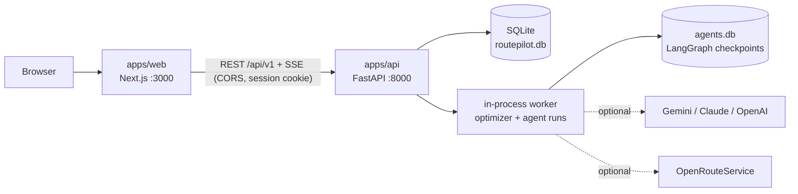

# RoutePilot AI

**An AI dispatcher for small van fleets.** · [Polski — krótkie podsumowanie](#polski--krótkie-podsumowanie)

> **Project status (2026-11-11): foundation implementation available for review; the MVP is incomplete.**
> The API health endpoints, initial database schema, EN/PL web shell and tooling are available. Product features below remain **planned**. GitHub CI and owner review are pending.
> RoutePilot AI is an MVP with a deadline (2026-11-15); afterwards it continues as a portfolio project.

| Item | Status |
|---|---|
| Research, architecture, implementation plan ([`docs/report.md`](docs/report.md)) | ✅ done |
| Rules for coding agents ([`context.md`](context.md), [`AGENTS.md`](AGENTS.md), [`CLAUDE.md`](CLAUDE.md)) | ✅ done |
| Specifications, golden cases, ADRs ([`specs/`](specs/README.md), [`docs/adr/`](docs/adr/README.md)) | ✅ written; P0 specifications approved and ADRs accepted by the owner (2026-11-11), golden cases approved; FEAT-008 (P1) is still a draft |
| UI design: design system, tokens, mockups of every screen ([`docs/design/`](docs/design/README.md)) | ✅ approved by the owner (2026-11-11); not implemented yet |
| Implementation backlog: 53 PR-sized slices covering all 210 acceptance criteria ([`backlog.md`](backlog.md)) and a GitHub issue generator ([`scripts/create_github_issues.sh`](scripts/create_github_issues.sh)) | ✅ written |
| API health/readiness, initial migration, EN/PL web shell, tooling, `ci-fast` definition | Local implementation; [validation report](docs/reports/FEAT-000-foundation-and-001-1.md); GitHub CI pending |
| CRUD, generators, optimizer, runtime agents and product screens | ⏳ planned |
| Demo video (`docs/media/demo.mp4` / `.gif`) and screenshots | ⏳ planned |

---

## 1. What it is

RoutePilot AI is a full-stack web app: an **AI dispatcher** for a small fleet of vans up to 3.5 t (curtain-sider bodies, 8/9/10 euro pallets) driven by the company's own employed drivers. It keeps a list of drivers and their vans. In a chat with a human dispatcher it finds freight offers, checks driver availability and **working time**, builds the most profitable routes with consolidated loads (and gets drivers home for the weekend), compares three variants — **most profitable / fastest / lowest fuel and CO₂** — and proposes load-to-driver assignments. **A human approves every assignment.** The app also works without any AI key.

All drivers, vans and offers in the app are **synthetic demo data**. They are not real freight-exchange offers and not real people.

## 2. Features (planned)

- **Fleet management (CRUD):** drivers, vans (pallet places, payload, dimensions), working-time state, home base, cost profiles.
- **Freight offers:** synthetic offers in the format of the TIMOCOM Freight Exchange API v3, plus manually added offers (CRUD), filters, data-quality indicators.
- **Route optimizer:** per-driver plans with pickups, deliveries, breaks and rests; fleet-wide assignment (no load is used twice); three variants side by side with costs, profit and the **CO₂ footprint**; comparison with simple strategies.
- **Working-time rules:** the Polish Act on Drivers' Working Time for domestic trips; Regulation (EC) No 561/2006 for international van trips (it covers vans over 2.5 t since 2026-07-01).
- **AI Dispatcher (multi-agent):** a supervisor agent delegates to the Freight Scout, Fleet & Compliance and Route Planner agents; a live trace shows which agent called which tool; an approval card appears before any write.
- **Login with captcha** (Cloudflare Turnstile), roles `admin` / `dispatcher` / `demo`, EN/PL interface.
- **Manual optimizer:** the same engine without AI, for users who have no LLM key.
- **Load plan from above:** a top view of the van floor shows which pallets sit where after each stop, next to the timeline of driving, loading, breaks and rests.
- **Clear interface:** an own design system with one red accent, drawn vans wherever a vehicle runs a route, and plain-language states for loading, empty, error and conflicts ([`docs/design/`](docs/design/README.md)).

## 3. Creative twist

**The AI explains and negotiates trade-offs, but it never does the maths.** The dispatcher can ask "why this plan?" or "what if we save fuel instead?" and gets three verified variants with profit, time, litres and kg CO₂. Every number in an answer comes from the deterministic optimizer. A grounding guard checks each number against tool results before the answer is shown, and the only write action (`assign_plan`) waits for a human click on *Approve*. The live trace makes the agents' work visible instead of hiding it.

## 4. Technical overview

| Layer | Technology |
|---|---|
| Frontend (`apps/web`) | Next.js 16, React 19, TypeScript (strict), Tailwind CSS + Radix UI primitives with an own design system ([`docs/design/`](docs/design/README.md)), TanStack Query, react-hook-form + Zod, MapLibre GL, next-intl (EN/PL); typed API client generated from OpenAPI |
| Backend (`apps/api`) | Python 3.13, FastAPI, Pydantic v2, SQLAlchemy 2 + Alembic; layered modules (`api` → `service` → `domain` / `repository`); REST with full CRUD, RFC 9457 error responses, explicit CORS |
| Database | **SQLite** (one local file, WAL mode) — no database server needed; tests run on in-memory SQLite |
| AI agents | **LangGraph** (custom supervisor graph, SQLite checkpoints, `interrupt()` for human approval), LangChain chat-model abstraction — **swappable LLM provider** (Google Gemini, Anthropic Claude, OpenAI), model configurable per agent role |
| Optimizer | custom deterministic Branch-and-Bound (selective pickup and delivery with time windows and profits) + exact fleet assignment + independent validators |
| Routing | city distance matrix stored in the repo; optional OpenRouteService API (cached); haversine fallback — works offline |
| Quality | pytest, Hypothesis (property-based tests), schemathesis, Vitest, Playwright, ruff, mypy, ESLint, import-linter; GitHub Actions CI |

Notable solutions (planned):

- **Agents reason, code computes.** Agents call deterministic tools (optimizer, working-time calculator, cost model). A plan validator rejects invalid plans. A grounding guard checks every number in an answer.
- **Correctness by property-based testing.** The optimizer must match brute force on small instances, never exceed capacity, never break the working-time rules of its profile, and stay deterministic. Ten golden cases with hand-checked arithmetic live in [`specs/golden/`](specs/golden/README.md).
- **Prompt-injection resistance.** Offer texts are treated as untrusted data; the freight-scouting agent has no write tools.
- **Ports and adapters.** The optimizer does not know where offers come from. A real freight-exchange adapter can replace the mock provider later.
- **REST done carefully.** `201` + `Location` on create, `204` on delete, `409` for conflicts, `422` for validation, problem+json errors with a stable `code`, cursor pagination, a CORS allowlist with credentials and CSRF protection.

## 5. Architecture



Backend layers: `api` (routers, schemas) → `service` (use cases, transactions) → `domain` (pure models and rules) and `repository` (SQLAlchemy). Agent tools are thin adapters over the same services as the HTTP API. More diagrams: [`docs/report.md`](docs/report.md) §12; layering rules: [`DEVELOPMENT.md`](DEVELOPMENT.md) §2.

## 6. Run locally — step by step

> Steps 1–2 run the foundation: `/health`, `/ready`, API documentation and the EN/PL placeholder page. Login, demo seed, routing and optimization are planned. The full MVP clean-clone check belongs to FEAT-007.

**Prerequisites**

| Tool | Version | Check |
|---|---|---|
| Python | 3.13 | `python3 --version` |
| [uv](https://docs.astral.sh/uv/) | 0.13.6 used for validation | `uv --version` |
| Node.js | 22.23.4 (`.nvmrc`) | `node --version` |
| pnpm | 11.3.0 (`packageManager`; `corepack enable`) | `pnpm --version` |

No Docker, no database server and no API keys are required.

**Step 1 — API (terminal 1)**

```bash
cd apps/api
cp .env.example .env            # works as-is; LLM and ORS keys are optional
uv sync                          # install dependencies
uv run alembic upgrade head      # create the SQLite database
uv run uvicorn routepilot.main:app --reload --port 8000
```

The migration creates all MVP tables. A local signing key is generated and persisted on first start when `SECRET_KEY` is empty. Demo-data seeding arrives in FEAT-002. API docs: `http://localhost:8000/docs`. Health check: `http://localhost:8000/health`; readiness: `http://localhost:8000/ready`.

**Step 2 — web (terminal 2)**

```bash
cd apps/web
cp .env.example .env.local      # API URL: http://localhost:8000
pnpm install
pnpm dev
```

Open `http://localhost:3000`.

**Step 3 — log in (planned, FEAT-001/2)**

Two local accounts will be created on first start from `apps/api/.env.example`: the demo account (`DEMO_EMAIL` / `DEMO_PASSWORD`, dispatcher-level: chat, fleet, offers, optimizer, approvals) and the admin account (`ADMIN_EMAIL` / `ADMIN_PASSWORD`, also cost profiles and the demo-data generator). Locally the captcha will use Cloudflare's official Turnstile test keys.

**Optional — enable AI (planned, FEAT-006).** Provider keys and `AGENT_MODEL_POLICY` are reserved for the later agent implementation; the current foundation does not call an LLM.

**Optional — live routing (planned, FEAT-004).** `ORS_API_KEY` is reserved for the later routing adapter; the current foundation does not call ORS.

**Tests**

```bash
(cd apps/api && uv run pytest)
(cd apps/web && pnpm test)
```

Troubleshooting (ports in use, missing tools, resetting the database): [`DEVELOPMENT.md`](DEVELOPMENT.md) §6.

## 7. How I used AI tools

- **Research and design (done).** I used **Claude Code** to research the domain: the official TIMOCOM API documentation and OpenAPI file, Regulation (EC) No 561/2006, the Polish Act on Drivers' Working Time, van market rates, routing engines and agent frameworks. It also helped me write the design documents ([`docs/report.md`](docs/report.md), [`context.md`](context.md), this README) and compare architecture options with weighted decision matrices.
- **Specifications (done, approved).** An "Architect & Spec" agent session wrote the feature specifications, golden cases and ADRs from the report. The prompt I used is committed: [`docs/agent-prompts/01-specs-and-docs.prompt.md`](docs/agent-prompts/01-specs-and-docs.prompt.md). I reviewed, corrected and approved each specification before any code is written.
- **UI design (done).** I designed every screen with Claude on a design canvas: first a neutral look, then a palette reduced to one red accent, a top-view load plan and drawn vans. The result became the design system in [`docs/design/`](docs/design/README.md) and a decision record ([ADR-0015](docs/adr/ADR-0015-frontend-ui-components-and-design-system.md)).
- **Planning (done).** Claude Code split the approved specifications into a [`backlog`](backlog.md) of PR-sized slices, checked with a script that every acceptance criterion sits in exactly one slice, and wrote [`scripts/create_github_issues.sh`](scripts/create_github_issues.sh), which turns each slice into a detailed GitHub issue (context, scope, files, interfaces, tests, acceptance criteria, Definition of Done, dependencies).
- **Implementation (planned).** It follows a **spec-driven workflow**: requirement → specification → acceptance criteria → tests → agent implementation in an isolated branch → CI quality gates → human review.
- **Agent instructions are committed.** [`AGENTS.md`](AGENTS.md) is the tool-agnostic entry point with behavioural rules; [`CLAUDE.md`](CLAUDE.md) imports it and adds Claude Code notes; [`context.md`](context.md) holds the project rules (module boundaries, invariants, testing, when to stop and ask).
- **What AI does not decide.** Specifications, ADRs, migrations, prompts and merges need my approval.

> **Placeholder — concrete examples.** This section will get real examples during implementation: a task brief and its completion report, a case where a property test caught an agent's mistake, and what I had to correct by hand.

## 8. Demo

`docs/media/demo.mp4` (and/or `docs/media/demo.gif`) — **planned**. Screenshots: `docs/media/screenshots/` — **planned**. Script and recording settings: [`specs/FEAT-009-demo-media.md`](specs/FEAT-009-demo-media.md).

Until then, the approved mockups of every screen are in [`docs/design/mockups/`](docs/design/mockups/), described in [`docs/design/README.md`](docs/design/README.md) §9.

## 9. Project structure

```
RoutePilotAI/
├── README.md · DEVELOPMENT.md · context.md · AGENTS.md · CLAUDE.md
├── backlog.md               # implementation slices, owner actions, schedule
├── apps/
│   ├── api/                 # FastAPI and SQLite foundation
│   └── web/                 # Next.js EN/PL shell
├── contracts/openapi.json   # generated health/readiness contract
├── specs/                   # requirements, FEAT specifications, golden cases
├── docs/
│   ├── report.md            # research and architecture report (40 sections)
│   ├── adr/                 # architecture decision records
│   ├── design/              # design system, tokens and screen mockups
│   ├── agent-prompts/       # prompts used to instruct coding agents
│   └── media/               # demo video and screenshots (planned)
├── data/mock/               # cities, routing matrix, synthetic offers and fleet (planned)
├── scripts/                 # create_github_issues.sh + github_issues/ (issue data); more scripts planned
├── tests/e2e/ · evals/ · bench/   # (planned)
└── .github/workflows/       # ci-fast, ci-full (planned)
```

## 10. Limitations

- **Synthetic data only.** Offers, drivers and companies are generated. They are not real freight-exchange offers or real people. The app has no connection to TIMOCOM.
- **Simplified working-time model.** The work/driving/rest schedule is a planning estimate based on a simplified model of selected rules (Polish Act on Drivers' Working Time; Regulation (EC) No 561/2006). It does not certify legal compliance.
- **Estimates.** Distances, travel times, fuel, tolls and CO₂ are estimates. Cost parameters marked "assumption" in [`docs/report.md`](docs/report.md) §17.4 are not market facts.
- **Pallet geometry is approximated.** Capacity uses declared pallet places and euro-pallet equivalents; loading order is not modelled for curtain-siders.
- **Small scale.** The optimizer is exact for a fleet of about 5 vans; larger fleets need a different solver.

## 11. Roadmap (after the MVP)

PostgreSQL and self-hosted deployment (Docker Compose on a VPS), event-driven screening of new offers, driver messaging (Telegram/SMS/WhatsApp) with approvals, a real freight-exchange integration, self-hosted routing, tachograph data, larger fleets.

## 12. Documentation map

| Document | What it answers |
|---|---|
| [`README.md`](README.md) | What the project is and how to run it |
| [`DEVELOPMENT.md`](DEVELOPMENT.md) | How the project is built: API guide, database, testing, CI, UX rules, workflow |
| [`context.md`](context.md) | Project rules for coding agents (source of truth for rules) |
| [`AGENTS.md`](AGENTS.md) · [`CLAUDE.md`](CLAUDE.md) | Entry points for AI coding agents |
| [`specs/`](specs/README.md) | What to build: requirements, feature specifications, acceptance criteria, golden cases |
| [`backlog.md`](backlog.md) | In which order: slices, dependencies, owner actions, schedule check |
| [`docs/adr/`](docs/adr/README.md) | Why: architecture decisions and rejected alternatives |
| [`docs/design/`](docs/design/README.md) | How it looks: design system "Clear Route v3", tokens, components, screen mockups |
| [`docs/report.md`](docs/report.md) | Research, sources and rationale |

---

## Polski — krótkie podsumowanie

RoutePilot AI to aplikacja webowa fullstack: **AI Spedytor** dla małej floty busów do 3,5 t (plandeka, 8/9/10 europalet). To MVP z terminem 15.11.2026, a później projekt portfolio.

- **Stan (11.11.2026):** projekt zakończony (specyfikacje, decyzje, design system, backlog) — aplikacja nie jest jeszcze zaimplementowana; funkcje poniżej są planowane.
- **Co robi:** prowadzi listę kierowców i busów (CRUD), wyszukuje oferty, sprawdza dostępność i czas pracy kierowców, układa trasy z doładunkami i powrotem na weekend, porównuje warianty: najbardziej dochodowy / najszybszy / najmniej paliwa i CO₂.
- **AI:** system wieloagentowy (LangGraph). Agenci rozumują, a liczy i sprawdza deterministyczny silnik. Każde przypisanie zatwierdza człowiek. Aplikacja działa też bez klucza AI.
- **Technologie:** Next.js 16 + TypeScript, FastAPI + Python 3.13, SQLite, własny Branch-and-Bound, REST z pełnym CRUD i jawnym CORS.
- **Interfejs:** własny design system z jednym czerwonym akcentem, widok rozmieszczenia palet na podłodze busa z góry i rysunki busów (`docs/design/`).
- **Uruchomienie (planowane):** dwa terminale, bez Dockera i bez kluczy API — kroki w sekcji 6 powyżej.
- **Dane:** wyłącznie syntetyczne (oznaczenie w interfejsie: „DANE SYNTETYCZNE”); to nie są realne oferty ani realne osoby.
- **Zastrzeżenie:** „Harmonogram pracy, jazdy i odpoczynków jest estymacją planistyczną opartą na uproszczonym modelu wybranych przepisów (ustawa o czasie pracy kierowców; rozporządzenie (WE) nr 561/2006). Nie stanowi potwierdzenia zgodności z przepisami.”
- **Dokumentacja** jest po angielsku: `DEVELOPMENT.md`, `context.md`, `specs/`, `docs/`, `backlog.md`.
