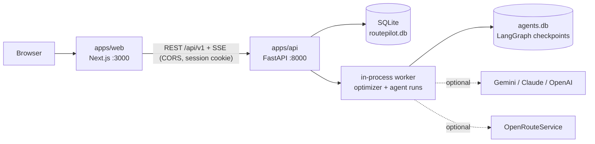

# RoutePilot AI

**An AI dispatcher for small van fleets.** · [Polski — krótkie podsumowanie](#polski--krótkie-podsumowanie)

> **Project status (2026-11-15): the P0 features are implemented and checked by `ci-full`; the demo recording and screenshots are still to do.**
> RoutePilot AI is an MVP with a deadline (2026-11-15); afterwards it continues as a portfolio project.
> Status below means *checked by a quality gate*; the gates and their numbers are in [`DEVELOPMENT.md`](DEVELOPMENT.md) §8 and [`docs/metrics.md`](docs/metrics.md).

[](https://github.com/IgorK834/AI_Dispatcher/actions/workflows/ci-full.yml)

| Item | Status |
|---|---|
| Research, architecture, implementation plan ([`docs/report.md`](docs/report.md)) | ✅ done |
| Rules for coding agents ([`context.md`](context.md), [`AGENTS.md`](AGENTS.md), [`CLAUDE.md`](CLAUDE.md)) | ✅ done |
| Specifications, golden cases, ADRs ([`specs/`](specs/README.md), [`docs/adr/`](docs/adr/README.md)) | ✅ written; P0 specifications approved and ADRs accepted by the owner (2026-11-11), golden cases approved; FEAT-008 (P1) is still a draft and not built |
| Foundation: API, database migration, EN/PL web shell, tooling | ✅ checked by `ci-fast` and `ci-full` |
| Fleet and offers CRUD, demo-data generators, login, optimizer, working-time rules | ✅ checked by `ci-full` (unit, property, API, integration and browser tests) |
| Product screens: fleet, offers, optimizer, plan view, AI Dispatcher, admin ([`docs/design/`](docs/design/README.md)) | ✅ checked by `ci-full` (component tests and Playwright scenarios) |
| Runtime agents: supervisor and three specialists, guards, human approval | ✅ checked by `ci-full` on scripted models; measured on a live model, see [`docs/reports/`](docs/reports/FEAT-006-live-evals-2026-11-14.md) |
| Quality gates: coverage thresholds, end-to-end scenarios, clean-clone run, documentation checks | ✅ run by `ci-full` (the clean-clone run must take at most 10 minutes) |
| Metrics report ([`docs/metrics.md`](docs/metrics.md)) | ✅ generated by `scripts/benchmark_report.py`; run by hand, not part of `ci-full` |
| Demo video (`docs/media/demo.mp4` / `.gif`) and screenshots | ⏳ planned (FEAT-009) |

---

## 1. What it is

RoutePilot AI is a full-stack web app: an **AI dispatcher** for a small fleet of vans up to 3.5 t (curtain-sider bodies, 8/9/10 euro pallets) driven by the company's own employed drivers. It keeps a list of drivers and their vans. In a chat with a human dispatcher it finds freight offers, checks driver availability and **working time**, builds the most profitable routes with consolidated loads (and gets drivers home for the weekend), compares three variants — **most profitable / fastest / lowest fuel and CO₂** — and proposes load-to-driver assignments. **A human approves every assignment.** The app also works without any AI key.

All drivers, vans and offers in the app are **synthetic demo data**. They are not real freight-exchange offers and not real people.

## 2. Features

- **Fleet management (CRUD):** drivers, vans (pallet places, payload, dimensions), working-time state, home base, cost profiles.
- **Freight offers:** synthetic offers in the format of the TIMOCOM Freight Exchange API v3, plus manually added offers (CRUD), filters, data-quality indicators.
- **Route optimizer:** per-driver plans with pickups, deliveries, breaks and rests; fleet-wide assignment (no load is used twice); three variants side by side with costs, profit and the **CO₂ footprint**; comparison with simple strategies.
- **Working-time rules:** the Polish Act on Drivers' Working Time for domestic trips; Regulation (EC) No 561/2006 for international van trips (it covers vans over 2.5 t since 2026-07-01).
- **AI Dispatcher (multi-agent):** a supervisor agent delegates to the Freight Scout, Fleet & Compliance and Route Planner agents; a live trace shows which agent called which tool; an approval card appears before any write.
- **Login with captcha** (Cloudflare Turnstile), roles `admin` / `dispatcher` / `demo`, EN/PL interface.
- **Manual optimizer:** the same engine without AI, for users who have no LLM key.
- **Load plan from above:** a top view of the van floor shows which pallets sit where after each stop, next to the timeline of driving, loading, breaks and rests.
- **Clear interface:** an own design system with one red accent, drawn vans wherever a vehicle runs a route, and plain-language states for loading, empty, error and conflicts ([`docs/design/`](docs/design/README.md)).

## 3. Creative twist

**The AI explains and negotiates trade-offs, but it never does the maths.** The dispatcher can ask "why this plan?" or "what if we save fuel instead?" and gets three verified variants with profit, time, litres and kg CO₂. Every number in an answer comes from the deterministic optimizer. A grounding guard checks each number against tool results before the answer is shown, and the only write action (`assign_plan`) waits for a human click on *Approve*. The live trace makes the agents' work visible instead of hiding it.

## 4. Technical overview

| Layer | Technology |
|---|---|
| Frontend (`apps/web`) | Next.js 16, React 19, TypeScript (strict), Tailwind CSS + Radix UI primitives with an own design system ([`docs/design/`](docs/design/README.md)), TanStack Query, react-hook-form + Zod, MapLibre GL, next-intl (EN/PL); typed API client generated from OpenAPI |
| Backend (`apps/api`) | Python 3.13, FastAPI, Pydantic v2, SQLAlchemy 2 + Alembic; layered modules (`api` → `service` → `domain` / `repository`); REST with full CRUD, RFC 9457 error responses, explicit CORS |
| Database | **SQLite** (one local file, WAL mode) — no database server needed; tests run on in-memory SQLite |
| AI agents | **LangGraph** (custom supervisor graph, SQLite checkpoints, `interrupt()` for human approval), LangChain chat-model abstraction — **swappable LLM provider** (Google Gemini, Anthropic Claude, OpenAI), model configurable per agent role |
| Optimizer | custom deterministic Branch-and-Bound (selective pickup and delivery with time windows and profits) + exact fleet assignment + independent validators |
| Routing | city distance matrix stored in the repo; optional OpenRouteService API (cached); haversine fallback — works offline |
| Quality | pytest, Hypothesis (property-based tests), schemathesis, Vitest, Playwright, ruff, mypy, ESLint, import-linter; GitHub Actions CI |

Notable solutions:

- **Agents reason, code computes.** Agents call deterministic tools (optimizer, working-time calculator, cost model). A plan validator rejects invalid plans. A grounding guard checks every number in an answer.
- **Correctness by property-based testing.** The optimizer must match brute force on small instances, never exceed capacity, never break the working-time rules of its profile, and stay deterministic. Ten golden cases with hand-checked arithmetic live in [`specs/golden/`](specs/golden/README.md).
- **Prompt-injection resistance.** Offer texts are treated as untrusted data; the freight-scouting agent has no write tools.
- **Ports and adapters.** The optimizer does not know where offers come from. A real freight-exchange adapter can replace the mock provider later.
- **REST done carefully.** `201` + `Location` on create, `204` on delete, `409` for conflicts, `422` for validation, problem+json errors with a stable `code`, cursor pagination, a CORS allowlist with credentials and CSRF protection.

Measured on the seeded demo data ([`docs/metrics.md`](docs/metrics.md), generated by `scripts/benchmark_report.py` with reduced engine settings that the file states, among them a 2-day planning horizon): the most profitable fleet plan earns EUR 1,303.10, against EUR 938.93 for the best single offer per driver (+38.8 %) and EUR 1,127.29 for the greedy assignment (+15.6 %). All 5 drivers get a plan and 3 of the 5 plans carry two or more orders at the same time. 22.3 % of the kilometres are empty; the plans use 44.1 % of the pallet places and 53.1 % of the payload over the kilometres driven, so the targets for fuller vans in [`docs/metrics.md`](docs/metrics.md) are recorded as not met. These are results on 150 synthetic offers, not a forecast for real freight.

## 5. Architecture



Backend layers: `api` (routers, schemas) → `service` (use cases, transactions) → `domain` (pure models and rules) and `repository` (SQLAlchemy). Agent tools are thin adapters over the same services as the HTTP API. More diagrams: [`docs/report.md`](docs/report.md) §12; layering rules: [`DEVELOPMENT.md`](DEVELOPMENT.md) §2.

## 6. Run locally — step by step

> Steps 1–2 start the whole app: the API on `:8000` (the first start seeds the synthetic demo data and the two local accounts) and the web app on `:3000`. `scripts/clean_clone_check.sh` runs exactly these commands in a fresh clone (serving the production build, `pnpm build && pnpm start`, instead of `pnpm dev`) and `ci-full` runs it.

**Prerequisites**

| Tool | Version | Check |
|---|---|---|
| Python | 3.13 | `python3 --version` |
| [uv](https://docs.astral.sh/uv/) | 0.13.6 used for validation | `uv --version` |
| Node.js | 22.23.4 (`.nvmrc`) | `node --version` |
| pnpm | 11.3.0 (`packageManager`; `corepack enable`) | `pnpm --version` |

No Docker, no database server and no API keys are required.

**Step 1 — API (terminal 1)**

```bash
cd apps/api
cp .env.example .env            # works as-is; LLM and ORS keys are optional
uv sync                          # install dependencies
uv run alembic upgrade head      # create the SQLite database
uv run uvicorn routepilot.main:app --reload --port 8000
```

The migration creates all MVP tables. A local signing key is generated and persisted on first start when `SECRET_KEY` is empty, and the first start seeds the demo data (5 drivers with vans, 150 synthetic offers). API docs: `http://localhost:8000/docs`. Health check: `http://localhost:8000/health`; readiness: `http://localhost:8000/ready`.

**Step 2 — web (terminal 2)**

```bash
cd apps/web
cp .env.example .env.local      # API URL: http://localhost:8000
pnpm install
pnpm dev
```

Open `http://localhost:3000`.

**Step 3 — log in**

Two local accounts are created on first start from `apps/api/.env.example`: the demo account (`DEMO_EMAIL` / `DEMO_PASSWORD`, dispatcher-level: chat, fleet, offers, optimizer, approvals) and the admin account (`ADMIN_EMAIL` / `ADMIN_PASSWORD`, also cost profiles and the demo-data generator). Locally the captcha uses Cloudflare's official Turnstile test keys, so the sign-in page needs internet access.

**Optional — enable AI.** Add one provider key (`GOOGLE_API_KEY`, `ANTHROPIC_API_KEY` or `OPENAI_API_KEY`) and `AGENT_MODEL_POLICY` to `apps/api/.env`, then restart the API ([`DEVELOPMENT.md`](DEVELOPMENT.md) §6.1 and §11). Without them the AI Dispatcher screen says "AI is off" and the manual optimizer does the same work.

**Optional — live routing.** `ORS_API_KEY` enables OpenRouteService (cached). Without it the app uses the stored city matrix and the haversine fallback.

**Tests**

```bash
(cd apps/api && uv run pytest)
(cd apps/web && pnpm test)
make e2e        # Playwright in Chromium; run `pnpm exec playwright install chromium` once
```

Troubleshooting (ports in use, missing tools, resetting the database): [`DEVELOPMENT.md`](DEVELOPMENT.md) §6.

## 7. How I used AI tools

- **Research and design (done).** I used **Claude Code** to research the domain: the official TIMOCOM API documentation and OpenAPI file, Regulation (EC) No 561/2006, the Polish Act on Drivers' Working Time, van market rates, routing engines and agent frameworks. It also helped me write the design documents ([`docs/report.md`](docs/report.md), [`context.md`](context.md), this README) and compare architecture options with weighted decision matrices.
- **Specifications (done, approved).** An "Architect & Spec" agent session wrote the feature specifications, golden cases and ADRs from the report. The prompt I used is committed: [`docs/agent-prompts/01-specs-and-docs.prompt.md`](docs/agent-prompts/01-specs-and-docs.prompt.md). I reviewed, corrected and approved each specification before any code is written.
- **UI design (done).** I designed every screen with Claude on a design canvas: first a neutral look, then a palette reduced to one red accent, a top-view load plan and drawn vans. The result became the design system in [`docs/design/`](docs/design/README.md) and a decision record ([ADR-0015](docs/adr/ADR-0015-frontend-ui-components-and-design-system.md)).
- **Planning (done).** Claude Code split the approved specifications into a [`backlog`](backlog.md) of PR-sized slices, checked with a script that every acceptance criterion sits in exactly one slice, and wrote [`scripts/create_github_issues.sh`](scripts/create_github_issues.sh), which turns each slice into a detailed GitHub issue (context, scope, files, interfaces, tests, acceptance criteria, Definition of Done, dependencies).
- **Implementation (done).** It follows a **spec-driven workflow**: requirement → specification → acceptance criteria → tests → agent implementation in an isolated branch → CI quality gates → human review.
- **Agent instructions are committed.** [`AGENTS.md`](AGENTS.md) is the tool-agnostic entry point with behavioural rules; [`CLAUDE.md`](CLAUDE.md) imports it and adds Claude Code notes; [`context.md`](context.md) holds the project rules (module boundaries, invariants, testing, when to stop and ask).
- **What AI does not decide.** Specifications, ADRs, migrations, prompts and merges need my approval.

**Four concrete examples**

1. **A brief and its completion report.** Every task starts as a GitHub issue generated from the [`backlog`](backlog.md): the specification, the acceptance criteria (ACs) in scope, the allowed paths and the required gates. The agent ends with a completion report in the pull request: changes, AC → test, gates run, and what it could not verify. [Pull request 110](https://github.com/IgorK834/AI_Dispatcher/pull/110) is one: it lists the changed files, the tests that name `AC-FEAT-004-15` and `AC-FEAT-003-25`, the gate results and the remaining risks.
2. **A defect caught by a gate.** The first `ci-full` runs stalled. Gate 7 (browser scenarios) hung at the *Assign* step: the optimisation worker was forked from the web server and kept its open client connections alive, so the browser reused a dead socket. The fix starts the worker with `spawn`, and a regression test (`AC-FEAT-004-15`) fails on the old behaviour. Gate 3a then hung in the working-time validator, which looped for ever when an activity ended less than one minute before the Monday week boundary; a unit test that reproduces it (`AC-FEAT-003-25`) came first, then the fix. Both were found by reading the run logs, not by guessing.
3. **A manual correction.** The first measurement of the agents on a live model showed that they skipped lookups the questions required, so I approved a second version of two prompts that states the missing rules, and measured again. The first campaign had also used 484 835 of its 500 000 tokens, so every later campaign runs under a hard ledger that reserves a model call's whole token cap before the call is sent. Prompt changes and paid runs stay with me: an agent may propose them, never start them. Details and the measurements: [`docs/reports/FEAT-006-live-evals-2026-11-14.md`](docs/reports/FEAT-006-live-evals-2026-11-14.md) and [`evals/README.md`](evals/README.md).
4. **A result that did not match the plan.** I asked for fuller vans. Research showed that the demo plans were chains because the data priced and placed offers like full-van loads, so FEAT-010 changed the data, not the solver. The first new tariff left the fleet without profit, so a price check against public examples added a per-pallet charge. The fill target of 60 % still failed, because 40 % of the kilometres are empty whatever the data or the search; I did not tune constants to hit it and recorded it as an open question. The whole story, with symptoms, fixes and what comes next, is in [`docs/development-log.md`](docs/development-log.md).

## 8. Demo

`docs/media/demo.mp4` (and/or `docs/media/demo.gif`) — **planned**. Screenshots: `docs/media/screenshots/` — **planned**. Script and recording settings: [`specs/FEAT-009-demo-media.md`](specs/FEAT-009-demo-media.md).

Until then, the approved mockups of every screen are in [`docs/design/mockups/`](docs/design/mockups/), described in [`docs/design/README.md`](docs/design/README.md) §9.

## 9. Project structure

```
RoutePilotAI/
├── README.md · DEVELOPMENT.md · context.md · AGENTS.md · CLAUDE.md
├── backlog.md               # implementation slices, owner actions, schedule
├── apps/
│   ├── api/                 # FastAPI, SQLite, optimizer, working-time rules, runtime agents
│   └── web/                 # Next.js EN/PL app: fleet, offers, optimizer, plans, AI Dispatcher, admin
├── contracts/openapi.json   # generated API contract
├── specs/                   # requirements, FEAT specifications, golden cases
├── docs/
│   ├── report.md            # research and architecture report (40 sections)
│   ├── adr/                 # architecture decision records
│   ├── design/              # design system, tokens and screen mockups
│   ├── agent-prompts/       # prompts used to instruct coding agents
│   └── media/               # demo video and screenshots (planned)
├── data/mock/               # cities, routing matrix, synthetic offers and fleet
├── scripts/                 # CI helpers, clean_clone_check.sh, check_docs.py, benchmark_report.py
├── tests/e2e/               # Playwright scenarios (Chromium)
├── evals/ · bench/          # agent evaluations (paid runs are manual) · engine benchmark
└── .github/workflows/       # ci-fast, ci-full, ai-evals (manual)
```

## 10. Limitations

- **Synthetic data only.** Offers, drivers and companies are generated. They are not real freight-exchange offers or real people. The app has no connection to TIMOCOM.
- **Simplified working-time model.** The work/driving/rest schedule is a planning estimate based on a simplified model of selected rules (Polish Act on Drivers' Working Time; Regulation (EC) No 561/2006). It does not certify legal compliance.
- **Estimates.** Distances, travel times, fuel, tolls and CO₂ are estimates. Cost parameters marked "assumption" in [`docs/report.md`](docs/report.md) §17.4 are not market facts.
- **Pallet geometry is approximated.** Capacity uses declared pallet places and euro-pallet equivalents; loading order is not modelled for curtain-siders.
- **Small scale.** The optimizer is exact for a fleet of about 5 vans; larger fleets need a different solver.
- **Engine runtime depends on the settings.** The search grows quickly with the offers per plan and the plans kept per driver. [`docs/metrics.md`](docs/metrics.md) reports the timings of a reduced setting and does not claim the runtime target for the engine defaults. At the defaults a run takes minutes and is cut by the 30 s per-driver safety limit, so the 15 s target (NFR-002) is **not met**; a search speed-up of about four times did not change that.
- **Van fill is below its target.** About 40 % of the kilometres of the profit plans are empty (the drive to the first pickup and the drive home before the weekend), so the fill over all kilometres is about 40 %, against a target of 60 %. On loaded kilometres it is 56 % of the pallet places and 68 % of the payload ([`docs/metrics.md`](docs/metrics.md)). The target is an open question for the owner (OQ-010-11).
- **Demo data is generated, including its towns.** 605 places: 55 named ones and 550 generated points around them. Prices and the per-pallet handling charge are assumptions checked against a few public price examples, not a tariff ([`docs/raport.md`](docs/raport.md) §3.6). The routing matrix is a 10 MB straight-line matrix, not road routing.

## 11. Roadmap (after the MVP)

**Next, in order** (reasons and effort: [`docs/development-log.md` §3](docs/development-log.md#3-how-it-will-be-improved)):

1. Label dominance in the exact search, to move towards the 15 s target without losing exactness, then a decision on the runtime defaults.
2. A better definition of the fill target, and the cause of empty kilometres shown in the plan view.
3. Real towns and a road-routing matrix for the demo data, and a tariff calibrated against a published table.
4. Load metrics in the answers of the dispatcher agent, and a nightly benchmark in CI that records trends.
5. Loading order and 2D pallet placement.

**Later:** PostgreSQL and self-hosted deployment (Docker Compose on a VPS), event-driven screening of new offers, driver messaging (Telegram/SMS/WhatsApp) with approvals, a real freight-exchange integration, self-hosted routing, tachograph data, larger fleets.

## 12. Documentation map

| Document | What it answers |
|---|---|
| [`README.md`](README.md) | What the project is and how to run it |
| [`DEVELOPMENT.md`](DEVELOPMENT.md) | How the project is built: API guide, database, testing, CI, UX rules, workflow |
| [`context.md`](context.md) | Project rules for coding agents (source of truth for rules) |
| [`AGENTS.md`](AGENTS.md) · [`CLAUDE.md`](CLAUDE.md) | Entry points for AI coding agents |
| [`specs/`](specs/README.md) | What to build: requirements, feature specifications, acceptance criteria, golden cases |
| [`backlog.md`](backlog.md) | In which order: slices, dependencies, owner actions, schedule check |
| [`docs/adr/`](docs/adr/README.md) | Why: architecture decisions and rejected alternatives |
| [`docs/design/`](docs/design/README.md) | How it looks: design system "Clear Route v3", tokens, components, screen mockups |
| [`docs/report.md`](docs/report.md) | Research, sources and rationale |
| [`docs/raport.md`](docs/raport.md) | Research on part-load (LTL) transport, measurements of the demo data and the price check |
| [`docs/development-log.md`](docs/development-log.md) | Problems met during the build, how each was solved, and how it will be improved |
| [`docs/walkthrough.md`](docs/walkthrough.md) | A 10–15 minute presentation guide: architecture, decisions, numbers, demo script, questions and answers |
| [`docs/metrics.md`](docs/metrics.md) | Generated measurements: profit, fill, consolidation, timings |

---

## Polski — krótkie podsumowanie

RoutePilot AI to aplikacja webowa fullstack: **AI Spedytor** dla małej floty busów do 3,5 t (plandeka, 8/9/10 europalet). To MVP z terminem 15.11.2026, a później projekt portfolio.

- **Stan (15.11.2026):** funkcje P0 są zaimplementowane i sprawdzane przez `ci-full` (testy jednostkowe, integracyjne i przeglądarkowe, progi pokrycia, uruchomienie ze świeżego klonu). Do zrobienia: nagranie demo i zrzuty ekranu (FEAT-009).
- **Co robi:** prowadzi listę kierowców i busów (CRUD), wyszukuje oferty, sprawdza dostępność i czas pracy kierowców, układa trasy z doładunkami i powrotem na weekend, porównuje warianty: najbardziej dochodowy / najszybszy / najmniej paliwa i CO₂.
- **AI:** system wieloagentowy (LangGraph). Agenci rozumują, a liczy i sprawdza deterministyczny silnik. Każde przypisanie zatwierdza człowiek. Aplikacja działa też bez klucza AI.
- **Technologie:** Next.js 16 + TypeScript, FastAPI + Python 3.13, SQLite, własny Branch-and-Bound, REST z pełnym CRUD i jawnym CORS.
- **Interfejs:** własny design system z jednym czerwonym akcentem, widok rozmieszczenia palet na podłodze busa z góry i rysunki busów (`docs/design/`).
- **Uruchomienie:** dwa terminale, bez Dockera i bez kluczy API — kroki w sekcji 6 powyżej.
- **Dane:** wyłącznie syntetyczne (oznaczenie w interfejsie: „DANE SYNTETYCZNE”); to nie są realne oferty ani realne osoby.
- **Zastrzeżenie:** „Harmonogram pracy, jazdy i odpoczynków jest estymacją planistyczną opartą na uproszczonym modelu wybranych przepisów (ustawa o czasie pracy kierowców; rozporządzenie (WE) nr 561/2006). Nie stanowi potwierdzenia zgodności z przepisami.”
- **Ograniczenia (15.11.2026):** cel czasu działania silnika (15 s) i cel wypełnienia busów (60 %) nie są osiągnięte — przyczyny, pomiary i plan poprawek: `docs/development-log.md`; opis do prezentacji projektu: `docs/walkthrough.md`.
- **Dokumentacja** jest po angielsku: `DEVELOPMENT.md`, `context.md`, `specs/`, `docs/`, `backlog.md`.
