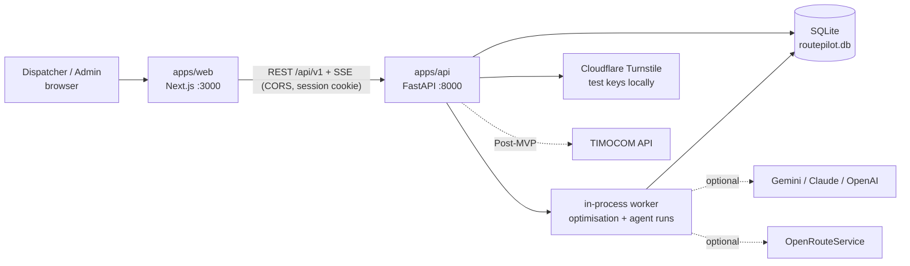
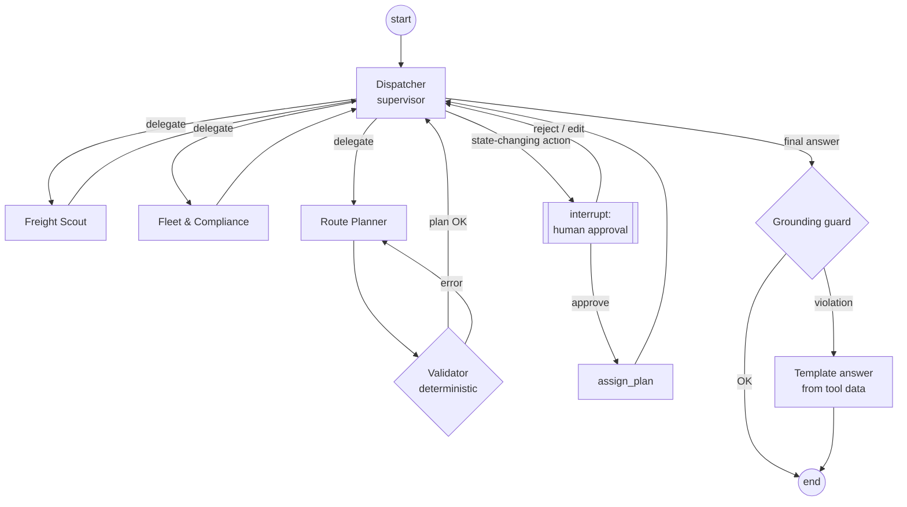
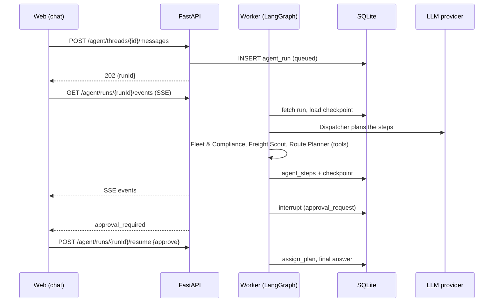
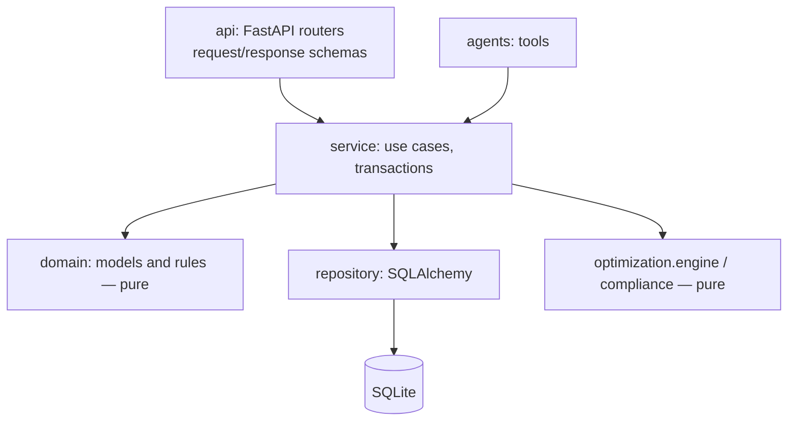
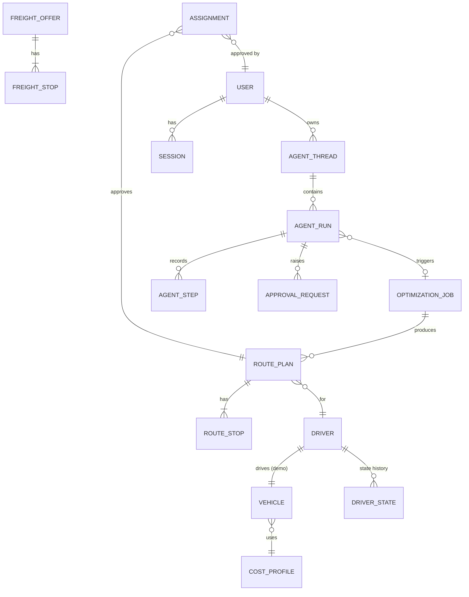
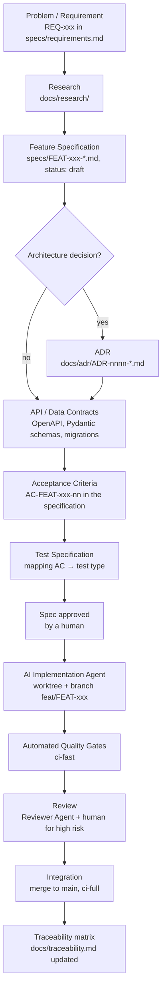
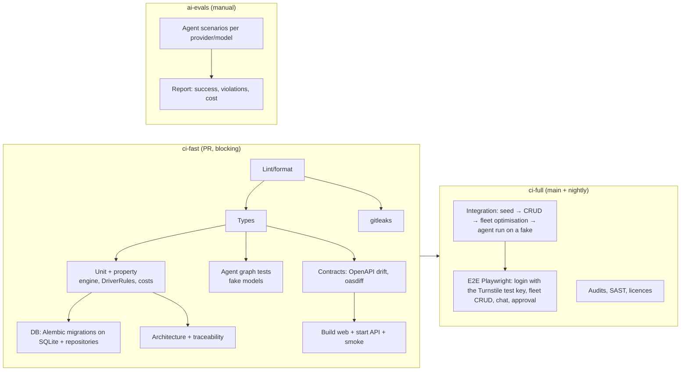
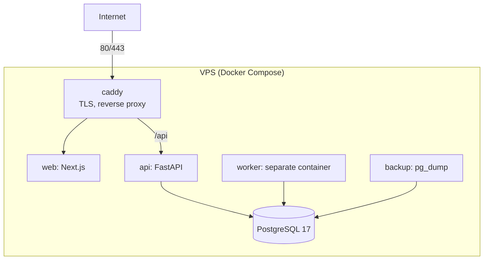

# RoutePilot AI — Technical Research & Architecture Report

> **Document status:** v3.0 (2026-11-09) — research and design; translated to English on 2026-11-09 (content unchanged). Direction: an **AI dispatcher** for a fleet of vans ≤ 3.5 t, a **multi-agent system on LangGraph**, a REST API with full CRUD, **SQLite**, local run without Docker and without required keys, login with captcha, a swappable LLM provider, the CO₂ footprint of variants. PostgreSQL and a VPS — the portfolio version after the MVP.
> **Source verification date:** 2026-11-09 (unless stated otherwise).
> **No part of the application is implemented yet.** All endpoints, commands, paths and modules are **planned**.
> **Related documents:** [`README.md`](../README.md) (overview, run steps), [`context.md`](../context.md) (operational rules for coding agents), [`DEVELOPMENT.md`](../DEVELOPMENT.md) (engineering guide), [`specs/`](../specs/README.md) (what to build), [`docs/adr/`](adr/README.md) (decisions).
> **Confidence labels:** **V** verified, **I** inferred, **U** unknown, **A** approximate (§2).

---

## 1. Executive Summary

**Product vision.** RoutePilot AI is an **AI dispatcher**: an application that keeps a list of drivers and their vans (up to 3.5 t, curtain-sider body, 8/9/10 euro pallets) and — talking with a human dispatcher — finds freight offers, checks driver availability and working time, builds the most profitable routes with consolidated loads and proposes load-to-driver assignments. The final decision belongs to a human.

**Two horizons.**
- **MVP (deadline: 2026-11-15):** a small, fully working full-stack application started locally in a few steps (**SQLite, no Docker, no required API keys**): a REST API with full CRUD for drivers, vehicles and offers, login with captcha (Cloudflare Turnstile — test keys locally), a fleet of 5 drivers and synthetic offers from a generator (TIMOCOM API v3 format), an optimisation engine (single van + fleet assignment), three route variants (most profitable / fastest / lowest fuel consumption) with the **CO₂ carbon footprint**, a working-time model (Act on Drivers' Working Time + Regulation 561/2006 for vans in international transport since 2026-07-01) and a **multi-agent system** (Dispatcher + 3 agents) with a chat, a visible trace of agent activity and human approvals. The application also works without AI.
- **Portfolio / product (after the MVP):** PostgreSQL and deployment on a self-managed VPS, event-driven mode (the agent rates new offers on its own), driver messaging (Telegram/SMS/WhatsApp), a real freight exchange (TIMOCOM after Business Approval), self-hosted routing, tachograph data, multiple companies.

**Key decisions:**

| Area | MVP decision |
|---|---|
| Frontend | Next.js 16 + React 19 + TypeScript strict, Tailwind + shadcn/ui, TanStack Query, MapLibre, i18n EN/PL (next-intl); runs on `localhost:3000` and calls the API directly |
| Backend | Python 3.13 + FastAPI + Pydantic v2 — a modular monolith (REST API, engine, agents, in-process worker); `localhost:8000`; **explicitly configured CORS** |
| Database | **SQLite** (local file, WAL mode) through SQLAlchemy 2 + Alembic; tests on in-memory SQLite; PostgreSQL as the portfolio path |
| API | REST, OpenAPI generated from FastAPI, full CRUD: drivers, vehicles, offers (manual), cost profiles |
| Runtime agents | **LangGraph 1.2.x**: a custom supervisor graph (Dispatcher) + Freight Scout, Fleet & Compliance, Route Planner; deterministic tools; guard nodes (validator, grounding, budget); `interrupt()` for approvals; checkpoints in SQLite (`langgraph-checkpoint-sqlite`) |
| LLM models | swappable provider through LangChain `init_chat_model`: Google Gemini (the owner's default choice), Anthropic Claude, OpenAI; model per agent role; **key optional** |
| Optimisation | custom deterministic Branch-and-Bound (selective PDPTW with profits, chains of orders, capacity: pallet places + kg) → exact fleet assignment → independent validator |
| Route variants | `profit` / `fastest` / `fuel` + **kg CO₂ per variant** (litres of diesel × emission factor) |
| Working time | `DriverRules`: `pl_domestic_employee_v1` (the Act) and `eu561_van_international_v1` (561/2006 + working time); a plan with an international leg is computed under 561 |
| Routing | OpenRouteService (optional key) with a cache; **demo city matrix stored in the repo**; haversine fallback — works offline |
| Auth | accounts with roles `admin`/`dispatcher`/`demo`, Argon2id, session in an httpOnly cookie, Turnstile (Cloudflare test keys by default locally), rate limiting; demo account created on first start |
| Run | two terminals: `uv sync` + start the API; `pnpm install` + `pnpm dev`; data seed on first start |
| AI tools in the work | Claude Code (research, documentation, implementation in a spec-driven process); instructions for coding agents in the repo (`context.md`, `AGENTS.md`, `CLAUDE.md`) |
| Delivery | public GitHub repo, `README.md` with run instructions and a description of the use of AI tools, a `.mp4`/`.gif` recording in the repo |

**Verified facts with the largest impact:**
1. Since **2026-07-01** Regulation 561/2006 covers the carriage of goods by vehicles **> 2.5 t in international transport and cabotage** (Art. 2(1)(aa)). Domestically, drivers employed under an employment contract are subject to the **Act on Drivers' Working Time (ustawa o czasie pracy kierowców)** (a break after 6 h of work, up to 12 h of work per day in the equivalent system, daily rest 11 h, weekly rest 35 h, ≤ 60 h of work per week).
2. International van rates after 2026-07-01: +35–80% (BdKEP via trans.info); a 1 500 km route: about 27.5 h without limits vs more than 42 h with one driver under the 561 regime → **working time is key**.
3. Spot medians for VAN from Poland (Trans.eu Freight Radar, August/September 2026): CZ 0.93, SK 0.93, HU 0.79, DE 0.68, FR 0.60 €/km.
4. An 8 EP van ≈ 4.20 × 2.10 m (765–947 kg), a 10 EP van ≈ 4.85 × 2.10 m (about 1 085 kg); pallets in a **mixed layout**; mass often constrains more than pallets.
5. TIMOCOM Freight Exchange API v3.0.6 — `POST /freight-exchange/3/freight-offers/search`, `meta` + `payload`, Basic Auth, a sandbox with credentials from TIMOCOM, ≤ 30 offers per page, ≥ 45 s between identical searches, 2-step search, Business Approval; `VEHICLE_UP_TO_3_5_T` is in the enumeration.

**Largest risks:** scope vs deadline (a hard P0/P1 split, a cut list), agent non-determinism (deterministic tools, guards, tests on fake models), correctness of the working-time model (two profiles, conservatism, disclaimers), write concurrency in SQLite (one worker, WAL, short transactions).

**First implementation task:** specifications and ADRs (task #0), then `FEAT-000` (monorepo + `ci-fast`).

---

## 2. Research Methodology

Phases: Discovery → External research → Architecture evaluation → Domain & algorithm design → Engineering process → MVP planning → documents → consistency review. Confidence classification: **V** (verified in an official/primary source), **I** (inferred), **U** (unknown), **A** (approximate — values from listings, secondary or conflicting sources).

**Sources added in v2:** EUR-Lex (Art. 2 and 3 of Regulation 561/2006, consolidated version), the consolidated text of the Act on Drivers' Working Time (Dz.U. 2024 poz. 220, downloaded from api.sejm.gov.pl), Trans.eu Freight Radar (public dashboard, August/September 2026), trans.info and Interia (the van market after 2026-07-01), vehicle listings (mascus, otomoto — body dimensions and payload), EU Oil Bulletin through fuel-prices.eu (diesel prices), infor.pl (per diems 2026, minimum wages), oesterreich.gv.at (AT vignette), sources on the LKW-Maut, the LangGraph documentation (interrupts), OpenRouteService (routing options, plans), the PyPI/npm registries (versions), the Cloudflare Turnstile documentation.

**Limitations of the v2 research:**
- Body dimensions and payloads come from **listings** (A), not from manufacturer data sheets. For the **9 EP van no reliable dimensions were found** (§16.3).
- There is no public median of VAN rates for domestic PL→PL lanes (§17.4 — assumption).
- Act on Drivers' Working Time — consolidated text of 2024; later amendments were not verified.
- The model identifier "Gemini 3.8 Flash" was not verified — taken from the project owner's statement; configurable.
- The ORS parameters `preference`/`alternative_routes` are only partly confirmed (forum, options documentation) — to be verified in FEAT-004.

---

## 3. Business Problem Analysis

### 3.1. Problem
A dispatcher runs several van drivers. Each driver has a van (8, 9 or 10 EP, about 0.8–1.1 t of payload), a home base, a current position, used working time and an obligation to return for the weekend. There are hundreds of offers on the exchange. Everyday questions:
1. Which offers fit which driver (position, deadline, pallets, **mass**)?
2. Can several loads be combined in one van (consolidated loads) and in what order?
3. Will the driver make it while keeping the **working time** (and in international transport — driving time and rests under 561/2006)?
4. After unloading, is there another order towards the base so the driver gets home for the weekend?
5. Which variant is the most profitable, and which is the fastest or the most fuel-efficient?
6. How to split the offers between drivers so that the **fleet** earns the most (and not each driver separately)?

### 3.2. Example (golden `GOLD-001`, adapted to a 10 EP van, 1 085 kg)
The driver is in Katowice. A: 4 EP / 380 kg, Katowice → Wrocław; B: 4 EP / 420 kg, Opole → Dresden; C: 2 EP / 200 kg, Wrocław → Leipzig. The sequence `pick A → pick B → drop A → pick C → drop B → drop C`: pallets 4 → 8 → 4 → 6 → 2 → 0 (≤ 10 ✓), mass 380 → 800 → 420 → 620 → 200 → 0 kg (≤ 1 085 ✓). The leg Wrocław → Dresden/Leipzig is international transport → the whole plan is computed under the profile `EU_561_VAN_INTERNATIONAL`. The expected values (times, costs) are calculated by hand in the specification before implementation ([`specs/golden/GOLD-001.md`](../specs/golden/GOLD-001.md)).

### 3.3. Users and roles
| Role | Description | Permissions in the system |
|---|---|---|
| `admin` | company owner / administrator | users, drivers, vehicles, cost profiles, demo data generator, AI settings (models, budgets) |
| `dispatcher` | dispatcher | chat with the AI dispatcher, offers, optimisation, approval of assignments |
| `demo` | public account for presentations | like dispatcher, but with a limit on AI queries and no configuration changes; data is reset |
| driver | (post-MVP) | receiving orders through a messenger, confirmations |

### 3.4. Current workflow (hypothesis to be confirmed)
The dispatcher browses the exchange (filters: area, date, vehicle type up to 3.5 t), calls drivers for their position and working time, combines orders in their head or in a spreadsheet, negotiates the rate, sends the order data to the driver (phone/messenger). Since 2026-07-01 international transport adds planning under 561/2006 and the tachograph — clearly harder.

### 3.5. What we improve and how we measure it
- Automatic evaluation of combinations and chains of orders per driver, and fleet assignment.
- A plan with a schedule of work/driving/rests, occupancy (pallets, kg) and costs.
- A conversation with the AI dispatcher instead of clicking through filters; proposals with a rationale, ready for approval.
- **Metrics (measured by the application, not assumed):** uplift of fleet profit vs baselines (every driver takes the best single offer; greedy assignment), share of empty km, capacity utilisation (EP·km and kg·km), share of drivers who return to base for the weekend, time from question to proposal.

---

## 4. Market & Competitor Research

### 4.1. The van market after 2026-07-01 (F = fact from a source, H = hypothesis)
| Finding | Type | Source |
|---|---|---|
| Vehicles of 2.5–3.5 t in international carriage of goods for hire or reward: obligation of the G2V2 tachograph and of the driving and rest time rules since 2026-07-01 | F | EUR-Lex Art. 2(1)(aa) of Regulation 561/2006; trans.info (2026-09-07); Interia |
| About 40 thousand Polish vehicles in this segment (industry estimate) | F (estimate) | trans.info, Interia |
| International van rates: temporarily +100–200% after 1 July, permanently +35–80% (BdKEP) | F (statement of an association) | trans.info, Interia |
| G2V2 installation: about 3.5–4.7 thousand EUR per vehicle | F (BdKEP) | trans.info |
| Spot medians for VAN from PL (August/September 2026): CZ 0.93, SK 0.93, HU 0.79, DE 0.68, FR 0.60 €/km | F | Trans.eu Freight Radar |
| The number of offers from PL on the Trans.eu exchange grows year over year (e.g. PL→DE +51%, PL→FR +81% — all types) | F | Trans.eu Freight Radar |
| Tools for planning that respects working time are becoming more important for small van fleets | H | inferred from the above |

### 4.2. Competitors and related solutions
- **TIMOCOM:** exchange + API; in the Business Approval a search for additional loads is required (MUST); a "Fleetplanner" demo; HERE Truck routing.
- **Trans.eu:** SmartMatch, integrations with TMS (frameLOGIC), announced AI tools (e.g. a negotiation assistant, "Best Route Assistant" — interviews).
- **Transporeon:** natural-language search for carriers (2026).
- **TMS** (Descartes, Adaption): consolidation of own orders, not selection of spot offers.
- **Conclusion (H):** AI assistants in logistics appear at large players; the niche for RoutePilot is **a small van fleet + working-time awareness + combining offers + transparent agent recommendations** as a layer independent of the exchange.

### 4.3. Barriers and adoption risks
Access to exchange data (contracts, approval, costs), trust in the estimates (distance, time, fuel), the need for tachograph data for credible 561 planning, integration with driver messengers, responsibility for decisions (which is why a human approves).

## 5. TIMOCOM API Research

### 5.1. Key findings

| # | Finding | Source | Verification date | Confidence | Impact on architecture |
|---|---|---|---|---|---|
| T1 | The portal offers the APIs: Freight Exchange, Live Shipment Tracking, Transport Order, Live Tracking, Profile, Freight Price Insights | developer.timocom.com | 2026-11-09 | V | Several future adapters; we start with Freight Exchange |
| T2 | Freight Exchange API **v3.0.6**, OpenAPI 3.0.3 publicly exportable (Stoplight) | developer.timocom.com/docs/freight-exchange/bbf3f610ba4d2-freight-exchange; api.stoplight.io/…/openapi.yaml | 2026-11-09 | V | We can generate/validate raw models from the official schema; the mock uses a compatible format |
| T3 | Servers: Live `https://api.timocom.com/freight-exchange/3`, Sandbox `https://sandbox.timocom.com/freight-exchange/3` | OpenAPI `servers` | 2026-11-09 | V | Configuration `TIMOCOM_BASE_URL` per environment |
| T4 | Endpoint `POST /freight-offers/search` (operationId `post-search-freight-offers`), body `offerSearchFilter`, response `freightOffersResponse` (200), errors 400/415/422 | OpenAPI | 2026-11-09 | V | The hypothesis from the earlier analysis is **confirmed** |
| T5 | Other operations: `GET /freight-offers?ids=…` (lookup of foreign offers, full data with contact), `/my-freight-offers` (CRUD of own offers), `/freight-quotes`, `/vehicle-space-offers/search`, `/enumerations/*` (among others vehicle-bodies, vehicle-types, currencies, country-codes) | OpenAPI | 2026-11-09 | V | Lookup only on the dispatcher's request (2-step); enumerations for mapping |
| T6 | Freight Exchange authentication: **HTTP Basic** (`securitySchemes.authorization: http/basic`); access through a "group and group password" | OpenAPI; Freight Exchange Introduction | 2026-11-09 | V | Adapter with pluggable auth |
| T7 | In general "most TIMOCOM APIs use OAuth2" (authorization code — preferred, client credentials, password); Freight Price Insights — OAuth2; OAuth base `https://my.timocom.com/auth/oauth/` | Getting started; OAuth2 page; Freight Price Insights | 2026-11-09 | V | **Discrepancy** Basic vs OAuth2 → the auth strategy is an interface (`AuthStrategy`) |
| T8 | Response structure: `meta` (`requestId`, `responseTimestamp`) + `payload` (array of `freightOffer`) | OpenAPI `freightExchangeResponse`, `freightOffersResponse` | 2026-11-09 | V | The hypothesis from the earlier analysis is confirmed; we log `requestId` |
| T9 | Errors in a format close to RFC 7807 (`application/problem+json`: `type`, `title`, `status`, `detail`, `instance`, `invalid-params`, `meta`) | OpenAPI `problem` | 2026-11-09 | V | Mapping of provider errors to an internal `ProviderError` |
| T10 | Codes: 200 OK; 400, 422, 403 — no retry; 5xx — retry after some time; on throttling 503 — retry after the pause suggested in the response | Freight Exchange Introduction | 2026-11-09 | V | Retry policy in the adapter (backoff, max attempts) |
| T11 | Limits: dynamic throttling; "Search Freight" on the same route **MUST NOT** be repeated within **45 s**; publishing an offer no more often than every 30 min | Freight Exchange Introduction | 2026-11-09 | V | Rate limiter per filter; refresh schedule ≥ 45 s |
| T12 | Pagination: `firstResult` (offset from 0), `maxResults` 1–30 (the server caps it at 30); every page counts as a request unless it is empty; paginate until an empty result without `DETACHED_DELETED_ENTITIES` | API Concepts; OpenAPI | 2026-11-09 | V | Pagination iterator with a page limit (cost) |
| T13 | `inclusiveRightUpperBoundDateTime` is **required**; > 8 h in the past → 422 `INVALID_QUERY_DATE_TIME`; `exclusiveLeftLowerBoundDateTime` allows fetching only new/changed offers (interval (A,B]) | OpenAPI; API Concepts | 2026-11-09 | V | Incremental import ("New offers only") with a remembered marker |
| T14 | Two-step search: the search result is at most 30 anonymised offers **without a contact person**; contact data through lookup; in the first step the UI should show only the company name, TIMOCOM ID, VAT | Search Freight Offers guide | 2026-11-09 | V | UI and model: the contact is not part of an offer from a search |
| T15 | Generic searches (e.g. all offers in DE) **only with special consent** of TIMOCOM | Search guide; API integration guide | 2026-11-09 | V | No "download everything"; targeted search per vehicle (area `size_km`) |
| T16 | Search filters: `startLocation`/`destinationLocation` (`areaSearch` with `address` + `size_km` or `postalCodeAreasArray`), `loadingDate` (`dateInterval` or `individualDates`), `lengthRange_m`, `weightRange_t`, `vehicleProperties`, `sortings` (`loadingDate`, `creationDateTime`) | OpenAPI `offerSearchFilter`; Search guide | 2026-11-09 | V | Mapping of the vehicle configuration → provider filter |
| T17 | Offer fields (`freightOffer` = `offer` + extension): `id`, `customer`, `contactPerson`, `vehicleProperties` (`body[]`, `type[]`, `bodyProperty[]`, `equipment[]`, `loadSecuring[]`, `swapBody[]`), `trackable`, `publicRemark` (≤500), `internalRemark`, `deeplink`, `creationDateTime`, `logisticsDocumentTypes`, `acceptQuotes`, `additionalInformation[]`, `distance_km`, `freightDescription` (3–50 characters), `length_m` (0–99.99), `weight_t` (0–99.99), `loadingPlaces[]` (2–10), `paymentDueWithinDays`, `price` (`amount`, `currency` ISO-4217) | OpenAPI | 2026-11-09 | V | Raw model of the adapter; all previously assumed fields are confirmed |
| T18 | `loadingPlace`: `loadingType` (`LOADING`/`UNLOADING`), `address` (`city`, `country` ISO 3166-1 alpha-2, `postalCode`, `geoCoordinate{latitude,longitude}` WGS84, `geocoded`), `earliestLoadingDate`, `latestLoadingDate` (date), `startTime`, `endTime` (HH:MM, **no time zone**) | OpenAPI | 2026-11-09 | V | Time normalisation requires inferring the zone from the country (marked as `inferred`) |
| T19 | `price` is **optional** (not in `required`); required: `acceptQuotes`, `freightDescription`, `length_m`, `loadingPlaces`, `weight_t` (+ from `offer`: `contactPerson`, `trackable`, `vehicleProperties`) | OpenAPI | 2026-11-09 | V | An offer without a price = unknown revenue → separate handling |
| T20 | **Missing fields**: number of pallets, pallet dimensions, temperature, ADR, ramp service time, stacking. The only occurrence of "pallet" is the equipment `PALLET_STOP_BAR` | OpenAPI (grep) | 2026-11-09 | V | Pallets/temperature/service time = **enrichment**, never "a fact from TIMOCOM" |
| T21 | `loadingPlaces` 2–10 → an offer can be **multi-stop**; the first `LOADING`, the last `UNLOADING` | OpenAPI | 2026-11-09 | V | `FreightStop` model with a sequence; the MVP handles 2 stops, multi-stop is P2 |
| T22 | Offers are removed from the exchange after the latest loading date passes | API Concepts | 2026-11-09 | V | Status `expired` + retention of raw data |
| T23 | A sandbox exists; it requires **test credentials and a test user** from TIMOCOM; test items are not migrated to production | Launch Checklist; Search guide | 2026-11-09 | V | Offline contract tests on the OpenAPI examples; the sandbox as an optional post-MVP smoke test |
| T24 | Access: no self-service registration; an email to api@timocom.com ("Request for NEW API User"); users must be TIMOCOM customers | Freight Exchange Introduction; Launch Checklist | 2026-11-09 | V | Production integration is outside the MVP scope |
| T25 | Every integration requires a **Business Approval** (TIMOCOM Product/Partner Management): among others an explanation of the use/storage/deletion of data, the fetch interval, 2-step search (MUST), area search (MUST), multiple search (MUST), search for additional loads (MUST) | Business Approval | 2026-11-09 | V | Requirements for the future product; we design in line with them from the start |
| T26 | Billing: mentions of "billing events", "contingents" of searches, prevention of duplicates | Launch Checklist; API integration guide | 2026-11-09 | I | A cost per query is likely → cache, deduplication, limits |
| T27 | API price list, quantity limits of contingents | — | — | U | Question to TIMOCOM |
| T28 | Permitted further processing (AI, price analytics, historical storage) | — | — | U | Question to TIMOCOM; the design assumes minimisation |
| T29 | Inconsistencies in the OpenAPI: the schema `kilometres` has `maximum: 200` but is used for `distance_km` (example 4711); `startTime` is described with the pattern HH:MM, but the examples show `08:15:22Z`; the key `'creationDateTime '` with a trailing space in an example | OpenAPI | 2026-11-09 | V | **Tolerant** mapper (parsing of both formats, no hard validation of max 200 for `distance_km`), tests on these cases |

### 5.2. Verification of earlier hypotheses
| Hypothesis | Result |
|---|---|
| `POST /freight-exchange/3/freight-offers/search` | ✅ V (T4) |
| `id`, `loadingPlaces`, `loadingType`, `address.geoCoordinate`, `earliestLoadingDate`, `latestLoadingDate`, `startTime`, `endTime`, `weight_t`, `length_m`, `price.amount`, `price.currency`, `freightDescription`, `vehicleProperties` | ✅ V all (T17, T18) |
| structure `meta` + `payload` | ✅ V (T8) |
| `geoCoordinate` always present | ❌ — optional (`geocoded` can be `false`, `geoCoordinate: null`) → geocoding in the enrichment |
| `length_m` = loading metres | ⚠️ I — the description is "length in metres" of the load; the interpretation as LDM is a domain inference, we mark it as `inferred` |

### 5.3. Integration design — see §15 and §16.

---


> **v2 addition to §5:** the `vehicleType` enumeration in OpenAPI 3.0.6 contains `VEHICLE_UP_TO_3_5_T` (V). Synthetic offers for vans have `vehicleProperties.type = ["VEHICLE_UP_TO_3_5_T"]` and `body` from the values acceptable for a curtain-sider (`CURTAIN_SIDER`, `TAUTLINER`, `BOX` as an acceptable alternative according to the offer). The adapter's search filter (post-MVP) sets `vehicleProperties.type = ["VEHICLE_UP_TO_3_5_T"]` and `weightRange_t.inclusiveMaximum` = the van's payload.

---

## 6. Legal & Licensing Risks

| # | Risk | Type | Mitigation |
|---|---|---|---|
| L1 | Retention of TIMOCOM offer data (delete at the latest on the loading day, apart from negotiation/order) | V | `retention_until`, purge; no contacts in the database |
| L2 | Generic TIMOCOM searches require consent | V | no "download everything" mode; the Freight Scout agent uses targeted searches per driver |
| L3 | TIMOCOM query interval ≥ 45 s | V | rate limiter in the adapter; the agent cannot force more frequent queries |
| L4 | TIMOCOM Business Approval | V | conformance with the checklist from the start |
| L5 | Passing offer data to external LLMs (Gemini/Claude/OpenAI) | U | in the MVP only synthetic data; for real data: minimisation, pseudonymisation, consent of the data provider; the option of a local model (post-MVP) |
| L6 | GDPR: data of drivers (name, phone, position, working time) and users | V | fictional demo data (generator); minimisation; drivers' personal data does not reach the LLM beyond an identifier/pseudonym; retention; legal basis and a DPA with the LLM provider before real data is used |
| L7 | Driver working time: a simplified model ≠ legal compliance | V | two legal profiles, conservative rules, a mandatory notice, no compliance claims |
| L8 | The agent proposes actions with legal/financial effects (assigning an order, a message to a counterparty) | — | human-in-the-loop (`interrupt`), audit of decisions, no message sending in the MVP |
| L9 | The captcha (Cloudflare Turnstile) processes the user's browser data | I | information in the demo's privacy policy; Turnstile only on login forms |
| L10 | Dependency licences (LangGraph/LangChain MIT, OR-Tools Apache-2.0) | V | licence gate in CI; no GPL/AGPL at runtime |
| L11 | OSM data (ORS, tiles) — ODbL attribution | I | attribution in the map UI |
| L12 | Synthetic data presented as real | — | flag `is_synthetic`, badge in the UI, no TIMOCOM branding |
| L13 | Scraping of exchanges | — | forbidden (a rule in `context.md`) |

---

## 7. Functional Requirements

| ID | Requirement | Priority |
|---|---|---|
| REQ-001 | Offer model independent of the source, with field provenance | P0 |
| REQ-002 | Idempotent import of offers from a provider (mock in the TIMOCOM v3 format) | P0 |
| REQ-003 | Deterministic offer generator for vans ≤ 3.5 t (150 offers, PL + EU, difficulty categories) | P0 |
| REQ-004 | Deterministic **fleet generator**: 5 drivers with assigned vans 8/9/10 EP, bases, positions, working-time state; started from the admin panel or the CLI | P0 |
| REQ-005 | Login with email + password and Cloudflare Turnstile (official test keys locally), roles `admin`/`dispatcher`/`demo`, demo account created on first start, logout, lockout after many failed attempts | P0 (lockout: P1) |
| REQ-006 | **Full CRUD through the REST API and the UI**: drivers, vehicles, cost profiles, manual offers (`source=manual`; provider offers are read-only); generator and reset of demo data in the admin panel | P0 |
| REQ-007 | Offer list with filters, data completeness and provenance | P0 |
| REQ-008 | Fleet view: drivers, vans, positions, working-time state, availability | P0 |
| REQ-009 | Optimisation for a selected driver: top-K plans (consolidated loads + chain of orders within the horizon), with a schedule, breaks/rests, occupancy (EP, kg), costs and profit | P0 |
| REQ-010 | Fleet optimisation: assignment of offers to drivers that maximises total profit, without duplicating offers | P0 |
| REQ-011 | Three result variants: most profitable, fastest (earliest completion), lowest fuel consumption | P0 (level of combinations/order), P1 (road choice) |
| REQ-012 | Working-time model with the profiles `PL_DOMESTIC_EMPLOYEE` and `EU_561_VAN_INTERNATIONAL`; a plan never violates the rules of its profile | P0 |
| REQ-013 | Return of the driver to base for the weekend as a hard constraint (configurable) | P0 |
| REQ-014 | Comparison with baselines (best single offer per driver; greedy assignment) and a rejection report | P0 |
| REQ-015 | **Chat with the AI dispatcher** (multi-agent system): questions in natural language, delegation to agents, answers based on tool results | P0 |
| REQ-016 | **Trace of agent activity** in the UI (which agent, which tool, result, time, tokens) in real time | P0 |
| REQ-017 | **Human approval** of state-changing actions (assigning an offer to a driver) | P0 |
| REQ-018 | Plan explanation with verification of numbers (grounding) and a template fallback | P0 |
| REQ-019 | Route map with stops and their order | P0 (degradable to a list) |
| REQ-020 | Routing: demo city matrix stored in the repo, ORS with a cache when a key is given, estimation fallback — the application works offline | P0 |
| REQ-021 | EN/PL interface | P0 (switch, key screens), P1 (full coverage) |
| REQ-031 | **Carbon footprint**: kg CO₂ for every plan and variant (litres of diesel × emission factor), comparison of variants | P0 |
| REQ-032 | Local run without Docker, a database server or API keys; data seed on first start; explicit CORS between `localhost:3000` and `localhost:8000` | P0 |
| REQ-033 | Delivery documentation: `README.md` (description, technologies, step-by-step run of API and web, how AI tools were used), a `.mp4`/`.gif` recording in the repo, instruction files for coding agents in the repo | P0 |
| REQ-022 | Interpretation of offer descriptions by the Freight Scout agent (pallets, pallet type, remarks) as enrichment with provenance `ai` | P1 |
| REQ-023 | Alternative roads for legs (fastest vs avoiding motorways) and their effect on time and fuel | P1 |
| REQ-024 | Risk rating of a plan (time buffers, inferred data) | P1 |
| REQ-025 | Event-driven mode: automatic rating of new offers and an inbox of proposals | Post |
| REQ-026 | Driver messaging (Telegram/SMS/WhatsApp) with approval | Post |
| REQ-027 | Real offer sources (TIMOCOM, other exchanges) | Post |
| REQ-028 | Tachograph/telematics data as the source of driver state | Post |
| REQ-029 | Multi-tenant SaaS | Post |
| REQ-030 | MCP server with RoutePilot tools | Post |

## 8. Non-Functional Requirements

| ID | Requirement | Measure |
|---|---|---|
| NFR-001 Engine determinism | identical snapshot → identical result | property + golden; node budget |
| NFR-002 Engine performance | per driver: pool ≤ 60 offers, ≤ 6 offers in a plan, horizon 5 days; fleet of 5 drivers | p95 ≤ 15 s for the whole fleet optimisation on a typical laptop (target; to be measured) |
| NFR-003 Correctness | 0 plans that violate the invariants | validator + property tests |
| NFR-004 Agent control | every run is bounded: max steps (`recursion_limit`), max tool calls, token budget, timeout | configuration + tests |
| NFR-005 AI resilience | no LLM / LLM failure → the application works (optimisation from the UI, template explanations) | tests with a fake model |
| NFR-006 Model swappability | changing the provider/model only through configuration | contract test for ≥ 2 providers (fakes) |
| NFR-007 Chat latency | first token / trace event ≤ 2 s after sending the question (streaming) | measurement |
| NFR-008 Security | OWASP ASVS L1 for auth; no secrets in the repo; no PII in prompts | tests, gitleaks |
| NFR-009 Contracts | OpenAPI matches the implementation; no unintended breaking changes | drift + oasdiff |
| NFR-010 Accessibility | WCAG 2.1 AA for key views | axe (P1) |
| NFR-011 Observability | JSON logs with `request_id`, `run_id`, `job_id`; agent trace in the DB; optionally LangSmith | review |
| NFR-012 Cost | local run without charges; optional LLM with a daily token budget | configuration |
| NFR-014 Ease of running | clean clone → working application in ≤ 10 min following the README; no Docker, database server or API keys | "clean clone" test |
| NFR-015 API quality | REST consistent with HTTP semantics, full CRUD, problem+json, CORS with an allowlist | contract and CORS tests |
| NFR-013 Maintainability | module boundaries enforced automatically | import-linter, ESLint |

---

## 9. Technology Stack Comparison

### 9.1. Backend and frontend
Variants A (Next.js + FastAPI), B (Spring Boot), C (NestJS), D (Next.js only) were compared (weighted matrix §10.1). The move to a multi-agent system **strengthens** variant A: mature agent frameworks (LangGraph, Pydantic AI) and provider SDKs have the best support in Python.

### 9.2. State of the libraries (PyPI/npm, 2026-11-09)
| Package | Version | Role |
|---|---|---|
| next / react / typescript | 16.4.5 / 19.3.1 / 7.0.2 | web (TS — pin a version supported by Next.js/ESLint) |
| @tanstack/react-query / zod / maplibre-gl / react-map-gl | 5.107.1 / 4.6.7 / 6.17.0 / 8.1.3 | web |
| @marsidev/react-turnstile | 1.6.3 | captcha widget (alternatively the Cloudflare script without a library) |
| fastapi / pydantic / sqlalchemy / alembic / psycopg | 0.162.2 / 2.14.3 / 2.1.8 / 1.20.1 / 3.3.8 | api |
| **langgraph** | 1.2.20 (2026-11-05) | agent orchestration |
| **langgraph-checkpoint-sqlite** | 3.1.3 | durable graph state (MVP); `langgraph-checkpoint-postgres` 3.2.0 — portfolio version |
| sse-starlette | 3.7.0 | event stream (SSE) from FastAPI |
| aiosqlite | 0.22.1 | asynchronous access to SQLite (if needed for an async checkpointer) |
| langchain-core | 1.7.6 (MIT) | abstraction of models and tools |
| langchain-google-genai / langchain-anthropic / langchain-openai | 4.4.3 / 1.7.10 / 1.7.4 (MIT) | provider adapters |
| langgraph-supervisor | 0.0.31 (last release 2025-11) | **not used** — custom supervisor graph (control, testability, API stability) |
| langsmith | 0.14.17 | optional tracing (off by default) |
| pydantic-ai | 2.66.0 | alternative (§10.2) |
| litellm | 1.108.3 | rejected (a redundant layer next to LangChain) |
| argon2-cffi | 25.1.0 | password hashing |
| slowapi | 0.1.10 (MIT) | rate limiting |
| ortools | 9.15.6755 | post-MVP (larger fleets) |
| hypothesis / pytest / mypy / ruff / schemathesis | 6.170.15 / 9.2.0 / 2.4.1 / 0.17.4 / 4.33.1 | quality |

## 10. Weighted Decision Matrix

### 10.1. Backend
Scale 1–5; score = Σ(weight × rating)/5.

| # | Criterion | Weight | A FastAPI | B Spring | C NestJS | D Next-only |
|---|---|---|---|---|---|---|
| 1 | Development speed | 12 | 4 | 2 | 4 | 5 |
| 2 | Ease of work for AI agents | 8 | 4 | 3 | 4 | 4 |
| 3 | Ecosystem maturity | 5 | 4 | 5 | 4 | 4 |
| 4 | LLM integrations | 6 | 5 | 4 | 4 | 4 |
| 5 | Solver integrations | 12 | 5 | 5 | 2 | 2 |
| 6 | Performance | 4 | 4 | 5 | 4 | 3 |
| 7 | Testability | 8 | 5 | 4 | 4 | 3 |
| 8 | Type safety | 6 | 3 | 5 | 5 | 5 |
| 9 | API contracts | 7 | 5 | 4 | 4 | 3 |
| 10 | Scalability | 3 | 4 | 5 | 4 | 3 |
| 11 | Simplicity of deployment | 5 | 4 | 3 | 4 | 5 |
| 12 | Maintenance costs | 3 | 4 | 3 | 4 | 5 |
| 13 | Number of infrastructure components | 4 | 3 | 3 | 3 | 5 |
| 14 | Full-stack convenience | 5 | 3 | 2 | 5 | 5 |
| 15 | Extension to SaaS | 4 | 4 | 5 | 4 | 3 |
| 16 | Risk for the 2026-11-15 deadline | 8 | 4 | 2 | 4 | 4 |
| | **Score** | **100** | **83.6** | **72.8** | **76.6** | **77.0** |

Sensitivity analysis: with the weight of "solvers" at 4 and "development speed" at 20 the scores are: A 82.0, D 81.8, C 79.8, B 68.0 — A remains the best. The move to a multi-agent system strengthens A (the best support for agent frameworks and provider SDKs in Python).

### 10.2. Agent framework
Scale 1–5; score = Σ(weight × rating)/5.

| Criterion | Weight | **LangGraph** | Pydantic AI | Claude Agent SDK | Managed Agents (Claude) | CrewAI | Custom loop (provider SDK) |
|---|---|---|---|---|---|---|---|
| Flow control (graph, conditions, guards) | 15 | 5 | 4 | 2 | 2 | 2 | 5 |
| Human-in-the-loop and state durability | 12 | 5 (`interrupt`, SQLite/Postgres checkpoints) | 3 | 3 | 4 | 2 | 2 |
| Swappability of LLM providers (Gemini/Claude/OpenAI) | 12 | 5 | 5 | 1 | 1 | 4 | 2 |
| Deterministic testability (fake models) | 12 | 4 | 5 | 2 | 2 | 2 | 4 |
| Event streaming to the UI | 8 | 5 | 4 | 4 | 4 | 3 | 3 |
| Market recognition (portfolio) | 10 | 5 | 3 | 3 | 3 | 4 | 2 |
| Fit to the domain (own tools, not files/code) | 8 | 5 | 5 | 2 | 3 | 4 | 5 |
| Deadline risk (learning curve, boilerplate) | 10 | 3 | 4 | 3 | 3 | 4 | 3 |
| Local run / self-hosting, no lock-in | 8 | 5 | 5 | 4 | 1 | 5 | 5 |
| Maturity / API stability | 5 | 4 | 4 | 4 | 3 | 3 | 5 |

Score table:

| Variant | Σ(weight×rating) | Score |
|---|---|---|
| LangGraph | 15·5+12·5+12·5+12·4+8·5+10·5+8·5+10·3+8·5+5·4 = 463 | **92.6** |
| Pydantic AI | 15·4+12·3+12·5+12·5+8·4+10·3+8·5+10·4+8·5+5·4 = 418 | 83.6 |
| Custom loop | 15·5+12·2+12·2+12·4+8·3+10·2+8·5+10·3+8·5+5·5 = 350 | 70.0 |
| CrewAI | 15·2+12·2+12·4+12·2+8·3+10·4+8·4+10·4+8·5+5·3 = 317 | 63.4 |
| Claude Agent SDK | 15·2+12·3+12·1+12·2+8·4+10·3+8·2+10·3+8·4+5·4 = 262 | 52.4 |
| Managed Agents | 15·2+12·4+12·1+12·2+8·4+10·3+8·3+10·3+8·1+5·3 = 253 | 50.6 |

**Decision (ADR-0006): LangGraph** with a custom supervisor graph. Pydantic AI is a good alternative (better typing, simpler), but weaker in durable interrupts and less recognised. Claude Agent SDK and Managed Agents drop out because the provider is not swappable (the owner uses Gemini) and because they fit file-and-code agents.

### 10.3. Database
**MVP decision: SQLite** (local file, WAL, `busy_timeout`). Rationale: zero configuration at start, sufficient performance for one user and a fleet of 5 vans, an official LangGraph checkpointer for SQLite, tests on an in-memory database. Costs: no `SKIP LOCKED` (→ one in-process worker), no JSONB/arrays (→ JSON columns), weaker type support (→ int for money, mm and m; a `TypeDecorator` for UTC dates), serialised writes (→ short transactions). **PostgreSQL 17** remains the target database of the portfolio version (VPS): SQLAlchemy and Alembic are written without dialect-specific functions, and the differences (checkpointer, queue) sit behind ports.

### 10.4. Routing
| Criterion | Weight | **ORS API (free)** | Self-hosted OSRM/Valhalla | Haversine estimation | HERE/Google (paid) |
|---|---|---|---|---|---|
| Realism for vans (car/light-commercial profile) | 25 | 4 | 4 | 1 | 5 |
| Cost | 20 | 5 | 4 (RAM/server) | 5 | 2 |
| Implementation time | 20 | 5 | 2 | 5 | 4 |
| Test determinism | 15 | 3 (with cache — 4) | 5 | 5 | 2 |
| Road alternatives / avoiding motorways | 10 | 4 | 4 | 1 | 5 |
| Independence | 10 | 3 | 5 | 5 | 2 |
| **Score** | 100 | **86** (with cache) | 77 | 72 | 69 |

Decision (ADR-0005): the ORS API in the MVP with a cache, haversine fallback; a self-hosted engine in the portfolio version (§21).

### 10.5. Deployment
The MVP runs locally (two processes: API and web). Portfolio version: **a self-managed VPS** (Docker Compose) — §30.2.

---

## 11. Recommended Architecture

### 11.1. Style
Two separate applications in one repository: **`apps/api`** (FastAPI — a layered modular monolith) and **`apps/web`** (Next.js). The frontend runs at `http://localhost:3000` and calls the REST API at `http://localhost:8000` directly (through a typed client generated from OpenAPI) — **CORS is configured explicitly** in the API. Durable state: **one SQLite file** (`apps/api/data/routepilot.db`, WAL mode). Long operations (optimisation, agent runs) are handled by a **worker inside the API process** (an `asyncio` background task + `ProcessPoolExecutor(max_workers=1)` for CPU work), with jobs stored in a table — after a restart unfinished jobs are resumed or marked as failed. No Docker, Redis or database server in the MVP.

### 11.2. Backend layers and modules
Every domain module has the layers: `api` (FastAPI routers, request/response schemas) → `service` (use cases, transactions) → `domain` (models and rules, pure) → `repository` (SQLAlchemy). Routers contain no business logic.

| Module | Responsibility | MVP |
|---|---|---|
| `shared` | units, money, IDs, clock, errors (problem+json), configuration | ✅ |
| `identity` | users, roles, Argon2id, sessions, Turnstile, rate limit, login audit, demo account on first start | ✅ |
| `fleet` | **CRUD** for drivers and vehicles, `DriverState`, cost profiles, fleet generator | ✅ |
| `freight` | offers (import from a provider + **CRUD for manual offers**), normalisation, provenance | ✅ |
| `routing` | `RoutingProvider`: ORS (optional key), cache, demo city matrix from the repo, haversine; fuel and CO₂ model | ✅ |
| `compliance` | `DriverRules` (PL and 561 profiles) — pure | ✅ |
| `optimization.engine` | pure engine: prefilter, costs, B&B per driver, fleet assignment, objectives, validators, baselines | ✅ |
| `optimization.jobs` | jobs, in-process worker, results, assignments | ✅ |
| `agents` | LangGraph graph, agents, tools (adapters over services), guards, prompts, model policy, SQLite checkpoints, trace | ✅ |
| `integrations` | `FreightProvider`: mock (MVP), TIMOCOM (skeleton, offline tests) | ✅ |
| `messaging` | driver messaging | Post-MVP |

(✅ in this table means "in the MVP scope", not "implemented".)

### 11.3. API (REST, planned)
**Rules:** plural resources, HTTP methods used according to their semantics (`GET` read, `POST` create → `201` + `Location`, `PATCH` partial change, `PUT` only for a full replacement, `DELETE` → `204`); prefix `/api/v1`; camelCase JSON; UUIDs; cursor pagination (`limit`, `cursor`) and filters in the query string; errors as **RFC 9457 `application/problem+json`** with a `code` field; Pydantic validation → `422`; version conflicts (`version`) → `409`; `Idempotency-Key` for job `POST`s; long operations → `202` + a job resource; OpenAPI generated to `contracts/openapi.json` (drift + oasdiff in CI).

**CORS:** `CORSMiddleware` with an allowlist from configuration (`CORS_ALLOWED_ORIGINS`, default `http://localhost:3000`), `allow_credentials=True` (session cookie), allowed methods `GET, POST, PATCH, PUT, DELETE, OPTIONS`, headers `Content-Type, Idempotency-Key, X-CSRF-Token`; **never** `*` together with `allow_credentials`. A preflight (`OPTIONS`) integration test for an allowed and a disallowed origin.

| Method | Path | Description | Role | Prio |
|---|---|---|---|---|
| GET | `/health`, `/ready` | liveness / readiness (DB + migrations) | — | P0 |
| GET | `/api/v1/auth/captcha-config` | public Turnstile site key | — | P0 |
| POST | `/api/v1/auth/login` · `/logout` · GET `/me` | session | — / logged in | P0 |
| GET · POST | `/api/v1/drivers` | list (filters: base, availability) · create | dispatcher · admin | P0 |
| GET · PATCH · DELETE | `/api/v1/drivers/{id}` | details (with van and state) · change · delete (soft delete when the driver has assignments) | dispatcher · admin | P0 |
| GET · POST | `/api/v1/drivers/{id}/state` | state history · new state (position, availability, counters) | dispatcher | P0 |
| GET · POST | `/api/v1/vehicles` | list · create | dispatcher · admin | P0 |
| GET · PATCH · DELETE | `/api/v1/vehicles/{id}` | vehicle | dispatcher · admin | P0 |
| GET · POST | `/api/v1/cost-profiles` · GET/PATCH `/{id}` | cost profiles | dispatcher · admin | P0 |
| GET · POST | `/api/v1/freight-offers` | list with filters · **create a manual offer** (`source=manual`) | dispatcher | P0 |
| GET · PATCH · DELETE | `/api/v1/freight-offers/{id}` | details · edit/delete (only `source=manual`; provider offers are read-only → `409`) | dispatcher | P0 |
| POST | `/api/v1/admin/demo-data/generate` · `/reset` | generator / reset of demo data | admin | P0 |
| POST · GET | `/api/v1/optimization-jobs` · `/{id}` · `/{id}/result` | optimisation job (`scope`, `driverIds`, `objectives`) | dispatcher | P0 |
| GET | `/api/v1/route-plans/{id}` | plan (stops, schedule, occupancy, costs, CO₂, geometry) | dispatcher | P0 |
| GET · POST · DELETE | `/api/v1/assignments` · `/{id}` | assignments (created after approval) · cancellation | dispatcher | P0 |
| POST · GET | `/api/v1/agent/threads` · `/{id}` | conversations with the AI dispatcher | dispatcher | P0 |
| POST | `/api/v1/agent/threads/{id}/messages` | message → `202 {runId}` | dispatcher | P0 |
| GET | `/api/v1/agent/runs/{runId}/events` | SSE: agent steps, tools, interrupts | dispatcher | P0 |
| POST | `/api/v1/agent/runs/{runId}/resume` | decision for an `interrupt` (`approve`/`reject`/`edit`) | dispatcher | P0 |
| POST | `/api/v1/route-plans/{id}/explanations` | explanation (LLM + grounding, or template) | dispatcher | P0 |
| GET/POST/PATCH | `/api/v1/admin/users` | users | admin | P1 |

### 11.4. Frontend (planned)
| View | Content | Prio |
|---|---|---|
| `/login` | email, password, Turnstile, EN/PL, demo account credentials (in local mode) | P0 |
| `/` AI Dispatcher | chat · map of the fleet/routes · panel: agent trace, approval cards, proposals | P0 |
| `/fleet` | list of drivers and vans, **add/edit/delete forms**, working-time state (bars of remaining time), base, `home_by` | P0 |
| `/offers` | offer list, filters, completeness, provenance, synthetic-data badge, **add/edit/delete a manual offer** | P0 |
| `/plans/[id]` | 3 variants side by side (profit / time / fuel + **CO₂**), map, timeline (driving/work/break/rest), EP and kg occupancy, pallet layout diagram, costs | P0 |
| `/optimizer` | manual optimisation without AI | P0 |
| `/admin` | demo data generator, cost profiles, AI model policy per role | P0 (generator), P1 (the rest) |

UX: empty states with hints, confirmations before deletion, toasts after CRUD operations, loading skeletons, error messages with the problem+json `code` (EN/PL), responsive from 1024 px (cards below 768 px), accessibility (Radix, labels, `aria-live` for the run status).

### 11.5. Repository structure
```
RoutePilotAI/
├── README.md                   # overview, technical description, step-by-step run, use of AI tools, video (EN + short PL summary)
├── DEVELOPMENT.md              # engineering guide
├── context.md                  # rules for coding agents
├── AGENTS.md · CLAUDE.md       # agent entry points; they point to context.md
├── apps/
│   ├── api/                    # FastAPI: src/routepilot/{shared,identity,fleet,freight,routing,compliance,optimization,agents,integrations}
│   │   ├── migrations/         # Alembic
│   │   ├── data/               # routepilot.db (gitignored), seed/*.json
│   │   └── tests/
│   └── web/                    # Next.js, messages/en.json, messages/pl.json
├── contracts/openapi.json      # generated, committed
├── specs/ · docs/{adr,architecture} · docs/report.md · docs/media/   # demo.mp4 / demo.gif, screenshots/
├── data/mock/                  # cities.json, routing-matrix.json, offers.timocom.json, fleet.json
├── evals/ · tests/e2e/ · scripts/ · bench/
└── .github/workflows/          # ci-fast, ci-full
```

## 12. Architecture Diagrams

### 12.1. Overview (MVP, local)


### 12.2. Agent graph (LangGraph)


### 12.3. Flow: a question to the AI dispatcher


### 12.4. Backend layers


## 13. Domain Modeling

### 13.1. Entities (MVP)
| Entity | Description | Notes |
|---|---|---|
| `User` | account (email, Argon2id password hash, role, UI language, status, failed-login counter) | roles: `admin`, `dispatcher`, `demo` |
| `Session` | server-side session (token hash, user, expiry, IP/UA digest) | httpOnly cookie |
| `Driver` | own driver (fictional data in the demo): name, phone (fictional), home base, default legal profile, assigned vehicle | 1 driver ↔ 1 vehicle in the demo |
| `Vehicle` | van ≤ 3.5 t: body, **pallet places** (8/9/10 EP), interior dimensions, **payload kg**, side access (curtain), sleeper cab (yes/no), consumption parameters | |
| `DriverState` | state of work/driving time (counters), end of the last daily/weekly rest, current position, available from, deadline for returning to base (`home_by`) | versioned; in the MVP from the generator or manual editing |
| `CostProfile` | fuel prices, driver costs, per diems, accommodation, tolls, vehicle cost/km, currency, exchange rates | values from §17.4 |
| `FreightOffer`, `FreightStop` | offer (source, revenue, vehicle requirements, provenance, completeness) + stops with time windows; load: number and **type of pallets** (EUR/industrial/half), mass | |
| `OptimizationJob` | job (`scope: driver|fleet`), input snapshot | |
| `RoutePlan` | plan for a driver: `variant ∈ {profit, fastest, fuel}`, `kind ∈ {optimized, baseline_single, baseline_greedy}` | |
| `FleetSolution` | set of plans (one per driver or none) for an objective variant | JSON in the job result (JSONB in PostgreSQL) |
| `RouteStop` | `START`, `PICKUP`, `DELIVERY`, `BREAK`, `DAILY_REST`, `WEEKLY_REST`, `END` + times, counters, occupancy | |
| `Assignment` | approved assignment of a plan to a driver (who, when, from which run) | the only write action of agents |
| `AgentThread`, `AgentRun`, `AgentStep` | conversation, graph execution, steps (agent, tool, shortened input/output, tokens, time) | trace in the UI and audit |
| `ApprovalRequest` | a graph interrupt waiting for a human decision | status `pending/approved/rejected/expired` |
| `RouteExplanation` | plan explanation (LLM with grounding, or template), prompt version, model | |
| `RoutingCacheEntry` | ORS result (matrix/route) with a key and version | |
| `AuditEvent` | logins, configuration changes, assignments, data generator | |

### 13.2. Entity model


### 13.3. Rules
SI units, money in minor units + ISO-4217, `timestamptz` UTC + the IANA zone of a stop, `NULL` + `missing_fields` instead of invented values, field provenance, optimistic concurrency (`version`), immutable results, input snapshot in the job.

### 13.4. Vehicle — internal schema (designed)
```json
{
  "id": "…", "label": "BUS-03", "vehicleType": "VEHICLE_UP_TO_3_5_T",
  "body": { "type": "CURTAIN_SIDER", "innerLengthM": 4.85, "innerWidthM": 2.10, "innerHeightM": 2.10,
            "palletPlaces": 10, "layoutTemplate": "EUR_MIXED_6X4", "sideAccess": "LEFT", "provenance": "generated_mock" },
  "payloadKg": 1085, "gvwKg": 3500, "sleeperCab": false,
  "fuel": { "lPer100kmEmptyAt90": 11.0, "lPer100kmFullAt90": 13.0, "speedCurve": "VAN_DEFAULT_V1", "provenance": "assumption" },
  "costProfileId": "…"
}
```

---

## 14. Database Design

MVP tables in **SQLite** (`apps/api/data/routepilot.db`; agent checkpoints in `agents.db`). Type conventions (portable to PostgreSQL):
- PK: UUID stored as `TEXT` (36 characters) — in PostgreSQL `uuid`;
- times: `TypeDecorator UtcDateTime` (written as ISO 8601 in UTC, read as an aware `datetime`) — in PostgreSQL `timestamptz`;
- money: `INTEGER` in minor units + `TEXT(3)` currency; lengths in **mm**, distances in **m**, masses in **kg** (`INTEGER`) — no problems with `Numeric` precision in SQLite;
- coordinates: `REAL` (a precision of 1e-5 is enough; they are not money);
- structures and lists: `JSON` columns (in PostgreSQL `jsonb`); the mark `[]` below = a list in JSON;
- email: `TEXT` normalised to lower case + `UNIQUE`;
- PRAGMA on connect: `journal_mode=WAL`, `foreign_keys=ON`, `busy_timeout=5000`;
- column names with the suffix `_km`/`_m` in the table below describe domain values; in the database they are stored as `INTEGER` in metres/millimetres (for example `distance_m`, `inner_length_mm`).


| Table | Key columns (short) | New/changed |
|---|---|---|
| `users` | `email` (lowercase, unique), `password_hash`, `role`, `locale`, `is_active`, `failed_logins`, `locked_until`, `last_login_at` | new |
| `sessions` | `token_hash unique`, `user_id`, `expires_at`, `created_at`, `ip_hash`, `ua_hash` | new |
| `drivers` | `name`, `phone`, `home_city`, `home_lat`, `home_lon`, `default_rules_profile`, `vehicle_id unique`, `is_synthetic` | changed |
| `driver_states` | `driver_id`, `valid_from`, `current_lat/lon/city`, `available_from`, `work_today_min`, `drive_today_min`, `drive_since_break_min`, `work_since_break_min`, `last_daily_rest_end`, `last_weekly_rest_end`, `work_week_min`, `drive_week_min`, `drive_prev_week_min`, `home_by`, `source` (`generated_mock`/`user`/`tachograph`) | new |
| `vehicles` | `label`, `vehicle_type`, `body_type`, `inner_length_m`, `inner_width_m`, `inner_height_m`, `pallet_places`, `layout_template`, `side_access`, `payload_kg`, `gvw_kg`, `sleeper_cab`, `fuel_*`, `cost_profile_id`, `is_synthetic` | changed |
| `cost_profiles` | fuel, driver/h, per diems per country (`per_diem`), accommodation, tolls (`tolls`), cost/km, currency, `fx_rates`, `min_profit_minor`, `min_margin_pct` | changed |
| `import_batches` | `source`, `started_at`, `finished_at`, `status`, `counts` | — |
| `raw_freight_records` | `source`, `source_offer_id`, `payload`, `payload_sha256`, `fetched_at`, `import_batch_id`, `is_synthetic`, `retention_until`; `unique(source, source_offer_id, payload_sha256)` | — |
| `freight_offers` | `source`, `source_offer_id` (unique with source), `raw_record_id`, `status`, `is_synthetic`, `description`, `revenue_amount_minor`, `revenue_currency`, `weight_kg`, `pallet_count`, `pallet_type`, `loading_length_m`, `required_body_types[]`, `required_vehicle_types[]`, `completeness_score`, `missing_fields[]`, `quality_flags[]`, `field_provenance`, `retention_until`, `version` | changed (pallets) |
| `freight_stops` | `offer_id`, `sequence`, `stop_type`, `city`, `postal_code`, `country_code`, `lat`, `lon` (`REAL`), `timezone`, `window_start`, `window_end`, `service_minutes`, `provenance` | — |
| `optimization_jobs` | `status`, `scope`, `objectives[]`, `idempotency_key unique`, `input_sha256`, `request` (snapshot), `solver_version`, `progress`, `stats`, `error`, `attempts`, `heartbeat_at`, `requested_by`, timestamps | changed |
| `route_plans` | `job_id`, `driver_id`, `kind`, `variant`, `rank`, `offer_ids[]`, `rules_profile`, `revenue_minor`, `cost_total_minor`, `net_profit_minor`, `currency`, `margin_pct`, `distance_km`, `empty_km`, `fuel_l`, `duration_min`, `work_min`, `drive_min`, `wait_min`, `finish_at`, `home_reached`, `risk_level`, `calculation`, `warnings`, `geometry null` | changed |
| `route_stops` | `route_plan_id`, `sequence`, `kind`, `offer_id`, `lat`, `lon`, `label`, `arrival_at`, `wait_min`, `service_start_at`, `departure_at`, `leg_km`, `leg_drive_min`, `load_pallet_eq_after`, `load_kg_after`, work/driving counters after the action | changed |
| `assignments` | `route_plan_id`, `driver_id`, `approved_by`, `approved_at`, `agent_run_id null`, `status` (`active/cancelled`) | new |
| `agent_threads` | `user_id`, `title`, `created_at` | new |
| `agent_runs` | `thread_id`, `status` (`queued/running/waiting_approval/succeeded/failed/cancelled`), `model_policy`, `tokens_in/out`, `cost_estimate_minor`, `error`, `started_at`, `finished_at` | new |
| `agent_steps` | `run_id`, `seq`, `agent`, `type` (`llm/tool/guard/interrupt`), `tool_name`, `input_summary`, `output_summary`, `tokens`, `duration_ms`, `status` | new |
| `approval_requests` | `run_id`, `interrupt_id`, `action`, `payload`, `status`, `decided_by`, `decided_at` | new |
| `route_explanations` | `route_plan_id`, `status`, `source` (`llm`/`template`), `model`, `prompt_version`, `input_sha256`, `output`, `grounding_ok`, tokens, `cost_estimate_minor`, `error` | — |
| `routing_cache` | `key unique` (provider+profile+options+points, hash), `kind` (`matrix/route`), `payload`, `provider_version`, `created_at` | new |
| LangGraph checkpoint tables | managed by `langgraph-checkpoint-sqlite` (`setup()` on start), in a separate file `agents.db` (fewer write conflicts) | new |
| `audit_events` | `at`, `actor`, `action`, `entity_type`, `entity_id`, `diff` | — |

Migrations: Alembic (`render_as_batch=True` mode for `ALTER TABLE` in SQLite); the checkpoint tables are created by the library (`setup()`) on start, not by migrations. The demo data seed runs on first start (idempotent — it checks a marker in the `app_meta` table).

---

## 15. External Integration Architecture

### 15.1. Offer providers
Port `FreightProvider` + `OfferMapper`; `MockFreightProvider` returns payloads in the TIMOCOM v3 format; `TimocomV3Mapper` is shared by the mock and the future adapter; `TimocomFreightProvider` (skeleton, offline tests) with an `AuthStrategy` (Basic/OAuth2), a 45 s limiter, pagination ≤ 30, an incremental mode; raw payload with retention; no contacts and no real data in the MVP.

### 15.2. Routing — port `RoutingProvider` (designed internal contract)
```python
class RoutingProvider(Protocol):
    provider_id: str                                       # "ors_v2_driving_car" | "haversine_v1"
    def matrix(self, points: Sequence[GeoPoint]) -> TravelMatrix: ...      # km, min
    def route(self, waypoints: Sequence[GeoPoint], *, variant: RouteVariant) -> RouteResult: ...
        # RouteVariant: FASTEST | AVOID_HIGHWAYS | ALTERNATIVE(n)   (P1: AVOID_HIGHWAYS, ALTERNATIVE)
        # RouteResult: distance_km, duration_min, segments[{km, min, way_category?}], geometry (GeoJSON)
```
Implementations: `OrsRoutingProvider` (HTTP, API key on the server side, cache in `routing_cache`, retry with backoff, query limit), `HaversineRoutingProvider` (fallback and tests). The engine receives a **ready matrix** (pure function); it makes no HTTP calls.

### 15.3. LLM — model policy per role
- Abstraction: `langchain_core` chat models; construction through `init_chat_model("<provider>:<model>")`, e.g. `google_genai:<gemini-model-id>`, `anthropic:<claude-model-id>`, `openai:<model-id>`.
- Configuration (`AGENT_MODEL_POLICY`, editable by the admin): a mapping `role → model, parameters (e.g. "thinking"/effort level), max_tokens, timeout`. By default all roles use the model chosen by the owner (Gemini Flash in "high" mode); a cheaper model for Freight Scout and a stronger one for the Dispatcher are possible — **a decision based on evaluations (§22.8)**, not made up front.
- Required of a model: tool calling + structured output (Pydantic schemas). A contract test on fakes for ≥ 2 providers.
- API keys only in server environment variables (`GOOGLE_API_KEY`, `ANTHROPIC_API_KEY`, `OPENAI_API_KEY` — only the ones in use).

### 15.4. Captcha — port `CaptchaVerifier`
`TurnstileVerifier` (POST to the Cloudflare verification endpoint with the server secret, the token and the IP). Locally and in CI the default is **Cloudflare's official test keys** (V — Turnstile documentation): site key `1x00000000000000000000AA` + secret `1x0000000000000000000000000000000AA` (always pass; they work on `localhost`); the `2x…` keys (always fail) in negative tests. In a public environment — own keys (starting the application with test keys and `APP_ENV=production` ends with a configuration error).

### 15.5. Driver messaging (post-MVP) — port `MessagingProvider`
Adapters: Telegram Bot API (the simplest start), SMS (gateway), WhatsApp Business. Rules: every outgoing message requires approval (`interrupt`), versioned message templates, a delivery log, driver opt-in, no transfer of counterparty data beyond what is necessary (address, window, order number).

---

## 16. Freight Data Normalization

### 16.0. Data layers
| Layer | Content | Created by | Trust |
|---|---|---|---|
| **Raw** | provider payload 1:1 | adapter | source |
| **Normalized** | internal model (SI units, UTC, internal enumerations) | `TimocomV3Mapper` + `Normalizer` | source + deterministic transformations |
| **Enrichment** | pallets, service time, coordinates (geocoding), time zone, risk, completeness, text interpretation | deterministic rules, mock generator, AI, user | depends on provenance |

### 16.0a. Field provenance
| Internal field | TIMOCOM source | Provenance | Notes |
|---|---|---|---|
| `revenue` | `price.amount`, `price.currency` | `source` | optional in TIMOCOM; missing → an offer "without a price" |
| `weightKg` | `weight_t` | `source` (conversion) | |
| `loadingLengthM` | `length_m` | `source`; the interpretation as LDM = `inferred` | |
| `pallets` | — (not in the API) | `generated_mock` (synthetic data) / `derived` / `ai` / `user` | see 16.3 |
| `requirements.bodyTypes` | `vehicleProperties.body[]` | `source` | enumeration mapping |
| stops, types | `loadingPlaces[].loadingType` | `source` | |
| `window` | `earliestLoadingDate`, `latestLoadingDate`, `startTime`, `endTime` | `source` + `inferred` (zone) | no hours → a whole-day window 00:00–23:59 local, flag `TIME_WINDOW_DAY_ONLY` |
| `lat/lon` | `address.geoCoordinate` | `source` or `derived` (geocoding from the city table) | missing and not geocodable → the offer is infeasible for the solver, flag |
| `timezone` | — | `inferred` from `country` (map country → IANA; multi-zone countries are marked) | |
| `serviceMinutes` | — | `default` (profile, 30 min for vans) / `ai` / `user` | |
| `temperatureC` | — | `ai` / `user` / `generated_mock` | |
| TIMOCOM `distance_km` | `distance_km` | `source`, **informational only** | the engine computes its own distances |

Changes for vans:

### 16.1. Load
`pallet_count` (int), `pallet_type ∈ {EUR_1200x800, IND_1200x1000, HALF_800x600, UNKNOWN}`, `weight_kg`, `stackable` (null), `loading_length_m` (from TIMOCOM `length_m`, provenance `inferred` as LDM). TIMOCOM does not provide pallets → `generated_mock` (mock) / `derived` / `ai` / `user`.

### 16.2. Van capacity — MVP model
1. **Mass:** the sum of `weight_kg` on board ≤ `payload_kg` (hard, exact). In vans ≤ 3.5 t this is often the binding constraint (e.g. 10 EP at 120 kg each = 1 200 kg > 1 085 kg).
2. **Pallet places:** the sum of **EUR equivalents** ≤ `pallet_places`. Equivalents (conservative): EUR = 1.0; half pallet = 0.5; industrial 1200×1000 = **1.5** (in the mixed layout it fits only in the transverse column and takes 1.0 m instead of 0.8 m of length; the value 1.5 is a deliberate rounding up); `UNKNOWN` = 1.0 + flag.
3. **Dimensions:** load length > `inner_length_m` or height > `inner_height_m` (if known) → incompatible.
4. **Access to the load:** a curtain-sider with an opening side (`side_access`) → in the MVP **no LIFO constraint** (every pallet is reachable from the side or after re-arranging — an assumption marked with the flag `LOADING_ORDER_NOT_MODELLED`). A box body with access only from the rear (post-MVP) → a LIFO rule in the engine.
5. No pallets and no length → rejection `MISSING_CAPACITY_DATA`.

### 16.3. Pallet layout in the body (research)
EUR 1200×800. An interior width of about 2.10 m allows a **mixed layout**: a column of pallets placed transversely (1.20 m across, 0.80 m along) + a longitudinal column (0.80 m across, 1.20 m along); 2.00 m of width in total.

| Interior (listings, A) | Longitudinal only (2 × ⌊L/1.2⌋) | Transverse only (1 × ⌊L/0.8⌋) | **Mixed** (⌊L/0.8⌋ + ⌊L/1.2⌋) | Declared |
|---|---|---|---|---|
| 4.20 × 2.10 m | 6 | 5 | **8** (5 + 3) | 8 EP ✓ |
| 4.85 × 2.10 m | 8 | 6 | **10** (6 + 4) | 10 EP ✓ |
| 9 EP | — | — | the simple mixed layout gives 8 for L ∈ [4.0; 4.8) and 10 for L ≥ 4.8 m | **not verified** |

Conclusion: as the owner noted, pallets in 8/10 EP vans are **not placed one behind another**; the mixed layout reproduces the declared capacities. No body dimensions were found for 9 EP; the two-column mixed layout does not give 9 places for any length, so 9 EP bodies must have a different geometry (e.g. a different width or layout). **MVP decision:** capacity = the **declared number of places** from the vehicle data (field `pallet_places`, source: admin/generator); the layout template (`layoutTemplate`) is used for visualisation and validation only where it is known (`EUR_MIXED_5X3` for 8 EP, `EUR_MIXED_6X4` for 10 EP); for 9 EP `layoutTemplate = DECLARED_ONLY` + open question Q11. Post-MVP: an exact 2D solver (5 cm grid) for mixed pallet types.

---

## 17. Mock Data Strategy

### 17.1. Rules
Deterministic generators (seed), versioned, output in `data/mock/`, dates relative to `MOCK_REFERENCE_DATE`, `is_synthetic = true`, fictional companies/people/phone numbers, the raw offer format = TIMOCOM v3 + an enrichment file.

### 17.2. Fleet generator (REQ-004) — `fleet-generator v1`
Started from: the CLI (`make seed-fleet`) or the admin panel (`POST /api/v1/admin/demo-data/generate {seed, drivers: 5}`); eventually the admin edits the data by hand.

| Driver (fictional) | Base | Van | Interior | Payload | Sleeper cab | Default profile |
|---|---|---|---|---|---|---|
| D1 | Katowice | 10 EP curtain-sider | 4.85 × 2.10 × 2.10 | 1 085 kg | no | PL / EU-561 depending on the route |
| D2 | Wrocław | 10 EP curtain-sider | 4.85 × 2.10 × 2.10 | 1 050 kg | yes | as above |
| D3 | Poznań | 9 EP curtain-sider | declared 9 EP (dimensions to be confirmed) | 1 000 kg | no | as above |
| D4 | Łódź | 8 EP curtain-sider | 4.20 × 2.10 × 2.30 | 880 kg | no | as above |
| D5 | Kraków | 8 EP curtain-sider | 4.20 × 2.10 × 2.15 | 765 kg | no | as above |

The dimension and payload values correspond to the ranges from listings (A). First and last names are generated from a fixed list of fictional data (no libraries with data of real people at runtime). Driver state (`DriverState`) is drawn deterministically: position (base or a city after unloading), `available_from` within 0–24 h of `MOCK_REFERENCE_DATE`, working/driving time used in the week (0–60% of the limit), end of the last daily rest, `home_by` = Friday 18:00 local time of the base (configurable).

### 17.3. Offer generator for vans — `offers-generator v2`
- 150 offers; `vehicleProperties.type = ["VEHICLE_UP_TO_3_5_T"]`, `body ∈ {CURTAIN_SIDER, TAUTLINER}` (some: `BOX` — a curtain-sider is also acceptable according to the offer text).
- **Load:** 1–10 pallets (a distribution weighted towards 1–4), type: 85% EUR, 10% industrial, 5% half pallets; mass 40–1 100 kg (some offers deliberately exceed the payload of an 8 EP van while fitting a 10 EP van).
- **Geography:** ~40 cities (`data/mock/cities.json`): PL — Katowice, Wrocław, Opole, Kraków, Łódź, Poznań, Warszawa, Gdańsk, Szczecin, Rzeszów, Bielsko-Biała, Częstochowa; DE — Dresden, Leipzig, Berlin, Hamburg, München, Nürnberg, Köln, Frankfurt, Stuttgart, Hannover; CZ — Praha, Brno, Ostrava; SK — Žilina, Bratislava; AT — Wien, Linz; HU — Budapest, Győr; NL — Venlo, Rotterdam; BE — Antwerpen; FR — Strasbourg, Lyon; IT — Verona, Milano; DK — Kolding; ~45% domestic PL lanes, ~55% international; corridors: Silesia↔Saxony/Czechia/Slovakia, Greater Poland↔Berlin/Hamburg, PL→Hungary, PL↔Benelux.
- **Time windows:** working days, windows of 2–8 h, some "whole day", some tight (working-time tests); a 7-day horizon.
- **Difficulty categories:** incomplete (no price/pallets/coordinates), incompatible (refrigerated body, tail lift required — if the van has none), mutually exclusive, too heavy, unprofitable detours, "return" chains to the drivers' bases (important for the weekend), 2% with prompt-injection text in `publicRemark`.
- **Rates (generated, not market data):** `price = max(min_fare, rate_corridor × distance × noise)`; `rate_corridor` from the Trans.eu VAN median (§17.4) for lanes from PL and from assumptions for the others; log-normal noise σ≈0.15; `min_fare` for short runs (assumption).

### 17.4. Cost and rate parameters (research → generator and cost profiles)
| Parameter | Demo default | Source / status |
|---|---|---|
| VAN rate PL→CZ / SK / HU / DE / FR | 0.93 / 0.93 / 0.79 / 0.68 / 0.60 €/km | **V** — Trans.eu Freight Radar, spot medians, offers of August/September 2026 |
| VAN rate PL→PL (domestic) | 0.85 €/km (≈ 3.6 PLN/km) | **assumption** (no public median) — to be calibrated |
| Rates of the other lanes (e.g. DE→PL, CZ→PL) | 0.7 × the rate of the direction from PL (returns are cheaper) | **assumption** |
| Minimum freight (short runs) | 120 € | **assumption** |
| Diesel price PL | 1.81 €/l | **V** — EU Oil Bulletin via fuel-prices.eu, 2026-11-02 (1.812 €/l) |
| Consumption of a 10 EP van (90 km/h) | 11.0 l/100 km empty, 13.0 l/100 km full (linear interpolation by mass) | **assumption** to be calibrated |
| Effect of speed on consumption | curve `VAN_DEFAULT_V1`: 50 km/h ×1.10; 70 ×0.95; 90 ×1.00; 110 ×1.18; 130 ×1.35 | **assumption** based on passenger-car tests (90→120 km/h: +20–30%, auto-swiat/playtech/autocentrum); a curtain-sider van has more drag → a higher penalty |
| Minimum wage PL 2026 | 4 806 PLN gross / 31.40 PLN/h | **V** (according to tachospeed/infor, 2026) |
| Employer cost of a van driver | 14 €/h (work + on-duty time) | **assumption** (above the minimum; to be calibrated) |
| Per diem | domestic transport: 45 zł/day (≈ 10.59 € at 4.25), half for trips of 8–12 h; **none in international transport** (the driver is not on a business trip — Art. 26f of the Act, Dz.U. 2026 poz. 477) | **V** — the Act (api.sejm.gov.pl) and the regulation on business-trip allowances; corrected 2026-11-11 (the earlier 49 €/day for DE was wrong for drivers) |
| Per diems of other countries | not used (see the row above) | — |
| Accommodation (van without a sleeper cab) | 55 € / night | **assumption**; under the 561 regime the daily rest in the vehicle is allowed only with a sleeping place (Art. 8(8)) — a van without a cab → accommodation cost |
| Minimum wage DE (posting — cabotage, cross-trade) | 13.90 €/h from 2026-01-01 | **V** (infor) — in the MVP information only; bilateral carriage is outside posting (I) |
| Road tolls PL for ≤ 3.5 t | e-TOLL does not apply (only > 3.5 t); concession motorway sections are charged by category 1 | **V** (e-TOLL > 3.5 t — trans.info); concession sections — **I** |
| DE (LKW-Maut) | 0 for ≤ 3.5 t | **V** (the LKW-Maut applies to > 3.5 t) |
| Vignettes ≤ 3.5 t | AT 106.80 €/year (10 days 12.80 €); CZ about 2 440 CZK/year; SK about 60 €/year; HU category D2 for N1; SI category 2B; CH 40 CHF/year | AT **V** (oesterreich.gv.at); the others **A** (resellers) |
| Motorway tolls per km (FR, IT, ES) | an averaged rate per country (e.g. FR 0.12 €/km cat. 2) | **assumption** — to be verified |
| EUR/PLN exchange rate | 4.25 (static, configurable) | **assumption** — in production the NBP (National Bank of Poland) rate |
| Vehicle cost (tyres, service, depreciation) | 0.12 €/km | **assumption** |
| Diesel emission factor (tank-to-wheel) | **2.6 kg CO₂e / l** (configurable) | **A** — sources: 2.67 kg CO₂e/l (NZ MfE, Measuring Emissions Guide 2025), 2.57 kg CO₂e/l (DEFRA 2025 for a blend with a bio component, according to GreenCalculus); an intermediate value was adopted |
| G2V2 tachograph (information only) | 3.5–4.7 thousand € / vehicle | **V** (BdKEP via trans.info) |

Vignette cost model: the fleet has **annual vignettes** for the vignette countries (profile configuration) → the marginal cost of a route = 0, with a flag; optionally the cost of a short-term vignette if there is no annual one.

### 17.5. Golden scenarios (updated)
`GOLD-001` the example from §3.2; `GOLD-002` a tempting detour; `GOLD-003` **mass** exceeded while the pallet count fits; `GOLD-004` a time window forces the order; `GOLD-005` international transport: a 45-minute break after 4.5 h of driving causes lateness → the plan is rejected; `GOLD-006` no feasible combinations; `GOLD-007` domestic: a 30-minute break after 6 h of work (the Act) and the 12-hour daily work limit; `GOLD-008` return for the weekend: the best profit requires a chain with a return offer; `GOLD-009` fleet: the same offer is the best for two drivers → the global assignment is better than the greedy one; `GOLD-010` an industrial pallet (1.5 eq.) overflows 8 EP. Files: [`specs/golden/`](../specs/golden/README.md).

---

## 18. Optimization Algorithm Research

### 18.1. Classification (update)
For one driver: a **selective PDPTW with profits** over a multi-day horizon (consolidated loads at the same time + a chain of consecutive orders), two-dimensional capacity (pallet equivalents + kg), working/driving time constraints according to the legal profile, an end constraint (return to base before `home_by`). For the fleet: an **assignment** (set packing) — every offer with at most one driver, every driver with at most one plan, maximisation of the total objective. A "prize-collecting multi-vehicle PDPTW" variant; solved by **decomposition**: column generation (top-K plans per driver) + exact selection of the combination.

### 18.2. Comparison (v1 summary + new items)
| Approach | Role in RoutePilot |
|---|---|
| Greedy (cheapest insertion) | baseline per driver and baseline of the fleet assignment |
| Brute force (small instances) | oracle in property tests |
| **B&B over route labels** | ✅ generation of top-K plans per driver and objective |
| **Exact search over plan combinations** (5 drivers × ≤ 10 plans → ≤ 11⁵ ≈ 161 thousand combinations, with conflict pruning) | ✅ fleet assignment in the MVP |
| CP-SAT (OR-Tools) | post-MVP: assignment for > 10 drivers (set packing model) |
| OR-Tools Routing (multi-vehicle PDPTW) | post-MVP: benchmark and larger fleets |
| Metaheuristics | unnecessary at the MVP scale |

### 18.3. MVP algorithm
**Step 0 — snapshot** (fleet, driver states, vehicles, cost profiles, offers, travel matrix from the ORS cache, parameters: `horizon_days=5`, `max_offers_per_plan=6`, `top_k_per_driver=10`, `max_pool_per_driver=60`, `node_budget_per_driver=1 500 000`, `objectives=[profit,fastest,fuel]`).

**Step 1 — prefilter per driver:** body/type compatibility, mass and pallet equivalents of a single offer ≤ capacity, reachability of the loading window from the position and `available_from` (taking into account the minimum working time for the approach), horizon, distance of the first approach ≤ `max_first_deadhead_km` (default 350 km).

**Step 2 — B&B per driver and objective:** labels (position, time, load [pallet eq., kg], onboard, done, `DriverRules` state, cost, revenue, fuel) with these specifics:
- moves: `DELIVER`, `PICKUP`, and insertions of **breaks/rests** performed by `DriverRules.advance_*` (the engine does not know the regulations, only the port);
- the label's `rules_profile` = `EU_561_VAN_INTERNATIONAL` if any leg of the plan crosses a border (a change "on the fly" during extension: switching to the 561 profile re-validates the earlier legs — in the implementation: two search branches for domestic/international offers; conservative);
- closing the plan: after the last unloading a **drive to base** if `home_by` falls within the horizon; no way to reach the base before `home_by` → the plan is infeasible;
- an evaluation function that depends on the objective (§19.2); a bound only for the objective `profit` (for `fastest`/`fuel` the bound = a lower bound on the time/fuel needed to finish);
- result: a heap of the top-K **distinct offer sets** per objective.

**Step 3 — fleet assignment:** for every objective: choose at most one plan per driver (or "no plan"), with no shared offers, maximising the sum of profit (objective `profit`) or minimising the sum of time/fuel subject to `profit ≥ min_profit` for every plan and covering the same or a larger number of drivers (objectives `fastest`/`fuel`). DFS over drivers in the order of increasing number of candidates, with conflict pruning and a bound equal to the sum of the best remaining plans. Deterministic tie-break.

**Step 4 — independent validation** of every plan (`RouteValidator`) and of the fleet solution (`FleetValidator`: no duplicate offers, one plan per driver).

**Step 5 — baselines:** (a) every driver takes the best single offer with the drive to base, assignment in driver order; (b) greedy: iteratively the best increase of fleet profit through cheapest insertion.

**Step 6 — (P1) road choice:** for the selected plan and the variant `fastest`/`fuel` the engine fetches the routes `FASTEST` and `AVOID_HIGHWAYS` (and the ORS alternatives) for every leg, estimates time and fuel per segment (speed curve), chooses the road that minimises the objective and **re-validates** the schedule and the working time.

**Performance:** pure Python + bounds + a pool limit; the benchmark `bench/fleet_5x60.py` in FEAT-003. If p95 > 15 s: reduce `max_offers_per_plan` to 4, `horizon_days` to 3 or `top_k` to 5; label dominance (P1).

### 18.4. How the engine works — in plain words
1. **We filter out** the offers that a given van certainly cannot carry (wrong body, too heavy, too far, the window has already passed).
2. **We build routes step by step**: from the current place the driver can go for another load or unload what is on board. At every step we compute the driving time, the working time, the required breaks and rests, the occupancy (pallets, kg) and the costs.
3. **We cut dead ends**: if a route violates a time window, the capacity or the working time — we stop it; if even in the best case it cannot beat the routes already found — we stop it too (Branch-and-Bound).
4. **We keep a few of the best** distinct routes for every driver and every objective (profit, time, fuel).
5. **We split the loads between drivers**: we check combinations of routes so that no load goes to two people and the whole fleet earns the most.
6. **We check the result a second time** with an independent validator and compare it with simple strategies (best single offer, greedy choice) to show how much the optimisation gives.


---

## 19. Objective Function & Constraints

### 19.1. Net profit of a plan
```
NetProfit = Revenue − FuelCost − TollCost − DriverCost − PerDiem − Accommodation − VehicleCost
FuelCost      = Σ_segments km × L100(load_kg, speed_kmh) / 100 × fuel_price
L100(load,v)  = (c_empty + (c_full − c_empty) × load/payload) × speed_curve(v)
TollCost      = Σ_segments km × toll_per_km(country)  (+ short-term vignettes if there are no annual ones)
DriverCost    = (work + on-duty/waiting) [h] × driver_cost_per_hour
PerDiem       = domestic plans only: per_diem(PL) × multiplier by trip duration (FEAT-003 FR-12); 0 on international plans
Accommodation = number of daily rests away from base × accommodation cost   (0 with a sleeper cab and a profile that allows rest in the vehicle)
VehicleCost   = km × vehicle_cost_per_km
```
The drive to base for the weekend is a **real cost** of the plan (empty km, time).

### 19.2. Three objectives (variants)
| Variant | Objective function (lexicographic order) | Conditions |
|---|---|---|
| `profit` — most profitable | max NetProfit → min completion time → min fuel | hard constraints; `NetProfit ≥ min_profit`, margin ≥ `min_margin_pct` |
| `fastest` — fastest | min completion time (`finish_at` = arrival at base or the last unloading) → max NetProfit | as above |
| `fuel` — lowest fuel consumption | min litres of fuel → max NetProfit | as above |

Every plan and variant also has a **carbon footprint**: `co2_kg = fuel_l × CO2_FACTOR_KG_PER_L` (default 2.6; §17.4). The `fuel` variant is therefore also the variant with the lowest emissions. The UI shows kg CO₂ and the difference from the `profit` variant; the values are an estimate (consumption model + factor).
The UI shows the variants side by side with the differences (Δ profit, Δ time, Δ litres). We do not combine objectives with weights — the lexicographic order is explicit and explainable.

### 19.3. Constraints — MVP status
| Constraint | Status |
|---|---|
| Payload kg on every leg | **exact** |
| Pallet places (EUR equivalents) on every leg | **exact in the equivalents model**; 2D geometry approximated (§16.2–16.3) |
| Load dimensions vs interior | exact, if the data exists |
| Access order to pallets (LIFO) | **not modelled** for curtain-siders (flag) |
| Time windows | exact (UTC, zone `inferred`) |
| Pickup before delivery, one offer = one driver | exact |
| Working / driving time / breaks / rests | **simplified legal profiles** (§20) |
| Return to base before `home_by` | exact (in the time model) |
| Travel times | ORS `driving-car` × `van_speed_factor` (default 1.08 — an assumption, a van is slower than a car) or haversine |
| Driving bans, speed limits per country | approximated by ORS / out of scope |
| Road tolls | approximated (§17.4) |

### 19.4. Invariants (extended)
1. Load (pallet equivalents, kg) after every action ∈ [0, capacity].
2. Every offer in a plan: exactly one `PICKUP` and one `DELIVERY`, `PICKUP` before `DELIVERY`.
3. No actions for offers outside the plan; revenue = Σ revenues of the plan's offers.
4. Service start at every stop ∈ time window.
5. Time is monotonic; arrival = departure + driving + inserted breaks/rests.
6. Driver state conforms to the rules of the plan's legal profile (§20).
7. Net profit = revenue − Σ cost components (reconstruction from the breakdown, accuracy 1 minor unit).
8. Determinism: identical snapshot → identical result (except `runtimeMs`).
9. No feasible plans → an empty list + a rejection report; never an infeasible plan presented as feasible.
10. Top-K plans have distinct offer sets and are sorted by the objective and tie-breakers.
11. Optimality (tests, N ≤ 5, K ≤ 3): B&B = brute-force oracle.
12. Every offer occurs in the fleet solution **at most once**; every driver has at most one plan.
13. If `home_by` ∈ horizon, the plan ends at the driver's base before `home_by`.
14. A plan with a border-crossing leg is validated with the profile `EU_561_VAN_INTERNATIONAL`.
15. Fleet profit of the `profit` solution ≥ fleet profit of both baselines (with `truncated=false`).
16. The `fastest` variant has `finish_at` ≤ that of the `profit` variant; the `fuel` variant has litres ≤ those of the `profit` variant (for the same drivers covered by plans).

(Translation note: `context.md` → Optimization Engine Invariants adds invariant 17 — `co2_kg` = `fuel_l` × the configured factor. The profile names `PL_DOMESTIC_EMPLOYEE` / `EU_561_VAN_INTERNATIONAL` used in this report are the same profiles as the identifiers `pl_domestic_employee_v1` / `eu561_van_international_v1` of §20.2.)

---

## 20. Driver Working Time Modeling

### 20.1. Legal findings
| Finding | Source | Verification date | Confidence | Impact |
|---|---|---|---|---|
| Since 2026-07-01 Regulation 561/2006 applies to the carriage of goods by vehicles > 2.5 t **in international transport or cabotage operations** (Art. 2(1)(aa)) | EUR-Lex, consolidated version | 2026-11-09 | V | profile `EU_561_VAN_INTERNATIONAL` for routes with an international leg |
| Exemption of Art. 3(ha): vehicles of 2.5–3.5 t carrying goods for own account, when driving is not the main activity | EUR-Lex | 2026-11-09 | V | does not apply to RoutePilot's carriage for hire or reward |
| 561 limits (driving 9 h/day, twice a week 10 h; 56 h/week; 90 h/2 weeks; a 45-minute break after 4.5 h; daily rest 11 h; weekly rest 45 h/24 h; daily rest in the vehicle only with a sleeping place while stationary — Art. 8(8)) | EUR-Lex (v1) | 2026-11-09 | V | parameters of the 561 profile |
| The Act on Drivers' Working Time (ustawa o czasie pracy kierowców) covers drivers **employed under an employment relationship** who perform road carriage (Art. 1(1)) | Dz.U. 2024 poz. 220 (consolidated text) | 2026-11-09 | V | profile `PL_DOMESTIC_EMPLOYEE` (own drivers = employees) |
| Working time includes, among others, driving, loading/unloading, forwarding duties, vehicle servicing; also waiting for loading of unknown duration (Art. 6) | as above | 2026-11-09 | V | service and waiting are counted as work |
| Working time ≤ 8 h/day and 40 h/week on average (Art. 11); in the equivalent system up to **12 h/day** (Art. 15) | as above | 2026-11-09 | V | default limit of 12 h of daily work (equivalent system), configurable |
| Weekly working time ≤ 48 h on average, max. **60 h** in a week (Art. 12) | as above | 2026-11-09 | V | weekly limit 60 h (hard), the 48 h average is outside the MVP |
| After **6 h of work** a break of ≥ 30 min (≤ 9 h of work) or ≥ 45 min (> 9 h); it may be split into parts of ≥ 15 min (Art. 13) | as above | 2026-11-09 | V | break rule of the PL profile |
| Daily rest ≥ **11 h** uninterrupted in every 24-hour period; weekly ≥ **35 h** (Art. 14) | as above | 2026-11-09 | V | rest rules of the PL profile |
| Night work: working time ≤ 10 h per 24 hours (Art. 21) | as above | 2026-11-09 | V | P1 (the definition of night time is to be configured) |
| Chapter 4a (driving limits of 10 h, breaks) concerns regular services up to 50 km — **not** goods vans | as above | 2026-11-09 | V | no driving-time limit in the PL profile (the constraints follow from working time) |
| A driver in international transport is subject to both 561 (driving) and the working-time rules (Directive 2002/15 / the Act) | I (Art. 3 of the Act: its provisions do not affect 561) | 2026-11-09 | I | the 561 profile also imposes the working-time limits (a break after 6 h of work, 60 h/week) |

### 20.2. Module `DriverRules`
```python
class DriverRules(Protocol):                 # port in the compliance module; pure implementations
    profile_id: str                          # "pl_domestic_employee_v1" | "eu561_van_international_v1"
    def advance_drive(self, s: DriverState, minutes: int) -> Outcome: ...   # inserts BREAK / DAILY_REST / WEEKLY_REST
    def advance_work(self, s: DriverState, minutes: int) -> Outcome: ...    # loading, unloading, other duties
    def advance_wait(self, s: DriverState, minutes: int) -> Outcome: ...    # waiting (work/on-duty — conservatively work)
    def remaining(self, s: DriverState) -> Remaining: ...                   # available working/driving time today and in the week
```
**`pl_domestic_employee_v1`:** work (driving + service + waiting) per day ≤ 12 h (parameter; 8 h in the basic system); a 30-minute break after 6 h of work (45 minutes when daily work > 9 h) — in the MVP the break is taken whole; daily rest 11 h in every 24-hour period (a 24 h window from the start of work); weekly work ≤ 60 h; weekly rest 35 h (planned as `WEEKLY_REST` at base on the return for the weekend); night work — P1.
**`eu561_van_international_v1`:** the 561 rules (a 45-minute break before 4 h 30 min of driving, daily driving ≤ 9 h, daily rest 11 h, a 24 h window ⇒ ≤ 13 h after the end of the rest, weekly driving ≤ 56 h and two-week driving ≤ 90 h from `DriverState`) **plus** the working-time limits (a break after 6 h of work, weekly work ≤ 60 h); daily rest in the vehicle only when `sleeper_cab = true` (otherwise an accommodation cost); regular weekly rest outside the vehicle (Art. 8(8)) — in the MVP planned at base.
**Profile choice:** a plan that contains any international operation/cabotage → `eu561…` for the whole plan (conservative; precise switching per day — post-MVP).
**Outside the MVP scope:** split breaks (15 + 30, parts ≥ 15 min), split/reduced rests, extensions to 10 h, compensation of weekly rests, the 48 h average over the reference period, night work, posting and the minimum wages of EU countries, double crew, ferry/train, tachograph data.
**Mandatory notice:** "The work/driving/rest schedule is a planning estimate based on a simplified model of selected rules (Polish Act on Drivers' Working Time; Regulation (EC) No 561/2006). It does not certify legal compliance."

---

## 21. Routing Engine Comparison

Comparison of engines (from the v1 research, prices A):

| Engine | Truck profile | Height/mass/bans | Tolls | Cost model | Licence/hosting | Determinism in tests | Role |
|---|---|---|---|---|---|---|---|
| **HERE Routing v8** | ✅ truck (vehicle attributes) | ✅ | ✅ (toll cost) | paid per transaction; official Routing Truck price list: 0–5 000 transactions/month free, then about 2.20 EUR/1000 (A — conflicting sources: others say 30k/250k) | SaaS | ❌ (changing data) | **production** (TIMOCOM also uses HERE Truck Routing — F) |
| **PTV (Developer/xServer)** | ✅ | ✅ | ✅ | commercial (individual offer) | SaaS/on-prem | ❌ | production (enterprise alternative) |
| **GraphHopper** | API: `small_truck`, custom models with restrictions (A) | ✅ in custom models (A) | partly | Free 500 credits/day, non-commercial only (A); paid from about 69 EUR/month (A) | open source (Apache-2.0) + SaaS | ✅ self-hosted with a frozen OSM extract | alternative |
| **OSRM** | no native truck profile (Lua profiles for own configuration) | limited | ❌ | open source; self-hosted | BSD-2 (I) | ✅ self-hosted | ❌ for trucks |
| **Valhalla** | ✅ `truck` costing (height, width, mass, axle load, hazmat in the options — according to the source code) | ✅ (OSM data) | limited | open source; self-hosted | MIT (I) | ✅ self-hosted | **post-MVP self-hosted** |
| **OpenRouteService** | ✅ `driving-hgv` | ✅ HGV parameters | ❌ | Free: 2 000 directions/day, 500 matrix/day, 40/min (V according to the plans page; other sources conflict); matrix max 3 500 elements (e.g. 50×50) | SaaS (Heidelberg) / self-hosted (GPL — I) | ⚠️ SaaS changes | **P2 optional demo adapter** |
| **Haversine estimation** | ❌ | ❌ | ❌ (average rate) | 0 | none | ✅ fully | **MVP** |

(The "Role" column is the v1 assessment for heavy trucks; the v2 decision for vans follows below.)

An important change in v2: **vans ≤ 3.5 t can use the car/light-commercial profile** (no truck restrictions, no LKW-Maut in DE), so a truck profile is not required.

**MVP decision — OpenRouteService API:**
- profile `driving-car`; times × `van_speed_factor` (assumption 1.08);
- options (V — ORS options documentation): `avoid_features` ∈ {`highways`, `tollways`, `ferries`, …}; alternatives `alternative_routes` (`target_count`, `share_factor`, `weight_factor`; default 2 — according to the client documentation/forum, **I**);
- limits of the free plan (V according to the ORS plans page, conflicting values in other sources): 2 000 directions/day, 500 matrix/day, 40/min; matrix ≤ 3 500 elements per request;
- **strategy within the limits:** the demo offers lie in ~40 cities + the driver bases → a city matrix ≈ 45 × 45 = 2 025 elements → **one** matrix request; the result is stored in `data/mock/routing-matrix.json` (committed; deterministic tests) and in `routing_cache`; route geometries (`directions`) are fetched on demand for displayed plans and cached;
- failure/limit → `HaversineRoutingProvider` + the warning `ROUTING_FALLBACK` in the plan.

**Portfolio version (post-MVP):** self-hosted Valhalla or OSRM in Docker Compose on the VPS with an OSM extract of Poland/Central Europe (cost: RAM and graph build time — to be measured), a matrix cache for arbitrary addresses (geohash), HERE as a commercial option (attributes, tolls).


---

## 22. Runtime AI Architecture

### 22.1. Overriding principles
1. **Agents reason and orchestrate, tools compute.** Every number about mass, capacity, working time, feasibility, costs and profit comes from deterministic tools (engine, `DriverRules`, `CostModel`, validators).
2. **Agents are not a source of truth.** The final answer passes through the grounding guard; a plan passes through the validator; a write action passes through human approval.
3. **Least privilege.** Every agent has its own tool list (allowlist); there is only one write tool (`assign_plan`) and only after `interrupt`.
4. **The application works without AI.** Optimisation and template explanations are available in the UI also with the LLM turned off.
5. **Development agents ≠ runtime agents.** Coding agents (§25) are not part of the product.

### 22.2. Agents
| Agent | Purpose | Tools (allowlist) | Output (structured) |
|---|---|---|---|
| **Dispatcher** (supervisor) | understands the dispatcher's intent, plans the steps, delegates to specialists, merges the results, asks for approvals, formulates the answer | `delegate(agent, task)` (routing in the graph), `request_approval(action, payload)`, `explain_plan(plan_id)` | `DispatcherDecision{next: agent|finish|approve, task, rationale}` → `FinalAnswer{summary, proposals[], cited_facts[]}` |
| **Freight Scout** | finds and rates offers for drivers/regions; detects missing data and suspicious content; (P1) interprets offer descriptions | `search_offers(filters)`, `get_offer(id)`, `offer_quality(id)`, `interpret_offer_text(id)` (P1) | `ScoutReport{candidate_offer_ids[], excluded[{id, reason}], data_issues[], notes}` |
| **Fleet & Compliance** | fleet state: who, where, available when, how much working/driving time is left, who must return for the weekend; assessment of plan feasibility under the legal profile | `list_drivers()`, `driver_state(id)`, `driver_availability(id, horizon)`, `check_plan_rules(plan_id)` | `FleetReport{drivers[{id, available_from, remaining_work_min, remaining_drive_min, home_by, profile}], warnings[]}` |
| **Route Planner** | runs the optimisation for a driver/the fleet and the objective variants, compares with the baselines, picks a recommendation | `optimize_driver(driver_id, offer_ids?, objectives)`, `optimize_fleet(driver_ids, objectives)`, `get_plan(plan_id)`, `compare_plans(plan_ids)`, `route_alternatives(plan_id)` (P1) | `PlannerReport{recommended: {variant, fleet_solution_id}, alternatives[], tradeoffs[], baseline_uplift}` |
| *(post-MVP)* **Communications** | prepares messages to drivers/shippers | `draft_message`, `send_message` (only after `interrupt`) | `MessageDraft` |

**Deterministic nodes in the graph (no LLM):** `PlanValidator` (after every Route Planner result — rejects plans that violate the invariants), `GroundingGuard` (before the final answer — the numbers and IDs in the text must occur in the tool results of that run), `BudgetGuard` (steps, tokens, time), `ApprovalGate` (`interrupt()` before `assign_plan`).

### 22.3. Implementation in LangGraph
- A `StateGraph` with explicit state (`messages`, `task`, `scout_report`, `fleet_report`, `planner_report`, `tool_results` (facts for grounding), `pending_approval`, `budget`).
- A **custom supervisor** (the Dispatcher node + conditional edges) instead of the `langgraph-supervisor` package (0.0.31, last release 2025-11) — full control, simpler tests.
- Specialists as "ReAct"-style subgraphs limited to their own tools and `max_tool_calls` (e.g. 6).
- **Human-in-the-loop:** `interrupt(payload)` in `ApprovalGate`; resume with `Command(resume={"decision": "approve"|"reject"|"edit", ...})` from the endpoint `/agent/runs/{id}/resume`; it requires a checkpointer and the same `thread_id` (V — LangGraph documentation). The code before `interrupt()` is idempotent (the node restarts from the beginning after resume).
- **Durability:** `langgraph-checkpoint-sqlite` (a separate file `agents.db`); `thread_id` = `agent_threads.id`; in the portfolio version `langgraph-checkpoint-postgres`.
- **Streaming:** the worker (in the same process) writes the steps to `agent_steps` and publishes them to an internal event queue (`asyncio.Queue` per run); the API exposes SSE (`/agent/runs/{id}/events`, sse-starlette); after reconnecting the client receives the steps from `agent_steps` after the last `seq`.
- **Limits:** `recursion_limit` (e.g. 25 steps), a limit of tool calls per agent, a token limit per run (`AGENT_RUN_TOKEN_BUDGET`), a daily budget per user (the `demo` account — lower), a run timeout (e.g. 120 s).
- **Model policy:** `AGENT_MODEL_POLICY` (role → `provider:model`, parameters) with `init_chat_model`; a model fallback (e.g. a second provider) on 5xx errors/limits; no model → the answer "AI unavailable" + a link to the manual optimizer.

### 22.4. Tools — contracts
- Every tool: Pydantic input/output schema (`extra="forbid"`), a description for the model, `read`/`write` classification, an output size limit (e.g. ≤ 20 offers, shortened fields).
- Tools are **thin adapters** over the application services (the same ones as the HTTP API) — no business logic in the agent layer.
- Tool results that contain offer content are marked as **untrusted data** (field `untrusted_text`) and never injected into the system prompt.
- Every call is recorded in `agent_steps` (input/output summary, time, status).

### 22.5. Example run
"Find the best loads for the vans for tomorrow so that everyone gets home for the weekend."
1. Dispatcher → Fleet & Compliance: the state of 5 drivers (positions, availability, remaining time, `home_by`).
2. Dispatcher → Freight Scout: candidates per driver (area, windows, kg/pallets), with a list of exclusions and data problems (e.g. an offer with a prompt injection marked as suspicious).
3. Dispatcher → Route Planner: `optimize_fleet(objectives=[profit, fastest, fuel])` → `PlanValidator` ✓ → a recommendation (e.g. the `profit` variant) + a comparison with the baselines.
4. Dispatcher → `ApprovalGate`: a card in the UI "Assign plans: D1 (A+C), D2 (B), D4 (E) — fleet profit X €, everyone at base before Friday 18:00" → the dispatcher approves/rejects/edits.
5. `assign_plan` → the final answer through `GroundingGuard`.

### 22.6. AI security
| Threat | Control |
|---|---|
| Prompt injection in offers | offer content only as data in tool results; Freight Scout has no write tools; the Dispatcher cannot write without `interrupt`; an injection test corpus; marking of suspicious offers |
| Excessive autonomy | tool allowlist per agent; one write tool; approvals; audit |
| Hallucinated numbers/IDs | `GroundingGuard`; structured answers; template fallback |
| Loops and costs | `recursion_limit`, tool and token limits, timeout, daily budgets |
| Data leakage | minimisation (drivers as `D1…D5` + the name only in the UI), no phone numbers in prompts, fictional demo data; API keys on the server side |
| Provider failure | model fallback, the mode without AI |
| Ambiguous decisions | the Dispatcher must return a `rationale` and a list of assumptions; the UI shows the trace |

### 22.7. Plan explanations
The `RouteExplainer` from v1 stays as the tool `explain_plan` (structured output + grounding + `TemplateExplainer`) — used by the Dispatcher and directly in the plan view.

### 22.8. Agent evaluation
- **Deterministic (every PR):** graph tests with fake models (`GenericFakeChatModel`/scripted answers with tool calls): the correct sequence of delegations, enforcement of `interrupt` before a write, behaviour on tool errors, limits, grounding, resistance to poisoned tool results.
- **Periodic (live, `ai-evals`):** a set of ≥ 30 scenarios (`evals/agents/*.yaml`: question, fleet/offer state, expected: tools used, no violations, approval required/not required, key facts in the answer). Metrics: task success, correctness of tool calls, grounding violations (target 0), write-policy violations (target 0), number of steps, tokens and cost per task, latency. A comparison of providers/models per role (Gemini vs Claude vs OpenAI) — the basis for the model-policy decision.
- **Injection (live):** ≥ 10 cases; target: 0 actions against the policy, offers marked as suspicious.

---

### 22.9. How the agents work — in plain words
- The **Dispatcher** is the "shift manager": it reads the dispatcher's question, decides whom to ask, collects the answers and formulates a recommendation.
- **Fleet & Compliance** knows where the drivers are and how much longer they can work and drive; **Freight Scout** looks for and rates offers; **Route Planner** runs the engine and compares the variants.
- The agents **do not compute by themselves** — they call tools (engine, working-time calculator, costs), and the tool results are the only source of numbers in the answer.
- Before anything is saved (assigning a load), the graph **stops and waits for "Approve"** from a human.
- Everything the agents do is visible live in the trace panel: who, which tool, what result.

## 23. Multi-Agent Architecture Assessment

| Variant | Assessment for RoutePilot v2 |
|---|---|
| A single LLM with tool calling | the simplest; one prompt with ~15 tools grows and loses precision; weaker separation of permissions |
| Deterministic workflow + AI steps (v1) | the most predictable, but it does not meet the product goal (a conversation with the dispatcher, flexible tasks) or the portfolio goal |
| **Supervisor + 3 specialists (LangGraph) + deterministic nodes** | ✅ separation of responsibilities and permissions, shorter prompts, testable subgraphs, approvals, a trace readable for the user; cost: more LLM calls (mitigation: limits, a cheaper model for specialists after evaluation) |
| A full agent "swarm" without a supervisor | ❌ hard to control and test |

**Conclusion:** the multi-agent design is justified by the **split of domains and permissions** (offers / fleet and law / optimisation), not by showiness; whatever requires correctness stays in deterministic tools and guard nodes. The number of agents is deliberately small (3 + supervisor); further ones (Communications, Pricing) only after their value is proven in evaluations.


---

## 24. Spec-Driven Development Strategy

### 24.1. Process


### 24.2. Identifiers and artefacts
| Artefact | ID format | Location (planned) |
|---|---|---|
| Requirement | `REQ-001` | `specs/requirements.md` |
| Non-functional requirement | `NFR-001` | `specs/requirements.md` |
| Feature specification | `FEAT-003` | `specs/FEAT-003-optimizer-and-working-time.md` |
| Acceptance criterion | `AC-FEAT-003-07` | in the FEAT file |
| Golden case | `GOLD-001` | `specs/golden/GOLD-001.md` + `apps/api/tests/golden/` |
| ADR | `ADR-0004` | `docs/adr/ADR-0004-optimization-engine.md` |
| Test | any name + the marker `@pytest.mark.ac("AC-FEAT-003-07")` / in TS the title contains `[AC-FEAT-005-02]` | `apps/*/tests`, `tests/e2e` |

### 24.3. Feature specification template
The full template is in `context.md` → Specification Templates (and in `specs/_template.md`). Sections: metadata (ID, title, status `draft|approved|implemented|deprecated`, owner, related REQ/ADR, modules), goal, business context, scope/out of scope, functional requirements, non-functional requirements, contracts (API, schemas, migrations), acceptance criteria (Given/When/Then, each with an ID and a test type), edge cases, dependencies, test plan, open questions, changelog.

### 24.4. Traceability
**Mechanism (simple, automatic):**
1. Every AC has an ID in the specification.
2. Tests declare the ACs they cover: Python `@pytest.mark.ac("AC-FEAT-003-07")`; TS/Playwright — a tag in the test title `[AC-FEAT-005-02]`.
3. The script `scripts/trace.py` (planned): parses `specs/*.md` (ACs of specifications with the status `approved`/`implemented`) and the test code; joins them with the JUnit XML reports from CI (pass/fail result); generates `docs/traceability.md`.
4. CI (Gate 10) fails when: an AC in an `approved`/`implemented` specification has no test; a test refers to a non-existent AC; an `implemented` specification has a failing test.

**Example matrix (target format, illustrative values):**
| REQ | FEAT | AC | Test(s) | Type | CI result |
|---|---|---|---|---|---|
| REQ-009 | FEAT-003 | AC-FEAT-003-01 "the load never exceeds the capacity" | `test_props_capacity_never_exceeded` | property | (from CI) |
| REQ-009 | FEAT-003 | AC-FEAT-003-04 "B&B = brute force for N ≤ 5" | `test_props_bnb_matches_oracle` | property | (from CI) |
| REQ-010 | FEAT-003 | AC-FEAT-003-09 "the result contains baseline single and greedy" | `test_result_contains_baselines` | unit | (from CI) |
| REQ-012 | FEAT-006 | AC-FEAT-006-03 "a number outside the facts → template fallback" | `test_grounding_rejects_hallucinated_number` | unit (fake LLM) | (from CI) |

(The AC numbers in this example are illustrative; the binding numbering is in the FEAT files.)

### 24.5. Definition of Ready / Done — see `context.md`.

---

## 25. AI Coding Agents Workflow

### 25.1. Minimal set of roles (4 + human)
| Role | Responsibility | Permissions |
|---|---|---|
| **Human (Tech Lead/Owner)** | approves specifications, ADRs, high-risk changes, merges | full |
| **Architect & Spec Agent** | REQ → FEAT, ACs, test plan, ADRs, guards the module boundaries and the consistency of `context.md` | edits `specs/`, `docs/`, `context.md` (rule changes — with human consent); does **not** edit production code |
| **Implementation Agent** (instances per task: backend/optimizer/frontend) | implements one FEAT specification in an isolated worktree, writes tests together with the code | edits the modules named in the task brief + tests; contracts only if the specification requires it |
| **Review & QA Agent** | reviews the diff against the specification, runs the gates, looks for test gaps, security, checks traceability | read-only + comments; may add tests in a separate commit if indicated |

Rejected as separate roles in the MVP: Integration Agent (replaced by CI: contract drift, migrations, import-linter), Security Agent (part of Review + automatic scanners), Optimization Agent (an instance of the Implementation Agent with a brief for FEAT-003). Rationale: fewer context hand-offs, fewer conflicts, automatic gates instead of "watchdog agents".

### 25.2. Work isolation
- Every task = a branch `feat/FEAT-xxx-short-description` in a separate **git worktree**.
- In parallel only tasks with disjoint file sets (e.g. FEAT-003 engine in `apps/api/src/routepilot/optimization/engine/` and FEAT-005 UI in `apps/web/src/features/offers/`).
- Shared files (`contracts/openapi.json`, Alembic migrations, `context.md`, `pnpm-lock.yaml`, `uv.lock`) — **one owner at a time**; a change must be flagged in the brief; migrations are numbered sequentially after a rebase.
- Merge only through a PR after a green `ci-fast`.

### 25.3. Task order format (Task Brief)
```markdown
## Task: FEAT-003 / slice 2 — Branch-and-Bound search
- Spec: specs/FEAT-003-optimizer-and-working-time.md (status: approved, rev 3)
- ACs in scope: AC-FEAT-003-01..06
- Allowed paths: apps/api/src/routepilot/optimization/engine/**, apps/api/tests/optimization/**
- Forbidden: contracts/**, migrations/**, apps/web/**
- Contracts touched: none
- Depends on: FEAT-003 slice 1 (merged: CostModel, DriverTimeConstraints)
- Required gates: ci-fast + `make test-props` (HYPOTHESIS_PROFILE=ci)
- Done when: all ACs in scope have passing tests; coverage engine ≥ 90%; report filed
- Stop and ask if: spec ambiguous, a contract change seems needed, an invariant cannot be satisfied
```

### 25.4. Completion report format (Completion Report)
```markdown
## Report: FEAT-003 / slice 2
- Status: done | partial | blocked
- Changes: (files/modules, 1 line each)
- ACs covered: AC-FEAT-003-01 (test_props_capacity…), …
- Gates run locally: lint ✅ types ✅ unit ✅ props ✅ (results / numbers)
- Assumptions made: …
- Unverified / known gaps: …
- Spec changes proposed (not applied): …
- Risks / follow-ups: …
```

### 25.5. Collaboration rules (summary; full version in `context.md`)
1. No implementation without an `approved` specification. 2. No contract changes without a specification update. 3. No modification of other modules without a justification in the report. 4. Deleting/disabling tests to get a green CI is forbidden. 5. Bypassing gates is forbidden (`--no-verify`, `# type: ignore` without a justification, `eslint-disable` without a comment). 6. Small PRs (target ≤ ~400 changed lines excluding generated files). 7. Every implementation comes with tests. 8. A report of assumptions and unverified items. 9. Architecture conflicts → Architect Agent + human. 10. High-risk changes → human approval.

---


---

## 26. CI/CD Architecture

Two GitHub Actions workflows (planned): **`ci-fast`** (every PR, blocking, target ≤ 8 min) and **`ci-full`** (push to `main` + nightly). Optional `ai-evals` (manual, with an API secret and a budget). Deployment (VPS) — post-MVP.


- **Gate 5 (DB):** `alembic upgrade head` → `downgrade -1` → `upgrade head` on a fresh SQLite file; repository tests on in-memory SQLite (a fixture with a transaction).
- **Gate 9 (build/smoke):** `next build`; start `uvicorn` with an empty DB file (seed on start), `GET /health`, `/ready`, CORS preflight.
- **Gate 10:** import-linter (layers and module boundaries), ESLint boundaries, `trace.py --check`, `check_spec_touch.py`.
- No external services in CI: fake LLMs, ORS fixtures, Turnstile test keys.

## 27. Quality Gates

```
No passing CI                → No merge
No approved specification    → No implementation
No acceptance criteria       → No completed feature
No tests                     → No completed implementation
Breaking API change          → Contract review required
New migration                → Human review
Prompt / agent policy change → New version + ai-evals run before merge
New agent tool               → Spec + allowlist + read/write classification + tests
Write tool without interrupt → Rejected
```
| Gate | Locally | PR | main/nightly | Blocks |
|---|---|---|---|---|
| 1 Lint/format, 2 Types | ✅ | ✅ | ✅ | yes |
| 3 Unit + property, 3a Agents (fakes) | ✅ | ✅ | ✅ | yes |
| 4 Contracts | optional | ✅ | ✅ | yes |
| 5 DB (SQLite) | ✅ | ✅ | ✅ | yes |
| 6 Integration | — | — | ✅ | yes in full |
| 7 E2E | — | — | ✅ | before a release |
| 8a Secrets / 8b Audits, SAST, licences / 8c Auth and CORS | ✅/—/— | ✅/—/✅ | ✅ | yes (8b: high+) |
| 9 Build + smoke | — | ✅ | ✅ | yes |
| 10 Architecture and specification | ✅ | ✅ | ✅ | yes |
| AI evals | — | — | manual | on a prompt/policy/tool change |

Coverage thresholds: `optimization.engine`, `compliance` ≥ 90/85 (lines/branches); `identity` ≥ 90/80; `freight`, `fleet`, `routing`, `agents` ≥ 85/75; routers ≥ 75; web `lib/` ≥ 80.

## 28. Testing Strategy

Pyramid: unit, property, golden, contract, DB, integration, E2E, AI evaluations.

| Area | Key tests |
|---|---|
| REST / CRUD | for drivers, vehicles, manual offers and cost profiles: `201` + `Location`, `200`, `204`, `404`, `409` (version, read-only provider offer, deleting a driver with an active assignment), `422` (validation), pagination and filters; conformance with OpenAPI (schemathesis) |
| CORS | preflight `OPTIONS` from an allowed origin → the headers `Access-Control-Allow-*` and `Allow-Credentials`; from a disallowed one → no headers; no `*` with credentials |
| `compliance` | property: ≤ 6 h of work without a break (PL), ≤ 4 h 30 min of driving without a 45-minute break (561), ≤ 12 h of daily work (PL, parameter), ≤ 9 h of daily driving (561), 11 h of rest in a 24 h window, weekly limits; golden GOLD-005, GOLD-007; profile choice |
| `optimization.engine` | invariants 1–16 (§19.4); B&B = oracle (N ≤ 5); fleet assignment = brute force (≤ 3 drivers × ≤ 4 plans); determinism; variant definitions; pallet equivalents; CO₂ = litres × factor; GOLD-001…010 |
| `routing` | ORS adapter on recorded responses; cache; matrix from the repo; fallback; fuel model (monotonic in mass, speed curve) |
| `fleet` | generator: determinism, ranges, `is_synthetic`; the seed on first start is idempotent |
| `identity` | Argon2id, sessions, account lockout, Turnstile (test keys: pass/fail), roles, CSRF token + Origin |
| `agents` | fake models: delegations; `interrupt` → `resume(approve)` → `assign_plan`; `resume(reject)` → no write; tool error; tool outside the allowlist; grounding; step limit; poisoned offer; provider swap; the SQLite checkpoint survives a process restart |
| E2E | login (test key) → fleet: add/edit/delete a driver → AI Dispatcher: question → trace → approval → the assignment is visible in the fleet; manual optimizer; EN/PL |

## 29. Security & Privacy

| Area | MVP |
|---|---|
| Authentication | email + password (Argon2id); the `demo` and `admin` accounts are created on first start from `.env` values (locally the default demo credentials described in the README; in every other environment own passwords are required); no self-registration |
| Captcha | Cloudflare Turnstile on login, server-side verification before the password check; **locally the default is Cloudflare's official test keys** (site key `1x00000000000000000000AA`, secret `1x0000000000000000000000000000000AA` — always pass, work on `localhost`); in a public environment own keys |
| Sessions | a random token ≥ 256 bits in a cookie `HttpOnly; SameSite=Lax` (`Secure` on HTTPS), only a hash in the DB; expiry; invalidation on logout |
| CSRF | the frontend (`:3000`) and the API (`:8000`) are cross-origin but same-site → the cookie is sent with `credentials: 'include'`; protection: a CSRF token (double submit, header `X-CSRF-Token`) + a check of `Origin` against the CORS allowlist for state-changing methods |
| CORS | allowlist from configuration, `allow_credentials=True`, `*` forbidden; preflight test |
| Brute force | login rate limit per IP and account (slowapi), account lockout after N failed attempts |
| Authorisation | roles checked in FastAPI dependencies; tests of the permission matrix |
| Secrets | `.env` (gitignored), `.env.example` without secrets (except the public Turnstile test keys); gitleaks |
| AI | §22.6; LLM and ORS keys are optional and server-side only |
| Data | fictional demo data; no PII in logs and prompts; the SQLite file stays outside the repo |
| Headers | CSP, X-Content-Type-Options, Referrer-Policy (middleware in the API and Next.js headers) |

## 30. Deployment Architecture

### 30.1. MVP — local run
Requirements: Python 3.13 + uv, Node.js 22 LTS + pnpm. No Docker and no database server.
1. `apps/api`: `cp .env.example .env` → `uv sync` → `uv run alembic upgrade head` → `uv run uvicorn routepilot.main:app --reload --port 8000` (on first start an automatic seed: accounts, fleet, offers, cost profiles).
2. `apps/web`: `cp .env.example .env.local` → `pnpm install` → `pnpm dev` → `http://localhost:3000`.
3. Optional: an LLM key (`GOOGLE_API_KEY` / `ANTHROPIC_API_KEY` / `OPENAI_API_KEY` + `AGENT_MODEL_POLICY`) and `ORS_API_KEY`. Without them: the chat says that AI is off (the manual optimizer and template explanations are available), routing uses the repo matrix / haversine.

An optional `Makefile` shortens these steps, but the README gives the direct commands (they also work without `make`).

### 30.2. Post-MVP — portfolio version on a VPS

The change SQLite → PostgreSQL: the same SQLAlchemy/Alembic code (we avoid dialect-specific functions), the checkpointer `langgraph-checkpoint-postgres`, a job queue with `SKIP LOCKED`, the worker as a separate container. Described in ADR-0002 and ADR-0007.

## 31. Cost Analysis

| Item | MVP (local) | Portfolio (VPS) |
|---|---|---|
| Infrastructure | 0 € | VPS about 5–15 €/month + domain (A) |
| OpenRouteService | 0 € (optional key, free plan) | 0 € / self-hosted |
| Cloudflare Turnstile | 0 € (test keys) | 0 € (free plan) |
| LLM | 0 € without a key; with a key — according to the price list of the chosen provider, limited by a daily budget | as before |
| GitHub (public repo, Actions) | 0 € | 0 € |

## 32. MVP Feature Prioritization

| Priority | Scope |
|---|---|
| **P0** | FEAT-000 monorepo, `ci-fast`, `AGENTS.md`/`CLAUDE.md`; FEAT-001 domain + SQLite + migrations + **CRUD (drivers, vehicles, manual offers, cost profiles)** + CORS + auth (Turnstile with test keys, demo account); FEAT-002 generators (fleet, offers) + mock provider + TIMOCOM mapper + seed on first start; FEAT-003 engine (DriverRules, costs, B&B, fleet assignment, 3 objectives, **CO₂**, validators, baselines) + property/golden; FEAT-004 routing (matrix in the repo, ORS optional, fallback) + in-process jobs + result API; FEAT-006 LangGraph agents (Dispatcher + 3 agents, tools, guards, `interrupt`, SQLite checkpoints, SSE, model policy, `explain_plan`); FEAT-005 frontend (login, AI Dispatcher, fleet with CRUD, offers with CRUD, plan with 3 variants and CO₂, manual optimizer, admin generator, EN/PL for key screens); FEAT-007 `README.md` (required sections), `ci-full`, E2E; FEAT-009 `.mp4`/`.gif` recording + screenshots in the repo |
| **P1** | road choice (ORS alternatives); interpretation of offer descriptions; risk rating; full admin panel; full translations; night work; label dominance; axe |
| **P2** | 2D pallet solver; split breaks; plan export |
| **Post-MVP** | PostgreSQL + VPS (Docker Compose, Caddy, backup, deploy from CI); event-driven mode; driver messaging; TIMOCOM and other exchanges; self-hosted routing; tachograph; OR-Tools; MCP server; multi-tenant |

**Cut order:** (1) interpretation of offer descriptions, (2) road choice, (3) full admin panel, (4) full translations, (5) Freight Scout merged into the Dispatcher, (6) ORS → only the repo matrix/haversine, (7) `ci-full` limited to an E2E smoke test. **We do not cut:** the engine with validators, `DriverRules`, CRUD + CORS, `interrupt` before a write, `GroundingGuard`, login, the path without AI, the README with run instructions, the recording.

## 33. Detailed Implementation Plan

| Day | Goal | Tasks | DoD | Fallback plan |
|---|---|---|---|---|
| **2026-11-09 (Mon)** | Documentation and specifications | documents (✔); `specs/requirements.md`; FEAT-000…007, 009; GOLD-001…010; ADR-0001…0014 | P0 specifications `approved` | FEAT-005/006 in the morning of 2026-11-10 |
| **2026-11-10 (Tue)** | Foundation + CRUD + data | FEAT-000 (monorepo, `ci-fast`, `AGENTS.md`/`CLAUDE.md`); FEAT-001 (SQLite, migrations, CRUD, CORS, auth with test keys, account seed); FEAT-002 (generators, mapper, import, seed on start) | `ci-fast` green; CRUD works (tests + Swagger UI); login works locally | account lockout → P1 |
| **2026-11-11 (Wed)** | Engine + working time + routing | FEAT-003 (DriverRules, costs, CO₂, B&B, fleet assignment, variants, validators, oracle, golden, benchmark); FEAT-004 (city matrix → `data/mock/routing-matrix.json`, `RoutingProvider`, in-process jobs, result API) | invariants green; benchmark measured | horizon 3 days, ≤ 4 offers in a plan |
| **2026-11-12 (Thu)** | Agents | FEAT-006 (graph, agents, tools, guards, `interrupt`/resume, SQLite checkpoints, SSE, model policy, tests on fakes, one run on Gemini) | the "find and assign" scenario works | Scout merged into the Dispatcher |
| **2026-11-13 (Fri)** | Frontend | FEAT-005 (login, AI Dispatcher, fleet with CRUD, offers with CRUD, plan with variants and CO₂, manual optimizer, admin generator, EN/PL) | the demo scenario is clickable | map → list |
| **2026-11-14 (Sat)** | Quality and README | FEAT-007 (`ci-full`, E2E, UX polish, fixes, metric measurements, `README.md` with step-by-step instructions and the AI tools section); a trial run from scratch on a clean clone | a clean clone starts following the README; `ci-full` green | E2E smoke |
| **2026-11-15 (Sun)** | Recording and release | FEAT-009 (recording `docs/media/demo.mp4` and/or `.gif`, screenshots, embedding in the README), tag `v0.1.0` | the public repo is complete | a recording of a shorter scenario |

## 34. Demo Scenario (2–4 min)

| Step | What we show |
|---|---|
| 1 | Login (Turnstile), EN/PL switch, the "synthetic data" badge. |
| 2 | Fleet: 5 drivers, vans 8/9/10 EP, remaining working/driving time; **adding a driver and a van (CRUD)**. |
| 3 | AI Dispatcher: "Find the best loads for all vans for tomorrow; everyone must get home for the weekend." Trace: Dispatcher → Fleet & Compliance → Freight Scout (skips the offer with a prompt injection) → Route Planner → Validator. |
| 4 | Plan: the variants profit / fastest / lowest fuel with **kg CO₂**, the map, the timeline with breaks (the Act vs 561), EP and kg occupancy, costs. |
| 5 | Approval card → "Approve" → assignments in the fleet; a rejection saves nothing. |
| 6 | Without an AI key: the manual optimizer works the same way (deterministic engine). |

Materials in the repo: `docs/media/demo.mp4` (or `.gif`), `docs/media/screenshots/*.png`, embedded in the README.

## 35. Post-MVP Evolution
1. **PostgreSQL + VPS:** Docker Compose (Caddy with HTTPS, web, api, worker, postgres, backup), deploy from GitHub Actions (GHCR + SSH), uptime monitoring.
2. **Event-driven mode:** automatic rating of new offers and an inbox of proposals.
3. **Driver messaging:** `MessagingProvider` (Telegram Bot → SMS → WhatsApp Business), the Communications agent, approval of messages.
4. **Real data:** TIMOCOM (sandbox → Business Approval), other exchanges, TIMOCOM Freight Price Insights.
5. **Routing:** self-hosted Valhalla/OSRM, arbitrary addresses, tolls per segment.
6. **Working time:** tachograph/telematics; split breaks and rests, night work, posting.
7. **Scale and product:** OR-Tools/CP-SAT, multi-tenant, registration with email verification, 2FA, MCP server, driver app.

## 36. Risks & Mitigations
| # | Risk | P | Impact | Mitigation |
|---|---|---|---|---|
| R1 | Scope vs deadline | high | high | P0/P1, cut list, parallel worktrees once the contracts are fixed |
| R2 | Agent non-determinism | high | high | deterministic tools, guards, `interrupt`, tests on fakes |
| R3 | Wrong working-time model | medium | high | two profiles, conservatism, property tests, disclaimers |
| R4 | Engine performance | medium | high | prefilter, bounds, budgets, benchmark, fallback parameters |
| R5 | Write concurrency in SQLite (API + worker + checkpoints) | medium | medium | WAL, `busy_timeout`, short transactions, one worker, the checkpointer in a separate DB file (`agents.db`) |
| R6 | Running on another person's machine fails | medium | high | no required keys, seed on start, a "clean clone" test in CI and by hand on 2026-11-14, tool versions in the README |
| R7 | LLM API limits/changes | medium | medium | optional key, swappability, budgets, fakes |
| R8 | No 9 EP dimensions | high | low | declared capacity + equivalents (Q11) |
| R9 | Auth/CORS security | medium | high | Argon2id, Turnstile, CSRF token, CORS allowlist, 8c tests |
| R10 | Prompt injection through offers | medium | medium | untrusted data, allowlists, `interrupt`, test corpus |
| R11 | Architecture erosion by coding agents | medium | high | import-linter, contracts, small PRs |
| R12 | Incompatibility of the newest versions (TS 7, LangGraph 1.2) | medium | medium | pinned versions, verification in FEAT-000/006 |

## 37. Architecture Decision Records Summary
Status of all: **proposed**. Location `docs/adr/ADR-nnnn-*.md` (index: [`docs/adr/README.md`](adr/README.md)), template in `context.md`.

| ADR | Decision |
|---|---|
| 0001 Backend stack | Python 3.13 + FastAPI (modular monolith, layers api/service/domain/repository) + Next.js 16 |
| 0002 Database | **SQLite** (WAL) in the MVP; SQLAlchemy without dialect-specific functions; PostgreSQL 17 in the portfolio version |
| 0003 TIMOCOM integration | Ports & Adapters, a mock in the TIMOCOM v3 format, a shared mapper, no scraping, retention |
| 0004 Optimisation engine | B&B per driver (top-K) + exact fleet assignment + validators; OR-Tools post-MVP |
| 0005 Routing | demo city matrix in the repo + ORS (optional key) with a cache + haversine fallback |
| 0006 AI orchestration | LangGraph: supervisor + 3 specialists, deterministic tools, guards, `interrupt`, SQLite checkpoints |
| 0007 Run and deployment | locally without Docker (MVP); VPS + Docker Compose + Caddy (post-MVP) |
| 0008 Asynchronous processing | jobs table + a worker inside the API process; post-MVP a separate container + `SKIP LOCKED` |
| 0009 API and contracts | REST, full CRUD, problem+json, OpenAPI generated and committed, drift + oasdiff, **CORS with an allowlist** |
| 0010 Units and money | SI; money as int minor units; in the DB lengths in mm, distances in m (int), times in UTC |
| 0011 Driver working time | `DriverRules`: `pl_domestic_employee_v1`, `eu561_van_international_v1`; an international plan ⇒ 561 |
| 0012 Authentication | cookie sessions, Argon2id, Turnstile (test keys locally), CSRF token, roles |
| 0013 LLM providers | LangChain `init_chat_model`, model policy per role, key optional |
| 0014 Van capacity | mass + EUR equivalents + declared places; 2D geometry post-MVP |

## 38. Open Questions
| # | Question | Default assumption |
|---|---|---|
| Q1 | Commercial terms of the TIMOCOM API (price, contingents) | minimise queries |
| Q2 | Storing offers after the loading day (analytics) | no — purge |
| Q3 | Storing the raw search payload until the loading day | yes (an interpretation of the TIMOCOM guidelines) |
| Q4 | Passing offer content to external LLMs | not for real data |
| Q5 | Basic Auth vs OAuth2 for Freight Exchange v3 | both strategies behind an interface |
| Q6 | Time zone of `startTime`/`endTime` | the local zone of the point's country (`inferred`) |
| Q7 | Monitoring of new offers vs "generic search" | targeted searches ≥ 45 s |
| Q8 | Map tile provider | free with OSM attribution; fallback to a list |
| Q9 | Cost calibration (consumption, driver cost, accommodation, FR/IT tolls) | §17.4 (assumptions) |
| Q10 | Domestic PL→PL van rate | 0.85 €/km (assumption) |
| Q11 | Geometry of the 9 EP body | declared capacity, `DECLARED_ONLY` |
| Q12 | Gemini model identifier ("3.8 Flash", "high" mode) | configuration in `AGENT_MODEL_POLICY`, verification in FEAT-006 |
| Q13 | Working-time system (equivalent 12 h vs basic 8 h) | 12 h (parameter) |
| Q14 | Night time (Art. 21 of the Act) | P1 |
| Q15 | VPS provider and domain (portfolio version) | after the MVP |

## 39. Final Recommendations
1. Approve ADR-0001…0014 and the P0 specifications before any code.
2. CI from the first commit; coding agents work behind the gates.
3. First deliver what matters in every full-stack application: clear layers, correct REST with CRUD, CORS, a working UI, an easy start.
4. The engine and `DriverRules` are the core of credibility — invariants and property tests before performance optimisation.
5. Agents: few roles, deterministic tools, `interrupt` before a write, grounding before an answer; the application works without AI.
6. Honesty about data: synthetic, inferred, default and AI values are labelled; no claims of legal compliance.
7. Prepare the README and the recording from a version started from a clean clone.

## 40. Sources & References

Verification date: **2026-11-09**, unless stated otherwise.

**TIMOCOM** — portal https://developer.timocom.com/ ; Freight Exchange Introduction https://developer.timocom.com/docs/freight-exchange/509y81t8p3kus-introduction ; API Concepts https://developer.timocom.com/docs/freight-exchange/33zl4zzgas8zc-api-concepts ; Search guide https://developer.timocom.com/docs/freight-exchange/pdei4sbco607r-search-for-freight-offers ; API reference v3.0.6 https://developer.timocom.com/docs/freight-exchange/bbf3f610ba4d2-freight-exchange ; OpenAPI https://api.stoplight.io/projects/cHJqOjIwMTI4Nw/branches/v3/export/reference/openapi.yaml ; Getting started https://developer.timocom.com/docs/introduction-1/3h7zifp8eea2m-getting-started ; Launch Checklist https://developer.timocom.com/docs/introduction-1/9x5j9gc051rmt-launch-checklist ; Business Approval https://developer.timocom.com/docs/introduction-1/142eb2854f77c-business-approval ; OAuth2 https://developer.timocom.com/docs/introduction-1/bbf3f610ba4d2-o-auth2 ; Freight Price Insights https://developer.timocom.com/docs/freight-price-insights/72b66de24898e-introduction ; API integration guide https://www.timocom.co.uk/api-integration-guide ; GTC https://www.timocom.co.uk/gtc ; (not verified) https://www.timocom.pl/serwis/interfejsy , https://www.postman.com/timocom

**Law**
- Regulation (EC) No 561/2006, consolidated version — https://eur-lex.europa.eu/legal-content/EN/TXT/?uri=CELEX:02006R0561-20240522
- Act on Drivers' Working Time (ustawa o czasie pracy kierowców), consolidated text Dz.U. 2024 poz. 220 — https://api.sejm.gov.pl/eli/acts/DU/2024/220/text.pdf
- Directive 2002/15/EC — https://eur-lex.europa.eu/legal-content/EN/TXT/?uri=CELEX:32002L0015
- European Commission — smart tachograph (2025-08-19) — https://transport.ec.europa.eu/news-events/news/stronger-and-more-unified-enforcement-eu-rules-international-road-transport-smart-tachograph-2025-08-19_en

**Van market, rates, costs, emissions**
- Trans.eu Freight Radar — https://tfc.trans.eu/en/freight-radar
- trans.info (2026-09-07) — https://trans.info/pl/tachograf-zmienia-rynek-busow-ceny-przewozow-wzrosly-nawet-o-80-proc-500765
- Interia — https://motoryzacja.interia.pl/wiadomosci/news-nowe-obowiazki-dla-tysiecy-polskich-busow-ceny-transportu-wy,nId,23540420
- trans.info, road tolls 2026 — https://trans.info/pl/oplaty-drogowe-w-europie-2026-445868
- EU Oil Bulletin via fuel-prices.eu (2026-11-02) — https://www.fuel-prices.eu/Poland/02-11-2026/
- infor.pl — foreign per diems 2026 — https://kadry.infor.pl/kadry/wynagrodzenia/podroze_sluzbowe/6583104,diety-zagraniczne-2026-delegacja-niemcy-usa-litwa-austria-szwecja-czechy-i-inne-panstwa-tabela.html
- Austria vignette — https://www.oesterreich.gv.at/en/themen/mobilitaet/kfz/10/Vignette-und-Maut/Vignette-fuer-Fahrzeuge-bis-3,5-t
- Vignettes (resellers, A) — https://winiety24.eu/en/artykul/europe-road-tolls-vignettes-2026 ; https://www.fuel-prices.eu/vignette/
- LKW-Maut — https://www.bussgeldkatalog.net/lkw/maut/ ; https://as24.com/en/lkw-maut-toll-obligation-vehicles-weighing-more-35-tonnes-germany
- Consumption vs speed — https://www.auto-swiat.pl/ev/porady/ekonomiczna-jazda-poza-miastem-optymalna-predkosc-dla-nizszego-spalania/d29gm5h ; https://www.autocentrum.pl/newsy/dlaczego-75-km-h-daje-najnizsze-spalanie-ten-test-wszystko-wyjasnia/
- Diesel emission factor: NZ Ministry for the Environment, Measuring Emissions Guide 2025 (about 2.67 kg CO₂e/l) — https://measuringemissionsguide.environment.govt.nz/3_fuels.html ; DEFRA 2025 according to GreenCalculus (2.57 kg CO₂e/l, blend with a bio component, secondary source) — https://greencalculus.com/factors/mobile-combustion-emission-factors/

**Vans — bodies (listings, A)**
- Renault Master curtain-sider 10 EP — https://www.mascus.it/transportation/box-body-lutons/renault-master-tarpaulin-10-pallets-cruise-control-led/dlevercp.html
- Renault Master curtain-sider 8 EP — https://www.otomoto.pl/dostawcze/oferta/renault-master-180-dci-plandeka-firana-8ep-winda-750kg-salon-pl-ID6I43dC.html
- Superauto.pl — curtain-sider body — https://www.superauto.pl/artykuly/zabudowa-typu-plandeka-charakterystyka

**Agents and AI**
- LangGraph — interrupts — https://docs.langchain.com/oss/python/langgraph/interrupts
- PyPI (2026-11-09): langgraph 1.2.20, langgraph-checkpoint-sqlite 3.1.3, langgraph-checkpoint-postgres 3.2.0, langchain-core 1.7.6, langchain-google-genai 4.4.3, langchain-anthropic 1.7.10, langchain-openai 1.7.4, langgraph-supervisor 0.0.31, pydantic-ai 2.66.0, sse-starlette 3.7.0 — https://pypi.org/
- Anthropic Claude API — https://platform.claude.com/docs

**Routing** — ORS options https://giscience.github.io/openrouteservice/api-reference/endpoints/directions/routing-options ; ORS plans https://openrouteservice.org/plans/ ; alternatives (forum, I) https://ask.openrouteservice.org/t/how-does-alternative-routes-work/3572 ; HERE https://docs.here.com/routing/docs ; Valhalla https://github.com/valhalla/valhalla ; OSRM https://github.com/Project-OSRM/osrm-backend ; GraphHopper https://www.graphhopper.com/pricing/

**Security** — Cloudflare Turnstile: test keys https://developers.cloudflare.com/turnstile/troubleshooting/testing/ ; plans https://developers.cloudflare.com/turnstile/plans/

**Optimisation** — OR-Tools PDP https://developers.google.com/optimization/routing/pickup_delivery ; OR-Tools PyPI https://pypi.org/project/ortools/

**General market** — Trans.eu × CargoCrush https://trans.info/en/trans-eu-and-cargocrush-join-forces-smarter-load-matching-with-access-to-trans-eu-freight-511993 ; Trans.eu × frameLOGIC https://trans.info/trans-eu-and-framelogic-sign-a-partnership-agreement-the-integration-will-display-freight-loads-directly-within-the-tms-planner-511892 ; Transporeon https://itbrief.com.au/story/transporeon-launches-ai-search-for-carriers-across-europe ; Descartes https://routinguk.descartes.com/transportation-management/load-planning-and-consolidation ; TIMOCOM × HERE https://www.here.com/about/press-releases/here-technologies-and-timocom-extend-25-year-collaboration-to-boost-route ; TIMOCOM tracking https://www.timocom.co.uk/Newsroom/Press-releases/TimoCom-connects-freight-exchange-and-tracking-platform
