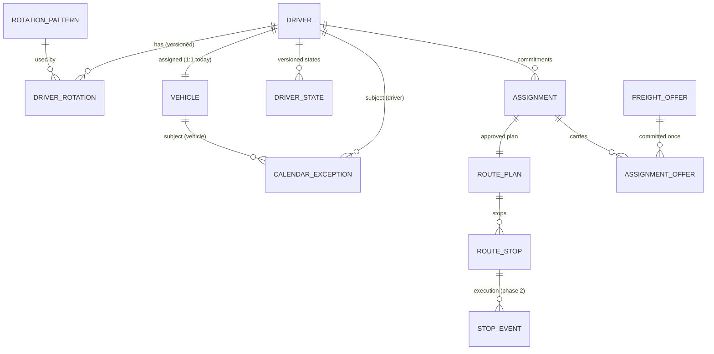
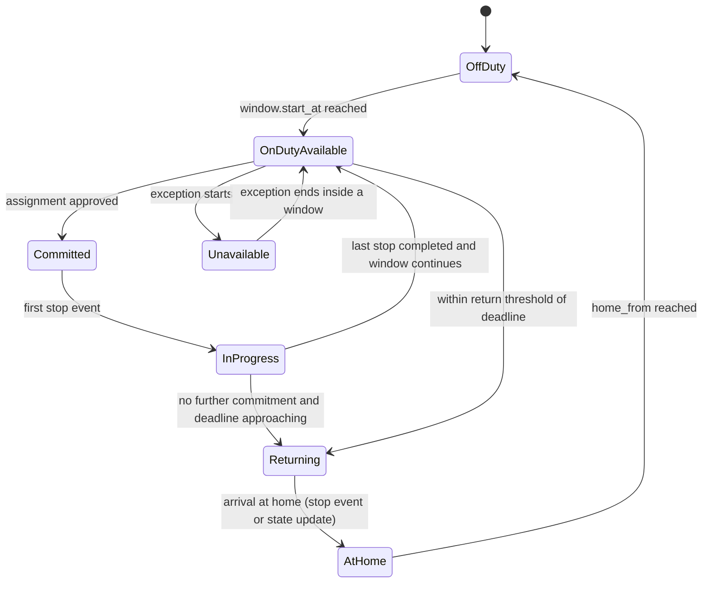
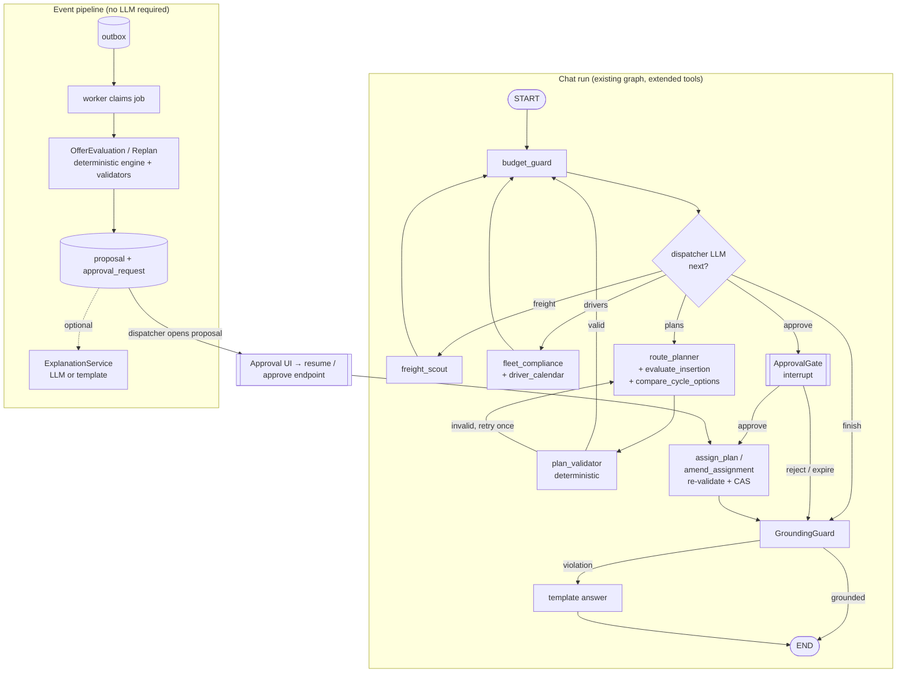
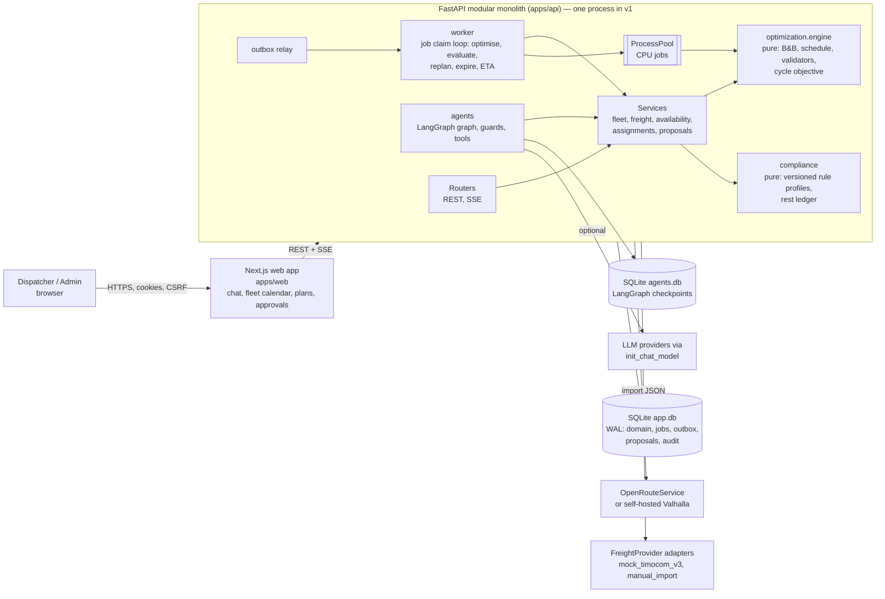
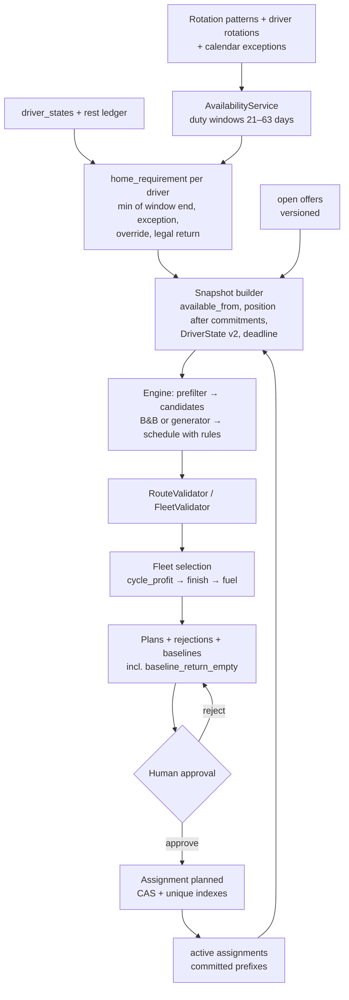
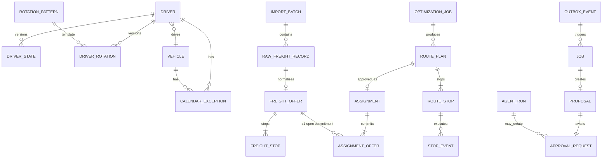

# Research: evolving RoutePilot AI into a driver-aware AI dispatcher

> **Status:** research note, 2026-11-17. It changes no specification, ADR, contract, migration or code. Every change it proposes needs a FEAT specification (and an ADR where `context.md` asks for one) and owner approval first. RoutePilot AI is an MVP with a deadline of 2026-11-15, later a portfolio project.
>
> **Repository state analysed:** branch `main`, commit `e9ac4fd71c6260842a3acb452c67b790744b8a55` (241 commits).
>
> **Data:** every RoutePilot figure in this note comes from the **synthetic** demo generators (`is_synthetic = true`). The worked examples use **illustrative assumptions**, not market data. Offers follow the structure of the TIMOCOM Freight Exchange API v3.0.6 payload; no real exchange data and no paid API are used or assumed.
>
> The work/driving/rest schedule is a planning estimate based on a simplified model of selected rules (Polish Act on Drivers' Working Time; Regulation (EC) No 561/2006). It does not certify legal compliance.

**Evidence tags used throughout**

| Tag | Meaning |
|---|---|
| **[CODE]** | Verified in the repository at the commit above (`path:line`; paths under `apps/api/src/routepilot/` unless they start with a top-level folder) |
| **[EXT]** | Verified in an external source listed in §15 |
| **[INF]** | Inferred from verified evidence |
| **[PROP]** | Proposed; does not exist |
| **[UNC]** | Uncertain or unverified; needs a check before it goes into a specification |

**How this note was made.** The repository was read directly (code, tests, migrations, specs, ADRs, benchmark files). Three read-only research passes ran in parallel: a repository audit, EU/Polish law and the freight market, and optimisation/agent/infrastructure options. The main decisions were then checked again in code (`schedule.py`, `search.py`, `fleet.py`, `snapshots.py`, `jobs/service/__init__.py`, `graph.py`, `rules.py`, migration `0001_initial.py`). No tests, benchmarks, LLM calls or network calls to TIMOCOM/ORS were run. EUR-Lex pages did not render for the research tool, so the EU texts were read from legislation.gov.uk copies of the Official Journal wording (§6.7).

---

## 1. Executive summary

**Where RoutePilot stands.** RoutePilot is not a design-phase project any more. It is a working modular monolith:
- 31 REST paths, 22 SQLite tables in one Alembic migration;
- an exact Branch-and-Bound engine with independent validators, golden cases and oracles;
- a LangGraph graph (Dispatcher + three specialists, four guards, one `interrupt()` before the only write);
- an EN/PL Next.js UI.

The strongest assets are its **discipline**: deterministic engine, validators separate from the search, versioned offers, snapshot hashing, grounding guard, approval interrupt and a large test suite. These should stay unchanged.

**What blocks the target product.** RoutePilot plans **one tour per driver inside a horizon of at most 7 days** (`optimization/jobs/domain/__init__.py:24-27`):
- It returns the driver home only when `home_by` falls inside that horizon (`optimization/engine/schedule.py:276-279`). Otherwise the plan ends wherever the last delivery is, at **no repositioning cost**.
- Weekly rest is **not scheduled**. It is an informational marker at the end of a home-returning plan (`schedule.py:310-316`).
- `last_weekly_rest_end` is stored but never reaches the engine (`optimization/jobs/snapshots.py:156-170`).
- A driver with an active assignment cannot receive another one (`jobs/service/__init__.py:828-834`), and an assignment never completes. So the product cannot add an offer to a route being driven.
- At default settings the 5-driver benchmark takes p50 158 s / p95 173 s and **every run is truncated** (`bench/results/fleet_5x60.json`, local run of 2026-11-15). After a truncated domestic pass the international pass is skipped silently (`optimization/engine/search.py:145-151`).

In short, RoutePilot optimises isolated short tours. The target product must optimise **driver work cycles**.

**The regulatory ground moved on 1 July 2026** [EXT]. Vans over 2.5 t in international transport or cabotage now fall under Regulation 561/2006 (Art. 2(1)(aa)) and need a G2V2 smart tachograph.
- The driver-return rule (Art. 8(8a): the driver must be able to return home or to the operational centre within every four consecutive weeks, about three after two consecutive reduced weekly rests) applies to these vans.
- The CJEU annulled only the eight-week **vehicle**-return rule (C-541/20 to C-555/20, 4 October 2024).
- Trade press reports international van prices up 35–80% after the change. Van drivers' legal hours are now a scarce, accumulating resource. That is exactly what multi-week, driver-aware planning manages and what the checked competitors do not (§3.5).

**Recommended direction.** Extend before replacing:
1. **Keep** the engine core, validators, LangGraph graph, guards, approval gate, provider ports, design system and test discipline.
2. **Add a strategic availability layer:** a small rotation and calendar model that *derives* availability windows and `home_by` deadlines and feeds the existing snapshot builder. No new solver is needed for this at first.
3. **Upgrade compliance** to a versioned `_v2` profile that knows the weekly-rest clock, reduced rests and compensation debt, and the four-week return deadline.
4. **Make plans cycle-aware:** price the way home (or to the next availability start) even when `home_by` is outside the tactical horizon.
5. **Add commitments and execution:** an assignment lifecycle, stop events, DB-enforced uniqueness, and incremental insertion that keeps approved stops fixed.
6. **Make larger fleets possible:** first fix the B&B's time budget and fleet DFS; then add OR-Tools Routing as a *candidate generator* behind a port, with the existing schedule builder and validators as the final judge. Adopt it only if the benchmark shows a gain.
7. **Let events trigger deterministic evaluation, not LLMs.** The LLM explains and coordinates; it never decides feasibility.

**The three highest-impact priorities**

| # | Priority | Why first |
|---|---|---|
| 1 | **Driver rotation and availability model + weekly-rest-aware compliance `_v2`** | Without it the product cannot express 14/7 or 21/7, cannot keep a return obligation beyond 7 days, and can plan past the latest legal start of a weekly rest |
| 2 | **Cycle-aware tactical planning** (always price the return; single `home_requirement()`; job-level time budget; both profile passes) | It turns today's "best isolated tour" into "best tour given where the driver must be next". This is the core business case (§5.6) |
| 3 | **Commitments and incremental insertion** (assignment lifecycle, unique constraints, staleness checks, insert-into-approved-route evaluation) | It is the foundation for dynamic offers, delays and replanning (scenarios 3, 4 and 6), and it closes a real double-assignment risk |

---

## 2. Existing repository audit

### 2.1 What exists and how it fits together [CODE]

| Area | Facts |
|---|---|
| Backend | `apps/api/src/routepilot/`, about 13.5k lines of Python 3.13. Modules `shared`, `identity`, `fleet`, `freight`, `routing`, `compliance`, `optimization.engine`, `optimization.jobs`, `agents`, `integrations`; boundaries enforced by import-linter |
| Frontend | `apps/web/src`: 195 TS/TSX files. Features `admin`, `agent-chat`, `auth`, `fleet`, `offers`, `optimizer`, `plans`. 802 i18n keys in EN and PL with full parity |
| Contract | `contracts/openapi.json`: 31 paths, among them CRUD for drivers, vehicles, cost profiles and offers; `drivers/{id}/state`; optimisation jobs and results; route plans and explanations; assignments; agent threads, runs, resume and SSE events; admin demo data |
| Database | one migration (`apps/api/migrations/versions/0001_initial.py`), 22 tables; LangGraph checkpoints in a separate `agents.db` |
| Agents | `langgraph==1.2.20`, `langgraph-checkpoint-sqlite==3.1.3`, `langchain==1.5.0` with Google, Anthropic and OpenAI adapters (`apps/api/pyproject.toml:10-16`) |
| Tests | backend `def test_*` counts: unit 143, agents 92, api 76, contract 44, security 26, db 23, integration 12, golden 11, props 9 (parametrised counts are higher). Web: 47 files, about 231 tests. E2E: 4 Playwright specs. Evals: 30 task and 10 injection scenarios |

### 2.2 Capability check against the expected feature list

| Expected capability | Verdict | Evidence |
|---|---|---|
| FastAPI backend, Next.js frontend, SQLite | ✅ works | `main.py`, `apps/web`, `shared/db/engine.py:17-19` (WAL, busy_timeout, FK) |
| LangGraph supervisor + Freight Scout, Fleet & Compliance, Route Planner | ✅ works (with a configured LLM) | `agents/graph.py:642-670` |
| Human approval | ✅ one `interrupt()` in `approval_gate`, outside try/except, idempotent by `interrupt_id` | `graph.py:451-530` |
| Deterministic B&B | ✅ exact DFS, per-driver node budget and wall-clock cut-off, top-K for 3 objectives | `optimization/engine/search.py:47-152` |
| Route and fleet validators | ✅ independent replay of the timeline, capacity, windows, costs and CO₂ | `optimization/engine/validators.py:91-420` |
| Freight consolidation | ✅ interleaved pickups and deliveries with 2-D capacity; partner-aware pool cut | `schedule.py:166-167`, `prefilter.py:96-132`, GOLD-001, GOLD-011 |
| Driver working time | ⚠️ partial: daily rules and 56/90 h limits; no weekly rest, reduced or split rests, 10 h extension or 4-week return | `compliance/rules.py`; §2.4 |
| Synthetic TIMOCOM-compatible offers | ✅ mock provider + tolerant mapper + provenance; ⚠️ the import runs only from admin demo-data generation | `integrations/timocom/mock.py:13-14`, `mapper.py:39-184`, `bootstrap.py:69` |
| Route and cost evaluation | ✅ fuel curve, tolls per km, driver hour cost, accommodation, domestic per diem; ⚠️ per diem is 0 on any foreign plan | `optimization/engine/costs.py:97-222` |

### 2.3 Optimiser, jobs and assignments: the details that drive the decisions

**Search (`optimization/engine/search.py`) [CODE].**
- Depth-first B&B over PICKUP/DELIVERY actions. The bound applies only once all three objectives hold K plans, and prunes only when a node is dominated on profit, finish time *and* fuel at once (`:70-92`).
- The wall-clock limit is **per driver**: `started_ms` is taken on each `search_driver` entry (`:57-58, 107-108`). A 5-driver job can therefore run about 5 × 30 s plus baselines and validation.
- The international `eu561` pass runs only `if not truncated` (`:145-151`). A truncated domestic pass silently drops every international plan for that driver.

**Schedule (`schedule.py`) [CODE].**
- `finish()` adds the home leg only if `home_by <= reference_time + horizon_days` (`:276-279`).
- The same test is repeated in `build_plan()` (`:393-396`), in `validators.py:105-109` and in `oracle.py:50-52`. These are four copies of one rule.

**Fleet assignment (`fleet.py:47-91`) [CODE].**
- An exact DFS over "no plan or one of the top-K" per driver, pruned on offer conflicts. Worst case is about ∏(Kᵢ + 1).
- An upper bound exists only for the profit objective.
- [INF] This is exact and fine for 5 drivers. It is not viable at 50.

**Jobs [CODE].**
- One asyncio loop feeds `ProcessPoolExecutor(max_workers=1)` with the `spawn` start method, so jobs run one at a time (`jobs/service/__init__.py:80-84, 279-322`).
- Heartbeat recovery, an idempotency key, and a full snapshot with its SHA-256 (`:130-185, 254-277`).
- There is no cancel endpoint.

**Snapshots [CODE].**
- The latest `driver_states` row per driver is used (`snapshots.py:63-71`).
- A driver without a state or a vehicle is skipped silently (`:82-83`).
- Only 2-stop offers are accepted (`:174-200`).
- The snapshot **ignores active assignments**, so already-committed drivers are optimised again.

**Assignments (`jobs/service/__init__.py:800-955`) [CODE].** The protection rests on four things:
- an in-process `threading.Lock`;
- an offer compare-and-set (`UPDATE … WHERE status='open' AND version=expected`, rowcount must be 1);
- one active assignment per driver;
- an offer-version check against the job snapshot.

Gaps:
1. The `assignments` table has only a non-unique index `(driver_id, status)` (`0001_initial.py:406-432`). The `IntegrityError → CONCURRENT_ASSIGNMENT` path (`:927-930`) can never fire. Uniqueness depends on a lock that holds only inside one process.
2. A new `driver_states` row written after the job is not checked at approval. A plan built on stale counters can be approved.
3. `cancel()` reopens offers **without bumping their version** (`:942`), so a stale plan for that offer can become assignable again.
4. Assignment status is `active | cancelled` only. Nothing completes, so a driver is blocked until cancellation.

### 2.4 Compliance today [CODE]

Both profiles are one class (`Eu561Rules(PlDomesticRules)` with `international=True`, `compliance/rules.py:56-60, 263-266`). Constants are hard-coded minutes.

| Rule | PL domestic (`pl_domestic_employee_v1`) | EU 561 van (`eu561_van_international_v1`) |
|---|---|---|
| Work break | 30 min after 6 h of work; +15 min top-up at 9 h | 45 min |
| Driving break | — | 45 min before 4 h 30 min of driving (no 15 + 30 split) |
| Daily driving | — | 9 h (no 10 h extension) |
| Daily work / span | 720 min parameter; 13 h span | 13 h span |
| Daily rest | always 11 h (no 9 h reduced rest, no 3 + 9 split) | same |
| Weekly work | 60 h | 60 h |
| Weekly / fortnightly driving | — | 56 h / 90 h |
| Weekly rest | **not modelled**. Monday 00:00 in the home time zone resets the week counters (`rules.py:24-53`) | same |
| 6 × 24 h weekly-rest clock, 45/24 h, compensation, 4-week return, 48 h average, night work, ferry/train | not modelled | not modelled |

`DriverState` (`compliance/models.py:15-27`) holds today's counters, one previous week of driving, `day_start_at`, `sleeper_cab` and `home_timezone`.
- It has no weekly-rest history.
- It has no compensation debt.
- It has no record of the last weekly rest *at home*.

### 2.5 Agents today [CODE]

- **Graph.** START → `budget_guard` → `dispatcher` (LLM decides `next`) → specialist → `budget_guard` …; `route_planner` → `plan_validator` (one retry) → `approve` (interrupt) → `finish` (GroundingGuard) or `template` (`graph.py:642-670`, `schemas.py:24`).
- **Tools.**
  - Read tools are allowlisted per role (`agents/tools/registry.py:132-156`).
  - `assign_plan` has `roles=()` and runs only from the ApprovalGate (`:682-695`).
  - The optimise tools pass **no horizon or parameters**, so the agent always uses the defaults (`:496-541`). Their job wait is a hard 60 s (`:467`).
- **Triggers.** Runs start **only** from chat (`agents/service.py:131-189, 231-263`). There is no event, schedule or background run. Approval expiry is lazy (`service.py:265-291`). Nothing recovers a run that was `running` at a crash [INF].
- **Budgets.** 25 steps, 6 tool calls per role, 120 s, 60k tokens per run (`shared/config.py:40-46`). `evals/README.md` reports that live models need 300 s / 40 steps to reach approval. The development log (P13) measured 50,000–76,000 tokens per complete run.
- **Quality.** Prompts v2 reach 27/30 task success, with 0 write-policy violations and 0/10 injections followed (`evals/README.md`).
- **The `edit` decision.** It exists in the approval schema but behaves like reject (`schemas.py:169`, `graph.py:524-527`).

### 2.6 Freight, routing and frontend [CODE]

**Freight.**
- Ports `FreightProvider` and `OfferMapper` (`freight/ports.py:14-24`). Only the mock provider exists.
- Import deduplicates by raw-payload SHA-256 and bumps `version` on change (`freight/service/imports.py:38-104`).
- Status `expired` and `retention_until` exist but nothing sets or reads them.
- Manual offers have optimistic versioning (`freight/service/offers.py:205-275`).

**Routing.**
- The chain is the repository matrix, then ORS (if a key is set), then haversine (`routing/composite.py:32-45`).
- The committed matrix is itself `haversine_v1` over 605 cities.
- ORS uses `driving-car` and refuses matrices over 3,500 cells (`routing/ors.py:59, 151-152`).
- No time dependence.

**Frontend.**
- The only timeline is a single-plan segment bar (`apps/web/src/features/plans/timeline.tsx:15-30`).
- No fleet Gantt, calendar or assignments list.

### 2.7 Measured performance (synthetic, local machine) [CODE]

| Run | Settings | Runtime | Truncated | Fill and empty km | Home before `home_by` |
|---|---|---|---|---|---|
| `docs/metrics.md` (committed, 2026-11-15) | 5 drivers, 150 offers, horizon 2 d, ≤3 offers, top 5 | p50 5.3 s, p95 5.4 s | 0/20 | EP·km 44.1%, empty km 22.3%, 3/5 plans with ≥2 on board | **0%** (the horizon does not reach `home_by`) |
| `bench/results/fleet_5x60.json` (local, untracked) | defaults: 5 d, ≤6 offers, top 10, pool 60 | p50 158.0 s, p95 172.9 s | **20/20** | EP·km 40.4%, empty km 39.7% | not reported |
| `bench/results/fleet_5x60_fallback.json` (local) | 3 d, ≤4, top 5 | p50 19.2 s, p95 80.2 s | 2/20 | — | — |

Fleet profit of the `profit` solution beats `baseline_single` by +38.8% and `baseline_greedy` by +15.6% (`docs/metrics.md`). The NFR-002 target (p95 ≤ 15 s at defaults) is **not met**. The README says so.

### 2.8 Answers to the ten audit questions

1. **Works end to end:**
   - fleet and offer CRUD with optimistic versions and audit;
   - synthetic import through the TIMOCOM-shaped mapper;
   - async optimisation job → B&B → exact fleet assignment → independent validation → stored plans;
   - the plan screen;
   - agent chat → specialists → validator → approval interrupt → atomic assignment → grounded answer;
   - the manual (no-AI) optimiser;
   - EN/PL.
2. **Partially implemented:**
   - runtime at defaults;
   - the agent path at default budgets;
   - weekly rest (a marker only);
   - per diem abroad;
   - ORS (car profile only);
   - the `edit` decision;
   - approval expiry;
   - the assignment lifecycle.
3. **Documented only:** offer expiry; split breaks; ferry/train; a real exchange adapter; FEAT-008 road alternatives (draft); PostgreSQL/VPS (ADR-0002, ADR-0007).
4. **Synthetic only:** all offers and tariffs, the fleet (uniform Friday 18:00 `home_by`), cost parameters, the haversine matrix, all benchmarks and evals.
5. **Hard to extend:**
   - the boolean-switched rule class with hard-coded constants;
   - the single-tour `ScheduleBuilder`;
   - four copies of the home-return rule;
   - exact fleet DFS;
   - tool defaults coupled to `JobParams`.
6. **Could block scaling:**
   - the per-driver time limit;
   - fleet DFS that grows exponentially with the number of drivers;
   - one sequential, uncancellable worker;
   - a process lock instead of DB constraints;
   - a static haversine matrix and the ORS 3,500-cell cap;
   - agent tool caps of 20 drivers.
7. **Reusable unchanged:**
   - `TravelMatrix` and the routing chain;
   - the prefilter and pallet equivalents;
   - `CostModel`;
   - `RouteValidator`/`FleetValidator`;
   - snapshot hashing;
   - import, dedup and versioning;
   - mapper provenance;
   - GroundingGuard, BudgetGuard and the ApprovalGate pattern;
   - the tool allowlist mechanism;
   - audit events;
   - the design system and i18n.
8. **Needs to evolve:** `DriverState`, the compliance profiles, the schedule builder's end condition, the snapshot builder, the assignment lifecycle, agent triggers, the horizon cap.
9. **Must stay deterministic:** everything that decides feasibility, cost, profit, capacity, legal limits, assignment conflicts and ranking. It already is.
10. **Missing and needed for production:**
    - rotations and calendars;
    - weekly-rest scheduling;
    - cycle-aware objectives;
    - execution tracking;
    - event-triggered evaluation and insertion;
    - offer expiry;
    - DB-enforced assignment integrity;
    - job cancel;
    - agent-run recovery;
    - multi-stop offers (later).

### 2.9 Implementation maturity matrix

| Component | Current functionality | Evidence | Gap | Recommended action | Priority |
|---|---|---|---|---|---|
| Planning horizon | 1–7 d (default 5); offers cut by pickup-window start | `jobs/domain/__init__.py:24-27`, `prefilter.py:75-78` | No multi-week view | [PROP] Strategic availability layer feeds 1–7 d tactical runs (§5) | P0 |
| `home_by` | Single timestamp per state row; home leg only if inside the horizon | `snapshots.py:124`, `schedule.py:276-288` | No return cost beyond the horizon; four copies of the rule | [PROP] One `home_requirement()` fed by the rotation; terminal return cost (§7.4) | P0 |
| Weekly rest | Counter reset at Monday; informational marker | `rules.py:24-53`, `schedule.py:310-316` | 6 × 24 h clock, 45/24 h, compensation not modelled | [PROP] Compliance `_v2` (§6.3) | P0 |
| `DriverState` | 12 counters | `compliance/models.py:15-27` | `last_weekly_rest_end` dropped; no rest ledger | [PROP] Extend the state and snapshot mapping | P0 |
| Availability | `available_from` only | `snapshots.py:116` | No rotation, leave or exceptions | [PROP] Rotation and calendar model (§5) | P0 |
| B&B search | Exact, node and time budgets | `search.py:47-152` | Per-driver time limit; truncated domestic pass skips 561; 158 s at defaults | [PROP] Job-level deadline, run both passes, label dominance (I1) | P0 |
| Fleet assignment | Exact conflict DFS | `fleet.py:47-91` | Exponential in drivers | [PROP] Set-packing on CP-SAT or a bounded search, DFS kept as oracle | P1 |
| Assignments | Lock + offer CAS + one active per driver | `jobs/service/__init__.py:805-930` | No DB uniqueness; stale driver state; cancel leaves offer version; no completion | [PROP] Lifecycle + partial unique indexes + state-version check (§8.6) | P0 |
| Jobs worker | 1 process, sequential | `jobs/service/__init__.py:80-84` | No cancel or priority; one job kind | [PROP] Job kinds, priority, cancel, outbox (§9.3) | P1 |
| Agents | Chat-only supervisor + interrupt | `graph.py`, `service.py:131-189` | No event entry; no recovery; budgets too tight for live runs | [PROP] Deterministic event pipeline + optional explanation run (§8) | P1 |
| Agent tools | Fixed defaults, 60 s wait | `registry.py:467, 496-541` | No horizon or driver scoping | [PROP] Bounded parameters; async job handles | P1 |
| Compliance profiles | Daily rules, 56/90 h, 60 h | `rules.py:63-246` | Reduced/split rests, 10 h, weekly rest, 48 h average, night | [PROP] `_v2` profiles with a rule table; keep `_v1` for golden replay | P0/P1 |
| Costs | Fuel, tolls, driver, accommodation, domestic per diem | `costs.py:97-222` | Per diem abroad; weekly-rest accommodation | [PROP] Country per diem table; weekly-rest cost | P2 |
| Routing | Haversine file → ORS car → haversine | `routing/composite.py:32-45` | No time dependence or restrictions | [PROP] Keep; optional Valhalla adapter later (§9.5) | P2 |
| Offers | Import, versioning, manual CRUD | `imports.py:38-104` | No expiry; 2-stop only; no import endpoint | [PROP] Expiry job; manual JSON import with the same mapper | P1 |
| Frontend | Chat, trace, approval, plan map and timeline | `features/plans/*` | No fleet calendar or Gantt | [PROP] Cockpit views (§9.6) | P1 |
| Validators | Independent replay | `validators.py:1, 8-13` | Shares limit constants with `rules.py` | [PROP] Validator reads the versioned rule table, not rule code | P2 |

### 2.10 Documentation inconsistencies found (report only, not fixed)

1. `context.md:4` still says "implementation has not started". `AGENTS.md` §3 marks `apps/api`, `apps/web`, `contracts/`, Makefile commands and workflows as *(planned)*. `DEVELOPMENT.md` still says "design phase" in several places. All of these exist.
2. `context.md:105-106` describes a weekly rest ≥ 35 h (PL) and "weekly rest at base". The code enforces no weekly rest.
3. `context.md:77` lists the end of the last weekly rest as part of `DriverState`. It is persisted but never used by the engine.
4. `context.md:108` ("the plan ends at base before `home_by`") holds only when `home_by` is inside the horizon. `docs/metrics.md` shows 0% home returns at a 2-day horizon.
5. `context.md:254, 287` present the 30 s safety and the 120 s / 25-step budgets as defaults. In practice the 30 s limit is per driver, and live agent runs need 300 s / 40 steps (`evals/README.md`).
6. The `IntegrityError → CONCURRENT_ASSIGNMENT` handler has no constraint that can raise it.
7. The `edit` approval decision is a reject in practice.
8. `validators.py:1` claims independence from the scheduler, but it shares limit definitions with `compliance/rules.py`. That is independence from the search, not from the rule constants.
9. **Possible legal over-constraint to review** [EXT/INF]. Polish Act art. 22 (Dz.U. 2026 poz. 477) exempts drivers of vehicles ≤ 3.5 t in domestic transport from art. 12 ust. 2–3 (the 60 h weekly cap), art. 13 (breaks after 6 h) and art. 21 (night work). Yet `pl_domestic_employee_v1` applies the 6 h break and the 60 h cap. Being conservative is acceptable for a planning estimate, but `context.md` rule 7 attributes these rules to the Act for vans. A lawyer should confirm, and the profile documentation should say "conservative assumption" rather than "the Act requires".
10. The 561 week runs from Monday 00:00 to Sunday 24:00 (Art. 4(i)). The code uses the driver's home time zone for that boundary (`rules.py:24-28`), while tachographs record in UTC [UNC]. Which time base an inspector applies needs checking.

---

## 3. European freight market analysis

### 3.1 Operating models

| Model | How freight moves | European pricing basis | RoutePilot relevance |
|---|---|---|---|
| **Direct LTL / partial loads** (*doładunki*) | One van collects several independent consignments and delivers them with no hub: multi-pick, multi-drop, one routing | Per pallet place, load length or a negotiated lump sum per job; for vans rarely per LDM [INF] | **Primary.** The engine already interleaves pickups and deliveries (GOLD-001) |
| **Network groupage / pallet networks** | Local collection → hub cross-dock → line haul → hub → local delivery; standard pallet tariffs | Per pallet by size and weight class, or chargeable weight via LDM (1 EUR pallet = 0.4 LDM on a 2.4 m trailer; 1 LDM ≈ 1,750–1,850 kg, varying by operator) [EXT, secondary] | Not targeted; the hub model is a different problem (network design) |
| **PTL** | Large part load, 1–2 stops, priced close to FTL | LDM or a share of FTL | Supported as a large LTL offer |
| **FTL** | One shipper, whole vehicle, point to point | €/km or lump sum per lane | Supported as an offer that fills the van; heavier vehicles later (phase 3, §11) |
| **Multi-stop** | One order with several stops | Lump sum or €/km + stop charge | ⚠️ Snapshots accept only 2-stop offers (`snapshots.py:174-200`) |
| **Backhaul** | Return load toward base | Often priced below the outbound leg to avoid an empty return | Critical for home-return cycles (§5.6) |
| **Express van ("bus" ≤ 3.5 t)** | A dedicated van, door to door, often overnight across the EU | €/km for the whole van or a lump sum + urgency surcharge | Overlaps FTL-for-vans. Hit hardest by the 1 July 2026 rules: the press reports a single-driver 1,500 km trip went from about 27.5 h to over 42 h [EXT, secondary] |

US NMFC class pricing is not used in Europe. It must not be imported into the tariff model [EXT].

### 3.2 Market structure and the 2026 shock

- **Empty running** [EXT]. Eurostat reports 21.8% empty vehicle-km for EU road freight in 2025 (national 26.0%, international 12.9%). These surveys cover heavy goods vehicles; small goods vehicles are excluded (verified for Spain's metadata, inferred EU-wide). **No official empty-km statistic for vans was found.**
- **Van regulation shock** [EXT, Trans.info citing the German courier association BdKEP, 7 Sep 2026]:
  - international van prices rose 35–80% after an initial spike of 100–200%;
  - about 40,000 Polish vans are affected;
  - a retrofit costs about €3,500–4,700 per vehicle;
  - a mid-May survey found 46.5% of firms unprepared.
- **Unknowns.** No authoritative 2025–2026 van cost per km or van €/km rate index was found. All cost and price numbers in this note stay **assumptions** (they match `docs/report.md` §17.4 and the FEAT-010 tariff).

### 3.3 Economics of direct LTL

The economic unit is the **cycle**, not the order: leave home → consignments and backhauls → home before the rotation's home period [INF].

- **Marginal profit of a consignment.**
  - The formula is ΔProfit = revenue − Δkm × variable €/km − Δtolls − Δ(driver hours) × hour cost − Δaccommodation − knock-on cost [INF].
  - The **knock-on cost** is the change in the cost of reaching the next obligation: the way home, the next weekly rest, the start of the next availability window. RoutePilot's engine ignores it whenever `home_by` is outside the horizon (`schedule.py:276-279`).
- **Fill.** A van earns only while several consignments are on board (`docs/raport.md` §1). Measured fill is about 40% over all km and 56% on loaded km (`docs/development-log.md` P5). Empty km come mainly from the first deadhead leg and the drive home.
- **Driver hours as a resource** [INF from §6]. Weekly driving (56 h), fortnightly driving (90 h), weekly-rest timing and compensation debt are consumed by every plan. A plan that burns the last 9 h of weekly driving far from home makes the next plan expensive.
- **Opportunity cost.** Accepting an offer now blocks the van for its duration. A better offer may arrive later. [INF] With synthetic data the arrival process is known; with real data it is not. RoutePilot should express this as a *recommendation with a reason* ("keep 4 h of driving for a likely backhaul from Lyon"), not as a hidden expected-value term. Its value cannot be validated without real data.

**Why isolated optimisation loses:** see the worked 14/7 case in §5.6. The best isolated offer (A) is the worst cycle choice.

### 3.4 Real dispatcher workflow and automation boundary

**D** = deterministic, **AI** = AI-assisted suggestion, **HA** = proposed and human-approved, **H** = human only.

| # | Step | Class | RoutePilot today | Target |
|---|---|---|---|---|
| 1 | Evaluate drivers and vehicles | D | `driver_availability`, counters | + rotation windows, rest ledger, return deadline |
| 2 | Search for freight | AI (ranking), H (exchange use) | synthetic search + agent | provider-independent intake (§8.7); no scraping |
| 3 | Qualify counterparties and offers | AI + H | `offer_quality`, completeness, `SUSPICIOUS_TEXT` | counterparty fields stay human-entered; never invented |
| 4 | Calculate profitability | D | `CostModel` | + cycle-aware return cost (§7.4) |
| 5 | Identify compatible partial loads | D | partner-aware pool, interleaving | + insertion into committed routes |
| 6 | Build multi-stop routes | D | B&B | + candidate generator for larger fleets |
| 7 | Negotiate and confirm | AI (draft), HA (commit) | — | message drafts only; no sending without approval |
| 8 | Track pickup and delivery | D | — | stop events, ETA from schedule replay |
| 9 | Handle delays and cancellations | AI + HA | — | deterministic impact analysis + recovery proposal |
| 10 | Find return loads | D + AI + HA | GOLD-008 (chain home) | backhaul search ranked by cycle value |
| 11 | Organise driver returns | D + HA | `home_by` in horizon | rotation-derived deadlines, 4-week return ledger |
| 12 | Close and document | D (generate), H (sign) | — | transport order / CMR data export later; eFTI readiness |

Steps 1, 4, 5, 6, 8 and the feasibility parts of 9–11 are deterministic engine work. The LLM's value is in steps 2 (interpreting requests), 7 (drafting) and 9–11 (explaining options and trade-offs).

### 3.5 Competitor landscape (features as published; nothing here is tested)

| Product | Confirmed features | AI | Automation boundary | Target | Gap relevant to RoutePilot |
|---|---|---|---|---|---|
| **Trans.eu** (PL) | Freight exchange, TMS/ERP API, messenger with translation | AI Negotiation Assistant (load availability near unloading, rate forecasts); Best Route Assistant (profit or loss per offer); fraud anomaly detection | Suggestions; carrier decides | Carriers, forwarders, shippers | Single-offer view; no driver working time or rotation seen |
| **TIMOCOM** (DE) | Freight marketplace, transport orders, Routes & Costs | AI freight entry from PDF or email; AI negotiation assistant shown at IAA 2026 | Data entry, first contact | Carriers, forwarders | No driver-hours or multi-week planning seen |
| **Teleroute / Alpega** | Freight exchange, payment guarantee, transport execution | Load recommendation engine | Recommendations | Carriers, LSPs | Exchange-centric |
| **Transporeon** (Trimble) | Procurement, spot marketplace | Natural-language search (Apr 2026, vendor claims) | Search; carrier accepts | Shipper networks | Shipper-side |
| **project44** | Visibility, iTMS | AI agent portfolio; procurement agent (2026) | Agentic execution claims | Shippers, LSPs | Shipper and enterprise side |
| **PTV xServer / Developer** | Routing and tour optimisation with an EU driving-time module | — | Engine/API | Integrators | Its own docs: weekly rules "not supported" in xTour; tours up to 6 days; no weekly-rest scheduling |
| **OptimoRoute** | Route planning, weekly planning add-on | — | Optimiser | Field service, last mile | No EU driver-hours feature listed; published price $35.10 / $44.10 per driver per month (billed annually) |
| **Qargo** (UK/EU) | Cloud TMS, groupage route optimisation, invoicing | AI order intake; its own post says planning boards are "not AI-powered yet" | Order intake | Hauliers, 3PLs | No multi-week driver rotation seen |
| **fireTMS** (PL) | Vehicle and driver schedule, route profitability, GPS integrations, exchange integrations, KSeF, per diems | none seen | Human-driven TMS | Polish transport firms | No working-time optimisation seen |
| **HappyRobot, Vooma** (US) | Voice and email agents for brokers | Agentic communications | Communications | US brokers | Not planning; US workflows |

Products that could not be verified (Descartes, Routific, Route4Me, Uber Freight EU, Einride, several Polish TMS names) are left out on purpose.

### 3.6 Differentiation opportunities [INF]

1. **Driver-aware multi-week planning.** A rest ledger (6 × 24 h weekly-rest clock, reduced-rest count, compensation debt, 56/90 h, 4-week return) checked on every plan. PTV states that it does not schedule weekly rests; exchanges and the checked TMSs show no such feature.
2. **Home-return optimisation.** Rank freight by how it moves the van toward the next obligation. Show the cost of the empty run home.
3. **Van-specific consolidation.** Pallet places and kg on narrow van floors, multi-stop sequencing with 561 breaks.
4. **Explainable, grounded decisions.** "Rejected: arrives home Saturday 02:10, after the home period starts Friday 18:00." RoutePilot already has the GroundingGuard and template explanations for this.
5. **Human-controlled automation as a compliance asset.** Objective inputs only, no behavioural driver scoring, human approval of every commitment. This also supports a not-high-risk position under the EU AI Act (§6.6).

---

## 4. Product gap analysis

| Gap | Class | Business benefit | Depends on |
|---|---|---|---|
| Rotation patterns, calendar exceptions, derived availability windows | **Critical** | Plans that respect 14/7, 21/7, Mon–Fri and leave | — |
| Weekly-rest-aware compliance `_v2` (6 × 24 h clock, 45/24 h, compensation, 4-week return warnings) | **Critical** | Prevents plans that run past the legal latest start of a weekly rest | — |
| Cycle-aware objective (return cost always priced) | **Critical** | Avoids "profitable" plans that strand the van | rotation, `home_requirement()` |
| Assignment integrity (DB uniqueness, staleness, cancel bumps version) | **Critical** | Removes double-commitment risk | — |
| Engine reliability (job-level deadline, both passes) | **Critical** | Predictable runtime; no silent loss of international plans | — |
| Assignment lifecycle + stop events (planned → in progress → completed) | **High-value** | Continuous planning; a driver can get the next assignment | integrity |
| Incremental insertion into committed routes | **High-value** | Scenario 3: dynamic offers | lifecycle |
| Delay impact and recovery proposal | **High-value** | Scenario 4 | lifecycle, stop events |
| Event-triggered deterministic evaluation (offer created/changed, delay) | **High-value** | Proactive dispatcher | outbox, job kinds |
| Fleet calendar / Gantt, rotation editor, return-deadline view | **High-value** | Makes the strategic layer usable | rotation API |
| Offer expiry, manual JSON import through the same mapper | Medium | Data hygiene; real-world input without a paid API | — |
| Larger-fleet tactical solver (OR-Tools candidate generator) | Medium (High at ≥ 20 vans) | Scenario 9 | benchmark harness |
| Agent tool parameters (horizon, driver subset), cheaper runs | Medium | Live agent usability (P13) | — |
| Foreign per diem, weekly-rest accommodation cost | Medium | Cost realism | compliance `_v2` |
| Multi-stop offers | Medium | PTL and multi-drop orders | engine change |
| Driver messaging, documents (transport order, CMR data, eFTI) | Future | Closes the order lifecycle | lifecycle |
| PostgreSQL, separate worker process, VPS | Future | Multi-user production | ADR-0002, ADR-0007 |
| Heavier vehicles, trailers, other bodies, multi-manning | Future | Market expansion | vehicle-class rule profiles |
| Telematics or tachograph ingest | Future | Actual counters instead of entered ones | GDPR review |
| Stochastic or anticipatory planning | Future | Better acceptance decisions | real historical data |

---

## 5. Driver rotation architecture (RFC)

> RFC status: **proposal** for a future FEAT specification (suggested id FEAT-011). Everything in this section is **[PROP]** unless tagged otherwise.

### 5.1 Goal, non-goals, and the one distinction that matters

**Goal.** A dispatcher can describe each driver's working pattern: 14/7, 21/7, 28/7, Monday–Friday, a custom cycle, plus leave and other exceptions. The planner then:
- knows **when** a driver is on duty;
- knows **where and by when** they must be back;
- knows **how much legal driving and working time** remains;
- plans freight so the obligations hold, and explains why an offer does not fit.

**Rotation ≠ legal permission.** A rotation pattern is an **operational or contractual availability rule**. It never grants driving time.
- During a 14-day duty period every legal limit still applies: daily and weekly driving, daily and weekly rest, the 6 × 24 h weekly-rest clock, compensation, the four-week return.
- The compliance engine (§6) is the only authority on legal limits. The rotation only bounds *when* a driver may be planned and *where they must end*.
- A pattern that cannot coexist with the legal four-week return is flagged at the pattern level (§5.9, V-4).

**Non-goals for the first version:**
- automatic generation of rotations;
- driver preferences as optimisation inputs (AI Act risk, §6.6);
- multi-manning;
- handover of a vehicle between drivers (designed in §5.11, built in phase 3);
- payroll.

### 5.2 Entity assessment (keep the domain small)

| Candidate concept | Decision | Reason |
|---|---|---|
| `RotationPattern` | **Table** (`rotation_patterns`) | A reusable template (14/7 is shared by many drivers); versioned |
| `DriverRotation` (driver ↔ pattern, anchor, validity) | **Table** (`driver_rotations`) | Each driver's own anchor date and validity; history is needed for audit and replay |
| `CalendarException` | **One table** (`calendar_exceptions`) with `subject_type ∈ {driver, vehicle}` | Leave, unavailability, training, extra duty, vehicle service. One table covers drivers *and* vehicles, so no separate `VehicleAvailability` is needed |
| `DriverAvailability` / `DutyWindow` | **Derived, not stored** | A pure function of pattern + anchor + exceptions + time zone; storing it would duplicate truth |
| `DriverHomeBase` | **Existing** `drivers.home_*` columns [CODE `fleet/domain/models.py:137-158`] | Already there; add an optional `operational_centre` later if it differs from home |
| `DriverReturnObligation` | **Derived** (`HomeRequirement` value object) | Computed from the duty window, exceptions, manual override and the legal return ledger |
| `DriverRestPeriod` / rest ledger | **Extend `driver_states`** + compliance `DriverState` | Weekly-rest facts belong to compliance state (§6.3), not to the calendar |
| `DriverAssignment` | **Existing** `assignments`, extended with a lifecycle (§8.6) | Do not duplicate |
| `VehicleAvailability` | **Covered by** `calendar_exceptions(subject_type='vehicle')` | Vehicles are 1:1 with drivers in the demo |
| `DriverHandover` | **Deferred** (phase 3) | Needs vehicle pools and multi-driver plans |
| Driver preferences | **Deferred** | AI Act Annex III 4(b) and GDPR risk; only objective inputs in v1 |

The result is **3 new tables**, a few new `driver_states` columns and **2 pure value objects**.

### 5.3 Entities and relationships



Derived at run time (not tables): `DutyWindow`, `HomeRequirement` and `RestLedger` (computed from `driver_states`).

### 5.4 Example schemas

**Pattern (Pydantic, `fleet/domain/rotation.py`, pure):**

```python
class RotationSegment(Schema):
    kind: Literal["on", "off"]
    days: int = Field(ge=1, le=42)

class RotationPattern(Schema):
    id: UUID
    name: str                                  # "14/7", "Mon–Fri", ...
    segments: list[RotationSegment]            # cycle, e.g. [on 14, off 7]; Mon–Fri = [on 5, off 2]
    duty_start_local: time = time(6, 0)        # first duty day starts at this local time
    home_from_local: time = time(18, 0)        # home period starts at this local time on the last "on" day
    return_buffer_min: int = Field(default=0, ge=0, le=720)  # planned slack before home_from
    version: int

class DriverRotation(Schema):
    id: UUID
    driver_id: UUID
    pattern_id: UUID
    pattern_version: int
    anchor_date: date                          # local date (home time zone) of the first "on" day of cycle 0
    valid_from: AwareDatetime
    valid_to: AwareDatetime | None
    version: int

class CalendarException(Schema):
    id: UUID
    subject_type: Literal["driver", "vehicle"]
    subject_id: UUID
    kind: Literal["leave", "unavailable", "training", "extra_duty", "vehicle_service", "home_by_override"]
    start_at: AwareDatetime
    end_at: AwareDatetime
    note_code: str | None = None               # enum-like code only; no free text, no health data
    version: int
```

`unavailable` deliberately covers sickness **without** a reason. Health data is a special category under GDPR, so the planner does not need to know why.

**Derived value objects (pure):**

```python
class DutyWindow(Schema):
    driver_id: UUID
    start_at: AwareDatetime                    # UTC
    end_at: AwareDatetime                      # home_from − return_buffer, UTC
    home_from: AwareDatetime                   # start of the home period
    source: Literal["rotation", "extra_duty", "legacy_state"]
    pattern_ref: str | None                    # "pattern_id@version"
    clipped_by: list[str]                      # exception ids that shortened it

class HomeRequirement(Schema):
    deadline: AwareDatetime
    point: Point                               # home base (or operational centre later)
    kind: Literal["rotation_end", "exception", "manual_override", "legal_return"]
    hard: bool                                 # True for all kinds in v1
    explain_code: str                          # e.g. "HOME_PERIOD_STARTS"
```

**Tables (Alembic, SQLite-portable; follows `context.md` Data Model rules):**
- `rotation_patterns(id TEXT PK, name, segments JSON, duty_start_local TEXT, home_from_local TEXT, return_buffer_min INT, version INT, created_at, updated_at, deleted_at)`
- `driver_rotations(id TEXT PK, driver_id FK, pattern_id FK, pattern_version INT, anchor_date TEXT, valid_from, valid_to, version, created_at)`
  - Unique `(driver_id, valid_from)`.
  - No overlapping validity per driver; enforced in the service and checked in a DB test.
- `calendar_exceptions(id TEXT PK, subject_type TEXT CHECK, subject_id TEXT, kind TEXT CHECK, start_at, end_at, note_code, version, created_at, updated_at, deleted_at)`
  - Index `(subject_type, subject_id, start_at)`.
- `driver_states` new columns (§6.3):
  - `last_regular_weekly_rest_end`
  - `last_home_weekly_rest_end`
  - `reduced_weekly_rests` JSON (week, deficit_min, due_by)
  - `reduced_daily_rests_since_weekly INT`
  - `extended_driving_days_this_week INT`

### 5.5 Recurrence calculation (pure, deterministic)

```text
windows(rotation, pattern, exceptions, tz, from_utc, to_utc):
  L = Σ segment.days                      # cycle length in days
  for each cycle k where the cycle overlaps [from, to]:
    day = anchor_date + k·L                 # local dates in the home time zone
    for each segment s in pattern.segments:
      if s.kind == "on":
        start = local(day, duty_start_local, tz) → UTC
        home_from = local(day + s.days − 1, home_from_local, tz) → UTC
        emit DutyWindow(start, home_from − return_buffer, home_from)
      day += s.days
  apply exceptions in a fixed order:
    1. extra_duty adds a window (or extends one)
    2. leave / unavailable / training subtract time from windows (splitting them)
    3. home_by_override caps end_at
  drop windows shorter than MIN_WINDOW_MIN (assumption: 120)
  sort by start_at, then id
```

**Rules:**
1. Local dates and times are converted with `zoneinfo` in the driver's home zone. DST gaps and folds use the `fold=0` rule, and both cases have tests.
2. The calculation uses only its inputs (injected `Clock` for "now"; `context.md` rule 2).
3. Results are cached per `(rotation.version, pattern.version, exceptions digest)` if ever needed. They are not stored.
4. **Legacy fallback.** A driver without a rotation gets exactly today's behaviour: one window `[state.available_from, state.home_by]` with `source="legacy_state"`. All current golden cases, property tests and evals stay valid.

**Example.**
- 14/7 anchored on Monday 2026-11-02 with home time `18:00` gives duty 2026-11-02 06:00 → home from Sunday 2026-11-15 18:00 (local).
- The next duty starts Monday 2026-11-23 06:00.
- Mon–Fri `[on 5, off 2]` anchored on any Monday reproduces the current default "Friday 18:00" (`fleet/generator.py:61-66` [CODE]).

### 5.6 Mandatory 14/7 scenario: cycle-aware decision

> **All numbers below are illustrative assumptions**, built from the demo cost parameters:
> - driver cost €14/h, i.e. `driver_cost_minor_per_hour=1400`, and accommodation €55, i.e. `accommodation_minor=5500` (`optimization/engine/models.py:55-66` [CODE]);
> - a composite variable cost of €0.40/km (fuel + vehicle + tolls);
> - 65 km/h average.
>
> They are not market prices.

**Situation.**
- Driver D (home Katowice, PL) is on a 14/7 rotation and is on duty day 11.
- The home period starts **Saturday 18:00**; the return buffer is 2 h, so `HomeRequirement.deadline` = Saturday 16:00.
- Now: **Thursday 08:00**, the van is empty in Munich (DE), profile `eu561_van_international_v1`.
- Remaining driving: this week 56 − 36 = 20 h; fortnight 90 − 36 − 36 = 18 h, so **18 h is binding**.
- Daily limit 9 h. No sleeper cab, so a night away means accommodation.

**Offers:**

| Offer | Lane | Size | Revenue | Note |
|---|---|---|---|---|
| A | Munich → Madrid | full van | €1,900 | moves away from home |
| B | Munich → Wrocław | 5 EP, 900 kg | €650 | toward home |
| C | Nuremberg → Opole | 3 EP, 300 kg | €380 | on B's corridor, pickup window Thu 12:00–14:00 |

**Deterministic evaluation (what the engine should output):**

| Option | km | Drive h | Revenue | Cost | **Isolated profit** (today's view, ends at the last drop) | **Cycle profit** (ends home by deadline) | Home ETA | Feasibility | Empty km |
|---|---|---|---|---|---|---|---|---|---|
| Return empty | 800 | 12.3 | €0 | €547 | — | **−€547** | Fri ≈ 07:00 | ✅ | 800 |
| B | 940 | 14.5 | €650 | €648 | +€125 | **+€2** | Fri ≈ 12:30 | ✅ | 220 |
| B + C | 950 | 14.6 | €1,030 | €667 | +€424 | **+€363** | Fri ≈ 13:30 | ✅ (8 EP / 1,200 kg in a 10 EP van with 1,300 kg payload) | 120 |
| C alone | 950 | 14.6 | €380 | €653 | −€212 | −€273 | Fri ≈ 13:30 | ✅ | 290 |
| A | 1,970 (+2,700 home) | 30.3 (+41.5) | €1,900 | — | **+€523** (best) | — | Tue+ | ❌ `FORTNIGHT_DRIVING_EXHAUSTED` before delivery, then `HOME_BY_UNREACHABLE` | — |

**Reading the table:**
- An isolated-order optimiser picks **A**. In this exact case today's engine would already reject A, because the 90 h fortnightly limit is modelled [CODE `compliance/rules.py:119-126`]. Give the driver 15 more hours of fortnightly driving, though, and today's engine would rank A first whenever `home_by` lies outside the horizon: the plan simply ends in Madrid with no return cost (`schedule.py:276-279` [CODE]).
- A cycle-aware engine rejects A with two deterministic codes and picks **B + C**.
- The right baseline is **not zero but "return empty" (−€547)**, because the drive home is an obligation. Against it, B adds €549 and B + C adds €910. The marginal value of C given B is €361 for about 10 km of detour and one hour of stops.

**How the deterministic optimiser decides [PROP]:**
1. `HomeRequirement` comes from the rotation (deadline Saturday 16:00, point = home).
2. Every candidate plan must end at home before the deadline. This is the hard constraint that exists today, now applied **whatever the tactical horizon**: when the deadline lies beyond the horizon, the plan must still be able to reach home in time from its last stop (a feasibility replay of the return leg under the rules), and the return cost is charged as a `return_reserve`.
3. The rules replay (`advance_drive` with fortnightly and weekly counters) rejects A before Madrid.
4. A new baseline, `baseline_return_empty`, gives the reference cycle value.
5. Plans are ranked by `cycle_profit`, then finish time, then fuel: the existing lexicographic objectives with a new first term (§7.4). Ties break on ids as today.
6. **Risk** is not a weighted number. The engine reports `slack_to_deadline_min` (B + C: about 26 h) and `window_risk` facts, for example "C's pickup window closes 2 h after the planned arrival". If C fails, B alone stays feasible (a fall-back plan is listed).
7. **Future availability.** Arriving on Friday leaves a 26 h slack. The engine reports it, and an optional follow-up search for a domestic Friday job can be proposed. The engine never assumes such a job exists.

**Where an LLM adds value without being the authority:**
- Turning "what should D do before going home?" into an engine call with the right horizon and offers.
- Noticing that C's data has a flagged field (say `PALLETS_DERIVED`) and telling the dispatcher, without filling the field in.
- Explaining the ranking in plain words, grounded in tool facts: "A is out: D has 18 h of fortnightly driving left and Madrid needs 30 h."
- Drafting the message to the driver and the request to the shipper for C (sent only after human approval).

### 5.7 Three planning layers and how they stay consistent

| Layer | Horizon | Responsibility | Implementation | Authority |
|---|---|---|---|---|
| **Strategic** | 21–63 days | rotations, exceptions, duty windows, home periods, legal return deadlines, capacity overview (driver-days per day) | pure `fleet.domain.rotation` + `compliance` ledger; **no solver in v1** | deterministic |
| **Tactical** | 1–7 days inside one duty window | freight selection, consolidation, sequencing, driver matching, return loads | existing engine (B&B; later a candidate generator, §7) | deterministic engine + validators |
| **Execution** | active assignments | status, actual times, ETA, delays, cancellations, rolling re-optimisation | assignment lifecycle + stop events + re-plan jobs (§8) | deterministic, human-approved changes |

**Contracts between layers:**
1. **Strategic → tactical.** The snapshot builder (`optimization/jobs/snapshots.py:61-172` [CODE]) receives, per driver:
   - `available_from = max(state.available_from, window.start_at, end of committed work)`;
   - `home_requirement` (deadline, point);
   - the rest ledger.
   A driver off duty is **excluded with a reason** (`DRIVER_OFF_DUTY`) instead of being skipped silently as today (`snapshots.py:82-83`).
2. **Tactical → execution.** An approved plan becomes an assignment with frozen stops. Approved stops are **commitments**: later runs see them as fixed prefixes, not as free offers.
3. **Execution → tactical.** Stop events write new `driver_states` rows (position, counters, time) through the existing versioned state mechanism. Re-planning starts from the latest state and keeps commitments.
4. **Execution → strategic.** A delay that moves the projected home arrival beyond `home_from` raises a `RETURN_AT_RISK` event. Changes to rotations or exceptions raise `COMMITMENT_CONFLICT` for every active assignment that no longer fits.
5. **Consistency rule.** Every job snapshot records the `rotation.version`, `pattern.version`, exception digest and state version it used, as part of the existing snapshot SHA-256. Approval re-checks them (§8.6). A change means the plan is stale, and stale plans are never assigned.

### 5.8 Planning algorithm (per tactical run)

```text
for driver in drivers (sorted by id):
  window   = current_or_next_duty_window(driver, now)        # strategic
  if window is None or window.start_at > now + horizon: exclude(DRIVER_OFF_DUTY)
  commits  = active assignment stops not yet executed         # execution
  start    = max(state.available_from, window.start_at, commits.end_at)
  req      = home_requirement(driver, window, exceptions, state, ledger)
  snapshot.driver = DriverSnapshot(start, position_after(commits), req, rules_state(ledger))
engine.optimize(snapshot):
  per plan: finish() always validates a feasible return to req.point by req.deadline
            if req.deadline inside the horizon: the plan ends at home (today's rule)
            else: return_reserve = cost(return leg replayed under the rules); cycle_profit = profit − return_reserve
  rank by cycle_profit → finish → fuel; validators replay the same rules independently
```

`home_requirement()` replaces the four duplicated checks (`schedule.py:276-279`, `schedule.py:393-396`, `validators.py:105-109`, `oracle.py:50-52` [CODE]). The deadline is the earliest of:
1. the window `end_at`;
2. the start of the next blocking exception;
3. the manual `driver_states.home_by` (kept as an override);
4. the legal-return deadline from the ledger (§6.3), when it is earlier.

### 5.9 Validation rules

| ID | Rule | Kind | Error code |
|---|---|---|---|
| V-1 | A pattern has ≥ 1 `on` and ≥ 1 `off` segment; total cycle length 2–63 days | hard (422) | `ROTATION_PATTERN_INVALID` |
| V-2 | No overlapping `driver_rotations` validity per driver | hard (409) | `ROTATION_OVERLAP` |
| V-3 | Exceptions: `start_at < end_at`, ≤ 90 days, no overlap of the same kind and subject | hard (422/409) | `EXCEPTION_INVALID`, `EXCEPTION_OVERLAP` |
| V-4 | A pattern whose longest `on` run, plus the gap to the next home period, exceeds 28 days | **warning that requires acknowledgement** (legal four-week return, §6.2) | `ROTATION_EXCEEDS_RETURN_PERIOD` |
| V-5 | A rotation or exception change that conflicts with an active assignment | hard (409) unless `force=true` by an admin; always creates a `COMMITMENT_CONFLICT` event | `COMMITMENT_CONFLICT` |
| V-6 | A plan ends after `HomeRequirement.deadline` | engine rejection | `HOME_BY_UNREACHABLE` (existing) |
| V-7 | A plan cannot reach home by the deadline from its last stop | engine rejection | `HOME_BY_AT_RISK` (new) |
| V-8 | A plan starts in an off-duty period | engine exclusion | `DRIVER_OFF_DUTY` (new) |
| V-9 | Assignment approval when rotation, exception or state versions changed since the job | 409 | `PLAN_STALE` (new) |

### 5.10 State transitions

**Driver duty status (derived on read; not stored):**



**Assignment lifecycle (stored; §8.6):** `planned → dispatched → in_progress → completed`, with `cancelled` reachable from `planned` or `dispatched`, and `amended` producing a new version.

### 5.11 Exceptional situations

| Situation | Deterministic handling | Human step |
|---|---|---|
| Driver sickness | `unavailable` exception; active assignments get `COMMITMENT_CONFLICT`; re-plan job proposes reassigning offers to other drivers | approve the reassignment; contact the shipper |
| Delayed loading | stop event with the actual time → replay → affected stops and deadlines listed | approve the recovery plan |
| Cancelled freight | offer withdrawn (version bump) → assignment `amended`; re-evaluate the remaining route and the return | approve the amended plan |
| Rotation changed | new `driver_rotations` version; V-5 check | resolve conflicts |
| Home-return conflict | `RETURN_AT_RISK` when the projected ETA exceeds the deadline | choose: drop an offer, swap a driver, accept a late return (logged, never automatic) |
| Vehicle breakdown | `vehicle_service` exception → driver without a vehicle is excluded; re-plan | approve |
| Driver handover / vehicle stays abroad | **phase 3**: a plan ending at a handover point; requires vehicle pools and a second driver's window | approve |
| Planned weekly rest away from home | compliance `_v2` inserts a regular (45 h, accommodation) or reduced (24 h) weekly rest when allowed (§6.3) | none if within the rules |
| Unplanned weekly rest (driver stopped early) | state update → replay → revised ETA | approve changes |
| Conflicting assignments | DB partial unique indexes + CAS → `CONCURRENT_ASSIGNMENT` / `OFFER_CHANGED` | retry from fresh data |

### 5.12 API proposals (REST, problem+json, `context.md` conventions)

| Method and path | Purpose | Notes |
|---|---|---|
| `GET/POST /rotation-patterns`, `GET/PATCH/DELETE /rotation-patterns/{id}` | Pattern CRUD | `DELETE` → 409 when in use; `PATCH` creates a new version |
| `GET /drivers/{id}/rotations`, `POST /drivers/{id}/rotations` | Rotation history and new version | `POST` with `valid_from`; V-2, V-5 |
| `GET/POST /calendar-exceptions`, `GET/PATCH/DELETE /calendar-exceptions/{id}` | Exceptions for drivers and vehicles | filter `subjectType`, `subjectId`, `from`, `to` |
| `GET /drivers/{id}/availability?from&to` | Duty windows, home requirements, ledger summary | max range 63 days |
| `GET /fleet/availability?from&to` | Gantt data: per driver windows, exceptions, assignments | max 63 days, ≤ 100 drivers per page |
| `POST /optimization-jobs` (existing) | `params.horizonDays` unchanged (≤ 7); new optional `driverIds` | the snapshot uses windows automatically |

Example `GET /drivers/{id}/availability` response (camelCase as in the API):

```json
{
  "driverId": "…",
  "windows": [
    {"startAt": "2026-11-23T05:00:00Z", "endAt": "2026-12-06T15:00:00Z",
     "homeFrom": "2026-12-06T17:00:00Z", "source": "rotation", "patternRef": "…@2", "clippedBy": []}
  ],
  "homeRequirement": {"deadline": "2026-12-06T15:00:00Z", "kind": "rotation_end", "hard": true,
                      "explainCode": "HOME_PERIOD_STARTS"},
  "ledger": {"weeklyRestDueBy": "2026-11-29T17:00:00Z", "fortnightDriveRemainingMin": 1080,
             "legalReturnDueBy": "2026-12-18T17:00:00Z", "openCompensations": []},
  "warnings": ["ROTATION_EXCEEDS_RETURN_PERIOD"]
}
```

**Agent tool [PROP]:** `driver_calendar(driver_alias, from, to)`, read-only, for Fleet & Compliance. It is a thin adapter over the availability service. Facts are exported for grounding.

### 5.13 Integration points in the current code

| Change | Where [CODE] | Kind |
|---|---|---|
| Pure rotation and windows module | new `fleet/domain/rotation.py` (imports `shared` only) | new |
| Repository and service | `fleet/repository/`, `fleet/service/` (new `rotation.py` next to `fleet.py`) | new |
| Snapshot integration | `optimization/jobs/snapshots.py:61-172` (`build_snapshot`) | change |
| Single `home_requirement()` | `optimization/engine/schedule.py` (new function used at `:276`, `:393`), `validators.py:105-109`, `oracle.py:50-52` | refactor + behaviour |
| Ledger fields | `compliance/models.py:15-27`, `snapshots.py:156-170`, `fleet/repository/models.py:88-89` | change + migration |
| Availability tool | `agents/tools/registry.py` (Fleet & Compliance allowlist) | new tool (spec + evals) |
| Generator | `fleet/generator.py` assigns demo patterns (e.g. 2 × Mon–Fri, 2 × 14/7, 1 × 21/7) with `is_synthetic` | change |
| UI | `apps/web/src/features/fleet/` (rotation form), new `features/calendar/` | new |

### 5.14 UI behaviour

The UI follows the design system `docs/design/`, EN/PL texts only through next-intl, and the mandatory working-time notice next to every schedule.

- **Rotation editor** (driver form):
  - choose a pattern or build segments;
  - set the anchor date;
  - preview the next 63 days;
  - V-4 warning text with an explicit acknowledgement checkbox.
- **Fleet calendar / Gantt:**
  - rows = drivers, columns = days (21/42/63);
  - bands for duty, home period, exceptions and committed assignments;
  - a deadline marker per driver;
  - hover shows the window and the ledger facts;
  - keyboard navigable (Radix primitives, accessibility rules).
- **Return-deadline column** in the fleet table: time left, projected ETA, and a status chip (`ok`, `at risk`, `unreachable`).
- **Exceptions dialog:**
  - kind (no free-text health data);
  - date range;
  - shows affected assignments before saving.

### 5.15 Acceptance tests (to become `AC-FEAT-011-xx`)

1. **[unit]** Given a 14/7 pattern anchored on 2026-11-02 in `Europe/Warsaw`, when windows are computed for 63 days, then exactly 3 windows exist with `home_from` on 2026-11-15, 12-06 and 12-27 at 18:00 local, and next starts on 11-23 and 12-14 at 06:00 local.
2. **[property]** For any valid pattern, anchor and range: windows are sorted, disjoint, inside the range, and each `end_at ≤ home_from`. Determinism: the same input gives the same output.
3. **[unit]** DST: a window that crosses 2026-10-25 or 2027-03-28 keeps the local times (UTC offsets differ by 1 h).
4. **[unit]** An `unavailable` exception in the middle of a window splits it into two; `extra_duty` on an off day adds a window.
5. **[unit]** A driver without a rotation gets one `legacy_state` window equal to today's `available_from` / `home_by`. **[golden]** GOLD-001…011 and props P1–P13 stay unchanged.
6. **[golden, new GOLD-012]** The §5.6 scenario: the `profit` solution is B + C; A is rejected with `FORTNIGHT_DRIVING_EXHAUSTED` (or `HOME_BY_UNREACHABLE`); `baseline_return_empty` = −€547; values come from a hand calculation approved by the owner.
7. **[integration]** A driver off duty at the reference time is excluded with `DRIVER_OFF_DUTY` and appears in the rejection report.
8. **[api]** A rotation change that conflicts with an active assignment → `409 COMMITMENT_CONFLICT`; with admin `force=true` → `200` + an audit event + a conflict event.
9. **[api]** Approving a plan after the driver's rotation version changed → `409 PLAN_STALE`.
10. **[unit]** A pattern of `[on 28, off 7]` → warning `ROTATION_EXCEEDS_RETURN_PERIOD`; `[on 21, off 7]` → no warning.
11. **[e2e]** The dispatcher creates a 14/7 rotation, sees it in the fleet calendar in EN and PL, and the plan screen shows the deadline and the working-time notice.
12. **[agent]** On fake models, `driver_calendar` is in the Fleet & Compliance allowlist only, and its numbers pass the GroundingGuard.

---

## 6. Compliance architecture

### 6.1 Principles

1. **Versioned, pure, deterministic rule profiles.**
   - Each profile is selected per plan by deterministic applicability rules: vehicle mass, operation type, countries, employment type.
   - Old versions stay for replaying stored plans; results already store `profile_id` [CODE `optimization/engine/models.py`, `rules_for_profile`].
2. **Rule constants as data.**
   - A versioned rule table (`compliance/profiles/<id>.toml` or a Python constant module) is read by the rule engine **and** the validator.
   - The validator keeps its own replay algorithm (`validators.py:221-338` [CODE]).
   - Today both share hard-coded constants through `rules.py` (§2.10 item 8).
3. **Separate the four kinds of constraint in data and in the UI:**
   - **hard legal** (blocks a plan);
   - **employer obligation** (blocks by default; documented; e.g. the four-week return);
   - **operational preference** (rotation, return buffer; blocks because the dispatcher set it);
   - **optional planning constraint** (e.g. "prefer the domestic profile").
4. **Never claim compliance.** Keep the mandatory notice. Report `unsupported_case` when an input falls outside the modelled scope, for example multi-manning, a trailer, or vehicles > 3.5 t.

### 6.2 Regulatory table (verified sources in §15; EU wording read from legislation.gov.uk copies of the OJ text)

| Regulation | Applicability | Exact requirement | Data needed | Constraint type |
|---|---|---|---|---|
| Reg. 561/2006 Art. 2(1)(aa), as inserted by 2020/1054 | From **1 July 2026**: goods in international transport or cabotage, vehicle (incl. trailer) > 2.5 t. Exempt: own account ≤ 3.5 t, driving not the main activity (Art. 3(ha)); craft/tools within 100 km (Art. 3(aa)) | The driving and rest rules apply | vehicle permissible mass, operation type, hire-or-reward | hard legal (scope switch) |
| 561 Art. 6 | in scope | daily driving ≤ 9 h, **10 h at most twice a week**; weekly ≤ 56 h; ≤ 90 h in two consecutive weeks | driving history ≥ 2 weeks | hard legal |
| 561 Art. 7 | in scope | 45 min break after 4.5 h driving; may be split **15 + 30** | driving segments | hard legal |
| 561 Art. 4, 8(2), 8(4) | in scope | daily rest ≥ 11 h (or 3 + 9 split), **reduced ≥ 9 h at most 3 times between weekly rests**; completed within 24 h of the end of the previous rest | rest history, reduced-rest count | hard legal |
| 561 Art. 8(6), 8(6b), 8(7), 8(9) | in scope | weekly rest **starts no later than the end of six 24 h periods** after the previous weekly rest; in two consecutive weeks two regular, or one regular + one reduced (≥ 24 h); each reduction compensated en bloc before the end of the third following week, attached to a rest ≥ 9 h | weekly-rest ledger, compensation debt with deadlines | hard legal |
| 561 Art. 8(6) derogation | international goods; rests started outside the establishment and residence states | two consecutive reduced weekly rests allowed if 4 weekly rests in 4 weeks, ≥ 2 regular | residence and establishment country, rest locations | hard legal (conditional) |
| 561 Art. 8(8) | in scope | regular and compensatory weekly rest **not in the vehicle**; suitable accommodation paid by the employer | accommodation cost per stop | hard legal + cost |
| 561 Art. 8(8a) | employer | organise work so the driver can return to the operational centre or residence **within each period of four consecutive weeks** (earlier after two consecutive reduced rests) for a regular or compensatory weekly rest; document it | home and operational centre, rotation, rest history, audit log | employer obligation (documented) |
| CJEU C-541/20 to C-555/20, 4 Oct 2024 | — | **Annulled** the 8-week **vehicle** return in Reg. 1071/2009 Art. 5(1)(b) (inserted by 2020/1055); upheld the driver return, the weekly-rest-in-cab ban, the cabotage cooling-off and the posting rules | — | (do not model vehicle return) |
| 561 Art. 9 | in scope | ferry/train: a daily or reduced weekly rest may be interrupted at most twice, ≤ 1 h total; regular weekly rest only if the crossing is ≥ 8 h with a sleeper | ferry/train legs | hard legal (conditional; not modelled v2) |
| 561 Art. 10 | undertakings, shippers, forwarders | no pay linked to distance or speed if it endangers safety; contractual schedules must respect 561 | contract windows | hard legal (product: never optimise driver pay by km) |
| 561 Art. 12 | driver, exceptional | +1 h / +2 h (after a 30 min break) to reach home or base for weekly rest | — | **never planned** (driver's safety valve) |
| Reg. 165/2014 as amended | vans 2.5–3.5 t in international/cabotage work from 1 July 2026 | G2V2 smart tachograph; automatic border recording; carry records for the current day + 56 days | tachograph type per vehicle | hard legal (vehicle eligibility) |
| Reg. 1071/2009 + 1072/2009 (2020/1055) | international hire-or-reward > 2.5 t from 21 May 2022 | Community licence; cabotage ≤ 3 operations within 7 days after the international unloading; **4-day cooling-off** per host state and vehicle | licence per vehicle; cabotage ledger per vehicle and country | hard legal |
| Directive 2020/1057 | cabotage and cross-trade are posting; bilateral (+1/+2 extra stops), transit and bilateral combined transport legs are not | IMI declaration by the start of posting; host pay rules | operation classification, countries, posting days | hard legal (admin + cost) |
| Directive 2002/15/EC | mobile workers in vehicles under 561 | average 48 h (reference period up to 4 months), max 60 h; breaks 30/45 min; night work ≤ 10 h | all working time | hard legal |
| Polish Act on Drivers' Working Time, consolidated **Dz.U. 2026 poz. 477** | employed drivers; **art. 22**: art. 12 ust. 2–3, art. 13, art. 21 (and others) do **not** apply to goods vehicles ≤ 3.5 t (domestic) or ≤ 2.5 t (international) | norm 8 h / average 40 h; equivalent system up to 12 h; average 48 h; daily rest 11 h; weekly rest 35 h (≥ 24 h in exceptional cases); records 10 years | contract type, working-time system, settlement period | hard legal (employment) |
| GDPR + Labour Code art. 22³ | employee location data | written purposes, information, no tracking in private time | duty status, retention | hard legal (data) |
| AI Act (EU) 2024/1689, Annex III 4(b), Art. 6(3); Digital Omnibus Reg. (EU) 2026/1744 | providers and deployers; Annex III obligations **from 2 December 2027** (postponed) [EXT, law-firm sources; one source shows a conflicting date — UNC] | high-risk if work allocation uses individual behaviour or traits, or evaluates performance; profiling always high-risk | feature inventory; Art. 6(4) documentation | hard legal (product design) |
| StVO §30(3) (DE) | lorries > 7.5 t and trailers behind lorries, Sundays/holidays 00–22 | driving ban | vehicle class, trailer flag | hard legal (country; not for solo vans) |
| Rotation patterns (14/7 …) | contract/company | no legal pattern; must fit the rules above | per-driver pattern | operational preference |

### 6.3 Proposed compliance engine `_v2`

**Profiles:**
- `eu561_van_international_v2`: vans > 2.5 t, international/cabotage. The current rules plus:
  - the 10 h extension (≤ 2 per week);
  - the 15 + 30 split break;
  - reduced daily rest 9 h (≤ 3 between weekly rests);
  - the 3 + 9 split rest;
  - the **6 × 24 h weekly-rest clock**;
  - regular (45 h) and reduced (24 h) weekly rest insertion with the two-week rule;
  - a compensation ledger;
  - the **four-week return deadline** (employer obligation);
  - average-48 h tracking (warn).
- `pl_domestic_van_employee_v2`: the Polish Act with the art. 22 carve-outs flagged per rule. The conservative v1 constraints (60 h, 6 h break) stay as **company policy** parameters, labelled as such.
- `unsupported_v1`: vehicles > 3.5 t, multi-manning, trailers, own-account exemptions. The plan is marked `UNSUPPORTED_RULE_PROFILE` and is not optimised.

**State (`DriverState` additions):**
- `last_weekly_rest_end`, `last_weekly_rest_kind (regular|reduced)`, `last_home_weekly_rest_end`;
- `reduced_daily_rests_since_weekly`;
- `extended_driving_days_this_week`;
- `compensations: list[(week_id, deficit_min, due_by)]`;
- `avg48_window_work_min` (optional).

These come from the extended `driver_states` row. Today's demo values come from the generator.

**Rest-insertion policy:**
1. Start with the **conservative policy**. Insert daily rests as today (11 h). Insert a **regular weekly rest** (45 h, accommodation cost unless at home) when the 6 × 24 h clock or the weekly limits require it.
2. Use the reductions (9 h daily, 24 h weekly, 10 h driving) **only when a plan is otherwise infeasible**, and record each use as a ledger fact. It is a deterministic, explainable rule ("the plan uses 1 of 2 extended driving days").
3. Never plan Art. 12.

**Validator.** It reads the same rule table, with its own replay, and adds checks: weekly rest started before the clock expires; regular rests not in the vehicle (an accommodation cost item exists); compensation before the due date; the return deadline.

**What to upgrade first (ordered by risk reduced per effort):**
1. Read `last_weekly_rest_end` into the state and **reject plans that run past the latest weekly-rest start** (`WEEKLY_REST_DUE`) unless they end at home before it. This is conservative and needs no rest insertion.
2. The four-week return deadline as a `HomeRequirement` kind (`legal_return`).
3. The 10 h extension and the 15 + 30 split. Both relax constraints, and both are needed for realistic van lanes after July 2026.
4. Reduced daily rest 9 h.
5. Weekly rest insertion away from home with accommodation cost, plus the compensation ledger.
6. The cabotage ledger (only when cabotage offers are planned).
7. The posting classification as a *fact* on the plan (posted days per country), not a constraint.

### 6.4 Relationship to planning

```text
strategic: rotation windows ──┐
compliance ledger ────────────┼──► HomeRequirement + DriverState (snapshot)
                              │
tactical engine ── ScheduleBuilder.extend/finish ── DriverRules(profile_v2) ── rule table
                                         │
                     RouteValidator (independent replay) ── rule table
```

Applicability is selected per plan as today: any international point means the international profile (`compliance/rules.py:18-21` [CODE]). Add vehicle mass and operation type to the selection; a missing mass means the stricter profile plus a flag.

### 6.5 Privacy and employment

- **Minimise data.** The LLM sees aliases (`D1…`), positions, counters and windows; never names, phone numbers or home addresses (already the rule, `context.md` AI rule 10).
- **Home address.** Needed only as a point. Store the home base at city precision unless the employer documents a reason for more.
- **Exceptions** store kinds, never health reasons.
- **Location history** from future telematics needs a written purpose, information to drivers and a retention period (Labour Code art. 22³; WP29 Opinion 2/2017; NSA III OSK 1340/22 [EXT, secondary]).

### 6.6 EU AI Act position (design rule, not legal advice)

[INF from EXT sources] Allocation that uses only **objective operational inputs** is less likely to fall under Annex III 4(b) under the draft Commission guidance:
- position, remaining legal hours, vehicle, rotation, return deadline;
- with human approval of every plan.

**Using driver punctuality, acceptance history, ratings or behaviour scores to allocate work would likely make it high-risk**, and profiling removes the Art. 6(3) exceptions.

Design rule [PROP]: no behavioural or performance features as planning inputs. Record an Art. 6(4) assessment before any commercial use. Revisit when the final guidelines are published.

### 6.7 Needs professional legal verification

1. Whether daily and reduced weekly rests may be taken in a van after Art. 8(8) was replaced (the text is now silent).
2. Whether 28/7 (or longer) rotations can satisfy Art. 8(8a) when the driver chooses to rest elsewhere, and what documentation suffices.
3. Mixed domestic/international weeks under the Polish art. 22 carve-outs together with 561.
4. Whether `pl_domestic_employee_v1`'s 60 h cap and 6 h break for vans are required or only conservative (§2.10 item 9).
5. The time base (UTC or local) for the 561 week and the 6 × 24 h clock in an inspection.
6. Posting rules for vans before 1 July 2026 and host-state remuneration components.
7. AI Act classification of any concrete allocation feature once the guidelines are final; the exact Annex III date.
8. GDPR legal basis and retention for tachograph, GPS and home-address data.
9. Shared liability under 561 Art. 10(4) for suggested schedules.
10. The exact EUR-Lex consolidated wording (this note used legislation.gov.uk copies).

---

## 7. Optimization architecture

### 7.1 The existing solver in one paragraph [CODE]

`optimize()` (`optimization/engine/optimizer.py:23-118`) runs four steps:
1. Per driver: prefilter, then a partner-aware pool (≤ 60 offers), then an exact DFS B&B over pickup and delivery actions (≤ 6 offers per plan), keeping the top 10 plans for each of three lexicographic objectives.
2. Rejections are produced for every offer that was not returned.
3. Baselines.
4. Fleet selection by an exact DFS over the per-driver candidates.

Every plan and solution is replayed by independent validators. Correctness is very strong (oracles, P1–P13, GOLD-001…011). Scalability is weak:
- the time limit is per driver;
- the bound prunes only on triple dominance;
- there is no label dominance;
- the fleet step is exponential in the number of drivers.

### 7.2 Which formulation RoutePilot actually solves

[INF] The tactical problem is a **selective pickup-and-delivery problem with time windows and profits**, with these extras:
- two capacity dimensions (EP and kg);
- EU or Polish driver rules inserted into the schedule;
- one tour per driver;
- a hard return deadline (sometimes);
- lexicographic objectives.

The closest literature [EXT, §15]:
- PDPTW (Li & Lim);
- selective PDP with profits (Roelink et al. 2025);
- VRPTW with EU social legislation (Goel 2009/2010; Kok et al. 2010; Prescott-Gagnon et al. 2010; Goel & Vidal 2014).

The common pattern in that literature is a routing heuristic plus a **separate exact feasibility check of each route against the driver rules**. That matches RoutePilot's split between the schedule builder and the validators.

The multi-week layer (§5) is a **multi-period** problem. It does not need to be solved as one model: the rotation fixes *when*, and the tactical run fixes *what* (rolling horizon; Pillac et al. 2013).

### 7.3 Options and weighted decision matrix

Scores 1–5 are **judgments** [INF] anchored on the evidence in §2 and §15; they are not measurements. Weights reflect this project: a small team, local run, determinism, reuse.

| Criterion (weight) | 1. Improve B&B (no new dependency) | 2. OR-Tools Routing as the only solver | 3. CP-SAT for everything | 4. Timefold (JVM sidecar) | 5. **Hybrid**: B&B core + CP-SAT fleet selection + optional OR-Tools candidate generator, validators as judge | 6. PyVRP / VROOM as generator |
|---|---|---|---|---|---|---|
| Solution quality (15) | 4 (exact when it finishes) | 4 | 3 | 4 | 4 | 4 |
| Runtime (10) | 2 | 4 | 3 | 4 | 4 | 5 |
| Scalability 20–100 vans (12) | 1 | 4 | 2 | 4 | 4 | 4 |
| Python 3.13 fit (8) | 5 | 4 (cp313 wheels) | 4 | 1 (Python discontinued in 1.25) | 4 | 4 |
| Licence (5) | 5 | 5 (Apache-2.0) | 5 | 4 | 5 | 5 (MIT/BSD-2) |
| Maintenance (7) | 3 | 4 | 4 | 2 | 3 | 3 |
| Integration cost (10) | 5 | 2 | 2 | 1 | 3 (staged) | 3 |
| Reuse of existing code (8) | 5 | 2 | 2 | 1 | 5 | 3 |
| Custom constraints: EU rules, 2-D, deadline (15) | 5 | 2 (breaks are approximate) | 4 | 4 | 5 (rules stay in the existing code) | 2 |
| Multi-week fit (10) | 2 | 2 | 3 | 3 | 4 (via the rotation layer) | 2 |
| **Weighted score (/5)** | **3.63** | **3.19** | **3.10** | **2.98** | **4.11** | **3.40** |

**Facts behind the scores** [EXT]:
- OR-Tools is 9.15 (Apache-2.0, cp313 wheels for macOS arm64 and Linux). It has `AddPickupAndDelivery`, multiple capacity dimensions, `AddDisjunction` penalties for optional offers, per-vehicle start and end, and `ReadAssignmentFromRoutes` warm starts. Its break support is approximate and fragile for EU rules. A known 9.15 Python bug affects `SetAllowedVehiclesForIndex`.
- Timefold removed Python support in 1.25.
- PyVRP 0.14 (MIT) added shipments; its EU hours-of-service break planning is Enterprise-only.
- VROOM has fixed clock-time breaks only.
- No open-source solver models Regulation 561/2006 natively.

**Sensitivity.** Option 5 stays first when any single weight is raised or lowered by 50%. Option 1 is the runner-up and comes closest when integration cost and reuse dominate. That is why option 1 is also the first stage of option 5 (phase 1 below).

### 7.4 Recommendation

**Primary: option 5, introduced in stages. No replacement of the existing optimiser.**

**Stage A (phase 1, no new dependency): make the current engine reliable and cycle-aware.**
1. **Job-level deadline.** Share one wall-clock budget across drivers (fair share, then reclaim the unused part), so runtime is bounded per job rather than per driver.
2. **Always run the international pass** when international offers exist, on its own share of the budget. A truncated domestic pass must not hide international plans (`search.py:145-151`).
3. **Label dominance (I1)** and cheaper node work (I2) from `docs/development-log.md` §3. Both keep exactness when the search is not truncated.
4. **Incumbent seeding.** Insert `baseline_greedy` plans into the top-K before the search starts, so the bound prunes from node 1.
5. **`home_requirement()` and the return check** (§5.8): `HOME_BY_AT_RISK` and `return_reserve`.
6. **Cycle-aware objective**, recorded as an engine objective version, e.g. `profit_v2` (ADR-0004 update):
   - `cycle_profit = profit − return_reserve`, where `return_reserve` = cost of the empty return leg (fuel + vehicle + tolls + driver hours + required rests and accommodation, replayed with the same rules) from the plan's end to the `HomeRequirement` point, when the deadline is beyond the horizon.
   - Lexicographic order: `profit_v2`: max cycle_profit → min finish → min fuel. `fastest` and `fuel` keep their order and add cycle_profit as the tie-break that replaces profit.
   - `baseline_return_empty` as a new baseline. Invariant 15 extends to it.
   - Rationale: it is conservative (no assumed backhaul), explainable ("this plan leaves €320 of return cost"), deterministic, and avoids weights.

**Stage B (phase 2, one new dependency `ortools`, ADR + licence note): scale the fleet step.**
- Replace the exact fleet DFS with a **CP-SAT set-packing model**: one binary per candidate plan, ≤ 1 plan per driver, ≤ 1 plan per offer.
- Lexicographic objectives become staged solves (fix objective 1, then optimise objective 2).
- CP-SAT runs with one worker and a fixed seed for determinism, which is slower but reproducible [EXT, OR-Tools forum, V2].
- Keep `fleet.py` DFS as the **oracle** for ≤ 5 drivers in property tests, and as the fallback when OR-Tools is unavailable.

**Stage C (phase 2–3, only if the benchmark says so): candidate generation for ≥ 20 vans.**
- Add a `CandidateGenerator` port with two implementations:
  1. the existing per-driver B&B (default for ≤ 10 vans);
  2. OR-Tools RoutingModel as a fleet-wide PDPTW with optional offers (disjunction penalty = revenue), two capacity dimensions, per-vehicle start (position, `available_from`) and end (home or the last stop with a deadline window), and a conservative surrogate for driving time (a daily driving dimension per day-tour).
- **Every** generated route is re-scheduled by `ScheduleBuilder` with the real rules and checked by `RouteValidator`. Routes that fail are repaired (drop the offer with the worst marginal value, re-schedule) or discarded.
- The output then feeds the same CP-SAT fleet selection.
- **Adoption gate:** OR-Tools candidates must beat the B&B on cycle profit at equal or better feasibility at 20 and 50 vans, within the time budget (§13).

**Fallback strategy.** If OR-Tools is rejected (dependency, licence review, benchmark), use Stage A plus a bounded beam search in place of the fleet DFS. The validators stay authoritative either way. PyVRP stays a benchmarked challenger only.

### 7.5 What remains, what changes

| Component [CODE] | Fate |
|---|---|
| `prefilter.py`, pallet equivalents, pool cut | **unchanged** |
| `schedule.py` `ScheduleBuilder.extend` | unchanged; `finish()` uses `home_requirement()` and the return replay |
| `search.py` | budget sharing, both passes, dominance, seeding |
| `fleet.py` | DFS kept as oracle and fallback; CP-SAT selection in Stage B |
| `costs.py` | unchanged; `return_reserve` reuses it |
| `validators.py` | unchanged algorithm; reads the rule table; new invariants (return feasibility, weekly-rest clock, commitments kept) |
| `oracle.py`, `fleet_oracle.py` | unchanged; extended to the new objective |
| `compliance/rules.py` | `_v2` profiles (§6.3); `_v1` kept for replay |

### 7.6 Rolling horizon and reoptimisation with commitments

- **Rolling horizon.** The tactical engine plans 1–7 days inside the current duty window. Each new event (§8.4) or a periodic tick (e.g. every 30 min, configurable) re-plans from the latest state.
- **Commitments.**
  - Executed stops are history.
  - Approved but unexecuted stops of an active assignment are a **fixed prefix**: the plan start = after the last committed stop, with the committed load on board.
  - New offers may be inserted **only after** the fixed prefix in phase 2. Insertion *between* committed stops is a phase 3 option that needs the assignment `amended` flow, re-approval, and a check that every committed window still holds.
- **Stability.**
  - Reoptimisation never reassigns a committed offer to another driver without an explicit `reassign` proposal and approval.
  - The engine reports `changed_stops`, `kept_stops` and `delta_cycle_profit` for every proposal.
- **Incremental insertion** (scenario 3) is a deterministic service:
  - for each active driver, try the new offer at every feasible position after the prefix (cheapest insertion with a full rules replay);
  - rank by Δcycle_profit;
  - propose the top-N.
  - It reuses `build_plan()` (`schedule.py:380-406` [CODE]); no new solver is needed.
  - The cost is O(drivers × positions²) `build_plan` calls, the same order as `baseline_greedy` [CODE `fleet.py:94-165`].

### 7.7 Independent validators are preserved

The rule stays: *search and validators are separate implementations that share only data models, `CostModel` and the rule definitions* (`context.md` Optimization Engine Invariants).

Any new generator (OR-Tools) is treated exactly like the B&B: its output is untrusted until the validator accepts it.

New invariants proposed for the property suite:
- **P14:** every plan is either home by `HomeRequirement.deadline` or has a feasible return replay with `return_reserve` charged.
- **P15:** no plan runs past the latest weekly-rest start unless a weekly rest is scheduled.
- **P16:** committed prefixes are identical before and after re-optimisation.
- **P17:** `cycle_profit = profit − return_reserve`, reconstructed to one minor unit.

---

## 8. Multi-agent architecture

### 8.1 Is the current LangGraph architecture sufficient?

**Yes for its job, which is conversational, human-triggered planning with one approved write.** Specifically:
- the custom supervisor and specialists;
- deterministic guards;
- one `interrupt()` with an idempotent approval row;
- the SQLite checkpointer;
- typed tools with allowlists;
- the grounding guard with a template fallback;
- an offline eval harness.

These are the right patterns [CODE §2.5; EXT: LangGraph interrupt semantics, re-execution on resume; OWASP LLM01 mitigations].

**No framework change is justified.** LangGraph 1.2.x (the repo pins 1.2.20; 1.2.22 is current [EXT]) already provides what is missing:
- durability modes;
- `Send` for fan-out;
- subgraphs;
- `RetryPolicy`.

LangGraph Agent Server / Platform is **not** usable: self-hosting needs an Enterprise licence plus PostgreSQL and Redis [EXT], which contradicts `context.md` constraints 1a and 6.

**What is missing is not more agents.** It is:
1. a **non-chat entry**: events and jobs start deterministic evaluations;
2. **tools that expose the new deterministic capabilities**;
3. **a second approval flow** for amendments.

On architecture style, the evidence [EXT: Anthropic "Building effective agents" 2024; LangChain multi-agent benchmark 2025; Cognition 2025] favours fewer agents for tightly coupled decisions. Dispatching is tightly coupled: the same drivers, offers and constraints.

**Recommendation:** add **no new LLM agent**. Keep the four, and measure in `ai-evals` whether collapsing the specialists into tools of one dispatcher agent improves success and tokens (P13: 50k–76k tokens per run). Do this only as an evaluated experiment with a new prompt version. Changing it untested would risk the 27/30 baseline.

### 8.2 Which proposed capabilities become what

| Capability | Becomes | Why |
|---|---|---|
| Freight Intelligence (offer scoring, completeness, suspicious text) | **deterministic service** + existing Freight Scout tools | scoring is arithmetic; the LLM only explains |
| Driver Scheduling (rotations, windows, ledger) | **deterministic service** + new read tool `driver_calendar` | legal and operational authority must be code |
| Dynamic Route Replanning | **background job** (`replan`, `evaluate_insertion`) + **proposal** in the approval inbox | must run without an LLM (scenario 8) |
| Profitability Analysis | **deterministic** (`CostModel`, `compare_cycle_options`) | numbers are never LLM output |
| Operational Risk Assessment | **deterministic rules** producing facts (slack, window risk, `RETURN_AT_RISK`) + LLM explanation | explainable, testable |
| Execution Monitoring | **event handlers** on stop events + periodic ETA job | no reasoning needed |
| Communication Assistance | **LangGraph node** (draft only, in the existing graph or a small subgraph); sending is a future write tool behind `interrupt()` | language is where an LLM adds value |
| Explanation of proposals | existing `ExplanationService` (LLM + template fallback) | already exists [CODE `agents/explanations.py:21-103`] |

### 8.3 Component contracts

| Component | Responsibility | Inputs | Outputs | Tools | Permissions | Trigger | Failure handling |
|---|---|---|---|---|---|---|---|
| `AvailabilityService` [PROP] | duty windows, home requirement, ledger summary | rotation, exceptions, states, clock | `DutyWindow[]`, `HomeRequirement` | — | read | API, snapshot build | pure; validation errors as 422 |
| `OfferEvaluationService` [PROP] | insertion and cycle comparison | offer id + version, driver set, commitments | ranked `InsertionProposal[]` with facts | engine `build_plan` | read | `offer.created/updated` event, manual | timeout → partial result flagged `TRUNCATED` |
| `ReplanService` [PROP] | recovery after a delay or cancellation | assignment, stop events | `AmendmentProposal` | engine | read | `stop.delayed`, `offer.withdrawn`, `exception.created` | no feasible recovery → `RETURN_AT_RISK` alert with options |
| `ProposalInbox` [PROP] | stores proposals for approval | proposals | approval requests (existing table) | — | write (proposal rows only) | services | idempotent by `(kind, subject, versions digest)` |
| Dispatcher agent (existing) | conversation, delegation, explanation | user text, tool facts | grounded answer, approval request | allowlisted read tools | read; write only via ApprovalGate | chat | template answer; AI_UNAVAILABLE 503 |
| Fleet & Compliance agent (existing) | driver facts | aliases | report | `list_drivers`, `driver_state`, `driver_availability`, `check_plan_rules`, **`driver_calendar`** | read | delegation | tool errors reported as facts |
| Route Planner agent (existing) | plan candidates | task | plan facts | `optimize_*`, `get_plan`, `compare_plans`, **`evaluate_insertion`**, **`compare_cycle_options`** | read | delegation | `PlanValidator` + one retry |
| ApprovalGate (existing) | human decision | approval payload | decision | `assign_plan`, **`amend_assignment`** (new write, interrupt) | write after approve | approve node | idempotent re-entry; `PLAN_STALE` → note |
| `ExplanationService` (existing) | plain-language reasons | facts | text | LLM or template | read | proposal created (async) or on demand | template fallback |

### 8.4 Answers to the mandatory architecture questions

1. **New offers trigger evaluation** through an **outbox event**: `offer.created` or `offer.updated` (version bump) is written in the same transaction as the import, upsert or manual CRUD [EXT pattern: transactional outbox]. The worker claims it and runs `OfferEvaluationService` on drivers whose window and position make the offer plausible (prefilter: vehicle, capacity, pickup reachable). There is no LLM.
2. **Detecting opportunities for active routes:** the same evaluation, restricted to drivers with an active assignment. Insertion happens after the committed prefix, ranked by Δcycle_profit, with a threshold (`min_delta_profit_minor`, a parameter) to avoid noise.
3. **An agent runs** when a human asks (chat), and optionally to explain a stored proposal (an async explanation job with a template fallback). An agent never runs as part of feasibility.
4. **A deterministic service runs without an LLM** for every evaluation, replan, ETA, conflict detection and proposal creation. Scenario 8 holds by construction.
5. **Shared fleet state:** a single source of truth in SQLite.
   - Versioned `driver_states`, offers with `version`, assignments with `version`.
   - Every job snapshots what it read and stores the digest (existing [CODE `jobs/service/__init__.py:158-176`]).
   - Workflows never share in-memory state.
6. **Stale plans are detected** at approval by comparing the snapshot's versions with current versions: offer (existing), driver state, rotation, exceptions and the assignment prefix (new). A mismatch gives `PLAN_STALE`. Proposals expire (TTL, existing pattern) and are swept eagerly by a periodic job, not lazily.
7. **Concurrent assignments are prevented** at the DB level:
   - an `assignment_offers(offer_id)` table with a partial unique index `WHERE status IN ('planned','dispatched','in_progress')`;
   - a partial unique index on the active assignment per driver for v1, relaxed later to "no overlapping time ranges", which is checked in the service;
   - the existing offer CAS;
   - `BEGIN IMMEDIATE` transactions [EXT SQLite].
   The in-process lock stays as a fast path but is no longer the guarantee.
8. **Reoptimisation respects commitments** through the fixed prefix (§7.6), P16, and amendments only through an approved `amend_assignment`.
9. **Decisions are explained** from facts:
   - each proposal carries structured `reasons` (binding constraint codes, deltas, slack);
   - the UI renders them with i18n templates;
   - the optional LLM explanation must pass the GroundingGuard.
10. **Model errors cannot change operational data:**
    - LLMs have read tools only;
    - the only writes are `assign_plan` and the new `amend_assignment`, both reachable only from the ApprovalGate after a human `approve`;
    - both take **ids and versions**, never free-form content;
    - both re-validate before writing.

### 8.5 Recommended LangGraph workflow



**Approval for event proposals.** A deterministic proposal does not need a LangGraph thread. It can be approved through the REST approval endpoint, which calls the same `AssignmentService` method with the same re-validation.
- Wrapping it in a minimal one-node graph with `interrupt()` would give one uniform audit path. It would also add a checkpoint per proposal.
- [PROP] Use one shared `ApprovalService` that both the graph's ApprovalGate and the REST endpoint call. The rule "every write needs a human approval" is enforced in that service, not only in the graph. This needs a `context.md` AI rule 3 clarification, so it goes to an ADR.

### 8.6 State, persistence and integrity

**Agent state.** Keep `AgentState` [CODE `graph.py:38-58`]. Add `proposal_ids` and `horizon` to the tool arguments rather than to the state.

**Checkpoints.**
- Keep `SqliteSaver` in `agents.db`.
- Set `durability="sync"` for runs that can reach the ApprovalGate [EXT].
- Add **run recovery** at startup: mark `running` runs older than the timeout as `failed`, so a thread is not stuck in `RUN_IN_PROGRESS` [INF §2.5].

**Assignment lifecycle (new, migration):**

```text
planned ──dispatch──► dispatched ──first stop event──► in_progress ──last stop──► completed
   │                      │                                 │
   └──cancel──► cancelled ◄┘                                └──amend (approved)──► new version (amended)
```

- **Stop events:** `stop_events(id, assignment_id, route_stop_id, kind ∈ {arrived, service_started, service_completed, skipped}, occurred_at, source ∈ {dispatcher, driver_app, telematics}, created_by)`. They append only.
- Completion writes a new `driver_states` row (position, counters replayed with the rules), `source='execution'`.
- **Fixes to existing gaps:**
  - `cancel()` bumps the offer version;
  - approval checks the driver-state version;
  - DB partial unique indexes;
  - a cancel endpoint for jobs.

### 8.7 Tool contracts (Agent Tool Spec style)

```markdown
### Tool: evaluate_insertion
- Agent(s): route_planner
- Kind: read
- Input: {offerAlias: str, driverAliases: list[str] ≤ 20 | None, topN: int ≤ 5}
- Output: {proposals: [{driverAlias, position, deltaCycleProfitMinor, currency, slackMin,
            keptCommittedStops: int, bindingConstraints: [code]}] ≤ 5, truncated: bool}
- Backing service: optimization.jobs.service.OfferEvaluationService.evaluate
- Facts exported for grounding: all numeric fields, aliases, codes
- Untrusted fields: none (offer text is never returned here)
- Errors: OFFER_CHANGED, DRIVER_OFF_DUTY, NO_FEASIBLE_INSERTION → reported as facts
- Tests: AC-FEAT-012-xx

### Tool: amend_assignment
- Agent(s): none (ApprovalGate only)
- Kind: write ⇒ interrupt required
- Input: {assignmentId, assignmentVersion, proposalId, proposalDigest}
- Backing service: AssignmentService.amend (re-validates the plan, prefix, versions; CAS)
- Errors: PLAN_STALE, OFFER_CHANGED, CONCURRENT_ASSIGNMENT (409)
```

`driver_calendar` (§5.12) and `compare_cycle_options` (inputs: driver alias and ≤ 6 offer aliases; output: the §5.6 table as facts) follow the same pattern.

### 8.8 Error recovery and security controls

**Error recovery.**
- **Retries.** `RetryPolicy` on LLM and routing calls only, never on write tools [EXT]. Job retries with attempts and backoff; idempotency keys on every job and proposal.
- **Provider failure.** Fall back to the second model (existing); then a template answer (existing); then AI_UNAVAILABLE with a link to the manual optimiser (existing).
- **Timeouts.** Agent tools get job handles: they return `{jobId, status}` and poll, instead of a hard 60 s wait [CODE `registry.py:467`].

**Security** (keep everything in `context.md` AI rules; add):
- event proposals are created only by services, never by agent output;
- proposal payloads hold ids and versions only;
- the approval endpoint requires the `dispatcher` or `admin` role, the CSRF token and an Origin check (existing pattern);
- offer text stays in `untrusted_text`;
- the prompt-injection eval set grows with event-path cases (an offer note that asks to "auto-approve").

**Observability.**
- Every proposal stores the engine version, objective version, rule-profile version, snapshot digest, model and prompt version (if any) and the approver.
- `audit_events` records creation, approval, rejection and expiry.

**Evaluation.**
- Add eval scenarios for the new tools: insertion, cycle comparison, calendar questions, the §5.6 case, a stale proposal.
- Offline on fakes in CI; live only with a budget.
- Measure tokens per run before and after the tool changes (P13).

---

## 9. Target system architecture

### 9.1 Container view (C4 level 2)



**Module boundaries (changes to the `context.md` table):**
- `fleet` gains `domain/rotation.py` (pure) and the availability service.
- `optimization.jobs` gains job kinds (`evaluate_offer`, `replan`, `expire`, `eta`), the outbox relay, proposals and the assignment lifecycle.
- `freight` emits outbox events on create, update and import.
- `agents` gets new tools only.
- `compliance` stays pure, with the rule table.

The import-linter contracts stay as they are: `optimization.engine` still has no IO; `agents` still never touches repositories.

### 9.2 Driver rotation and route-planning process



### 9.3 Dynamic replanning (new offer or delay)

```mermaid
sequenceDiagram
    participant Src as Import / manual CRUD / stop event
    participant DB as SQLite (tx)
    participant W as Worker
    participant S as Evaluation / Replan service
    participant E as Engine + validators
    participant P as Proposal inbox
    participant H as Dispatcher (UI)
    Src->>DB: write change + outbox event (one transaction)
    W->>DB: BEGIN IMMEDIATE; claim job (lease)
    W->>S: evaluate(event, versions)
    S->>E: build snapshots (committed prefixes fixed)
    E-->>S: feasible candidates + facts (or none)
    S->>P: proposal (idempotent key = kind + subject + versions)
    P-->>H: SSE / inbox badge (explanation: template, optional LLM)
    H->>P: approve (role, CSRF)
    P->>DB: re-validate versions → CAS → assignment amended / planned
    DB-->>H: result (or 409 PLAN_STALE)
```

### 9.4 Core entities



New tables:
- `rotation_patterns`, `driver_rotations`, `calendar_exceptions`;
- `assignment_offers`, `stop_events`;
- `outbox_events`, `proposals`.

`optimization_jobs` gets a `kind` column, or a generic `jobs` table with kinds (a decision for the ADR).

### 9.5 Infrastructure decisions

| Topic | Recommendation | Evidence |
|---|---|---|
| Database | **Stay on SQLite** for the single-host, single-writer product. Add `BEGIN IMMEDIATE`, partial unique indexes, outbox and leases. Move to PostgreSQL (ADR-0002 already plans it) when there is more than one app host, several write-heavy workers, or `SKIP LOCKED` / `LISTEN/NOTIFY` is needed | SQLite: one writer, same host only [EXT] |
| Jobs | Keep the in-process worker (ADR-0008); generalise it to job kinds with a priority, lease and cancel. A separate `python -m routepilot.worker` process later runs the same code | ADR-0008; APScheduler warns against shared job stores across processes [EXT] |
| Events | Transactional outbox and a polling relay. No broker (`context.md` forbids Redis and RabbitMQ) | microservices.io outbox [EXT] |
| Cache | Keep `routing_cache`; add a TTL column. Cache availability windows in memory per version digest only if profiling shows a need | [CODE `routing/cache.py`] |
| Routing | Keep the chain (matrix → ORS → haversine). A van ≤ 3.5 t rarely needs HGV restrictions. Later, an optional **Valhalla** adapter (MIT, truck costing, time-dependent speeds if supplied, `pyvalhalla` wheels) behind the same port for self-hosting; ORS stays an optional HTTP service (GPL-3.0 server; not embedded). Tolls stay configured per-km estimates; a paid toll API only with a budget | [EXT] §15 |
| Deployment | Local run unchanged. The portfolio VPS with Docker Compose as in ADR-0007, nightly SQLite `.backup` with an off-site copy | ADR-0007 |
| Monitoring | structlog JSON (existing), job and proposal metrics in a `/metrics`-style JSON endpoint, benchmark trend nightly (I8) | [CODE] |
| Security and GDPR | Existing controls (Argon2id, Turnstile, CSRF, CORS allowlist, roles); add a retention job for raw offer records (`retention_until` exists, unused) and stop events; data-subject export later | [CODE], §6.5 |

### 9.6 AI Dispatcher cockpit: functional requirements

All views use `docs/design/` tokens and Radix primitives, EN/PL through next-intl, the working-time notice wherever a schedule appears, and the SYNTHETIC DATA badge.

| View | Requirements |
|---|---|
| Driver rotation calendar | per-driver 63-day strip: duty, home and exception bands; edit the rotation; acknowledge V-4 warnings |
| Fleet availability / Gantt | drivers × days (21/42/63); committed assignments as bars; deadline markers; filter by status; keyboard navigation |
| Return deadlines | sortable column: deadline, projected ETA, slack, status chip |
| Active route map | existing MapLibre plan map extended to all active assignments, with the current position from the latest state |
| Consolidation recommendations | proposals list: Δcycle_profit, EP/kg fill before and after, extra km, binding constraints |
| AI dispatch chat | existing chat; the thread id survives a reload (I12); a pending approval card is restored |
| Profitability comparison | the §5.6 table for any driver and offer set (`compare_cycle_options`) |
| Approval interface | one inbox for chat and event proposals: diff of stops (kept, added, removed), versions, expiry, approve/reject with comment |
| Conflict resolution | `COMMITMENT_CONFLICT` and `PLAN_STALE` items with "re-plan" and "open driver" actions |
| Operational alerts | `RETURN_AT_RISK`, delay impact, offers expiring, jobs failed |
| Transport status dashboard | assignments by lifecycle state; today's stops planned vs actual |

### 9.7 Freight data and TIMOCOM-compatible payloads

**What exists [CODE]:**
- the `FreightProvider` / `OfferMapper` ports;
- `mock_timocom_v3`, the only provider;
- a tolerant v3.0.6-subset mapper with per-field provenance and quality flags;
- raw records with `retention_until`;
- import batches;
- SHA-256 dedup and a version bump on change;
- manual offers (`source=manual`).

This is already the right provider-independent design. **No new abstraction layer is needed.**

| Proposed concept | Decision |
|---|---|
| `SyntheticFreightProvider` | **Is** the existing `mock_timocom_v3` provider (keep the name; `is_synthetic=true`) |
| `TimocomPayloadProvider` | **Is** the existing mapper used by a new **manual JSON import** path: an admin uploads a file of `freightOffer` objects in the v3.0.6 shape. It goes through the same mapper, flags and provenance, with `source="import_timocom_v3_payload"`, `is_synthetic` taken from the file's declaration, and **no network call** |
| `ManualImportProvider` | Covered by the existing manual CRUD plus the JSON import above. CSV is a later option |
| `FutureExternalProvider` | Only the existing port. A real adapter needs a licence, a spec and an ADR-0003 update; it is not on the roadmap |

**Improvements [PROP]:**
1. **Expiry job.** It sets `status='expired'` when the last window has passed, and purges raw records after `retention_until`. Both fields already exist.
2. **Offer history.** Keep the previous versions' raw records, so a stored plan can show the offer version it used. The job snapshot already freezes them [CODE].
3. **Uncertainty stays visible** (scenario 7). A missing field stays `None` plus `missing_fields` [CODE `normalization.py:18-33`]. The engine rejects with `MISSING_REVENUE`, `MISSING_COORDINATES` or `MISSING_CAPACITY_DATA`, or uses a derived value with a flag. Neither the agent nor the import may fill a value without provenance.
4. **Synthetic market simulation.** Extend the generator (it already has corridors, consignment groups, return groups and a tariff [CODE `freight/generator.py`]) with:
   - **arrival times**: offers released over the horizon, which gives dynamism;
   - **cancellations and changes**: a version-bump stream;
   - **weekday and seasonal density curves**;
   - **corridor imbalance**: more outbound than return capacity;
   - **multi-day windows**.
   Every generated offer keeps `is_synthetic=true` and the `MOCK-*` ids. The simulator runs in benchmarks and demos only.

### 9.8 Mandatory scenarios

| # | Scenario | Required data | Components | Decision flow | Constraints | Expected behaviour | Failure behaviour | Acceptance test |
|---|---|---|---|---|---|---|---|---|
| 1 | Rotation-aware planning (14/7, return by date) | rotation, exceptions, state + ledger, offers | AvailabilityService, snapshot, engine, validators | window → `home_requirement` → plans that end home or keep a feasible return | V-6, V-7, rules `_v2` | only plans home before the deadline, or with a feasible return and the reserve charged | no plan → rejections + `baseline_return_empty` shown | GOLD-012 (§5.6); P14 |
| 2 | Profitable consolidation | 3 compatible partial loads | engine (interleaving), fill metrics | B&B over pickup/delivery orders | 2-D capacity per leg, windows | consolidated plan ranked above three single trips; fill and Δprofit reported | — | existing GOLD-001, GOLD-011 + a new 3-load golden case |
| 3 | Dynamic offer during an approved route | active assignment + stop events, new offer | outbox → `OfferEvaluationService` → proposal → approval | insertion after the committed prefix; Δcycle_profit ≥ threshold | P16, deadline, rules | proposal with kept stops = all committed, new stops listed | no feasible insertion → no proposal, logged | integration: offer.created → proposal; approval → `amended` version |
| 4 | Pickup delayed by hours | stop event with actual time | ReplanService, engine replay | replay → affected stops and deadline → recovery options (drop or reassign an offer) | windows, deadline, rules | `RETURN_AT_RISK` or window-miss facts; ranked recovery proposals | no recovery → alert with options; nothing changes automatically | integration with a fixed clock |
| 5 | Home-return conflict | attractive far offer | engine | return replay | V-6, V-7 | rejected with `HOME_BY_UNREACHABLE` / `HOME_BY_AT_RISK`; alternative plans listed | — | unit + GOLD-012 (offer A) |
| 6 | Two drivers, one load, concurrent approvals | two plans sharing an offer | AssignmentService | CAS + partial unique index in `BEGIN IMMEDIATE` | ≤ 1 open commitment per offer | first approval wins; second → 409 `OFFER_CHANGED`/`CONCURRENT_ASSIGNMENT` | — | db test: two connections, two processes |
| 7 | Imported payload lacks fields | JSON payload with missing price, coordinates or pallets | mapper, normalisation, prefilter | flags + `missing_fields`; prefilter rejection codes | core rule 3 | offer stored with flags; rejected or derived with provenance; agent says "missing" | — | contract test with fixtures; agent eval (existing #10 extended) |
| 8 | No LLM configured | no keys | manual optimiser, event pipeline, approval UI | all deterministic | — | optimisation, evaluation, proposals and approvals work; chat shows the AI-off panel (existing) | — | integration with the LLM disabled; e2e "AI off" |
| 9 | 50 vehicles, multiple days | generated fleet of 50, 1,500 offers | engine Stage A/B/C, worker | per-driver budget share → CP-SAT selection | runtime budget | p95 within target; feasibility 100% after validation | truncation flagged; partial results usable | benchmark cell 50 × 7 d (§13) |
| 10 | Weight classes and domestic vs international | vehicle mass, countries | profile selection | applicability rules | `_v2` profiles; `unsupported_v1` | correct profile per plan; > 3.5 t → `UNSUPPORTED_RULE_PROFILE` | never silently treated as a van | unit table test over (mass × countries × own-account) |

---

## 10. Technical decision records

Each of these becomes an ADR (`proposed`) for owner approval.

### TDR-1: Rotations are templates plus exceptions; availability is derived
- **Problem:** the engine knows only `available_from` and one `home_by` per state row; no 14/7, leave or calendar.
- **Alternatives:**
  - store every duty day as rows;
  - a full calendar standard (iCal RRULE);
  - pattern segments + exceptions with derived windows.
- **Criteria:** simplicity, determinism, audit, migration risk, expressiveness.
- **Recommendation:** segments + exceptions (§5.4–5.5). The windows are a pure function; a legacy fallback keeps current behaviour.
- **Consequences:**
  - 3 new tables;
  - `home_by` becomes derived (manual override kept);
  - the snapshot digest includes rotation versions.
- **Risks:** DST bugs (mitigated by property tests); dispatchers expecting arbitrary rules (exceptions cover them).
- **Evidence:** §2.3, §5; RRULE is more expressive than needed and harder to validate [INF].

### TDR-2: Versioned compliance profiles with a shared rule table and a rest ledger
- **Problem:** no weekly rest, reductions, extensions or return obligation; constants are hard-coded in one boolean-switched class.
- **Alternatives:** patch `rules.py` in place; a new rule engine library; versioned `_v2` profiles that read a rule table.
- **Recommendation:** `_v2` profiles (§6.3), conservative rest insertion, reductions used only when needed and recorded; `_v1` kept for replay.
- **Consequences:**
  - new golden cases;
  - plans become longer-horizon-aware;
  - validators read the table.
- **Risks:** legal misreading (mitigated by the §6.7 list and the notice); complexity creep (limit `_v2` to the §6.3 list).
- **Evidence:** §6.2 [EXT].

### TDR-3: Cycle-aware objective (`profit_v2`) and `baseline_return_empty`
- **Problem:** plans ending far from home look profitable; isolated ranking picks the wrong offer (§5.6).
- **Alternatives:**
  - weights on distance-from-home;
  - expected future value (stochastic);
  - the deterministic return reserve.
- **Recommendation:** the return reserve, computed with `CostModel` and the rules; lexicographic order kept.
- **Consequences:**
  - objective version recorded;
  - the plan UI shows plan profit and cycle profit;
  - invariant 15 extends to the new baseline.
- **Risks:** too conservative when a backhaul is likely. Mitigation: the backhaul search proposal; the reserve is shown, not hidden.
- **Evidence:** `docs/metrics.md` 0% home returns at 2 days; §5.6.

### TDR-4: Optimiser evolves in stages; no replacement
- **Problem:** runtime (158 s, truncated) and exponential fleet selection.
- **Alternatives:** options 1–6 (§7.3).
- **Recommendation:** Stage A (no dependency) → Stage B (CP-SAT selection) → Stage C (OR-Tools candidate generator only if the benchmark gate passes). The validators stay the judge; B&B stays the oracle and default for small fleets.
- **Consequences:** a new dependency `ortools` from Stage B (Apache-2.0, cp313 wheels verified [EXT]; `context.md` lists OR-Tools as post-MVP, so this needs an ADR).
- **Risks:**
  - non-determinism (single worker, fixed seed, `solution_limit`);
  - the 9.15 Python bug (#4982): avoid `SetAllowedVehiclesForIndex`.
- **Evidence:** §7.

### TDR-5: Event-driven deterministic evaluation; no new LLM agents
- **Problem:** runs start only from chat; dynamic offers and delays need proactive handling.
- **Alternatives:** an autonomous "monitor" LLM agent; LangGraph Platform cron; outbox + worker + deterministic services + proposals.
- **Recommendation:** outbox + worker + services (§8.4–8.5). LLMs explain proposals; approval goes through one `ApprovalService`.
- **Consequences:** job kinds, `outbox_events` and `proposals` tables; a clarification of `context.md` AI rule 3 so that REST approval of a deterministic proposal counts as the human approval.
- **Risks:** proposal noise (thresholds, dedup keys); SQLite writer contention (short transactions, `BEGIN IMMEDIATE`).
- **Evidence:** LangGraph Agent Server needs Enterprise + Postgres + Redis [EXT]; agent costs P13.

### TDR-6: Assignment integrity and lifecycle in the database
- **Problem:** uniqueness depends on an in-process lock; no completion; stale driver state; cancel does not bump the offer version.
- **Recommendation:**
  - `assignment_offers` with a partial unique index;
  - lifecycle states;
  - version checks (offer, state, rotation, prefix);
  - `stop_events`;
  - cancel bumps offer versions.
- **Consequences:** a migration and API additions (`/assignments/{id}/dispatch|complete`, `/stop-events`).
- **Risks:** migration on existing demo databases (handled by the demo reset).
- **Evidence:** §2.3 [CODE].

### TDR-7: Stay on SQLite; define the PostgreSQL trigger
- **Recommendation:** SQLite with WAL, one writer, short transactions, outbox, leases. PostgreSQL when the §9.5 triggers occur (multi-host, multiple writers).
- **Risks:** write contention from event bursts. Measure the job claim latency in the benchmark.
- **Evidence:** ADR-0002; SQLite docs [EXT].

### TDR-8: Freight intake stays behind the existing ports; add a manual payload import
- **Recommendation:** §9.7. No new provider abstraction; a JSON import through the existing mapper; an expiry job; the generator extended for dynamism.
- **Risks:** users importing real data (`is_synthetic=false`) without consent rules. Add an import declaration and a retention policy.

---

## 11. Implementation roadmap

Relative effort uses **S** ≈ a few days, **M** ≈ 1–2 weeks and **L** ≈ 3–5 weeks for one developer working with coding agents under the spec-driven workflow. These are estimates, not measurements.

### Phase 1: operational planning foundation

- **Scope:**
  - engine reliability (job deadline, both passes, dominance, seeding);
  - the `home_requirement()` refactor;
  - weekly-rest-due rejection with `last_weekly_rest_end`;
  - the rotation model, availability API and snapshot integration;
  - the cycle-aware objective and `baseline_return_empty`;
  - assignment integrity (DB uniqueness, staleness, cancel version);
  - the fleet calendar (read-only) and rotation editor;
  - the benchmark harness for 5/20 vans × 1/7 days;
  - GOLD-012.
- **Dependencies:** owner approval of FEAT-011 (rotations), FEAT-012 (engine reliability and cycle objective), an ADR-0004 update, a migration review.
- **Effort:** about 3 × M + 2 × S + 1 × L (rotation and UI), roughly 8–10 weeks.
- **Risks:**
  - golden and eval churn (mitigated by the legacy window and versioned objectives);
  - legal interpretation (§6.7).
- **Success criteria:**
  - 5×60 at defaults p95 ≤ 30 s with no silent loss of the international pass;
  - 100% of plans either home by the deadline or with a feasible charged return;
  - GOLD-012 passes;
  - two concurrent approvals of one offer, from two processes, produce exactly one assignment;
  - EN/PL calendar views.
- **Excluded:** OR-Tools, event pipeline, execution tracking, weekly-rest insertion away from home, multi-stop offers.

### Phase 2: intelligent dispatch automation

- **Scope:**
  - assignment lifecycle + stop events + driver-state update from execution;
  - outbox + job kinds + proposals + one `ApprovalService`;
  - `OfferEvaluationService` (insertion after the prefix);
  - `ReplanService` (delay, cancellation);
  - compliance `_v2` (10 h, 15 + 30, 9 h reduced rest, weekly rest insertion with accommodation, compensation ledger, four-week return);
  - CP-SAT fleet selection (Stage B);
  - agent tools `driver_calendar`, `evaluate_insertion`, `compare_cycle_options`;
  - `amend_assignment` behind `interrupt()`;
  - the approval inbox UI, alerts, chat thread persistence (I12);
  - the offer expiry job and manual JSON import;
  - the synthetic market simulator.
- **Dependencies:** phase 1; ADRs for TDR-2, TDR-4 (Stage B), TDR-5; `ai-evals` with a budget.
- **Effort:** about 2 × L + 4 × M, roughly 12–16 weeks.
- **Risks:**
  - SQLite contention under event bursts;
  - proposal noise;
  - agent token cost (I13);
  - `_v2` correctness.
- **Success criteria:**
  - scenarios 3, 4, 6 and 8 pass as integration tests;
  - P14–P17 green;
  - 20 vans × 7 days p95 ≤ 120 s;
  - ≥ 90% of approved stops unchanged after a 10% offer-arrival step;
  - eval success ≥ 27/30 kept, with new scenarios ≥ 80%.
- **Excluded:** real exchange integration, driver messaging, telematics, documents, heavier vehicles, PostgreSQL.

### Phase 3: production AI dispatcher platform

- **Scope:**
  - OR-Tools candidate generator (Stage C) if the gate passes;
  - 50/100-van benchmark targets;
  - PostgreSQL + a separate worker + VPS (ADR-0002, ADR-0007);
  - order lifecycle (quotation → acceptance → documents → settlement data export), with transport order and CMR data, eFTI-ready data model, KSeF hand-off as an export only;
  - driver messaging drafts → sending behind `interrupt()` (a new write tool);
  - vehicle classes > 3.5 t with their own rule profiles;
  - multi-stop offers;
  - handover and vehicle pools;
  - reporting (§13.3);
  - observability (Sentry or Grafana, P2 in `context.md`);
  - a GDPR retention and export toolset.
- **Dependencies:** phase 2; legal review (§6.7); licence review for any data provider.
- **Effort:** L-sized items, 4–6 months.
- **Risks:** scope creep; legal exposure; infrastructure cost.
- **Success criteria:**
  - 50 vans × 7 days p95 ≤ 300 s with feasibility 100%;
  - a multi-user deployment with backups restored in a drill;
  - documents generated from assignments;
  - an AI Act Art. 6(4) assessment written.
- **Excluded:** full autonomy (auto-approval), scraping, paid exchange APIs without a contract, behavioural driver scoring.

---

## 12. Implementation backlog

IDs are proposals (`RP-` = research proposal). Each task follows the repository workflow: an approved FEAT spec, tests with AC markers first, the smallest change, `make check` plus the listed gates. Priority: P0 (phase 1), P1 (phase 2), P2 (phase 3). Complexity: S/M/L as in §11.

### Epic E1: engine reliability and cycle awareness (FEAT-012)

| ID | Title | Description | Modules affected [CODE] | Proposed files | Depends | Acceptance criteria | Tests | Pri | Cx |
|---|---|---|---|---|---|---|---|---|---|
| RP-101 | Job-level time budget | Share one wall-clock budget across drivers; the report lists drivers whose search was cut | `engine/search.py`, `engine/optimizer.py`, `engine/models.py` | — | — | a 5×60 run at defaults finishes in ≤ `wall_clock_safety_s × 1.2` per job; `truncated_drivers` listed | unit (fake elapsed), bench | P0 | S |
| RP-102 | Run the international pass after a truncated domestic pass | Separate budget shares per profile pass | `engine/search.py:138-151` | — | RP-101 | for a driver with international offers, `eu561` plans are present even if the domestic pass truncates | unit, props | P0 | S |
| RP-103 | Label dominance + incumbent seeding | I1 + seed top-K with greedy plans | `engine/search.py`, `engine/fleet.py` | — | — | identical results to the oracle (N ≤ 5); ≥ 2× fewer nodes on bench seeds | props P11, bench | P0 | M |
| RP-104 | Single `home_requirement()` | Replace the four copies | `schedule.py:276,393`, `validators.py:105`, `oracle.py:50` | `engine/home.py` | — | no behaviour change on GOLD-001…011 and P1–P13 | golden, props | P0 | S |
| RP-105 | Return feasibility + `return_reserve` + `profit_v2` | §7.4 Stage A item 6 | `schedule.py`, `costs.py`, `search.py` ranking, `validators.py` | — | RP-104 | P14, P17 hold; objective version stored; plan view shows both profits | props, golden GOLD-012 | P0 | M |
| RP-106 | `baseline_return_empty` | New baseline per driver | `engine/fleet.py` | — | RP-105 | invariant 15 extended; shown in the result | unit, golden | P0 | S |

### Epic E2: rotations and availability (FEAT-011)

| ID | Title | Description | Modules | Proposed files | Depends | AC | Tests | Pri | Cx |
|---|---|---|---|---|---|---|---|---|---|
| RP-201 | Pure rotation and windows module | §5.4–5.5 | `fleet` | `fleet/domain/rotation.py` | — | §5.15 items 1–4, 10 | unit, props | P0 | M |
| RP-202 | Tables, repository, CRUD API | patterns, rotations, exceptions | `fleet`, migrations, `contracts/openapi.json` | `fleet/repository/rotation.py`, `fleet/api/rotation_routes.py` | RP-201 | `201`/`409`/`422` per conventions; audit events | api, db, security | P0 | M |
| RP-203 | Availability API | `/drivers/{id}/availability`, `/fleet/availability` | `fleet/service` | `fleet/service/availability.py` | RP-202 | ≤ 63 days; response as §5.12 | api, contract | P0 | S |
| RP-204 | Snapshot integration | windows → `available_from`, `home_requirement`; `DRIVER_OFF_DUTY` | `optimization/jobs/snapshots.py` | — | RP-104, RP-203 | §5.15 items 5, 7, 9 | integration, golden | P0 | M |
| RP-205 | Demo rotations in the generator | 2 × Mon–Fri, 2 × 14/7, 1 × 21/7, synthetic | `fleet/generator.py` | — | RP-202 | deterministic per seed; props for ranges | props | P0 | S |
| RP-206 | Rotation editor + fleet calendar (read) | §5.14, EN/PL | `apps/web/src/features/fleet` | `features/calendar/*` | RP-203 | e2e §5.15 item 11; axe clean | web unit, e2e | P0 | L |

### Epic E3: compliance `_v2` (FEAT-013)

| ID | Title | Description | Modules | Depends | AC | Tests | Pri | Cx |
|---|---|---|---|---|---|---|---|---|
| RP-301 | Weekly-rest-due rejection | Read `last_weekly_rest_end`; reject plans past the 6 × 24 h latest start unless home before it | `snapshots.py:156-170`, `compliance/models.py`, `rules.py` | — | `WEEKLY_REST_DUE` code; golden case | unit, golden, props P15 | P0 | S |
| RP-302 | Rule table shared by rules and validator | constants as versioned data | `compliance`, `validators.py` | — | v1 results identical | props, golden | P1 | M |
| RP-303 | 10 h extension, 15 + 30 split, 9 h reduced rest | used only if otherwise infeasible; ledger facts | `compliance` | RP-302 | golden cases per rule; facts exported | unit, golden | P1 | M |
| RP-304 | Weekly rest insertion + accommodation + compensation ledger | §6.3 | `compliance`, `schedule.py`, `costs.py` | RP-303 | multi-day plan with a 45 h rest abroad priced; compensation due dates | golden, props | P1 | L |
| RP-305 | Four-week return as a `HomeRequirement` kind | `legal_return` | `compliance`, `engine/home.py` | RP-104, RP-304 | deadline = min(…) per §5.8 | unit | P1 | S |
| RP-306 | Profile selection by mass and operation; `unsupported_v1` | §6.3 | `compliance/profiles.py` | — | table test over mass × countries × own-account | unit | P1 | S |

### Epic E4: commitments and execution (FEAT-014)

| ID | Title | Description | Modules | Depends | AC | Tests | Pri | Cx |
|---|---|---|---|---|---|---|---|---|
| RP-401 | DB-enforced assignment uniqueness | `assignment_offers` + partial unique indexes; `BEGIN IMMEDIATE` | `optimization/jobs`, migrations | — | two-process race → one assignment; `CONCURRENT_ASSIGNMENT` reachable | db (two connections), integration | P0 | M |
| RP-402 | Staleness check at approval | driver-state, rotation, exception versions in the snapshot digest | `jobs/service`, `snapshots.py` | RP-204 | `PLAN_STALE` 409 | api, integration | P0 | S |
| RP-403 | Cancel bumps offer version | — | `jobs/service/__init__.py:932-955` | — | a stale plan for a reopened offer cannot be assigned | api | P0 | S |
| RP-404 | Assignment lifecycle + stop events | §8.6 | `optimization/jobs`, API | RP-401 | state machine tests; `completed` frees the driver | unit, api, db | P1 | M |
| RP-405 | State update from execution | stop events → new `driver_states` row | `fleet/service`, `compliance` | RP-404 | replayed counters equal the validator's | integration, props | P1 | M |

### Epic E5: events, proposals, replanning (FEAT-015)

| ID | Title | Description | Modules | Depends | AC | Tests | Pri | Cx |
|---|---|---|---|---|---|---|---|---|
| RP-501 | Outbox + job kinds + lease + cancel | §9.5 | `optimization/jobs`, `freight` | RP-401 | at-least-once with idempotent consumers; cancel endpoint | db, integration | P1 | M |
| RP-502 | `OfferEvaluationService` (insertion after prefix) | §7.6 | `optimization/jobs/service` | RP-404, RP-501 | scenario 3; P16 | integration, props | P1 | M |
| RP-503 | `ReplanService` (delay, cancellation) | §8.3 | same | RP-405 | scenario 4 | integration | P1 | M |
| RP-504 | Proposals + one `ApprovalService` | shared by the graph and REST | `agents`, `optimization/jobs` | RP-502 | the graph and REST paths produce identical audit events | agents, api | P1 | M |
| RP-505 | Approval inbox + alerts UI | §9.6 | `apps/web/src/features` | RP-504 | e2e approve/reject; EN/PL | web, e2e | P1 | L |

### Epic E6: agents (FEAT-016)

| ID | Title | Depends | AC | Tests | Pri | Cx |
|---|---|---|---|---|---|---|
| RP-601 | `driver_calendar` read tool | RP-203 | allowlist, grounding | agents, evals | P1 | S |
| RP-602 | `evaluate_insertion`, `compare_cycle_options` tools | RP-502, RP-105 | allowlist; facts grounded; §5.6 case answered | agents, evals | P1 | M |
| RP-603 | `amend_assignment` write behind `interrupt()` | RP-504 | rejected without approve; idempotent re-entry | agents | P1 | M |
| RP-604 | Async job handles in tools; budget defaults fitted to measured runs (I13) | — | no 60 s hard wait; live run within the agreed budget | agents, ai-evals (budgeted) | P1 | M |
| RP-605 | Run recovery at startup; `durability="sync"` for approval runs | — | a killed run does not block its thread | agents | P1 | S |
| RP-606 | Experiment: single dispatcher + tools vs supervisor | RP-602 | decision memo from eval results | ai-evals | P2 | M |

### Epic E7: scale (FEAT-017)

| ID | Title | Depends | AC | Tests | Pri | Cx |
|---|---|---|---|---|---|---|
| RP-701 | Benchmark harness: fleet size, horizon, density, rotations, dynamism | RP-205 | §13 grid runs reproducibly; JSON report | bench | P0 | M |
| RP-702 | CP-SAT fleet selection (Stage B) | RP-701, ADR | equals the DFS on ≤ 5 drivers (oracle); 50 drivers × 10 plans < 5 s | props, bench | P1 | M |
| RP-703 | `CandidateGenerator` port + OR-Tools PDPTW (Stage C) | RP-702 | gate in §7.4; all output validator-accepted | bench, props | P2 | L |

### Epic E8: data, lifecycle, platform (later)

| ID | Title | Pri | Cx |
|---|---|---|---|
| RP-801 | Offer expiry and retention job | P1 | S |
| RP-802 | Manual JSON payload import through the mapper | P1 | S |
| RP-803 | Synthetic market simulator (arrivals, cancellations, density) | P1 | M |
| RP-804 | Order lifecycle + documents data (transport order, CMR fields, POD), eFTI-ready model | P2 | L |
| RP-805 | Driver message drafts → sending behind `interrupt()` | P2 | M |
| RP-806 | Vehicle classes > 3.5 t with their own profiles | P2 | L |
| RP-807 | Multi-stop offers | P2 | M |
| RP-808 | PostgreSQL + separate worker + VPS | P2 | L |
| RP-809 | Reporting (§13.3) | P2 | M |

---

## 13. Benchmark and evaluation strategy

### 13.1 Observed baseline (measured; synthetic; local machine)

The observed numbers are in §2.7:
- reduced settings: p95 5.4 s;
- defaults: p95 172.9 s, 20/20 truncated;
- EP·km fill about 40–44%, empty km 22–40% depending on settings;
- 0% home returns at a 2-day horizon;
- agent eval 27/30;
- 50k–76k tokens per live run.

**Every phase target below is a target, not an observation.**

### 13.2 Experiment design (proposed)

- **Generator:** the repository generators, extended (RP-205, RP-803). They are seeded, record the generator version in the output, and mark everything `is_synthetic=true`.
- **Factors:**
  - fleet ∈ {5, 20, 50, 100};
  - horizon ∈ {1, 7, 21} days (21 days runs as three rolling 7-day steps inside the rotation windows);
  - offer density ∈ {low 4, medium 12, high 30} offers per vehicle-day;
  - consolidation share ∈ {low 0.2, high 0.75} (partner share, existing metric);
  - rotations ∈ {all Mon–Fri, mixed 14/7 + 21/7 + Mon–Fri with two anchor offsets};
  - dynamism ∈ {0%, 30%} of offers released during the horizon.
- **Grid:**
  - full = 4 × 3 × 3 × 2 × 2 × 2 = 288 cells, run nightly or manually;
  - a fractional design of about 36 cells for pull requests (not in `ci-fast`);
  - 5 seeds per cell.
- **Solvers compared:** current B&B (sequential); Stage A; Stage B; Stage C (OR-Tools); `baseline_greedy`; `baseline_single`; `baseline_return_empty`.
- **Budgets:** tactical {10 s, 60 s} per job; strategic computations unbudgeted (pure, fast).
- **Machine:** record CPU model, cores, Python version and dependency versions.

### 13.3 Metrics and how each is measured

| Metric | Definition | Target (phase) |
|---|---|---|
| Profit improvement | fleet `cycle_profit` vs `baseline_greedy` and `baseline_return_empty`, per cell | ≥ the current +15.6% over greedy at 5 × 2 d; report the others (P1) |
| Empty-km share | km without load / total km (existing metric) | report; reduction vs the current B&B at equal feasibility (P2) |
| Consolidation | plans with ≥ 2 on board; partner share; EP·km and kg·km fill on all and on loaded km | report (OQ-010-11 decides the targets) |
| Home-return reliability | share of drivers whose plan ends home by the deadline, or keeps a feasible charged return | **100%** (P1) |
| Route feasibility | share of generated plans the validators accept, before and after repair | 100% after repair (all phases) |
| Runtime | p50/p95 wall and CPU per job; peak RSS (`resource`) | 5×60: p95 ≤ 30 s (P1); 20 × 7 d: ≤ 120 s (P2); 50 × 7 d: ≤ 300 s (P3) |
| Replanning stability | share of committed stops kept, in the same order, after an arrival step; added km for stability | ≥ 90% when ≤ 10% new offers (P2) |
| AI agent accuracy | eval task success, tool-call correctness, write-policy violations, injections followed | ≥ 27/30 kept; 0 violations; 0 injections (all) |
| Human approval outcomes | approve, reject and expire rates per proposal kind; time to decision; post-approval `PLAN_STALE` rate | report only (P2) |
| Infrastructure cost | job claim latency, SQLite busy retries, DB size growth per day | report; busy retries < 1% (P2) |
| Token cost | tokens per run and per approved assignment, from the ledger | ≤ the measured P13 range after I13 (P2) |

**Operational KPIs for the product** (Phase 3 reporting, defined now so the data model supports them):
- profit per driver-day and per vehicle-day;
- empty-km ratio;
- pallet utilisation;
- on-time delivery rate (stop events vs windows);
- home-return reliability;
- replanning frequency;
- acceptance quality (accepted proposals not later amended or cancelled);
- AI recommendation success (proposals approved and completed).

---

## 14. Cost and risk assessment

| Area | Assessment | Mitigation |
|---|---|---|
| Engineering complexity | The largest items are compliance `_v2` (weekly rest insertion) and the event pipeline. Everything else extends existing modules | ship `_v2` in the §6.3 order; keep conservative policies; one epic per FEAT |
| Runtime infrastructure | SQLite plus one process stays free to run locally. A portfolio VPS is a small fixed monthly cost [UNC: no provider chosen, Q15] | defer PostgreSQL until the triggers in §9.5 |
| LLM usage | Measured 50k–76k tokens per complete run (P13). Event proposals need **no** LLM; explanations have a template fallback | budgets, ledger, model tiering, I13 trimming; LLM explanation optional per proposal |
| Routing services | ORS hosted free tier: 2,000 directions and 500 matrix requests per day, 3,500-cell matrix cap [EXT, V2]. Haversine fallback is free but approximate | cache; offline matrix; optional self-hosted Valhalla (RAM sizing for Europe unverified [UNC]) |
| Database migration | New tables plus constraints on `assignments`; demo DBs reset easily | Alembic with downgrade; db tests up/down/up; human review (`context.md`) |
| Compliance risk | Misreading the law or over-claiming | never claim compliance; the notice; the §6.7 legal review; versioned profiles; facts, not verdicts |
| AI Act and GDPR | Behavioural allocation would likely be high-risk; location data needs purposes and retention | objective inputs only; no driver scoring; Art. 6(4) memo before any commercial use; minimisation |
| Data quality | Synthetic data can hide real-world issues (P1–P5 lessons) | the simulator with dynamism; manual import with provenance; measure before tuning |
| Operational failures | Worker crash mid-job; stuck agent runs; event storms | leases and heartbeat (existing); run recovery; proposal dedup keys; rate limits |
| Concurrency | Double assignment under multiple processes today | RP-401 first in phase 1 |
| Maintenance overhead | New dependency (`ortools`) only from phase 2, and only if the benchmark shows value; three more FEAT specs to maintain | gate dependencies on measurements; keep the oracle tests |
| Scope | The prompt's full platform is months of work | phases with explicit exclusions; the cut order mirrors `context.md` |

---

## 15. Source register

All external sources were accessed on **2026-11-17**. Confidence: **H** = official or primary text; **M** = reliable secondary source or vendor documentation; **L** = forum, vendor claim, or the source conflicts with another.

### 15.1 Repository (commit `e9ac4fd`)

| Source | Finding |
|---|---|
| `context.md`, `AGENTS.md`, `DEVELOPMENT.md`, `backlog.md` | rules; stale status lines (§2.10) |
| `docs/metrics.md`, `bench/README.md`, `bench/results/*.json` (local) | measured runtime and fill (§2.7) |
| `docs/development-log.md` | problems P1–P13, improvements I1–I14 |
| `docs/raport.md`, `specs/FEAT-010-ltl-consolidation.md`, `specs/golden/GOLD-001…011` | consolidation research and golden cases |
| `docs/adr/ADR-0002`, `-0004`, `-0006`, `-0008`, `-0011` | database, engine, LangGraph, jobs, working time |
| `apps/api/src/routepilot/**`, `apps/api/migrations/versions/0001_initial.py`, `contracts/openapi.json`, `apps/web/src/**`, `evals/README.md` | all [CODE] claims |

### 15.2 Law and regulation

| Title | URL | Publisher | Finding | Conf. |
|---|---|---|---|---|
| Regulation (EU) 2020/1054, Art. 1 (as adopted) | https://www.legislation.gov.uk/eur/2020/1054/article/1/adopted | legislation.gov.uk (copy of the EU OJ text) | 561 Art. 2(1)(aa), 3(aa), 3(ha), 8(6), 8(6b), 8(8), 8(8a), 9, 12 | H (re-check against EUR-Lex) |
| Regulation (EC) 561/2006, Art. 8 (2020-08-20) | https://www.legislation.gov.uk/eur/2006/561/article/8/2020-08-20 | legislation.gov.uk | daily and weekly rest; return within 4 weeks | H |
| Regulation (EC) 561/2006, ch. II, Art. 4, Art. 10 | https://www.legislation.gov.uk/eur/2006/561/chapter/II/2020-08-20 | legislation.gov.uk | Arts. 4, 6, 7, 10 | H |
| Regulation (EU) 2020/1054, Art. 2 | https://www.legislation.gov.uk/eur/2020/1054/article/2/adopted | legislation.gov.uk | tachograph border recording; 56 days of records | H |
| ELA — LCV 2026 | https://www.ela.europa.eu/assets/lcv2026/index.html | European Labour Authority | G2V2 for 2.5–3.5 t from 1 July 2026; posting categories | H |
| CJEU press release cp240173 (C-541/20 to C-555/20) | https://curia.europa.eu/jcms/upload/docs/application/pdf/2024-10/cp240173en.pdf | CJEU | 4 Oct 2024; vehicle-return rule annulled, driver return upheld | H (title) / M (content via summaries) |
| Regulation (EU) 2020/1055, Arts. 1 and 2 | https://www.legislation.gov.uk/eur/2020/1055/article/1/adopted | legislation.gov.uk | licence thresholds from 21 May 2022; 4-day cabotage cooling-off | H |
| Regulation (EC) 1072/2009, Art. 8 | https://www.legislation.gov.uk/eur/2009/1072/article/8/2020-08-20 | legislation.gov.uk | 3 cabotage operations in 7 days | H |
| Directive (EU) 2020/1057, Art. 1 | https://www.legislation.gov.uk/eudr/2020/1057/article/1/adopted | legislation.gov.uk | posting rules, IMI | H |
| Working time of mobile workers (2002/15/EC) | https://transport.ec.europa.eu/transport-modes/road/social-provisions/working-time_en | European Commission | 48 h average, 60 h max, breaks, night 10 h | H |
| Ustawa o czasie pracy kierowców, Dz.U. 2026 poz. 477 | https://api.sejm.gov.pl/eli/acts/DU/2026/477/text.pdf | Sejm (ELI) | consolidated text; art. 11–15, 21, 22, 25 | H (read via an infor.pl reproduction) |
| GPS monitoring in Polish law | https://bip.uodo.gov.pl/pl/579/3197 | UODO | Labour Code art. 22³; purposes | M |
| WP29 Opinion 2/2017 | https://ec.europa.eu/newsroom/article29/items/610169 | European Commission (WP29) | telematics at work; consent not a valid basis | M |
| AI Act Annex III; Art. 6 | https://artificialintelligenceact.eu/annex/3/ | Future of Life Institute (text mirror) | 4(b); 6(3), 6(4) | M |
| Digital Omnibus on AI in force | https://www.lewissilkin.com/insights/2026/07/27/the-digital-omnibus-on-ai-enters-into-force-today-102nedo | Lewis Silkin | Reg. (EU) 2026/1744; Annex III from 2 Dec 2027 | M (one source shows a conflicting date) |
| Draft Commission high-risk guidelines (workplace) | https://www.faegredrinker.com/zh/insights/publications/2026/6/draft-commission-guidelines-on-high-risk-ai-implications-for-the-workplace | Faegre Drinker | draft of 19 May 2026; allocation examples | M |
| StVO §30 | https://www.gesetze-im-internet.de/stvo_2013/__30.html | German Federal Ministry of Justice | > 7.5 t and trailers; Sundays | H |
| eFTI regulation | https://transport.ec.europa.eu/transport-themes/logistics-and-multimodal-transport/efti-regulation_en | European Commission | acceptance from 9 July 2027 | M |
| KSeF timeline | https://ksef.podatki.gov.pl/informacje-ogolne-ksef-20/podstawy-prawne-oraz-kluczowe-terminy/ | Ministry of Finance (PL) | mandatory dates in 2026–2027 | H |

### 15.3 Market

| Title | URL | Publisher | Finding | Conf. |
|---|---|---|---|---|
| Road freight transport by journey characteristics | https://ec.europa.eu/eurostat/statistics-explained/index.php?title=Road_freight_transport_by_journey_characteristics | Eurostat | 21.8% empty vehicle-km in 2025 (HGV surveys) | H |
| Eurostat metadata (Spain) | https://ec.europa.eu/eurostat/cache/metadata/en/road_go_esms_es.htm | Eurostat | small goods vehicles excluded | H (ES) / L (EU-wide) |
| Van market after the tachograph rule | https://trans.info/pl/tachograf-zmienia-rynek-busow-ceny-przewozow-wzrosly-nawet-o-80-proc-500765 | Trans.info (7 Sep 2026, citing BdKEP) | +35–80% prices; retrofit €3.5–4.7k; 27.5 h → 42 h | M |
| Trans.eu AI tools | https://tfc.trans.eu/en/ai-negotiation-assistant/ | Trans.eu | negotiation assistant; Best Route Assistant | M (vendor) |
| TIMOCOM AI freight entry | https://www.timocom.co.uk/blog/ai-logistics-freight-entry-691846 | TIMOCOM | AI freight entry | M (vendor) |
| Teleroute recommendation engine | https://teleroute-press-room.prezly.com/alpega-freight-exchange-teleroute-launches-europes-first-freight-ai-recommendation-engine | Alpega | load recommendations | M (date unknown) |
| Transporeon natural-language search | https://www.transporeon.com/en/company/press/transporeon-natural-language-search | Transporeon | Apr 2026 launch | M (vendor) |
| PTV driving-time regulation docs | https://xserver2.cloud.ptvgroup.com/dashboard/Content/TechnicalConcepts/Basics/DSC_DrivingTimeRegulation.htm | PTV Group | weekly rules not supported in xTour | H (vendor docs) |
| OptimoRoute pricing | https://optimoroute.com/pricing/ | OptimoRoute | published per-driver prices | H (vendor) |
| Qargo AI workflow | https://www.qargo.com/post/transport-ai-workflow/ | Qargo | planning boards "not AI-powered yet" | M (vendor) |
| fireTMS | https://firetms.com/pl | fireTMS | features; no working-time optimisation seen | M |
| project44 procurement agent | https://www.freightwaves.com/news/project44-launches-ai-agent-to-automate-freight-procurement-cut-costs | FreightWaves | agent portfolio | M |

### 15.4 Optimisation, routing, agents, infrastructure

| Title | URL | Publisher | Finding | Conf. |
|---|---|---|---|---|
| ortools on PyPI | https://pypi.org/project/ortools/ | PyPI | 9.15.6755, Apache-2.0, cp313 wheels | H |
| OR-Tools releases | https://github.com/google/or-tools/releases | Google | 3.13 support; issue #4982 | H |
| OR-Tools pickup and delivery / penalties / routing tasks | https://developers.google.com/optimization/routing/pickup_delivery | Google | PDP, disjunctions, warm start | H |
| OR-Tools `RoutingDimension` reference | https://developers.google.com/optimization/reference/constraint_solver/routing/RoutingDimension | Google | break interval APIs | H |
| OR-Tools forum on breaks and determinism | https://groups.google.com/g/or-tools-discuss/c/eStXtRFG_oI | OR-Tools group | breaks fragile; CP-SAT determinism needs settings | L |
| Hexaly vs OR-Tools on PDPTW | https://hexaly.com/?p=7032 | Hexaly | OR-Tools gaps 1.3–47% at 1 min | L (vendor) |
| pyvrp on PyPI / releases | https://pypi.org/project/pyvrp/ | PyPI | 0.14.1, MIT, shipments; EU HOS Enterprise-only | H |
| VROOM API | https://github.com/VROOM-Project/vroom/blob/master/docs/API.md | VROOM | shipments, fixed breaks | H |
| Timefold 1.25.0 release notes | https://timefold.pages.dev/releases/timefold-solver-1-25-0 | Timefold | Python support removed | H |
| Goel 2009; Goel 2010; Kok et al. 2010; Prescott-Gagnon et al. 2010; Goel & Vidal 2014 | https://econpapers.repec.org/RePEc:inm:ortrsc:v:44:y:2010:i:4:p:429-441 (and the others in Transportation Science) | INFORMS | routing with EU driver rules; exact schedule checks | H |
| Pillac et al. 2013 | https://econpapers.repec.org/RePEc:eee:ejores:v:225:y:2013:i:1:p:1-11 | EJOR | dynamic VRP review | H |
| Roelink et al. 2025 | https://ideas.repec.org/a/eee/oprepe/v14y2025ics2214716025000181.html | OR Perspectives | selective PDP with ALNS | H |
| Li & Lim PDPTW benchmark | https://www.sintef.no/projectweb/top/pdptw/li-lim-benchmark/ | SINTEF | instances and best-knowns | H |
| openrouteservice repo / restrictions / plans | https://github.com/GIScience/openrouteservice | HeiGIT | GPL-3.0/LGPL-3.0; 3,500-cell matrix; free-tier quotas | H / M |
| Valhalla API | https://valhalla.github.io/valhalla/api/route/api-reference/ | Valhalla | MIT; truck costing; time-dependent speeds | H |
| OSRM | https://github.com/Project-OSRM/osrm-backend | OSRM | BSD-2; no truck profile; RAM | H |
| GraphHopper | https://github.com/graphhopper/graphhopper | GraphHopper | Apache-2.0 core; truck model; commercial APIs | H |
| langgraph on PyPI | https://pypi.org/project/langgraph/ | PyPI | 1.2.22 (14 Nov 2026), MIT | H |
| LangGraph interrupts / checkpointers / durability | https://docs.langchain.com/oss/python/langgraph/interrupts | LangChain | the node re-runs on resume; durability modes | H |
| LangGraph self-hosted overview | https://docs.langchain.com/langsmith/deploy-to-self-hosted-overview.md | LangChain | Enterprise + PostgreSQL + Redis | H |
| Building effective agents | https://www.anthropic.com/engineering/building-effective-agents | Anthropic | start simple; workflows before agents | H |
| Benchmarking multi-agent architectures | https://blog.langchain.com/benchmarking-multi-agent-architectures | LangChain | supervisor translation overhead | M |
| Don't build multi-agents | https://cognition.ai/blog/dont-build-multi-agents | Cognition | context fragmentation | M |
| OWASP LLM01 prompt injection | https://genai.owasp.org/llmrisk/llm01-prompt-injection/ | OWASP | mitigations incl. human approval | H |
| Transactional outbox | https://microservices.io/patterns/data/transactional-outbox.html | microservices.io | outbox, idempotent consumers | M |
| SQLite WAL / transactions / RETURNING | https://www.sqlite.org/wal.html | SQLite | one writer, same host; `BEGIN IMMEDIATE`; RETURNING ≥ 3.35 | H |
| APScheduler FAQ | https://apscheduler.readthedocs.io/en/3.x/faq.html | APScheduler | no shared job store across processes | H |
| PostgreSQL SELECT (SKIP LOCKED) | https://www.postgresql.org/docs/current/sql-select.html | PostgreSQL | queue-like tables | H |

---

## 16. Final architecture recommendation

1. **What should remain unchanged?**
   - The modular monolith and its import boundaries.
   - The pure engine with independent validators, oracles and golden cases.
   - The versioned offers with CAS.
   - Snapshot hashing.
   - The LangGraph graph with its guards, the single `interrupt()` approval pattern and the GroundingGuard.
   - Typed, allowlisted tools.
   - The provider ports (`FreightProvider`, `OfferMapper`, `RoutingProvider`, chat models).
   - SQLite and the in-process worker.
   - The design system and EN/PL.
   - The synthetic-data rules.
2. **What should be improved first?**
   - Engine reliability (RP-101…104).
   - Assignment integrity (RP-401…403).
   - The weekly-rest-due rejection (RP-301).
   These are small, they reduce real risk, and they unblock everything else.
3. **What new modules are essential?**
   - `fleet/domain/rotation.py` + availability service.
   - The compliance rest ledger and `_v2` profiles.
   - The cycle-aware objective.
   - The assignment lifecycle with stop events.
   - The outbox with job kinds and proposals.
   Nothing else is essential for the target product.
4. **Should the existing optimiser be replaced?** **No.**
   - Fix its budget and bounds first.
   - Then replace only the **fleet-selection** step with CP-SAT.
   - Add OR-Tools Routing only as a validated candidate generator for ≥ 20 vans, and only if the benchmark gate passes.
   - The B&B stays the oracle and the small-fleet default.
5. **Is the current LangGraph architecture sufficient?** **Yes.**
   - Add tools, a run-recovery step, sync durability for approval runs, and one shared `ApprovalService`.
   - Add no new LLM agent.
   - Evaluate a single-agent variant as an experiment, not a migration.
6. **How should multi-week scheduling integrate with dynamic LTL routing?**
   - Through **derived windows and deadlines**: the strategic layer computes duty windows and `HomeRequirement`.
   - The snapshot builder turns them into `available_from`, the start position after commitments, and the deadline.
   - The tactical engine plans 1–7 days with a cycle-aware objective.
   - Execution events feed new states back.
   - Versions in the snapshot digest keep the three layers consistent.
7. **How can the system evolve without paid TIMOCOM access?**
   - Keep `mock_timocom_v3` and the mapper.
   - Add a manual v3.0.6-shaped JSON import through the same mapper, with provenance.
   - Extend the generator into a market simulator for benchmarks.
   - A real integration stays behind the existing port and needs a licence first. Nothing in the roadmap depends on it.
8. **What is the shortest realistic path to a usable AI dispatcher?**
   - Phase 1 (about 8–10 weeks): rotations, cycle-aware plans, a reliable engine, safe assignments and the calendar view. With these a dispatcher can plan 14/7 drivers home on time, with explained choices.
   - Phase 2 then adds the "dispatcher that notices": offer insertion, delay recovery and proposals.

---

## 17. First five implementation tasks

Each needs an approved FEAT spec before work starts (`AGENTS.md` §4). The briefs below are written so a coding agent can take them once the specs exist.

### Task 1: Engine runtime and profile-pass reliability (FEAT-012 slice 1)
- **Components:**
  - `optimization/engine/search.py:47-152` (`search_driver` budget, passes `:138-151`);
  - `optimization/engine/optimizer.py:23-118`;
  - `optimization/engine/models.py:129-141` (`EngineParams`);
  - `bench/fleet_5x60.py`.
- **Change:**
  - a job-level wall-clock budget shared fairly across drivers;
  - the international pass gets its own share and is never skipped because the domestic pass truncated;
  - the result lists `truncated_drivers`;
  - the benchmark gets a `--drivers N` flag.
- **Acceptance criteria:**
  - (a) on a fake elapsed clock, a 5-driver job never exceeds `wall_clock_safety_s × 1.2`;
  - (b) for a driver in the home country with international offers, the `eu561` plans are non-empty when feasible ones exist, even with a forced domestic truncation;
  - (c) GOLD-001…011 and P1–P13 unchanged;
  - (d) a `bench` run at defaults reports p95 and truncation honestly. Target p95 ≤ 30 s at 5×60, recorded and not asserted.
- **Gates:** `make check`, `make test-props`, bench (manual).

### Task 2: Single `home_requirement()` and weekly-rest-due rejection (FEAT-012 slice 2 + FEAT-013 slice 1)
- **Components:**
  - `schedule.py:271-322, 380-406`;
  - `validators.py:105-109, 181`;
  - `oracle.py:50-52`;
  - `optimization/jobs/snapshots.py:156-170`;
  - `compliance/models.py:15-27`;
  - `compliance/rules.py`.
- **Change:**
  - one `engine/home.py::home_requirement()` used by the schedule, the validator and the oracle;
  - `last_weekly_rest_end` mapped into `DriverState`;
  - a new rejection `WEEKLY_REST_DUE` when a plan runs past `last_weekly_rest_end + 6 × 24 h` without ending home before it.
- **Acceptance criteria:**
  - (a) the refactor changes no golden or property result;
  - (b) a golden case: driver with `last_weekly_rest_end` 5 days 20 h ago, an offer needing 10 h → rejected `WEEKLY_REST_DUE`; the same offer with a plan ending home 2 h before the limit → accepted;
  - (c) new property P15 holds;
  - (d) the validator rejects a crafted plan that violates the rule.
- **Gates:** `make check`, `make test-props`, `make test-db` (if the state mapping touches a repository).

### Task 3: Assignment integrity in the database (FEAT-014 slice 1)
- **Components:**
  - `optimization/jobs/service/__init__.py:800-955` (`_checked_plans`, `assign_many`, `cancel`);
  - `apps/api/migrations/` (new revision);
  - `snapshots.py` (state version in the digest).
- **Change:**
  - an `assignment_offers` table with a partial unique index on open commitments;
  - writes inside `BEGIN IMMEDIATE`;
  - approval rejects `PLAN_STALE` when the driver's latest state row differs from the snapshot's;
  - `cancel()` bumps the offer versions.
- **Acceptance criteria:**
  - (a) two processes approving two plans that share an offer → exactly one assignment; the other gets `409 CONCURRENT_ASSIGNMENT` or `OFFER_CHANGED`;
  - (b) a new driver state after the job → `409 PLAN_STALE`;
  - (c) after cancel, the old plan for that offer → `409 OFFER_CHANGED`;
  - (d) migration up/down/up green.
- **Gates:** `make check`, `make test-db`, `make openapi` (new error codes in the contract).

### Task 4: Rotation domain and availability windows (FEAT-011 slice 1)
- **Components:**
  - new `fleet/domain/rotation.py`, a pure module that imports only `shared`;
  - `fleet/generator.py:55-130` for demo patterns (later slice).
- **Change:** the §5.4 models and the §5.5 window calculation with exceptions and the legacy fallback. No API yet.
- **Acceptance criteria:** §5.15 items 1–5 and 10:
  - the 14/7 window dates;
  - property invariants;
  - DST;
  - exception split and extra duty;
  - legacy equivalence;
  - the V-4 warning.
  Import-linter: `fleet.domain.rotation` imports nothing with IO.
- **Gates:** `make check`, `make test-props`.

### Task 5: Cycle-aware objective and GOLD-012 (FEAT-012 slice 3)
- **Components:**
  - `schedule.py` `finish()`;
  - `costs.py` (reuse for `return_reserve`);
  - `search.py:24-44` (ranking keys);
  - `fleet.py` (`baseline_return_empty`);
  - `validators.py` (P14, P17);
  - `specs/golden/GOLD-012.md` (new, with owner-approved hand calculations).
- **Change:**
  - when the deadline is beyond the horizon, replay the return leg under the rules: infeasible → `HOME_BY_AT_RISK`; feasible → charge `return_reserve`;
  - rank `profit_v2` by `cycle_profit`;
  - add the new baseline;
  - store the objective version on results.
- **Acceptance criteria:**
  - (a) GOLD-012 reproduces the §5.6 ranking: B + C first, A rejected, `baseline_return_empty` present; figures equal the approved hand calculation to one minor unit;
  - (b) P14 and P17 hold on the Hypothesis profiles;
  - (c) `profit_v2` fleet cycle profit ≥ both baselines when not truncated (extended invariant 15);
  - (d) the plan API returns `profit`, `returnReserve` and `cycleProfit`, and the plan screen shows them with the working-time notice (EN/PL).
- **Gates:** `make check`, `make test-props`, `make openapi`, web tests.

---

## Appendix A. Critical review of this note

| Check | Finding | Change made |
|---|---|---|
| Unnecessary complexity | The first draft had separate `VehicleAvailability`, `DriverHandover` and preference entities | merged into one `calendar_exceptions` table; handover and preferences deferred (§5.2) |
| Solver hype | The research pass ranked a "hybrid with OR-Tools routing" first | split into stages; OR-Tools Routing only behind a benchmark gate; phase 1 has no new dependency (§7.4) |
| LLM overuse | The prompt suggested agents for scheduling, risk and monitoring | all became deterministic services or jobs; no new LLM agent (§8.2) |
| Contradictions with `context.md` | OR-Tools, the event-driven mode and the REST approval path are outside or against current rules | each is marked "needs an ADR or `context.md` change" (TDR-4, TDR-5) |
| Rotation vs legal permission | Risk of reading 14/7 as permission to drive 14 days | stated explicitly (§5.1); V-4 warning; the compliance engine stays the authority |
| Vehicle-return confusion | The 8-week vehicle return was annulled; the 4-week driver return stays | stated in §1 and §6.2; not modelled |
| Unsupported numbers | No authoritative van cost or rate data | all prices and costs labelled as assumptions; §5.6 uses repo demo parameters |
| Arithmetic | A worked-example row and the matrix totals were recomputed | corrected (isolated profit of C alone; weighted scores) |
| Hidden dependencies | Event proposals depend on the assignment lifecycle; insertion depends on committed prefixes | ordered in the backlog (RP-404 → RP-502) |
| Legal over-constraint | The domestic van profile is stricter than the Polish art. 22 carve-out | reported as a doc inconsistency and a legal question (§2.10 item 9, §6.7 item 4), not "fixed" |
| Evidence limits | EUR-Lex not reachable by the research tool; some secondary sources; unverified items marked [UNC] | §6.7 item 10; confidence column in §15 |
