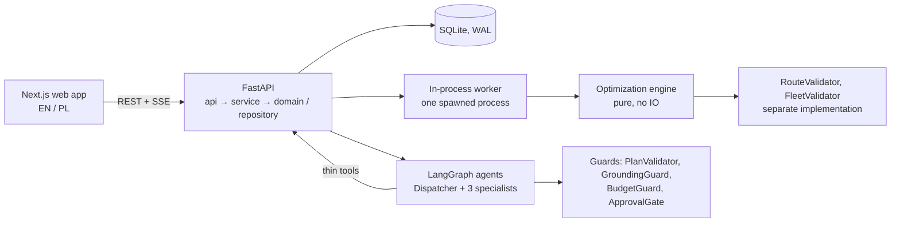

# Project walkthrough and questions

A guide for presenting RoutePilot AI in 10–15 minutes and for answering follow-up questions. RoutePilot AI is an MVP with a deadline of 2026-11-15, later a portfolio project. Every number below has a source; where it comes from a local run that is not committed, the text says so. The data is synthetic.

> The work/driving/rest schedule is a planning estimate based on a simplified model of selected rules (Polish Act on Drivers' Working Time; Regulation (EC) No 561/2006). It does not certify legal compliance.

Related: [`docs/development-log.md`](development-log.md) (problems and improvements), [`README.md`](../README.md) (what it is, how to run it), [`DEVELOPMENT.md`](../DEVELOPMENT.md) (how it is built).

## 1. The 60-second version

RoutePilot AI is an AI dispatcher for a small fleet of vans up to 3.5 t. A dispatcher keeps drivers and vans, chats with the system, and gets route plans in three variants (most profitable, fastest, lowest fuel and CO₂) with consolidated loads, a drive home before the weekend, and the working-time limits applied. **Agents reason and orchestrate; deterministic code computes and verifies.** A human approves every assignment, and the app works without any AI key.

Three points to make early:

1. The numbers (money, mass, capacity, working time) come from a deterministic engine that is checked by independent validators, never from a language model.
2. The only write action of the AI is `assign_plan`, and it runs only after a pause for human approval.
3. The project is built specification first: every requirement has acceptance criteria, and every criterion has a test that names it.

## 2. Architecture in one picture

What to say: a modular monolith with import rules that are checked automatically (import-linter on the backend, ESLint boundaries on the web side). The engine has no database, network or clock access; it receives a snapshot and a travel matrix, so it can be tested exactly. Agent tools are thin adapters over the same services as the REST API, so there is no business logic in the agent layer.

## 3. Decisions and their reasons

| Decision | Reason | Cost | Record |
|---|---|---|---|
| SQLite, no Docker, no keys | A clean clone runs in a few steps; the hard requirement is "easy to run" | One writer; PostgreSQL is designed for the portfolio version | [ADR-0002](adr/ADR-0002-database-sqlite-then-postgresql.md), [ADR-0007](adr/ADR-0007-local-run-and-deployment.md) |
| Own branch-and-bound engine | Exact results, determinism, explainable, testable against a brute-force oracle | Slow for large pools; about 5 vans | [ADR-0004](adr/ADR-0004-optimization-engine.md) |
| LangGraph with a custom supervisor | Durable state, `interrupt()` for approvals, checkpoints | A framework to learn; no supervisor library | [ADR-0006](adr/ADR-0006-ai-orchestration-langgraph.md) |
| Provider-neutral model layer | Gemini, Anthropic and OpenAI through configuration only | An adapter file to maintain | [ADR-0013](adr/ADR-0013-llm-providers.md) |
| Contract first (OpenAPI generated and committed) | The web types cannot drift from the API | A regeneration step in every contract change | [ADR-0009](adr/ADR-0009-api-crud-cors-contracts.md) |
| Money as integer minor units, `Decimal` for distances | No float rounding in money | Conversions at the edges | [ADR-0010](adr/ADR-0010-units-and-money.md) |
| Spec-driven work with approval gates | Agents are fast; the gates keep them honest | Slower start, paperwork | [`DEVELOPMENT.md` §10](../DEVELOPMENT.md#10-ai-assisted-development) |

## 4. How correctness is protected

- **Invariants.** 17 engine invariants (capacity after every action, one pickup before one delivery per offer, windows, monotonic time, profit reconstruction, determinism, and more) are checked by `RouteValidator` and `FleetValidator`, which are separate implementations from the search.
- **Oracles and property tests.** For small cases the search is compared with a brute-force oracle; Hypothesis generates the inputs.
- **Golden cases.** Eleven hand-computed scenarios (`GOLD-001` … `GOLD-011`) with the arithmetic shown in [`specs/golden/`](../specs/golden/README.md). The owner approves the values before a test exists. For GOLD-011 the hand arithmetic and the engine agreed on the first run.
- **Grounding.** Every number and ID in an AI answer must occur in the tool results of that run, or the answer is replaced by a template built from tool data.
- **Untrusted text.** Offer texts are data, flagged when they look like instructions, and never placed in system prompts.
- **Human approval.** `assign_plan` is the only write tool and runs only after `interrupt()` and an approving user with the right role.

## 5. Numbers to know

Source: [`docs/metrics.md`](metrics.md) (generated, reduced engine settings stated in the file: 2-day horizon, at most 3 offers per plan, top 5 plans).

| Result | Value |
|---|---|
| Fleet profit of the `profit` solution | EUR 1,303.10 |
| Best single offer per driver / greedy assignment | EUR 938.93 / EUR 1,127.29 |
| Gain over those baselines | +38.8 % / +15.6 % |
| Drivers with a plan | 5 of 5 |
| Plans with two or more orders on board | 3 of 5 |
| Van fill on loaded kilometres (pallets / payload) | 56.4 % / 68.0 % |
| Offers that have a consolidation partner | 75.7 % |
| Engine runtime, 2-day setting | 5.2 s p50 |

From a local 20-seed benchmark at the engine defaults (2026-11-15, not committed): fill over all kilometres 40.4 % of pallet places and 43.5 % of payload, 37 of 89 plans with two or more orders on board, 39.7 % of kilometres empty, p95 runtime 173 s, every run cut by the 30 s per-driver safety limit. The runtime target of 15 s and the fill target of 60 % are **not met**; the reasons are in section 7 and in the development log.

Quality gates at the time of writing: 805 backend tests, 255 web tests and 7 browser scenarios pass locally; `ci-fast` passed on the last pull request of the FEAT-010 stack (#131).

## 6. A five-minute demo

1. Start the API and the web app (two terminals, [README §6](../README.md#6-run-locally--step-by-step)). Log in with the demo account.
2. **Fleet and offers.** Show the drivers with their vans and the working-time state, and the offer list with the "SYNTHETIC DATA" badge, completeness and provenance.
3. **Manual optimizer.** Run a fleet optimisation and open the three variants. Point at the van fill, the orders on board, the CO₂ estimate, the deltas between variants and the working-time notice.
4. **Plan detail.** Show the timeline with breaks and rests, the cost breakdown with the provenance of each parameter, and the top-view load plan.
5. **AI Dispatcher.** Ask for the best plan for a driver. Show the trace (which agent, which tool, result, time, tokens), then the approval card. Approve, and show the assignment.
6. **Without a key.** Point out that the manual optimizer and the template explanations work without any model.

## 7. Three problems told as short stories

Full versions: [`docs/development-log.md`](development-log.md).

1. **The plans were chains because of the data, not the solver.** Measurements showed 81 % of offers without a partner and 46 % van fill. The engine could already consolidate, but every offer was priced like a full van and lanes were random. The fix was in the data generator: size-based prices, grouped lanes along corridors, mass that follows pallets. Then a second finding: the first tariff left the fleet without a profitable plan, because a pallet costs roughly the same whatever the distance. Public price examples led to a per-pallet handling charge. *Lesson: measure first, and check a model constant against an outside source.*
2. **A search that looked slow was mostly doing useless work.** A profile showed 33 move attempts per node, 92 % of them failing on a bound that is cheap to compute (arriving after the window closed). Skipping them gave about four times more nodes per second with identical results. But the runtime did not move, because the 30 s safety limit decides it. *Lesson: profile before optimising, and check whether the optimisation can change the metric you care about.*
3. **A target that cannot be reached is a finding, not a failure.** The fill target of 60 % cannot be met: about 41 % of the kilometres are empty (the drive to the first pickup and the drive home), whatever the data or the search. I did not tune constants to hit it; I added the fill on loaded kilometres to the report and recorded the open question for the owner. *Lesson: report honestly, and keep a decision with the person who owns it.*

## 8. Honest limits

- Synthetic data only; no connection to a freight exchange. The offers have the structure of the TIMOCOM Freight Exchange API v3.0.6 payload (taken from its OpenAPI file), but every value is generated.
- The working-time model is a simplification and never certifies compliance.
- Distances come from a straight-line matrix with a circuity factor, not from road routing.
- Cost and tariff parameters marked "assumption" are not market data.
- The exact search suits about 5 vans; the 15 s runtime target is not met at the defaults.
- Loading order and 2D pallet placement are not modelled.
- The project is a first version and needs improvements that are planned for later (section 9); none of them is claimed as done.

## 9. What comes next

In order: label dominance in the search (exact, aimed at the runtime target), a decision on the runtime defaults, a better definition of the fill target, real towns and a road-routing matrix for the demo data, a calibrated tariff, load metrics in the agent answers, a nightly benchmark, and later PostgreSQL on a VPS. Details and the reasons: [`docs/development-log.md` §3](development-log.md#3-how-it-will-be-improved).

## 10. Questions and answers

**Why a deterministic engine and not an LLM planner?** Money, capacity and working time must be correct and repeatable. A model cannot guarantee that, and a reviewer cannot audit it. The model explains and orchestrates; the engine computes, and the validators check.

**How do you stop the model from inventing numbers?** `GroundingGuard`: every number and ID in the final answer must appear in the tool results of that run, with formatting tolerance. A violation replaces the answer with a template built from tool data. Tests use fake models, and a live evaluation campaign measures the real behaviour under a token ledger.

**What stops an agent from changing data?** There is one write tool, `assign_plan`. It runs after `interrupt()` and a `resume` with an approval from a user with the right role. A pull request that adds a write tool without `interrupt()` is rejected by the project rules.

**How is the engine tested?** Four ways: invariants checked at runtime by separate validators, a brute-force oracle for small inputs, Hypothesis property tests, and hand-computed golden cases with the arithmetic in the repository.

**Why SQLite?** The hard requirement is a few steps to run, no database server and no keys. The schema avoids dialect-specific features so a move to PostgreSQL is a configuration and migration task, described in ADR-0002.

**Why is the runtime target not met, and what will you do?** The exact search explores about a million nodes per run, and the safety limit of 30 s per driver cuts it. A 4× speed-up was already found and the plans are unchanged. Next is label dominance in the search, which keeps exactness. If that is not enough, the defaults or the target must change, and that is the owner's decision.

**Why is the fill 40 % and not 60 %?** About 41 % of the kilometres are empty: the deadhead to the first pickup and the drive home before `home_by`. On loaded kilometres the fill is 56 % of pallet places and 68 % of payload. I tested different shares of return loads in the data and the empty share did not change, so I recorded the target as an open question instead of adjusting it.

**What was the hardest bug?** Two stand out. A worker forked from the web server kept dead client sockets alive and hung the browser scenarios (fixed by starting the worker with `spawn`). A validator looped when an activity ended less than a minute before the Monday week boundary. Both were found in run logs and have a regression test.

**How did you use AI tools, and where do you draw the line?** Claude Code did research, wrote specifications from my design, split the work into PR-sized slices and implemented them under written rules. I approve specifications, ADRs, migrations, prompts, golden values, dependencies and merges. The rules, the stop conditions and the prompts are committed ([`AGENTS.md`](../AGENTS.md), [`context.md`](../context.md), [`docs/agent-prompts/`](agent-prompts/)).

**What did you learn from the tariff mistake?** A constant that looks reasonable can be wrong by a factor of three. I now check constants against an outside source, label them "assumption", and keep a log of the check ([`docs/raport.md` §3.6](raport.md)).

**What would you change with more time?** Move the demo to real towns and a road-routing matrix, calibrate the tariff, add label dominance and a nightly benchmark, model loading order, and deploy the portfolio version on a VPS with PostgreSQL.

**How does the system scale?** Not far, by design: the exact search is for about 5 vans. Larger fleets need a heuristic or a general solver behind the same engine port, and a real job queue instead of the in-process worker.

**What is the security model?** Argon2id passwords, cookie sessions with only a hash stored, CSRF token plus origin check, an explicit CORS allowlist, rate limits, roles (`admin`, `dispatcher`, `demo`), security headers, secrets only in `.env`, and gitleaks in CI. Details in [`DEVELOPMENT.md` §13](../DEVELOPMENT.md#13-security-notes).
