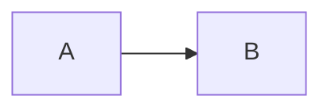

# Fixture project

[Polski](#polski--krótkie-podsumowanie)

## 1. What it is

A fixture. See [the guide](docs/linked.md#intro).

## 2. Features

- one

## 3. Creative twist

- two

## 4. Technical overview

- three

## 5. Architecture



## 6. Run locally — step by step

**Prerequisites**

| Tool | Version |
|---|---|
| Python | 3.13 |

**Step 1 — API (terminal 1)**

```bash
cd apps/api
cp .env.example .env            # works as-is
uv sync
uv run uvicorn routepilot.main:app --reload --port 8000
```

**Step 2 — web (terminal 2)**

```bash
cd apps/web
pnpm install
pnpm dev
```

**Tests**

```bash
(cd apps/api && uv run pytest)
```

## 7. How I used AI tools

- text

## 8. Demo

- text

## 9. Project structure

```
apps/
```

## 10. Limitations

- text

## 11. Roadmap

- text

## 12. Documentation map

| Document | What it answers |
|---|---|
| [`guide`](docs/linked.md) | text |

---

## Polski — krótkie podsumowanie

- jeden
- dwa
